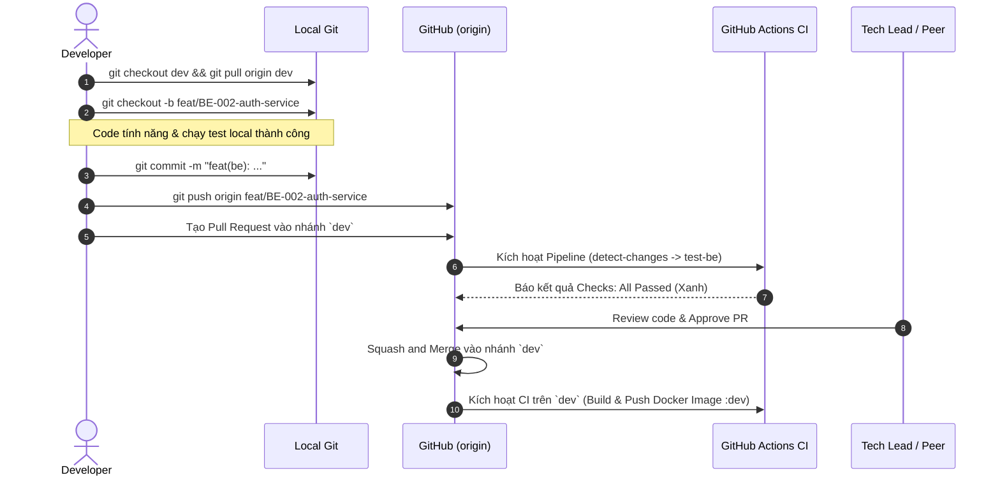

# RenderCV — Quy Tắc Git & Quy Trình Phát Triển (Git Workflow Rules)

Tài liệu này quy định chuẩn hoá quy trình làm việc với Git cho toàn bộ lập trình viên (Developer) trong dự án **RenderCV**, được thiết kế để tương thích và tối ưu hoá trực tiếp với hệ thống **GitHub Actions CI/CD Pipeline**.

---

## 🌳 1. Quy Tắc Đặt Tên Nhánh (Branch Naming Convention)

Pipeline CI/CD tự động lắng nghe và lọc sự kiện dựa trên tiền tố tên nhánh (xem [`main.yml`](file:///d:/Projects/Render/.github/workflows/main.yml)). Lập trình viên **bắt buộc** phải tuân thủ định dạng sau:

```text
<loại-nhánh>/<mã-tác-vụ>-<mô-tả-ngắn>
```

### Bảng Quy Định Tên Nhánh

| Tiền tố | Mục đích | Ví dụ hợp lệ | Hành vi của CI/CD |
|---|---|---|---|
| `feat/` | Phát triển tính năng mới | `feat/BE-002-auth-service`<br>`feat/FE-005-cv-theme-selector` | Tự động chạy test & typecheck của service tương ứng khi tạo PR. Không push Docker. |
| `fix/` | Sửa lỗi (Bug fix) | `fix/BE-045-jwt-token-expired`<br>`fix/FE-022-export-pdf-overflow` | Tự động chạy test & typecheck của service tương ứng khi tạo PR. Không push Docker. |
| `ci/` hoặc `ci-cd` | Cấu hình hạ tầng, DevOps, GitHub Actions | `ci-cd`<br>`ci/trivy-scan-enhancement` | Kích hoạt worker kiểm tra workflow pipeline. |
| `hotfix/` | Vá lỗi khẩn cấp trực tiếp từ Production | `hotfix/auth-crash-null-user` | Nhánh tạo từ `main`, merge thẳng về `main` và đồng bộ ngược về `dev`. |
| `dev` | Nhánh tích hợp chính (Protected) | `dev` | **Môi trường Dev**: Merge vào đây sẽ build & push Docker image `:dev` và `:<short-sha>`. |
| `staging` | Nhánh tiền phát hành / UAT (Protected) | `staging` | **Môi trường Staging**: Quét Trivy Security Gate, promote tag `:dev` -> `:staging`. |
| `main` | Nhánh Production (Protected) | `main` | **Môi trường Production**: Quét Trivy Security Gate, promote tag `:staging` -> `:latest`. |

> [!CAUTION]
> **Tuyệt đối không:**
> - Đặt tên nhánh tự do (ví dụ: `duy-test`, `fix-bug`, `be-update`, `temp`). Những nhánh này sẽ **không kích hoạt đúng bộ lọc CI/CD**.
> - Không dùng ký tự viết hoa hoặc khoảng trắng trong tên nhánh. Sử dụng dấu gạch ngang (`-`) để phân cách từ.

---

## 📝 2. Quy Tắc Viết Commit Message (Conventional Commits)

Dự án áp dụng chuẩn **Conventional Commits** với cấu trúc:

```text
<type>(<scope>): <mô tả ngắn bằng tiếng Anh hoặc tiếng Việt rõ nghĩa>
```

### Các Type được phép sử dụng:
* `feat`: Thêm tính năng mới cho ứng dụng.
* `fix`: Sửa lỗi phát sinh trong logic/giao diện.
* `docs`: Thêm hoặc cập nhật tài liệu (`README`, `docs/`, comment).
* `refactor`: Tái cấu trúc mã nguồn không làm thay đổi tính năng hay sửa lỗi.
* `test`: Viết thêm hoặc sửa đổi Unit/E2E test.
* `ci`: Chỉnh sửa cấu hình CI/CD (`.github/workflows/`, script DevOps).
* `chore`: Cập nhật dependency, cấu hình linter, build tool (`package.json`, `.gitignore`).
* `perf`: Cải thiện hiệu năng xử lý (performance).

### Quy định về Scope trong Monorepo:
Để phục vụ thay đổi có định hướng, hãy luôn chỉ định phạm vi module:
* `be` hoặc `backend`: Thuộc module [`MODULE_BE`](file:///d:/Projects/Render/MODULE_BE) (NestJS, Prisma, Auth, v.v.).
* `fe` hoặc `frontend`: Thuộc module [`MODULE_FE`](file:///d:/Projects/Render/MODULE_FE) (React, Redux, Canvas, v.v.).
* `ci`: Hạ tầng GitHub Actions, Docker, Trivy.
* `docs`: Tài liệu hệ thống.

### Ví dụ chuẩn:
```bash
git commit -m "feat(be): implement JWT authentication guard and strategy"
git commit -m "fix(fe): handle undefined avatar on user navbar"
git commit -m "test(be): add unit test for CV export service"
git commit -m "ci: add pull-requests read permission for paths-filter"
```

---

## 🧩 3. Nguyên Tắc Làm Việc Trong Monorepo (Tối Ưu CI/CD)

Hệ thống CI sử dụng bộ lọc đường dẫn [`dorny/paths-filter@v3`](file:///d:/Projects/Render/.github/workflows/main.yml#L95-L106):
- Thay đổi trong `MODULE_BE/**` -> Kích hoạt test & build Backend.
- Thay đổi trong `MODULE_FE/**` -> Kích hoạt test & build Frontend.

### 📌 Lời khuyên cho Developer:
1. **Tránh Commit "Tạp Nham" (Cross-cutting noise)**:
   - Nếu bạn chỉ làm nhiệm vụ Backend, **đừng vô tình format hoặc sửa file ở Frontend** trong cùng một commit. Điều này sẽ khiến CI phải chạy cả 2 worker FE & BE, làm tăng thời gian chờ đợi gấp đôi.
2. **Kiểm tra cục bộ trước khi push (Pre-push Check)**:
   - Nếu sửa Backend: Hãy chạy `npm run test` và `npm run build` tại [`MODULE_BE`](file:///d:/Projects/Render/MODULE_BE) trước khi push.
   - Nếu sửa Frontend: Hãy chạy `npm run build` và `npm test` tại [`MODULE_FE`](file:///d:/Projects/Render/MODULE_FE).

---

## 🔀 4. Vòng Đời Một Tính Năng (Feature Lifecycle & PR Process)



### Các bước cụ thể:

### Bước 1: Khởi tạo nhánh từ `dev`
Luôn đảm bảo nhánh `dev` ở local là mới nhất trước khi tách nhánh:
```bash
git checkout dev
git pull origin dev
git checkout -b feat/BE-002-auth-service
```

### Bước 2: Commit và Push lên Remote
```bash
git add MODULE_BE/
git commit -m "feat(be): add user register and login APIs"
git push origin feat/BE-002-auth-service
```

### Bước 3: Tạo Pull Request (PR)
- **Target branch (Nhánh đích)**: Luôn luôn là **`dev`** (Không bao giờ tạo PR trực tiếp vào `staging` hoặc `main`).
- **Tiêu đề PR**: `[BE-002] Implement User Authentication Service`.
- **Mô tả PR**: Liệt kê các thay đổi chính, cách test và checklist tự kiểm tra.

### Bước 4: Chờ CI/CD Quality Gate
- Kiểm tra các check tự động trên PR. Tất cả các job phải có trạng thái **xanh (Success)**.
- Nếu có check bị **đỏ (Fail)**: Xem log trên GitHub Actions, sửa lỗi tại local, commit và push tiếp lên nhánh feature đó (PR sẽ tự động trigger lại CI).

### Bước 5: Merge PR
- Sử dụng chế độ **`Squash and merge`** để giữ lịch sử commit trên nhánh `dev` gọn gàng, súc tích.
- Xoá nhánh feature sau khi merge thành công.

---

## 🚀 5. Quy Trình Release (Promotion sang Staging & Production)

Khi các tính năng trên nhánh `dev` đã hoàn tất một cột mốc (Sprint / Release candidate):

1. **Deploy lên Staging**:
   - Tạo PR từ `dev` vào `staging`.
   - Khi merge vào `staging`: Pipeline tự động quét lỗ hổng Trivy trên image `:dev`. Nếu đạt chuẩn an toàn, pipeline sẽ **promote image sang tag `:staging`**.
   - Đội ngũ QA / PO thực hiện nghiệm thu trên môi trường Staging.

2. **Deploy lên Production**:
   - Khi môi trường Staging đã pass kiểm thử, tạo PR từ `staging` vào `main`.
   - Khi merge vào `main`: Pipeline tự động quét lại bảo mật và **promote image sang tag `:latest`**.

---

## ⚠️ 6. Những Điều Tuyệt Đối Tránh (Don'ts)

| Hành vi cấm | Hậu quả |
|---|---|
| `git push --force` lên `dev`, `staging`, `main` | Ghi đè mã nguồn của đồng nghiệp, làm đứt gãy lịch sử Git. |
| Push code khi test local đang fail | Làm hỏng build trên CI của cả team, block các PR khác. |
| Commit các file nhạy cảm (`.env`, private keys) | Lộ bảo mật nghiêm trọng (Pipeline Trivy sẽ phát hiện và chặn). |
| Bỏ qua merge conflict hoặc commit conflict markers (`<<<<<<< HEAD`) | Gây lỗi compile cú pháp ở bước `tsc` của CI. |
