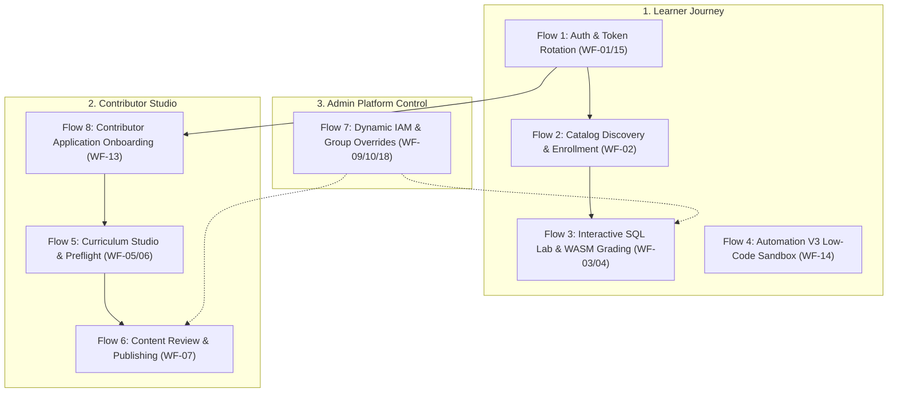

# Archify Full Feature Workflows Master Plan for `study-web`

## Overview
This plan defines the end-to-end technical **Feature Workflow Diagrams** (`diagram_type: "workflow"`) for all 8 core functional subsystems in the **study-web** ecosystem, derived directly from `docs/workflows/` and committed codebase implementations in `MODULE_BE`, `MODULE_FE`, and `MODULE_ADMIN`.

Each workflow uses multi-swimlane layouts (`lanes`), clear operational phases (`phases`), decision gates (`decision`), error recovery paths, and repository source provenance.

---

## 8 Core Feature Families

---

## Two-Tier Task Checklist

### Task 1: Auth & Token Rotation Workflow (`workflow`)
- [x] **Subtask 1.1**: Map login, Google OAuth, 15m access token in Redux, 7d HttpOnly refresh cookie, and SHA-256 session table rotation (ADR-001).
  - **Lanes**: `User / Client`, `NestJS API Gateway`, `AuthSession Service`, `PostgreSQL DB`
  - **Verify**: Confirm token reuse detection and revocation branches.
- [x] **Subtask 1.2**: Author `candidate.json` and finalize HTML.
  - **File**: `.archify/workflow-auth-session-20261024-152500/auth-session-workflow.html`
  - **Verify**: Finalize validation passes with `--quality showcase`.

### Task 2: Catalog Discovery & Series Navigation Workflow (`workflow`)
- [x] **Subtask 2.1**: Map catalog indexing, topic tag filtering, series detail view, and prerequisite check.
  - **Lanes**: `Learner`, `Catalog SPA (MODULE_FE)`, `Series Controller`, `PostgreSQL DB`
  - **Verify**: Active filter pill state synchronization and Pro paywall boundary.
- [x] **Subtask 2.2**: Author `candidate.json` and finalize HTML.
  - **File**: `.archify/workflow-catalog-discovery-20261024-152800/catalog-discovery-workflow.html`
  - **Verify**: Finalize validation passes with `--quality showcase`.

### Task 3: Interactive SQL Lab & Dual-Tier Grading Workflow (`workflow`)
- [x] **Subtask 3.1**: Map Monaco editor input, AST policy syntax guard, sub-10ms PGlite WASM worker execution, backend verification, and streak unlock.
  - **Lanes**: `Learner`, `Monaco UI`, `In-Browser PGlite WASM`, `Backend Grading Worker`, `Database`
  - **Verify**: Sub-10ms feedback loop vs authoritative backend hidden-test verification.
- [x] **Subtask 3.2**: Author `candidate.json` and finalize HTML.
  - **File**: `.archify/workflow-sql-lab-20261024-153000/sql-lab-workflow.html`
  - **Verify**: Finalize validation passes with `--quality showcase`.

### Task 4: Automation V3 Low-Code Sandbox Workflow (`workflow`)
- [x] **Subtask 4.1**: Map visual block palette, AST code synthesis, in-RAM iframe sandbox execution, real-time DOM highlight ring, 2s timeout, and declarative validation.
  - **Lanes**: `Learner`, `Automation V3 Workspace`, `Iframe Sandbox Runtime`, `Backend Validator`
  - **Verify**: DOM highlight ring and declarative contract validation (`automation-v3-validator.ts`).
- [x] **Subtask 4.2**: Author `candidate.json` and finalize HTML.
  - **File**: `.archify/workflow-automation-v3-20261024-153200/automation-v3-workflow.html`
  - **Verify**: Finalize validation passes with `--quality showcase`.

### Task 5: Contributor Curriculum Studio & Preflight Workflow (`workflow`)
- [x] **Subtask 5.1**: Map Series creation modal, SEO slug generator, 2-step Lab Studio (Markdown theory split-preview + starter/solution/tests setup), and mandatory preflight validation.
  - **Lanes**: `Contributor`, `Contributor Studio UI`, `Preflight Validation Service`, `PostgreSQL DB`
  - **Verify**: Preflight solution pass requirement before draft submission.
- [x] **Subtask 5.2**: Author `candidate.json` and finalize HTML.
  - **File**: `.archify/workflow-contributor-studio-20261024-153300/contributor-studio-workflow.html`
  - **Verify**: Finalize validation passes with `--quality showcase`.

### Task 6: Content Review Queue & Publication State Machine (`workflow`)
- [x] **Subtask 6.1**: Map draft submission, Admin Review Queue triage, claim item, structured change requests, approval, and catalog publishing.
  - **Lanes**: `Contributor`, `Admin Review Portal`, `Review Service`, `Catalog Store`
  - **Verify**: 8-state transition lifecycle (`draft` -> `submitted` -> `in_review` -> `changes_requested` / `approved` -> `published`).
- [x] **Subtask 6.2**: Author `candidate.json` and finalize HTML.
  - **File**: `.archify/workflow-content-review-20261024-153400/content-review-workflow.html`
  - **Verify**: Finalize validation passes showcase quality; JSON cleaned.

### Task 7: Dynamic IAM & Group Overrides Governance Workflow (`workflow`)
- [x] **Subtask 7.1**: Map Admin user directory, role transitions, user groups split-view, and 5-tier dynamic feature entitlement resolution (`checkUserFeature`).
  - **Lanes**: `Admin`, `Admin Control Plane`, `Entitlements Engine`, `Audit Logging Service`
  - **Verify**: 5-tier hierarchy: User DENY -> User ALLOW -> Subscription -> Groups -> Default Free.
- [x] **Subtask 7.2**: Author `candidate.json` and finalize HTML.
  - **File**: `.archify/workflow-dynamic-iam-20261024-153700/dynamic-iam-workflow.html`
  - **Verify**: Finalize validation passes showcase quality; JSON cleaned.

### Task 8: Contributor Application & Onboarding Workflow (`workflow`)
- [x] **Subtask 8.1**: Map user application submission (bio, portfolio, sample topic), Admin application review queue, approval/rejection with notes, and automatic role upgrade.
  - **Lanes**: `Learner`, `Contributor Modal`, `Admin Application Queue`, `User Role Service`
  - **Verify**: Transition from role `user` to `contributor` upon admin approval.
- [x] **Subtask 8.2**: Author `candidate.json` and finalize HTML.
  - **File**: `.archify/workflow-contributor-onboarding-20261024-153900/contributor-onboarding-workflow.html`
  - **Verify**: Finalize validation passes showcase quality; JSON cleaned.
