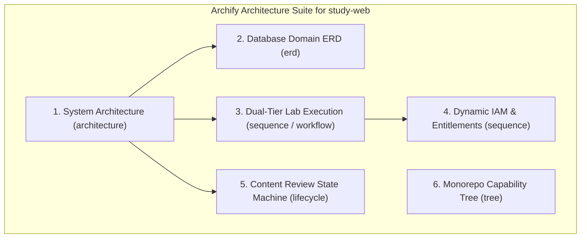

# Archify System Diagramming Plan for `study-web`

## Overview
This plan establishes a checked standalone visual architecture suite for the **study-web** ecosystem using the newly installed **Archify** skill. Each diagram will be generated with source evidence linked directly to repository code, validated through the Archify CLI compiler (`finalize`), and exported as interactive standalone HTML with light/dark themes, pan-and-zoom inspection, and visual traceability.

---

## Architecture Diagram Suite & Breakdown

---

## Two-Tier Task Checklist

### Task 1: High-Level System Architecture Diagram (`architecture`)
- [x] **Subtask 1.1**: Trace repository source evidence for Ingress, Client tiers, NestJS Gateway, IAM core, Domain modules, and Database/Sandbox tiers.
  - **File**: `MODULE_BE/src/app.module.ts`, `MODULE_FE/src/App.tsx`, `MODULE_ADMIN/src/App.tsx`
  - **Verify**: Confirm exact boundaries, call routes, and entry points.
- [x] **Subtask 1.2**: Author candidate JSON `candidate.json` for `architecture` following `examples/web-app.architecture.json`.
  - **File**: `.archify/architecture-system-overview/candidate.json`
  - **Verify**: Structure conforms to `schemas/architecture.schema.json`.
- [x] **Subtask 1.3**: Finalize and validate HTML delivery with Archify CLI.
  - **File**: `.archify/architecture-system-overview-20261024-143500/system-architecture.html`
  - **Verify**: `node .agents/skills/archify/bin/archify.mjs finalize architecture ...` passed all gates (validate, deliver, check, browser-check).

---

### Task 2: Database Domain Entity-Relationship Diagram (`erd`)
- [x] **Subtask 2.1**: Extract physical tables, relations, foreign keys, and indexes from Prisma schema.
  - **File**: `MODULE_BE/prisma/schema.prisma`
  - **Verify**: Map tables into functional domains (`identity`, `governance`, `plans`, `curriculum`).
- [x] **Subtask 2.2**: Author candidate JSON `candidate.json` for `erd` with table-first layout.
  - **File**: `.archify/erd-database-schema-20261024-145200/candidate.json`
  - **Verify**: Every entity has PK/FK attributes, types, and references matching `schema.prisma`.
- [x] **Subtask 2.3**: Finalize ERD HTML with Archify CLI (`--quality standard` for dense schema).
  - **File**: `.archify/erd-database-schema-20261024-145200/database-erd.html`
  - **Verify**: Archify finalize passed all gates (validate, deliver, check, browser-check) with 0 layout conflicts.
  - **File**: `.archify/erd-database-schema/database-erd.html`
  - **Verify**: Archify finalize exits code 0 with 0 layout conflicts.

---

### Task 3: Dual-Tier Lab Execution & Grading Flow (`sequence` / `workflow`)
- [x] **Subtask 3.1**: Trace client-side Monaco SQL editing, AST syntax policy guard, PGlite WASM Web Worker execution, and backend verification.
  - **File**: `MODULE_FE/src/features/lab/`, `MODULE_BE/src/modules/labs/`
  - **Verify**: Document exact message exchanges and latency boundaries (<10ms local vs backend sandbox).
- [x] **Subtask 3.2**: Author `candidate.json` for request lifecycle and state transitions.
  - **File**: `.archify/sequence-lab-execution-20261024-145400/candidate.json`
  - **Verify**: Conforms to `schemas/sequence.schema.json`.
- [x] **Subtask 3.3**: Finalize Sequence HTML delivery.
  - **File**: `.archify/sequence-lab-execution-20261024-145400/lab-execution-sequence.html`
  - **Verify**: Passed all validate, deliver, check, and browser-check gates.

---

### Task 4: Dynamic IAM & Feature Overrides Sequence (`sequence`)
- [x] **Subtask 4.1**: Trace HttpOnly JWT cookie auth guard, token rotation (ADR-001), and dynamic entitlement override evaluation (DOC-07).
  - **File**: `MODULE_BE/src/modules/entitlements/`, `MODULE_BE/src/modules/auth/`
  - **Verify**: Map authorization hierarchy: Default Role -> Group Overrides -> User Direct Overrides.
- [x] **Subtask 4.2**: Author candidate JSON for dynamic entitlement resolution.
  - **File**: `.archify/sequence-dynamic-iam-20261024-145700/candidate.json`
  - **Verify**: Check all source lines and actor lifelines.
- [x] **Subtask 4.3**: Finalize Dynamic IAM sequence HTML.
  - **File**: `.archify/sequence-dynamic-iam-20261024-145700/dynamic-iam-sequence.html`
  - **Verify**: CLI finalize receipt reports clean delivery across all gates.

---

### Task 5: Contributor Review & Content Lifecycle (`lifecycle`)
- [x] **Subtask 5.1**: Map the `ContentLifecycleStatus` enum states and transitions.
  - **File**: `MODULE_BE/src/modules/review/`, `MODULE_BE/prisma/schema.prisma`
  - **Verify**: All 8 states (`draft`, `submitted`, `in_review`, `changes_requested`, `approved`, `published`, `archived`, `rejected`) and transition rules accounted for.
- [x] **Subtask 5.2**: Author `candidate.json` for content lifecycle state machine.
  - **File**: `.archify/lifecycle-content-review-20261024-145900/candidate.json`
  - **Verify**: Conforms to `schemas/lifecycle.schema.json`.
- [x] **Subtask 5.3**: Finalize Content Review Lifecycle HTML.
  - **File**: `.archify/lifecycle-content-review-20261024-145900/content-review-lifecycle.html`
  - **Verify**: Pass finalize check across all gates (validate, deliver, check, browser-check).

---

### Task 6: Monorepo Architecture & Capability Tree (`tree`)
- [x] **Subtask 6.1**: Deconstruct monorepo structure across `MODULE_BE`, `MODULE_FE`, `MODULE_ADMIN`, and documentation suites.
  - **File**: Root `package.json` / workspace directories
  - **Verify**: Single-parent containment tree capturing all module boundaries.
- [x] **Subtask 6.2**: Author and finalize monorepo capability tree HTML.
  - **File**: `.archify/tree-monorepo-structure-20261024-150100/monorepo-tree.html`
  - **Verify**: CLI finalize receipt passes across all gates (validate, deliver, check, browser-check).
