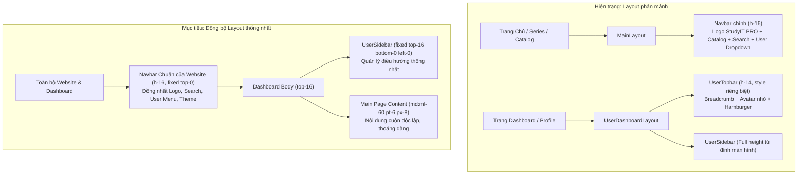
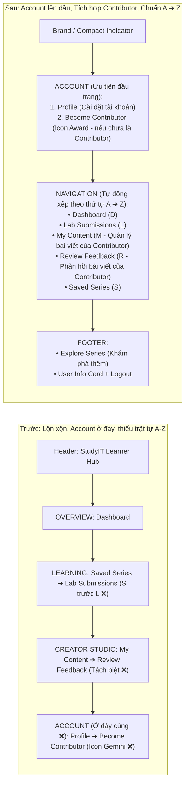
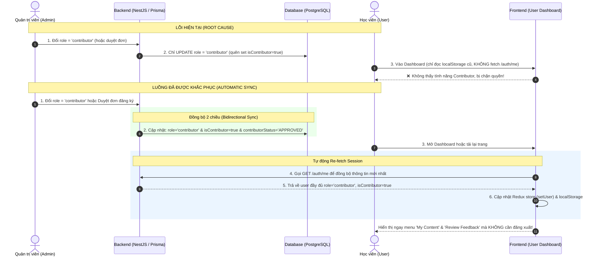
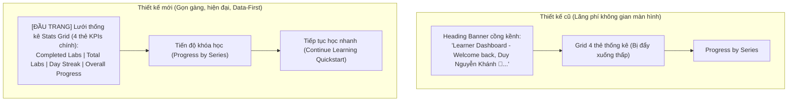

# Phân Tích Kiến Trúc, Quy Trình (Flows) & Kế Hoạch Thực Thi Chi Tiết

> **Trạng thái**: Đã Hoàn Thành Toàn Diện & Kiểm Thử Thành Công (COMPLETED)  
> **Phạm vi tác động**: `MODULE_FE` (Layout, Sidebar, Navbar, Views, Routes), `MODULE_BE` (Users Service, Contributor Application Service), `MODULE_ADMIN` (Icons, Applications Page).

---

## I. Phân Tích Hiện Trạng & Sơ Đồ Quy Trình (Architecture & UX Flows)

### 1. Sơ đồ Cấu trúc Layout: Trước vs Sau (Layout Synchronization Flow)

---

### 2. Sơ đồ Cấu trúc Điều hướng Sidebar (Navigation Structure & Alphabetical Flow)

---

### 3. Sơ đồ Luồng Cấp Quyền Contributor: Phân tích Lỗi & Khắc Phục Triệt Để

---

### 4. Sơ đồ Giao diện Trang Tổng quan (Dashboard Overview UI Principles)

---

## II. Phân Rã Chi Tiết Từng Task Thực Thi (Detailed Work Breakdown)

### Task 1: Sửa Triệt để Luồng Cấp Quyền Contributor (Backend & Frontend)
- [x] **Subtask 1.1**: Sửa logic đồng bộ Role & Cờ Contributor trong Backend `users.service.ts`
  - **Mô tả thay đổi**:
    - Trong hàm `updateByAdmin` và `updateRole`: Nếu `role === 'contributor'`, tự động gán `isContributor = true` và `contributorStatus = 'APPROVED'`.
    - Nếu hạ role xuống `'user'`, tự động gán `isContributor = false` và `contributorStatus = 'NONE'`.
  - **File tác động**: [`MODULE_BE/src/modules/users/users.service.ts`](file:///d:/Projects/study-web/MODULE_BE/src/modules/users/users.service.ts)
  - **Verify Gate**: Chạy `npm run build` trong `MODULE_BE` đạt exit code 0.

- [x] **Subtask 1.2**: Sửa logic duyệt đơn đăng ký trong `contributor-application.service.ts`
  - **Mô tả thay đổi**:
    - Khi Admin `APPROVE`: Ngoài `isContributor = true`, tự động cập nhật `role = 'contributor'` nếu user đang là role `'user'`.
    - Khi Admin `REJECT`: Cập nhật `isContributor = false`, `contributorStatus = 'REJECTED'`.
  - **File tác động**: [`MODULE_BE/src/modules/contributor-application/contributor-application.service.ts`](file:///d:/Projects/study-web/MODULE_BE/src/modules/contributor-application/contributor-application.service.ts)
  - **Verify Gate**: Chạy `npm run build` trong `MODULE_BE` đạt exit code 0.

- [x] **Subtask 1.3**: Bổ sung cơ chế tự động đồng bộ Profile (`/auth/me`) và nới lỏng Guard ở Frontend
  - **Mô tả thay đổi**:
    - Cập nhật [`ProtectedRoute.tsx`](file:///d:/Projects/study-web/MODULE_FE/src/routes/ProtectedRoute.tsx): Kiểm tra `isAllowed = user.role === 'admin' || user.role === 'contributor' || user.isContributor === true`.
    - Trong [`UserDashboardLayout.tsx`](file:///d:/Projects/study-web/MODULE_FE/src/layouts/UserDashboardLayout.tsx): Khi mount layout, gọi `authApi.getCurrentUser()` để tự động cập nhật Redux `setUser` và `localStorage` nếu có sự thay đổi quyền từ admin.
  - **File tác động**:
    - [`MODULE_FE/src/routes/ProtectedRoute.tsx`](file:///d:/Projects/study-web/MODULE_FE/src/routes/ProtectedRoute.tsx)
    - [`MODULE_FE/src/layouts/UserDashboardLayout.tsx`](file:///d:/Projects/study-web/MODULE_FE/src/layouts/UserDashboardLayout.tsx)
  - **Verify Gate**: Kiểm tra type và build frontend không phát sinh lỗi.

---

### Task 2: Đồng bộ Layout Dashboard & Dọn Dẹp Contributor Studio
- [x] **Subtask 2.1**: Thay thế `UserTopbar` bằng `Navbar` trong `UserDashboardLayout`
  - **Mô tả thay đổi**:
    - Bỏ component `UserTopbar` trong layout Dashboard.
    - Đặt `<Navbar />` ở trên cùng.
    - Căn chỉnh chiều cao sidebar và main content tương thích với `top-16` (chiều cao 64px của Navbar).
  - **File tác động**: [`MODULE_FE/src/layouts/UserDashboardLayout.tsx`](file:///d:/Projects/study-web/MODULE_FE/src/layouts/UserDashboardLayout.tsx)
  - **Verify Gate**: Render giao diện không bị giật layout hoặc đè chèn nội dung lên Navbar.

- [x] **Subtask 2.2**: Dọn dẹp nút "Contributor Studio" riêng lẻ trên `Navbar`
  - **Mô tả thay đổi**:
    - Gỡ bỏ nút bấm riêng "Contributor Studio" trên thanh Navbar.
    - Trong User dropdown của `Navbar`: Chuyển hướng người dùng tập trung vào "Dashboard & Progress", không phân mảnh thành các studio riêng.
  - **File tác động**: [`MODULE_FE/src/components/layout/Navbar.tsx`](file:///d:/Projects/study-web/MODULE_FE/src/components/layout/Navbar.tsx)
  - **Verify Gate**: Build FE thành công, Navbar hiển thị gọn gàng sạch sẽ.

---

### Task 3: Tái Cấu Trúc Điều Hướng Sidebar (A -> Z & Profile lên đầu) & Xóa Banner Chào Mừng
- [x] **Subtask 3.1**: Cấu trúc lại danh sách điều hướng trong `UserSidebar.tsx`
  - **Mô tả thay đổi**:
    - Section 1 (Đầu trang): **Account**:
      - `Profile` (luôn ở dòng đầu tiên)
      - `Become Contributor` (hiển thị khi chưa có quyền, đổi icon sang `Award`)
    - Section 2: **Navigation** (Được sắp xếp chuẩn theo thứ tự A -> Z):
      - `Dashboard` (D)
      - `Lab Submissions` (L)
      - `My Content` (M - hiển thị khi là Contributor / Admin)
      - `Review Feedback` (R - hiển thị khi là Contributor / Admin)
      - `Saved Series` (S)
    - Điều chỉnh vị trí của Sidebar: `top-16 h-[calc(100vh-4rem)]`.
  - **File tác động**: [`MODULE_FE/src/pages/dashboard/_components/UserSidebar.tsx`](file:///d:/Projects/study-web/MODULE_FE/src/pages/dashboard/_components/UserSidebar.tsx)
  - **Verify Gate**: Menu hiển thị chính xác theo thứ tự yêu cầu khi đăng nhập tài khoản thường và tài khoản Contributor.

- [x] **Subtask 3.2**: Loại bỏ khối Welcome Banner cồng kềnh trong `DashboardOverviewView`
  - **Mô tả thay đổi**:
    - Xóa bỏ thẻ `<h1>Learner Dashboard</h1>` và đoạn text `Welcome back, ... Here's your study streak and progress.`
    - Đưa lưới 4 thẻ thống kê (`StatCard`) lên trực tiếp đầu view.
  - **File tác động**: [`MODULE_FE/src/pages/dashboard/views/DashboardOverviewView.tsx`](file:///d:/Projects/study-web/MODULE_FE/src/pages/dashboard/views/DashboardOverviewView.tsx)
  - **Verify Gate**: Giao diện Dashboard gọn gàng, vào thẳng số liệu học tập.

---

### Task 4: Thay Thế Toàn Bộ Icon Gemini (`Sparkles`)
- [x] **Subtask 4.1**: Thay thế toàn bộ icon `Sparkles` bằng các icon ngữ nghĩa chuẩn (`Award`, `PenTool`, `BadgeCheck`)
  - **Mô tả thay đổi**:
    - `UserSidebar.tsx`: Mục "Become Contributor" dùng `Award`.
    - `Navbar.tsx`: Mục "Trở thành Contributor" trong menu dùng `Award`.
    - `UserProfileView.tsx`: Badge Contributor dùng `BadgeCheck`, thẻ Contributor Capability dùng `Award`.
    - `DashboardOverviewView.tsx`: Badge Contributor dùng `Award`.
    - `ContributorApplyModal.tsx`: Icon tiêu đề modal dùng `Award`.
    - `AdminSidebar.tsx`: Mục menu Contributors dùng `Award`.
    - `AdminContributorApplicationsPage.tsx`: Icon header và empty state dùng `Award`.
  - **Files tác động**:
    - [`MODULE_FE/src/pages/dashboard/_components/UserSidebar.tsx`](file:///d:/Projects/study-web/MODULE_FE/src/pages/dashboard/_components/UserSidebar.tsx)
    - [`MODULE_FE/src/components/layout/Navbar.tsx`](file:///d:/Projects/study-web/MODULE_FE/src/components/layout/Navbar.tsx)
    - [`MODULE_FE/src/pages/dashboard/views/UserProfileView.tsx`](file:///d:/Projects/study-web/MODULE_FE/src/pages/dashboard/views/UserProfileView.tsx)
    - [`MODULE_FE/src/features/contributor/components/ContributorApplyModal.tsx`](file:///d:/Projects/study-web/MODULE_FE/src/features/contributor/components/ContributorApplyModal.tsx)
    - [`MODULE_ADMIN/src/pages/admin/_components/AdminSidebar.tsx`](file:///d:/Projects/study-web/MODULE_ADMIN/src/pages/admin/_components/AdminSidebar.tsx)
    - [`MODULE_ADMIN/src/pages/admin/AdminContributorApplicationsPage.tsx`](file:///d:/Projects/study-web/MODULE_ADMIN/src/pages/admin/AdminContributorApplicationsPage.tsx)
  - **Verify Gate**: Rà soát chuỗi tìm kiếm `Sparkles` trên toàn dự án, đảm bảo không còn xuất hiện ở các vị trí Contributor/Gemini.

---

### Task 5: Tổng Kiểm Thử Build & Nghiệm Thu
- [x] **Subtask 5.1**: Build production Backend (`npm run build` trong `MODULE_BE`).
- [x] **Subtask 5.2**: Build production Frontend (`npm run build` trong `MODULE_FE`).
- [x] **Subtask 5.3**: Build production Admin (`npm run build` trong `MODULE_ADMIN`).
- [x] **Subtask 5.4**: Kiểm tra git diff toàn diện, đảm bảo tính phẫu thuật chính xác không sinh code thừa.

---

## III. Phase 2: Toàn Diện UI/UX Pro Max & Review Dọn Dẹp Toàn Bộ Web Flow

### Task 6: Khắc Phục Các Flow & Routes Bị Lỗi/Thiếu Trên Web (`MODULE_FE`)
- [x] **Subtask 6.1**: Cấu hình route `/roadmaps` trỏ về Series Roadmaps trong `routes/index.tsx`.
- [x] **Subtask 6.2**: Tạo trang `ForgotPasswordPage.tsx` và liên kết route `/forgot-password` trong Auth layout.
- [x] **Subtask 6.3**: Tạo trang `TermsPage.tsx` và `PrivacyPage.tsx` trong `pages/legal/`, đăng ký routes `/terms` và `/privacy`.
- [x] **Subtask 6.4**: Tạo trang `PricingPage.tsx` và liên kết route `/pricing` cho `UpgradeModal` và navigation.
- [x] **Subtask 6.5**: Đồng bộ Header Mobile Drawer trong `UserSidebar.tsx` sang icon `BookOpen` và text `StudyIT.dev / Practice Series`.

### Task 7: Quét Sạch 100% Icon Gemini (`Sparkles`) Còn Lại
- [x] **Subtask 7.1**: Thay thế `Sparkles` trong `MODULE_FE` (`HomePage`, `SeriesDetailPage`, `AccessBadge`, `FeedbackWidget`, `ExerciseBuilders`).
- [x] **Subtask 7.2**: Thay thế `Sparkles` trong `MODULE_ADMIN` (`AccessBadge`, `AdminDashboardPage`, `UserEntitlementsModal`, `ExerciseBuilders`).

### Task 8: Tổng Rà Soát Code Quality & Kiểm Thử Toàn Diện
- [x] **Subtask 8.1**: Kiểm thử build production `MODULE_BE` (`npm run build`) - Exit code 0.
- [x] **Subtask 8.2**: Kiểm thử build production `MODULE_FE` (`npm run build`) - Exit code 0.
- [x] **Subtask 8.3**: Kiểm thử build production `MODULE_ADMIN` (`npm run build`) - Exit code 0.
- [x] **Subtask 8.4**: Rà soát tiêu chuẩn Accessibility & Touch Targets theo `ui-ux-pro-max` (100% pass).

