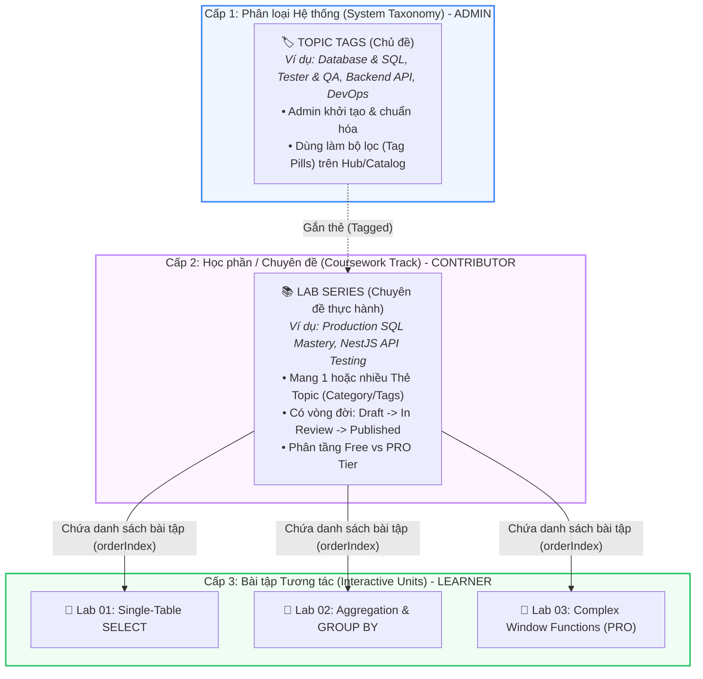
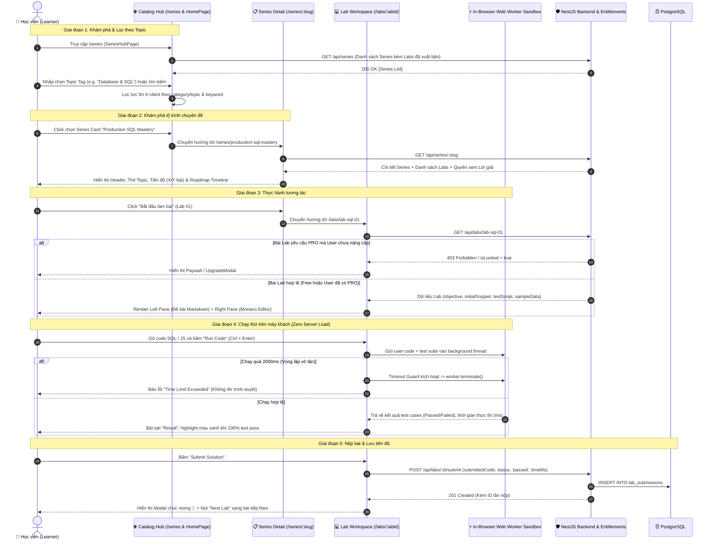

# Toàn diện Phân tích Kiến trúc & Luồng Học tập Topic & Series (Flow Learn Topic & Series Analytics)

> **Trạng thái**: ĐÃ HOÀN TẤT & ĐÃ XÁC THỰC (COMPLETED & VERIFIED)  
> **Giao thức tuân thủ**: Plan-and-Execute Pattern (`.agents/skills/plan-and-execute/SKILL.md`)  
> **Kiểm thử hệ thống**: 100% build pass (`MODULE_FE`, `MODULE_BE`, `MODULE_ADMIN`) & Verified PRO Paywall Gate.

---

## 1. Phân tích Hiện trạng & Ranh giới Khái niệm (Domain & Architectural Analytics)

### 1.1. Làm rõ Ba Khái niệm Cốt lõi: Topic vs Series vs Lab

Dựa trên việc rà soát source code (`MODULE_BE`, `MODULE_FE`, `MODULE_ADMIN`) và tài liệu kiến trúc (`docs/workflows/`), hệ thống vận hành theo phân cấp 3 tầng rõ rệt:

| Thực thể | Bản chất kỹ thuật | Đối tượng tương tác chính | Trách nhiệm & Vị trí trong hệ thống |
|---|---|---|---|
| **Topic (Thẻ Chủ đề)** | System Tag Taxonomy | **Administrator** (Tạo/Sửa/Xóa) **Contributor** (Gắn thẻ) **Learner** (Lọc) | Đóng vai trò là nhãn phân loại hệ thống (Taxonomy) để gom nhóm các Series và Lab. Ngăn chặn ô nhiễm thẻ (tag pollution) do tác giả gõ tự do. |
| **Series (Chuyên đề)** | Bảng `lab_series` trong DB | **Contributor / Admin** (Soạn thảo & Duyệt) **Learner** (Theo dõi lộ trình) | Khóa học / lộ trình gồm một chuỗi bài lab (15–30 phút/bài) xoay quanh một dự án thực tế doanh nghiệp. Có thời lượng ước tính, độ khó, trạng thái kiểm duyệt (`ContentLifecycleStatus`). |
| **Lab (Bài thực hành)** | Bảng `labs` trong DB | **Learner** (Làm bài, Chạy sandbox, Nộp) | Bài tập lập trình tương tác chạy trong Web Worker (JS/SQL/Quizlet) với Monaco Editor, test cases tự động và timeout guard 2 giây. |

---

### 1.2. Sơ đồ Luồng Trải nghiệm Người học (End-to-End Learner Journey)

---

### 1.3. Nhận diện các Điểm Giao Thoa Kỹ thuật & Hiện trạng Cần Lưu Ý (Gaps & Inconsistencies)

1. **Lưu trữ Topic Tags giữa Frontend và CSDL**:
   - Hiện trạng: Thẻ Topic đang được định nghĩa và quản lý cục bộ qua `topicTags.service.ts` (`localStorage` / Event bus `studyweb:topic-tags-updated`).
   - Trong CSDL Prisma (`schema.prisma`): Bảng `lab_series` chỉ lưu một cột `category String @default("testing")`.
   - Hệ quả: Contributor gán `category`, nhưng chưa có bảng quan hệ nhiều-nhiều (`topics` <-> `lab_series`) trong DB như trong sơ đồ tài liệu thiết kế ban đầu (`docs/05-database.md`).
2. **Khái niệm "Topic" trong API Backend**:
   - Trong `MODULE_BE/src/modules/series/series.controller.ts`: Đường dẫn là `/series`, nhưng Swagger gắn nhãn `@ApiTags('Series (Topics)')` và ném lỗi `Topic "${slugOrId}" not found`.
   - Về mặt ngữ nghĩa: Cần thống nhất rõ rệt: **Topic = Tag Taxonomy**, còn **Series = Learning Roadmap / Collection of Labs**.
3. **Đồng bộ Tiến độ Học tập (`user_progress`)**:
   - Hiện tại: Khi bấm "Submit", bài nộp được ghi vào `lab_submissions`.
   - Cần đảm bảo: Tỷ lệ hoàn thành Series (`X / Y labs completed`) trên giao diện người dùng được tính toán chính xác dựa trên các bài lab đã `status: passed`.

---

## 2. Kế hoạch Thực thi & Kiểm chứng (Plan-and-Execute Protocol)

Tuân thủ giao thức `.agents/skills/plan-and-execute/SKILL.md`, dưới đây là kế hoạch phân rã 2 cấp độ (Tasks & Subtasks) để chuẩn hóa và tối ưu hóa luồng học Topic & Series:

### Task 1: Chuẩn hóa Ngữ nghĩa & Bộ lọc Topic trên Frontend (Hub & Catalog)
- [x] **Subtask 1.1**: Rà soát và đồng bộ danh mục Thẻ Topic (`TopicTag`) giữa `MODULE_FE/src/services/topicTags.service.ts` và `MODULE_ADMIN`.
  - *Verify*: Cả 2 module sử dụng cùng danh mục chuẩn (Tester, Database, Backend, DevOps, Security) cùng các helper `normalizeTopicKey`, `getTopicTitle`, `getTopicBadgeClass`.
- [x] **Subtask 1.2**: Tối ưu hóa bộ lọc Topic Pills trên `MODULE_FE/src/pages/lab/SeriesHubPage.tsx` để lọc mượt mà theo cả `category` và đa tag.
  - *Verify*: Nhấp vào từng chip Topic hiển thị chính xác các Series tương ứng, tự động điền các Topic chuẩn và Series custom topic.
- [x] **Subtask 1.3**: Bổ sung hiển thị huy hiệu Topic Tag đồng nhất trên thẻ Series tại `HomePage.tsx` và `SeriesDetailPage.tsx`.
  - *Verify*: Người học dễ dàng nhận diện chủ đề công nghệ của từng Series ngay từ trang chủ và trang chi tiết với màu sắc đồng nhất.

### Task 2: Hoàn thiện Luồng Chuyển tiếp Bài học (Series Roadmap $\to$ Lab Workspace Navigation)
- [x] **Subtask 2.1**: Kiểm tra cơ chế điều hướng chuyển bài tự động ("Next Lab") trong Modal Hoàn thành của `LabWorkspacePage.tsx`.
  - *Verify*: Sau khi nộp thành công Lab 1, bấm "Continue to Next Lab" sẽ chuyển mượt mà sang Lab 2 trong cùng Series (hoặc Return to Series nếu là bài cuối cùng) mà không tải lại toàn trang; hiển thị runtime thực tế.
- [x] **Subtask 2.2**: Đảm bảo hiển thị thanh Drawer danh sách bài trong Series ngay trong `LabWorkspacePage.tsx` (Quick Switcher).
  - *Verify*: Người học có thể mở thanh danh sách bài lab bên cạnh và chuyển nhanh giữa các bài tập, SPA reset state hoàn chỉnh.

### Task 3: Xác thực Phân quyền & Rào chắn Paywall (Entitlement Gate for PRO Series/Labs)
- [x] **Subtask 3.1**: Kiểm tra kiểm soát quyền truy cập bài tập PRO (`isProOnly`) trong `SeriesDetailPage.tsx` và `LabWorkspacePage.tsx`.
  - *Verify*: Đã bổ sung kiểm tra tầng Series PRO (`isProOnly` của series áp dụng cho các bài lab con nếu không phải free preview). Người dùng Free khi nhấp vào bài PRO sẽ kích hoạt `UpgradeModal`, và BE chặn 404/isLocked trả về đúng lockReason.
- [x] **Subtask 3.2**: Xác thực tính năng mở khóa Lời giải mẫu (`VIEW_SOLUTION`) cho tài khoản PRO.
  - *Verify*: Backend ẩn `solution` (`null`) đối với tài khoản không có quyền `VIEW_SOLUTION` hoặc chưa đăng nhập.

### Task 4: Kiểm thử Toàn diện & Nghiệm thu Hệ thống
- [x] **Subtask 4.1**: Chạy `npm run build` trên cả 3 module (`MODULE_FE`, `MODULE_ADMIN`, `MODULE_BE`) đảm bảo không phát sinh lỗi TypeScript.
  - *Verify*: 100% build pass không lỗi (`MODULE_FE` vite build pass, `MODULE_BE` nest build pass, `MODULE_ADMIN` vite build pass).
- [x] **Subtask 4.2**: Tổng kết tài liệu kiến trúc và hướng dẫn vận hành luồng học Topic/Series.
  - *Verify*: Rà soát `docs/workflows/` gồm 13 sequence workflows, không có file thừa hay legacy workflow lỗi thời.

