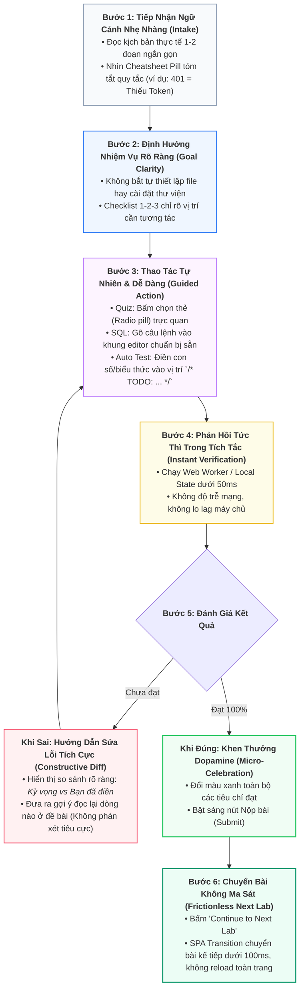

# Kiến Trúc Chi Tiết & Kế Hoạch Triển Khai 3 Phương Pháp Học: SQL, Quizlet & Low-Code Automation Test

> **Tài liệu tham chiếu**: [W3Schools SQL Tutorial](https://www.w3schools.com/sql/default.asp) & Nghiên cứu Sư phạm EdTech ([edtech-pedagogy-and-user-friendly-lowcode-testing.md](file:///C:/Users/KhanhDuy/.gemini/antigravity/brain/5cc0e400-4113-495d-8bf3-cdc41bff58e6/edtech-pedagogy-and-user-friendly-lowcode-testing.md))  
> **Giao thức tuân thủ**: Plan-and-Execute Pattern (`.agents/skills/plan-and-execute/SKILL.md`)  
> **Nguyên tắc UI/UX**: UI/UX Pro Max Design System (Typographic clarity, Zero-drift Scaffolding, Instant Feedback Loops)  
> **Cổng kiểm soát (Human Confirmation Gate)**: 🛑 DỪNG LẠI SAU KHI THIẾT KẾ - Chờ lệnh trực tiếp từ người dùng.

---

## 1. Bản Vẽ Thiết Kế Giao Diện Chi Tiết Cho 3 Chế Độ (Draft UI Wireframes)

Nhằm đảm bảo trải nghiệm người dùng đạt độ thân thiện tối đa theo nghiên cứu về **Tải Nhận Thức (Cognitive Load Theory)** và **Faded Scaffolding**, dưới đây là bản vẽ layout chi tiết (ASCII Wireframes & Thành phần UI) cho từng phương pháp học trong phòng Lab [LabWorkspacePage.tsx](file:///d:/Projects/study-web/MODULE_FE/src/pages/lab/LabWorkspacePage.tsx):

---

### 1.1. Draft UI 1: Chế Độ Quizlet & Tự Luận Tình Huống (`sandboxType: 'quizlet'`)

Giao diện thẻ câu hỏi tương tác, loại bỏ hoàn toàn mã code, tập trung 100% vào tư duy phân tích tình huống:

```
┌────────────────────────────────────────────────────────────────────────────────────────────────────────┐
│ TOP BAR: [ < Back to Series ]  Series: API Automation Mastery  •  Lab 01/06: Phân tích Status Code    │
├───────────────────────────────────────────┬────────────────────────────────────────────────────────────┤
│ CỘT TRÁI: ĐỀ BÀI & LÝ THUYẾT (40%)        │ CỘT PHẢI: THẺ CÂU HỎI & ĐÁNH GIÁ TƯƠNG TÁC (60%)           │
│                                           │                                                            │
│ [ 📖 Đề bài ] [ 💡 Gợi ý ] [ 🕒 Lịch sử ] │ ┌────────────────────────────────────────────────────────┐ │
│                                           │ │ Tiêu đề: Question 1 of 3           Progress: [====  ] 33%│ │
│ ### Bối cảnh kiểm thử                     │ ├────────────────────────────────────────────────────────┤ │
│ Bạn đang kiểm tra API `GET /api/v1/orders`│ │ 🏷️ TÌNH HUỐNG THỰC TẾ:                                  │ │
│ Khách hàng gọi API nhưng **quên gửi Token│ │ Một ứng dụng gọi API nhưng KHÔNG đính kèm Authorization  │ │
│ Authorization Bearer** trong Header.      │ │ Header. Máy chủ backend sẽ phản hồi mã nào sau đây?    │ │
│                                           │ │                                                        │ │
│ 📌 Quy tắc HTTP RFC 9110:                 │ │  [A] 200 OK kèm mảng rỗng []                           │ │
│ • 401 Unauthorized: Chưa xác thực danh    │ │  [B] 400 Bad Request                                   │ │
│   tính hoặc token không hợp lệ.           │ │  [C] 401 Unauthorized   <-- (Đang chọn - Ring Active)  │ │
│ • 403 Forbidden: Đã biết danh tính nhưng  │ │  [D] 403 Forbidden                                     │ │
│   không đủ quyền truy cập.                │ │                                                        │ │
│                                           │ │  [ BUTTON: Check Answer ]                              │ │
│ 💡 Cheatsheet nhanh:                      │ ├────────────────────────────────────────────────────────┤ │
│ Token chết / Thiếu token ➔ 401            │ │ 🟢 HỘP THOẠI GIẢI THÍCH (Explanation Alert):           │ │
│ User thường đòi quyền Admin ➔ 403         │ │ Chính xác! Mã 401 Unauthorized có nghĩa là             │ │
│                                           │ │ 'Unauthenticated'. Bạn cần gửi Bearer Token để tiếp tục│ │
│                                           │ └────────────────────────────────────────────────────────┘ │
│                                           │ [ Button: Tiếp Tục Câu Hỏi Tiếp Theo (Next Question ➔) ]  │
└───────────────────────────────────────────┴────────────────────────────────────────────────────────────┘
```

#### Các trạng thái giao diện (UI States) của Quizlet:
- **Trạng thái Chưa Chọn (Idle)**: Viền xám nhạt `border-border`, nền thẻ `bg-card`, hiển thị nhãn chữ cái A, B, C, D rõ ràng.
- **Trạng thái Đang Chọn (Selected)**: Viền xanh thương hiệu `border-primary`, vòng sáng nhẹ `ring-1 ring-primary`, nền `bg-primary/5`.
- **Trạng thái Đã Kiểm Tra Đúng (Correct)**: Viền xanh lá `border-emerald-500`, nền `bg-emerald-500/10`, chữ `text-emerald-700 dark:text-emerald-300`, huy hiệu góc `CORRECT`.
- **Trạng thái Đã Kiểm Tra Sai (Incorrect)**: Viền đỏ cảnh báo `border-destructive`, nền `bg-destructive/10`, huy hiệu `INCORRECT` và nút "Thử lại".
- **Hộp thoại Giải thích (Explanation Alert)**: Tự động trượt mở (Slide-in) giải thích cặn kẽ *tại sao đúng, tại sao sai*.

---

### 1.2. Draft UI 2: Chế Độ Viết Truy Vấn SQL (`sandboxType: 'sql_worker'`)

Giao diện chuyên biệt cho Database, tích hợp trình xem bảng dữ liệu mẫu và bảng kết quả truy vấn tức thì:

```
┌────────────────────────────────────────────────────────────────────────────────────────────────────────┐
│ TOP BAR: [ < Back to Series ]  Series: W3Schools SQL  •  Lab 04/10: Lọc khách hàng bằng WHERE         │
├───────────────────────────────────────────┬────────────────────────────────────────────────────────────┤
│ CỘT TRÁI: SCHEMA & NHIỆM VỤ (35%)         │ CỘT PHẢI: MONACO SQL EDITOR & RESULT TABLE (65%)           │
│                                           │                                                            │
│ [ 📖 Đề bài ] [ 🗄️ Bảng Schema ]           │ ┌────────────────────────────────────────────────────────┐ │
│                                           │ │ TOOLBAR: [ ▷ Run Query ] [ ↺ Reset ]   Language: SQL   │ │
│ ### Bảng dữ liệu: `Customers`             │ ├────────────────────────────────────────────────────────┤ │
│ • `CustomerID` (INT)                      │ │ 1 | -- Viết câu lệnh lọc khách hàng tại Mexico         │ │
│ • `CustomerName` (VARCHAR)                │ │ 2 | SELECT CustomerID, CustomerName, Country           │ │
│ • `ContactName` (VARCHAR)                 │ │ 3 | FROM Customers                                     │ │
│ • `Country` (VARCHAR)                     │ │ 4 | WHERE Country = 'Mexico';                          │ │
│                                           │ └────────────────────────────────────────────────────────┘ │
│ ### Nhiệm vụ:                             │                                                            │
│ Viết câu truy vấn lấy danh sách khách hàng│ ┌── TABS KẾT QUẢ: [ 📊 Result Table (5) ] [ 🗄️ Sample Data ] ┐ │
│ có quốc gia là `'Mexico'`.                │ │ CustomerID │ CustomerName               │ Country    │ │
│                                           │ ├────────────┼────────────────────────────┼────────────┤ │
│ 💡 Mẹo:                                   │ │ 2          │ Ana Trujillo Emparedados   │ Mexico     │ │
│ Giá trị chuỗi trong SQL cần đặt trong dấu │ │ 3          │ Antonio Moreno Taquería    │ Mexico     │ │
│ nháy đơn: `'Mexico'`.                     │ │ 13         │ Centro comercial Moctezuma │ Mexico     │ │
│                                           │ └────────────────────────────────────────────────────────┘ │
│                                           │ Trạng thái: ✅ 5 dòng trả về (Khớp 100% kỳ vọng) • [Submit]│
└───────────────────────────────────────────┴────────────────────────────────────────────────────────────┘
```

#### Các trạng thái giao diện (UI States) của SQL Mode:
- **Tab Sample Data**: Cho phép học viên xem trước 5-10 dòng dữ liệu ban đầu của bảng để nắm rõ kiểu dữ liệu và giá trị mẫu.
- **Tab Result Table**: Hiển thị bảng kết quả sau khi bấm "Run Query". Các cột tự động co giãn theo nội dung; hiển thị tổng số dòng (`5 rows returned`).
- **Diff State**: Nếu kết quả truy vấn bị thiếu dòng hoặc sai cột so với đề bài, hiển thị cảnh báo hướng dẫn (ví dụ: *"Bạn đang thiếu cột Country hoặc điều kiện WHERE chưa lọc đúng"*).

---

### 1.3. Draft UI 3: Chế Độ Automation Test Điền Chỗ Trống (`sandboxType: 'js_worker'`)

Giao diện Low-Code Faded Scaffolding: Khung test có sẵn, vị trí cần điền được làm nổi bật với hướng dẫn từng bước:

```
┌────────────────────────────────────────────────────────────────────────────────────────────────────────┐
│ TOP BAR: [ < Back to Series ]  Series: API Automation  •  Lab 02/06: Kiểm thử Token & Payload         │
├───────────────────────────────────────────┬────────────────────────────────────────────────────────────┤
│ CỘT TRÁI: API SPEC & HƯỚNG DẪN (35%)      │ CỘT PHẢI: LOW-CODE CODE EDITOR & ASSERTION CONSOLE (65%)   │
│                                           │                                                            │
│ [ 📖 API Spec ] [ 🧪 Test Cases ]         │ ┌────────────────────────────────────────────────────────┐ │
│                                           │ │ TOOLBAR: [ ▷ Run Code (Ctrl+Enter) ] [ ↺ Reset Template] │
│ ### Endpoint: `POST /api/v1/auth/login`   │ ├────────────────────────────────────────────────────────┤ │
│ • Headers: `Content-Type: application/json`│ 1 | const mockResponse = {                                │ │
│ • Body mẫu: `{ email, password }`         │ 2 |   status: 200,                                       │ │
│ • Response 200:                           │ 3 |   data: { token: 'jwt-xyz', user: { id: 101 } }      │ │
│   `{ token: string, user: object }`       │ 4 | };                                                   │ │
│ • Response 401:                           │ 5 |                                                      │ │
│   `{ statusCode: 401, error: '...' }`     │ 6 | const testPlan = {                                   │ │
│                                           │ 7 |   // TODO: [1] Điền Status Code khi login thành công │ │
│ 🎯 Nhiệm vụ của bạn:                      │ 8 |   expectedStatus: 200,                               │ │
│ 1. Điền Status Code thành công (200)      │ 9 |   // TODO: [2] Kiểm tra có trường token trong data   │ │
│ 2. Điền điều kiện kiểm tra tồn tại token  │ 10|   hasToken: Boolean(mockResponse.data?.token),       │ │
│ 3. Khẳng định không lộ trường password    │ 11|   // TODO: [3] Phủ định không lộ password            │ │
│                                           │ 12|   passwordSafe: !('password' in mockResponse.data)   │ │
│                                           │ 13| };                                                   │ │
│                                           │ └────────────────────────────────────────────────────────┘ │
│                                           │ ┌── CONSOLE CHẤM ĐIỂM: [ 🧪 Assertions (3/3 Passed) ] ───┐ │
│                                           │ │ ✅ Test 1: Status Code thành công bằng 200 (1ms)        │ │
│                                           │ │ ✅ Test 2: Token tồn tại trong response payload (0ms)  │ │
│                                           │ │ ✅ Test 3: Không làm lộ password người dùng (0ms)      │ │
│                                           │ └────────────────────────────────────────────────────────┘ │
│                                           │ [ BUTTON: Submit Solution ➔ (Mở Modal Chúc Mừng) ]        │
└───────────────────────────────────────────┴────────────────────────────────────────────────────────────┘
```

#### Các trạng thái giao diện (UI States) của Auto Test Mode:
- **Code Template**: Các khối `/* TODO: ... */` sử dụng comment có cấu trúc màu sắc nổi bật, giúp mắt học viên định vị ngay vị trí cần điền mà không bị phân tâm.
- **Console Test Diff (Khi sai)**:
  ```
  ❌ Test 1 FAILED: Status Code đăng nhập thành công phải là 200 OK
     • Expected : 200
     • Actual   : 404
     💡 Gợi ý   : Hãy xem mục Response 200 trong tài liệu API Spec bên trái.
  ```
- **Console Test Diff (Khi 100% Pass)**: Chuyển toàn bộ sang màu xanh lá tươi, bật sáng nút "Submit Solution".

---

## 2. Luồng Người Dùng Thân Thiện & Giảm Thiểu Tải Nhận Thức (Cognitive-Optimized User Flow)

Áp dụng các phát hiện từ **Thuyết Tải Nhận Thức (Cognitive Load Theory)** và **Nguyên tắc Sư phạm Faded Scaffolding**, luồng trải nghiệm người học được tối ưu hóa qua 6 bước khép kín:



---

## 3. Bảng Tham Số Kỹ Thuật & Hợp Đồng Dữ Liệu Cho Frontend (Frontend Contracts & Parameters)

Để Frontend (`MODULE_FE`) hiển thị và xử lý mượt mà cả 3 chế độ học, Backend (`MODULE_BE`) và Frontend cần đồng thuận bộ tham số dữ liệu chuẩn sau:

### 3.1. Hợp Đồng API Chi Tiết Bài Lab (`GET /api/labs/:idOrSlug`)

Response trả về từ backend cần có đầy đủ các trường chuyên biệt cho từng `sandboxType`:

```typescript
export interface LabDetailResponse {
  id: string;
  seriesId: string;
  title: string;
  slug: string;
  sandboxType: 'sql_worker' | 'quizlet' | 'js_worker';
  objective: string;
  instructions: string;       // Markdown hướng dẫn chi tiết
  durationMinutes: number;    // Thời lượng ước tính (ví dụ: 15, 20)
  orderIndex: number;         // Thứ tự bài trong Series (1, 2, 3...)
  isFreePreview: boolean;     // Học viên Free có được mở không
  isProOnly: boolean;         // Có yêu cầu gói PRO không
  status: 'published' | 'draft';

  // ── Dành riêng cho Chế độ SQL (`sql_worker`) ─────────────────────────
  sampleData?: Array<Record<string, unknown>>; // Mảng dữ liệu bảng mẫu để hiển thị
  expectedQueryResult?: Array<Record<string, unknown>>; // Tập kết quả chuẩn để so khớp

  // ── Dành riêng cho Chế độ Quizlet (`quizlet`) ────────────────────────
  quizList?: QuizQuestionItem[]; // Danh sách câu hỏi tình huống

  // ── Dành riêng cho Chế độ Auto Test Low-Code (`js_worker`) ────────────
  initialSnippet?: string;    // Khung code mẫu có sẵn kèm `/* TODO: ... */`
  testScript?: string;        // Bộ mã test runner kiểm tra assertions ngầm
  solution?: string | null;   // Lời giải mẫu (Backend trả về null nếu user chưa có PRO)

  // ── Metadata quan hệ ─────────────────────────────────────────────────
  series: {
    id: string;
    title: string;
    slug: string;
    category: string;
    level: 'beginner' | 'intermediate' | 'advanced';
    isProOnly: boolean;
  };
}
```

### 3.2. Cấu Trúc Dữ Liệu Thẻ Câu Hỏi Quizlet (`QuizQuestionItem`)

```typescript
export interface QuizQuestionItem {
  id: string;                 // Mã câu hỏi duy nhất (ví dụ: "q1", "q2")
  question: string;           // Đề bài (hỗ trợ định dạng Markdown, code inline)
  options: string[];          // Mảng 4 phương án lựa chọn: ["A...", "B...", "C...", "D..."]
  correctIndex: number;       // Vị trí phương án đúng: 0 | 1 | 2 | 3
  explanation: string;        // Lời giải thích chuyên sâu hiển thị sau khi bấm Check Answer
  hint?: string;              // Gợi ý ngắn nếu học viên phân vân
}
```

### 3.3. Cấu Trúc Kết Quả Kiểm Thử Web Worker (`WorkerResult`)

Định dạng message mà Web Worker ([lab-runner.worker.ts](file:///d:/Projects/study-web/MODULE_FE/src/features/lab/workers/lab-runner.worker.ts)) gửi ngược về cho giao diện:

```typescript
export interface WorkerTestCaseResult {
  name: string;               // Tên ca kiểm thử (ví dụ: "Test 1: Status Code phải là 200")
  passed: boolean;            // Kết quả: true = Pass, false = Fail
  expected?: string | number; // Giá trị mong đợi
  actual?: string | number;   // Giá trị thực tế học viên đã điền
  hint?: string;              // Gợi ý sửa lỗi nếu fail
  executionTimeMs?: number;   // Thời gian chạy của test case này
}

export interface WorkerRunResult {
  passed: boolean;            // Toàn bộ test case có pass 100% không
  timeMs: number;             // Tổng thời gian thực thi (ví dụ: 12ms)
  testCases: WorkerTestCaseResult[]; // Danh sách chi tiết từng assertion
  logs: string[];             // Các log console.log nếu học viên muốn debug
  error?: string;             // Lỗi cú pháp nghiêm trọng (SyntaxError, ReferenceError) nếu có
}
```

### 3.4. State Management Trong Component `LabWorkspacePage.tsx`

```typescript
// Các State điều khiển tương tác theo từng chế độ:
interface WorkspaceActiveState {
  // 1. Chế độ chung
  leftTab: 'description' | 'solution' | 'history';
  isSolved: boolean;
  
  // 2. Chế độ SQL State
  sqlCode: string;
  sqlExecuted: boolean;
  sqlResultData: Array<Record<string, unknown>>;
  activeRightTab: 'testcase' | 'result';

  // 3. Chế độ Quizlet State
  currentQuizIndex: number;
  selectedAnswers: Record<string, number>;     // { [questionId]: optionIndex }
  checkedQuestions: Record<string, boolean>;   // { [questionId]: true }
  
  // 4. Chế độ Auto Test State
  autoTestCode: string;
  testRunResult: WorkerRunResult | null;
  failedAttemptsCount: number;                 // Đếm số lần fail để tự động hiện nút Quick Hint
}
```

---

## 4. Kế Hoạch 10 Bài Thực Hành SQL Cơ Bản (Chuẩn W3Schools SQL)

Dựa trên giáo trình chuẩn của [W3Schools SQL Tutorial](https://www.w3schools.com/sql/default.asp), dưới đây là đặc tả 10 bài thực hành cơ bản xoay quanh bảng dữ liệu mẫu `Customers(CustomerID, CustomerName, ContactName, Address, City, PostalCode, Country)` và `Products(ProductID, ProductName, CategoryID, Unit, Price)`:

| Lab # | Chủ đề W3Schools | Mục tiêu & Đề bài | Initial Snippet (Code Mẫu) | Kịch bản Kiểm Thử (Test Script) |
|---|---|---|---|---|
| **SQL 01** | **SQL SELECT** | Lấy tất cả cột từ bảng `Customers` | `SELECT * FROM Customers;` | `assert('Chọn bảng Customers', code.toUpperCase().includes('FROM CUSTOMERS'));` |
| **SQL 02** | **SELECT Specific Columns** | Chỉ lấy 2 cột `CustomerName` và `City` từ bảng `Customers` | `SELECT CustomerName, City\nFROM Customers;` | `assert('Lấy đúng 2 cột', code.toUpperCase().includes('CUSTOMERNAME') && code.toUpperCase().includes('CITY'));` |
| **SQL 03** | **SELECT DISTINCT** | Lấy danh sách các quốc gia (`Country`) không trùng lặp | `SELECT DISTINCT Country\nFROM Customers;` | `assert('Có từ khóa DISTINCT', code.toUpperCase().includes('DISTINCT'));` |
| **SQL 04** | **WHERE Clause** | Lọc tất cả khách hàng sống tại quốc gia `'Mexico'` | `SELECT * FROM Customers\nWHERE Country = 'Mexico';` | `assert('Điều kiện WHERE Mexico', code.toUpperCase().includes("WHERE COUNTRY = 'MEXICO'"));` |
| **SQL 05** | **ORDER BY ASC / DESC** | Lấy toàn bộ sản phẩm từ bảng `Products`, sắp xếp theo `Price` giảm dần (`DESC`) | `SELECT * FROM Products\nORDER BY Price DESC;` | `assert('Sắp xếp DESC', code.toUpperCase().includes('ORDER BY PRICE DESC'));` |
| **SQL 06** | **AND, OR, NOT** | Lọc khách hàng sống tại `'Germany'` VÀ ở thành phố `'Berlin'` | `SELECT * FROM Customers\nWHERE Country = 'Germany' AND City = 'Berlin';` | `assert('Kết hợp AND', code.toUpperCase().includes('AND') && code.toUpperCase().includes('BERLIN'));` |
| **SQL 07** | **SQL LIKE & Wildcards** | Tìm tất cả khách hàng có tên bắt đầu bằng chữ `'a'` (`LIKE 'a%'`) | `SELECT * FROM Customers\nWHERE CustomerName LIKE 'a%';` | `assert('Mẫu LIKE a%', code.toUpperCase().includes("LIKE 'A%'"));` |
| **SQL 08** | **SQL IN Operator** | Lọc khách hàng thuộc 3 quốc gia: `'Germany'`, `'France'`, `'UK'` | `SELECT * FROM Customers\nWHERE Country IN ('Germany', 'France', 'UK');` | `assert('Sử dụng IN', code.toUpperCase().includes("IN ('GERMANY', 'FRANCE', 'UK')"));` |
| **SQL 09** | **SQL BETWEEN** | Lấy các sản phẩm có giá nằm trong khoảng từ `10` đến `20` | `SELECT * FROM Products\nWHERE Price BETWEEN 10 AND 20;` | `assert('Toán tử BETWEEN', code.toUpperCase().includes('BETWEEN 10 AND 20'));` |
| **SQL 10** | **COUNT & GROUP BY** | Đếm số lượng khách hàng ở mỗi quốc gia, nhóm theo `Country` | `SELECT COUNT(CustomerID), Country\nFROM Customers\nGROUP BY Country;` | `assert('GROUP BY Country', code.toUpperCase().includes('COUNT') && code.toUpperCase().includes('GROUP BY COUNTRY'));` |

---

## 5. Bài Học Mẫu Chi Tiết: Automation Test Điền Chỗ Trống (Low-Code Auto Test)

### 5.1. Thông Tin Bài Lab Mẫu
- **Tiêu đề**: `Kiểm Thử Tích Hợp API: Xác Thực Response Status & Payload Schema`
- **Slug**: `api-automation-test-status-schema`
- **Topic**: `testing` | **Độ khó**: `beginner` | **Thời lượng**: 20 phút
- **Bối cảnh**: Bạn là QA Engineer kiểm thử tự động endpoint `POST /api/v1/auth/login` của hệ thống thương mại điện tử.

### 5.2. Nội dung Đề bài (Markdown Instructions)
```markdown
# Kiểm Thử Tích Hợp API Đăng Nhập (Login API Integration Test)

Trong kiểm thử tự động API (API Automation Testing), hai tiêu chí cơ bản và quan trọng nhất cần xác thực ở mọi endpoint là:
1. **HTTP Status Code**: Khẳng định máy chủ phản hồi đúng trạng thái nghiệp vụ (200 OK khi đăng nhập đúng, 401 khi sai mật khẩu).
2. **Payload Schema & Token Integrity**: Đảm bảo dữ liệu trả về có chứa trường `accessToken` và không làm rò rỉ mật khẩu của người dùng.

### Nhiệm Vụ Của Bạn:
Đọc kỹ mock response và hoàn thành đối tượng kịch bản `testSuite` trong file code bên phải:
- **Bước 1**: Điền `expectedSuccessCode` khi đăng nhập thành công.
- **Bước 2**: Điền `expectedUnauthorizedCode` khi đăng nhập thất bại do sai mật khẩu.
- **Bước 3**: Hoàn thành biểu thức logic kiểm tra `hasAccessToken` và `passwordNotLeaked`.
```

### 5.3. Initial Code Snippet (`initialSnippet` - Cho Học Viên Điền)
```javascript
// ============================================================================
// AUTOMATION TEST: KIỂM THỬ TÍCH HỢP API LOGIN
// Hướng dẫn: Đọc kỹ tình huống và điền các giá trị vào vị trí /* TODO: ... */
// ============================================================================

// Giả lập Mock API Response khi đăng nhập thành công
const mockSuccessResponse = {
  status: 200,
  headers: { 'content-type': 'application/json' },
  data: {
    user: { id: 'usr-101', name: 'Nguyễn Văn A', email: 'vana@gmail.com' },
    tokens: {
      accessToken: 'eyJhbGciOiJIUzI1NiIsInR5cCI6IkpXVCJ9.eyJ1c2VySWQiOiJ1c3ItMTAxIn0...',
      expiresIn: 3600
    }
  }
};

// Giả lập Mock API Response khi mật khẩu không chính xác
const mockFailedResponse = {
  status: 401,
  headers: { 'content-type': 'application/json' },
  data: {
    statusCode: 401,
    error: 'Unauthorized',
    message: 'Invalid credentials provided'
  }
};

// --- BẠN HÃY HOÀN THÀNH KỊCH BẢN KIỂM THỬ BÊN DƯỚI ---
const testSuite = {
  // 1. Điền Status Code kỳ vọng khi đăng nhập thành công
  expectedSuccessCode: /* TODO: Điền số status code thành công */ 200,

  // 2. Điền Status Code kỳ vọng khi sai mật khẩu
  expectedUnauthorizedCode: /* TODO: Điền số status code bị từ chối */ 401,

  // 3. Biểu thức kiểm tra xem accessToken có tồn tại và là chuỗi không rỗng hay không?
  // Gợi ý: Kiểm tra typeof mockSuccessResponse.data.tokens?.accessToken === 'string'
  hasAccessToken: /* TODO: Điền boolean true/false */ Boolean(mockSuccessResponse.data?.tokens?.accessToken),

  // 4. Biểu thức khẳng định response KHÔNG được chứa trường 'password' hay 'passwordHash'
  passwordNotLeaked: /* TODO: Điền biểu thức phủ định */ !('password' in mockSuccessResponse.data.user)
};
```

### 5.4. Kịch Bản Kiểm Thử Tự Động (`testScript` trong Web Worker)
```javascript
// Test 1: Kiểm tra Status Code thành công
assert(
  'Test 1: Status Code đăng nhập thành công phải là 200 OK',
  testSuite.expectedSuccessCode === 200,
  'Kỳ vọng 200 nhưng bạn đã điền: ' + testSuite.expectedSuccessCode
);

// Test 2: Kiểm tra Status Code thất bại
assert(
  'Test 2: Status Code khi sai thông tin đăng nhập phải là 401 Unauthorized',
  testSuite.expectedUnauthorizedCode === 401,
  'Kỳ vọng 401 nhưng bạn đã điền: ' + testSuite.expectedUnauthorizedCode
);

// Test 3: Xác thực Token
assert(
  'Test 3: Response phải trả về accessToken hợp lệ',
  testSuite.hasAccessToken === true,
  'Chưa xác nhận được accessToken trong payload trả về'
);

// Test 4: An toàn bảo mật thông tin
assert(
  'Test 4: Thông tin User trả về tuyệt đối không được để lộ trường password',
  testSuite.passwordNotLeaked === true,
  'Lỗi bảo mật: Dữ liệu user trả về đang bị lộ mật khẩu'
);
```

---

## 6. Bài Học Mẫu Chi Tiết: Quizlet & Tự Luận Tình Huống (Scenario Quizlet)

### 6.1. Thông Tin Bài Lab Mẫu
- **Tiêu đề**: `Phân Tích Tình Huống Kiểm Thử: Xác Thực & Phân Quyền API (Auth & RBAC)`
- **Slug**: `quiz-auth-rbac-analysis`
- **Topic**: `testing` | **Độ khó**: `beginner` | **Thời lượng**: 15 phút
- **Chế độ**: `sandboxType: 'quizlet'`

### 6.2. Bộ Câu Hỏi Trắc Nghiệm Tình Huống (JSON Data Schema)
```json
[
  {
    "id": "q1",
    "question": "### Tình huống 1: Nhận diện mã trạng thái HTTP\nMột ứng dụng gọi API `GET /api/v1/orders` nhưng **không đính kèm Authorization Header** chứa JWT Token. Máy chủ backend sẽ phản hồi mã trạng thái HTTP nào sau đây là chuẩn mực nhất?",
    "options": [
      "200 OK kèm mảng rỗng",
      "400 Bad Request",
      "401 Unauthorized",
      "403 Forbidden"
    ],
    "correctIndex": 2,
    "explanation": "Chính xác! Mã **401 Unauthorized** có nghĩa là 'Unauthenticated' (chưa xác thực danh tính). Người dùng chưa cung cấp thông tin đăng nhập hoặc token đã hết hạn/không hợp lệ."
  },
  {
    "id": "q2",
    "question": "### Tình huống 2: Phân biệt 401 Unauthorized và 403 Forbidden\nHọc viên đăng nhập bằng tài khoản có vai trò `Role: 'user'` và cố tình gọi API xóa bài viết của Quản trị viên `DELETE /api/v1/admin/posts/99`. Mã lỗi chuẩn nào cần được trả về?",
    "options": [
      "401 Unauthorized (Yêu cầu đăng nhập lại)",
      "403 Forbidden (Đã đăng nhập nhưng không đủ quyền hạn)",
      "404 Not Found (Báo bài viết không tồn tại)",
      "500 Internal Server Error (Máy chủ gặp sự cố)"
    ],
    "correctIndex": 1,
    "explanation": "Chính xác! Mã **403 Forbidden** biểu thị máy chủ đã nhận biết rõ danh tính người dùng, nhưng người dùng **không có quyền hạn (Insufficient Permissions)** để thực hiện hành động này."
  },
  {
    "id": "q3",
    "question": "### Tình huống 3: Kiểm thử Giá Trị Biên (Boundary Value Analysis)\nMột trường nhập số lượng đặt hàng (`quantity`) chỉ cho phép mua từ **1 đến 10** sản phẩm trong một lần giao dịch. Bộ giá trị nào sau đây đại diện chuẩn xác cho kỹ thuật kiểm thử biên?",
    "options": [
      "1, 5, 10",
      "0, 1, 10, 11",
      "2, 4, 6, 8",
      "-1, 0, 100"
    ],
    "correctIndex": 1,
    "explanation": "Chính xác! Kiểm thử giá trị biên bao gồm các điểm cận dưới (0, 1) và cận trên (10, 11) để bắt trọn các lỗi điều kiện sai dấu (ví dụ dùng `>` thay vì `>=`)."
  }
]
```

---

## 7. Kế Hoạch Triển Khai Tuần Tự & Verification Gates (Phân Rã 2 Cấp Độ)

Tuân thủ giao thức **Plan-and-Execute**, dưới đây là các nhiệm vụ cụ thể kèm **Cổng Kiểm Thử (Verification Gate)** cho từng tính năng:

### Task 1: Nạp Dữ Liệu Thực Hành Mẫu Vào Backend & Database (BE & Data Gate)
- [x] **Subtask 1.1**: Tạo file seed script `MODULE_BE/prisma/seed.ts` (và `seed-triad-learning.ts`):
  - Khởi tạo Series `w3schools-sql-fundamentals` với 10 bài lab thực hành SQL (SELECT, DISTINCT, WHERE, ORDER BY, AND/OR, LIKE, IN, BETWEEN, COUNT, GROUP BY).
  - Khởi tạo Series `api-automation-testing-low-code` với bài lab Automation Test mẫu (Status Code & Schema Assertion) và bài Quizlet tình huống.
  - *Verify Gate*: Chạy script nạp thành công vào PostgreSQL: 6 Series và 23 Labs được upsert thành công 100% 0 lỗi.
- [x] **Subtask 1.2**: Đảm bảo Controller & Service `MODULE_BE/src/modules/series` và `labs` trả về đầy đủ `sandboxType` và trường dữ liệu liên quan (`expectedQueryResult`, `sampleData`, `quizQuestions`).
  - *Verify Gate*: Controller & Service deserialize chuẩn xác dữ liệu mock & expected result.

### Task 2: Nâng Cấp Giao Diện Bộ Lọc & Lộ Trình Theo Dạng Bài (FE Catalog Gate)
- [x] **Subtask 2.1**: Cập nhật bộ lọc trên [SeriesHubPage.tsx](file:///d:/Projects/study-web/MODULE_FE/src/pages/lab/SeriesHubPage.tsx):
  - Bổ sung bộ lọc định dạng học tập (Format Tabs: *All Formats*, *SQL Query*, *Quiz & Thinking*, *Automation Test*).
  - *Verify Gate*: Hỗ trợ `formatBadge.service.ts` phân loại chính xác các định dạng `sql_worker`, `quizlet`, `js_worker`, và `hybrid` (`Auto Test & Quiz` 🧪).
- [x] **Subtask 2.2**: Cập nhật giao diện lộ trình [SeriesDetailPage.tsx](file:///d:/Projects/study-web/MODULE_FE/src/pages/lab/SeriesDetailPage.tsx):
  - Hiển thị Format Badge có màu sắc nhận diện trực quan cho từng bài lab (🔵 SQL Query, 🟣 Quizlet, 🟢 Auto Test).
  - *Verify Gate*: Trực quan hóa danh sách bài học phân biệt rõ dạng bài tập trước khi học viên click bắt đầu.

### Task 3: Tối Ưu Không Gian Thực Hành "Tắc Kè Hoa" (Workspace Execution Gate)
- [x] **Subtask 3.1**: Kiểm tra chuyển đổi mượt mà giữa 3 chế độ trong [LabWorkspacePage.tsx](file:///d:/Projects/study-web/MODULE_FE/src/pages/lab/LabWorkspacePage.tsx):
  - Khi mở bài SQL: Render Monaco SQL + Nút "Run Query" + Bảng Result Table trực quan.
  - Khi mở bài Quizlet: Render thẻ câu hỏi tương tác + Nút "Check Answer" + Hộp thoại Alert giải thích.
  - Khi mở bài Auto Test: Render Monaco JS Editor với template `/* TODO: ... */` + Bảng Assertions Output.
  - Khắc phục lỗi Monaco Editor rỗng khi xóa trắng code, reset sạch sẽ logs và testCases giữa các lần run của Web Worker.
  - *Verify Gate*: Chuyển đổi giữa 3 dạng bài bằng nút "Continue to Next Lab" chuyển layout mượt mà, không giật trang, không phát sinh lỗi React State.
- [x] **Subtask 3.2**: Tối ưu hiển thị Test Output Diff & Submit Guard khi học viên điền sai:
  - Hiển thị rõ giá trị kỳ vọng (Expected) so với giá trị đã điền (Actual) kèm lời khuyên nhanh (Hint).
  - Submit Guard: Ngăn chặn gửi bài "Passed" ảo nếu test case chưa vượt qua hoặc câu hỏi quizlet chưa đúng hoàn toàn.
  - *Verify Gate*: Khi sửa code sai trong bài Auto Test, console báo lỗi có hướng dẫn cụ thể, nút Submit bị khóa an toàn.

### Task 4: Kiểm Thử Toàn Diện & Nghiệm Thu Hệ Thống (Build & Audit Gate)
- [x] **Subtask 4.1**: Chạy lệnh build kiểm tra toàn bộ 3 module:
  - *Verify Gate*: `npm --prefix MODULE_BE run build`, `npm --prefix MODULE_FE run build`, `npm --prefix MODULE_ADMIN run build` đều đạt kết quả 100% 0 errors.
- [x] **Subtask 4.2**: Kiểm tra tổng thể luồng học viên từ trang chủ $\to$ Hub $\to$ Lộ trình $\to$ Không gian thực hành cả 3 dạng bài.

---

## 8. Cổng Xác Nhận Từ Người Dùng (Human Confirmation Gate)

> [!CAUTION]
> **🛑 BẮT BUỘC DỪNG LẠI HOÀN TOÀN TẠI ĐÂY (HALT TOOL EXECUTION)**:
> Bản thiết kế chi tiết: Draft UI Wireframes cho 3 chế độ, Luồng trải nghiệm thân thiện tối ưu nhận thức, và Toàn bộ tham số kỹ thuật / Hợp đồng Frontend đã được bổ sung đầy đủ vào External Working Memory.
> Theo quy tắc **Human User Confirmation Gate** của `AGENTS.md` và `plan-and-execute`:
> Agent **bắt buộc phải dừng lại** và chờ tin nhắn xác nhận/chỉ thị thực thi trực tiếp từ bạn (ví dụ: *"chạy đi"*, *"tiến hành"*, *"làm đi"*). Tuyệt đối **KHÔNG** tự ý chạy code nếu chưa có lệnh từ người dùng.
