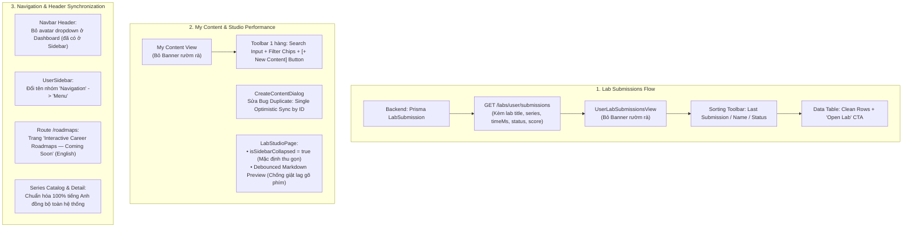

# Kế Hoạch Chi Tiết Thực Thi Phase 3: Lab Submissions, My Content, Review Feedback, Navbar & Series i18n

> **Trạng thái**: ĐÃ HOÀN THÀNH 100% (All Subtasks Completed & Verified via Build Gate)  
> **Áp dụng tiêu chuẩn**: `ui-ux-pro-max`, `code-reviewer`, `plan-and-execute`  
> **Phạm vi tác động**: `MODULE_FE` (UserLabSubmissionsView, ContributorContentPage, CreateContentDialog, LabStudioPage, MarkdownEditorWithPreview, UserReviewFeedbackView, Navbar, UserSidebar, RoadmapsPage, SeriesHubPage, SeriesDetailPage), `MODULE_BE` (LabsController, LabsService).

---

## I. Sơ đồ Quy Trình & Kiến Trúc Tương Tác (Architectural Flows)

---

## II. Bảng Theo Dõi Thực Thi (External Working Memory)

### Task 1: Tối ưu UI & Tính năng trang `Lab Submissions` (`MODULE_FE` & `MODULE_BE`)
- [x] **Subtask 1.1**: Loại bỏ Header rườm rà `Lab Submissions - History of all your interactive browser lab test runs...` tại `UserLabSubmissionsView.tsx`.
- [x] **Subtask 1.2**: Bổ sung endpoint backend `GET /labs/user/submissions` trong `labs.controller.ts` & `labs.service.ts` để truy vấn lịch sử nộp bài của user hiện tại (kèm thông tin lab, series, executionTimeMs, status, createdAt).
- [x] **Subtask 1.3**: Bổ sung API client `labApi.getUserSubmissions()` trong `lab.api.ts`.
- [x] **Subtask 1.4**: Xây dựng giao diện Table View chuẩn `ui-ux-pro-max`:
  - Sorting dropdown: "Last Submission" (Mới nhất / Cũ nhất) và "Name" (Tên bài Lab A -> Z / Z -> A).
  - Bảng dữ liệu hiển thị: Lab Name, Series, Status Badge (PASSED / FAILED), Execution Time, Submission Date, Nút "Open Lab" trực tiếp.
  - KPI Stat cards (Total Submissions, Passed Labs, Success Rate) & Empty state thanh lịch.

---

### Task 2: Cải tiến & Sửa lỗi trang `My Content` & Studio (`MODULE_FE`)
- [x] **Subtask 2.1**: Loại bỏ Header rườm rà `My Content - Author and manage curriculum series and practice labs.` trong `ContributorContentPage.tsx`.
- [x] **Subtask 2.2**: Đưa nút `Create Content` xuống nằm **cùng hàng ngang (cùng cấp)** với ô tìm kiếm (Search bar) và các tab lọc.
- [x] **Subtask 2.3**: Sửa triệt để lỗi **Duplicate Series**:
  - Trong `CreateContentDialog.tsx`: Loại bỏ cơ chế gọi `addOptimisticSeries` 2 lần dẫn đến 2 bản ghi (temp ID và server ID) tồn tại song song.
  - Trong `contributor.slice.ts` & `ContributorContentPage.tsx`: Đảm bảo đồng bộ ID chuẩn xác và deduplicate danh sách `authorSeries` theo `id` / `slug`.
- [x] **Subtask 2.4**: Trong `LabStudioPage.tsx`, đổi trạng thái mặc định của cột "Thông tin chung" thành thu gọn (`isSidebarCollapsed = true`).
- [x] **Subtask 2.5**: Khắc phục hiện tượng **lag / bấm không ra chữ** ở ô nhập code và markdown:
  - Debounce render preview markdown trong `MarkdownEditorWithPreview.tsx` (delay 150ms) để giải phóng main UI thread khi gõ phím.
  - Sử dụng memoized `previewHtml` tránh re-parse markdown đồng bộ trong vòng render.

---

### Task 3: Chuyên biệt hóa trang `Review Feedback` (`MODULE_FE`)
- [x] **Subtask 3.1**: Xây dựng view chuyên biệt tại `UserReviewFeedbackView.tsx` tập trung quản lý các bài nộp cần chỉnh sửa (`changes_requested`):
  - Hiển thị danh sách card bài tập / chuyên đề kèm chi tiết nhận xét của Admin / Reviewer (`reviewFeedback`).
  - Thao tác nhanh: Nút "Edit in Studio" để sửa ngay và "Mark Fixed & Resubmit" gọi trực tiếp API `seriesApi.submitForReview` / `labApi.submitForReview`.
- [x] **Subtask 3.2**: Thiết kế empty state sạch sẽ, thanh lịch khi không có yêu cầu sửa đổi ("All Clear! No Revisions Requested") cùng nút chuyển về "My Content".

---

### Task 4: Đồng bộ Header & Navigation: Menu phẳng thu gọn bên trái toàn web (`MODULE_FE`)
- [x] **Subtask 4.1**: Trong `Navbar.tsx`, bỏ dropdown submenu avatar; click avatar trỏ trực tiếp vào `/user/dashboard`.
- [x] **Subtask 4.2**: Trong `UserSidebar.tsx`, đổi tên header `Navigation` thành **`Menu`** (`Menu` title + icon thu gọn/mở rộng).
- [x] **Subtask 4.3**: Bỏ hoàn toàn phân tầng phụ `ACCOUNT` và `MENU` trong sidebar, gộp thành **1 danh sách phẳng (flat list)** duy nhất với Profile ở đầu, tiếp theo là Dashboard, Lab Submissions, My Content, Review Feedback, Saved Series, Become Contributor, Explore Series.
- [x] **Subtask 4.4**: Tích hợp sidebar hiển thị ở **chế độ thu gọn (collapsed mode, w-16)** ở bên trái cho **toàn bộ website** (`MainLayout` & `UserDashboardLayout`) khi user đăng nhập, không bắt buộc người dùng phải click vào user mới hiện sidebar.
- [x] **Subtask 4.5**: Tạo hook `useSidebarCollapse` đồng bộ trạng thái thu gọn/mở rộng qua `localStorage` và sự kiện hệ thống.

---

### Task 5: Trang Roadmaps "Coming Soon" Tiếng Anh Chuẩn (`MODULE_FE`)
- [x] **Subtask 5.1**: Tạo trang `RoadmapsPage.tsx` chuẩn phong cách Minimal Luxury:
  - Headline: *"Developer Learning Roadmaps Are Coming Soon"*
  - Subtitle: *"We are curating step-by-step guided learning tracks that connect theory, browser-based practice labs, and automated skill evaluations into clear career roadmaps."*
  - 4 Thẻ Roadmap Preview: Database Architecture & SQL Optimization, Modern Full-Stack TypeScript Engineering, DevOps & Cloud-Native Delivery, Advanced Frontend Systems & Performance.
  - CTA Button: *"Explore Active Practice Series"* trỏ về `/series`.
- [x] **Subtask 5.2**: Đăng ký route `/roadmaps` trong `routes/index.tsx` để render trực tiếp `RoadmapsPage`.

---

### Task 6: Đồng bộ hóa toàn bộ Ngôn ngữ Tiếng Anh cho Trang Series (`MODULE_FE`)
- [x] **Subtask 6.1**: Chuẩn hóa toàn bộ text tiếng Việt trong `SeriesHubPage.tsx` sang tiếng Anh chuẩn:
  - "Tất cả" $\rightarrow$ "All Topics", "Chuyên đề" $\rightarrow$ "Series Catalog", "Tất cả bài Lab" $\rightarrow$ "Practice Labs"
  - "Sắp xếp: Phổ biến nhất / Mới nhất / Thời lượng / Độ khó" $\rightarrow$ "Sort by: Most Popular / Newest First / Duration / Difficulty"
  - "Không tìm thấy chuyên đề phù hợp" $\rightarrow$ "No matching series found", "Xóa lọc" $\rightarrow$ "Clear Filters"
  - "Sắp ra mắt" $\rightarrow$ "Coming Soon", "Thuộc:" $\rightarrow$ "In:"
- [x] **Subtask 6.2**: Đồng bộ `SeriesDetailPage.tsx` và `CreateContentDialog.tsx` sang tiếng Anh nhất quán.

---

### Task 7: Kiểm thử Tổng thể & Build Gate
- [x] **Subtask 7.1**: Build production `MODULE_BE` (`npm run build` $\rightarrow$ Exit Code 0).
- [x] **Subtask 7.2**: Build production `MODULE_FE` (`npm run build` $\rightarrow$ Exit Code 0).
- [x] **Subtask 7.3**: Build production `MODULE_ADMIN` (`npm run build` $\rightarrow$ Exit Code 0).

---

### Task 8: Tinh giản UserSidebar & Căn chỉnh Dashboard Layout
- [x] **Subtask 8.1**: Bỏ mục `Explore Series` khỏi `UserSidebar` (chỉ giữ trong Header chính).
- [x] **Subtask 8.2**: Tinh giản Profile View (`UserProfileView.tsx`): Bỏ heading to thừa thãi, thiết kế Hero Identity Card + 2-column Information Grid.
- [x] **Subtask 8.3**: Căn giữa nội dung Dashboard bằng container `max-w-6xl mx-auto w-full` trên màn hình lớn.

---

### Task 9: Căn chỉnh Header Full-width & Đồng bộ SPA Navigation (Không mở tab mới)
- [x] **Subtask 9.1**: Căn chỉnh Header (`Navbar.tsx`): Thay `container mx-auto` bằng `w-full px-4 sm:px-6 lg:px-8` để Header dàn trải toàn chiều rộng, logo và thương hiệu bên trái ăn khớp thẳng hàng với Sidebar bên dưới.
- [x] **Subtask 9.2**: Kiểm tra và loại bỏ triệt để các thuộc tính `target="_blank"` trên các thẻ `<Link>` điều hướng (giữ trải nghiệm SPA mượt mà trong cùng một tab trình duyệt).
- [x] **Subtask 9.3**: Xác minh toàn bộ build gate (FE, BE, ADMIN) đạt mã thoát 0 (0 errors).
