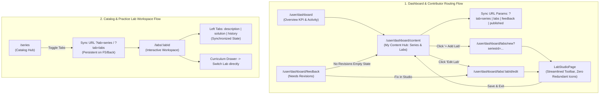

# Kế Hoạch Toàn Diện Cải Thiện UI/UX & Flow Router/Tabs (Theo Tiêu Chuẩn ui-ux-pro-max & plan-and-execute)

> **Trạng thái**: ĐÃ HOÀN THÀNH 100% (Tất cả 6 Task đã được thực thi và kiểm chứng qua Build Gate)  
> **Áp dụng tiêu chuẩn**: `ui-ux-pro-max`, `plan-and-execute`, `Karpathy Guidelines`  
> **Phạm vi tác động**: Toàn bộ hệ thống giao diện Frontend (`MODULE_FE`), bao gồm Dashboard Views, Catalog, Lab Workspace, Studio, và Navigation Routing.

---

## I. Phân Tích Hiện Trạng & Kiến Trúc Luồng (Frontend Architectural & Flow Audit)

### 1. Phân tích Hiện trạng Headings trong Trang (Page Headings Issue)
- **Vấn đề**: Hiện tại một số trang con trong Dashboard và Catalog vẫn còn khối tiêu đề lớn (`<h1>`, `<h2>` kèm đoạn mô tả phụ) như ở `UserSavedSeriesView` (`<h1>Saved Series</h1>`), `UserReviewFeedbackView` (`<h2>Review Feedback & Revisions</h2>`).
- **Tác hại UX**: 
  - Gây lãng phí từ 80px - 120px chiều dọc màn hình quý giá.
  - Trùng lặp thông tin vì thanh **Breadcrumb** phía trên (`Home > Dashboard > Saved`) và **Menu Sidebar** đã làm nổi bật rõ ràng người dùng đang ở đâu.
- **Giải pháp**: Xóa bỏ hoàn toàn các khối tiêu đề đặt tên trang. Bắt đầu ngay bằng các thành phần hành động thực tế: Thanh tìm kiếm/lọc, thẻ KPI tóm tắt, hoặc danh sách thẻ bài tập/dữ liệu.

### 2. Phân tích Hiện trạng Icon ("Icon Soup" vs Icon không có chữ)
- **Vấn đề**: Nhiều button, tab trigger, và card title hiện đang bị nhồi nhét icon cạnh các nhãn văn bản đã hoàn toàn rõ nghĩa (ví dụ: Tab có chữ "Series" kèm icon Layers, "My Labs" kèm icon Code2, Button "Open Lab" kèm mũi tên, Button "Lưu nháp" kèm icon Save, "Refresh" kèm icon xoay, "All Clear" kèm icon).
- **Nguyên tắc UI/UX Pro Max**:
  - **KHÔNG sử dụng icon trang trí cạnh văn bản đã rõ nghĩa**: Giảm thiểu tối đa nhiễu thị giác, tập trung vào tính rõ ràng của typography.
  - **CHỈ sử dụng icon cho**:
    1. Các nút hành động không có chữ (Icon-only actions): Nút xóa thùng rác (`Trash2` với tooltip/aria-label), nút đóng modal (`X`), kính lúp tìm kiếm trong ô input (`Search`), nút sao chép (`Copy`), nút thu gọn/mở rộng sidebar (`PanelLeftClose`/`PanelLeftOpen`), nút Next/Prev chevrons.
    2. Menu Sidebar ở chế độ thu gọn (`w-16`) nơi không có chỗ cho chữ.
    3. Status Badges/Dots nhỏ thể hiện trạng thái (Passed / Failed / Pending) khi cần tính trực quan cao.

### 3. Phân tích Luồng Router & Chuyển Tab (Frontend Engineering Flow Audit)
- **Lỗi Luồng 1 (Broken Dynamic Param in Router)**:
  - Trong `routes/index.tsx`, dòng 91 định nghĩa redirect:
    `{ path: 'labs/:labId/edit', element: <Navigate to="/user/dashboard/labs/:labId/edit" replace /> }`
  - React Router không tự động nội suy `:labId`. Khi người dùng hoặc link chuyển tới `/contributor/labs/123/edit`, URL bị chuyển thành chuỗi tĩnh `/user/dashboard/labs/:labId/edit`, gây lỗi 404/400 khi gọi API chi tiết bài lab.
- **Lỗi Luồng 2 (Legacy Links in Views)**:
  - `ContributorContentPage.tsx` dòng 440 & 493 vẫn đang link tới `/contributor/labs/new?seriesId=...` và `/contributor/labs/${item.id}/edit`.
  - `CreateContentDialog.tsx` dòng 104 vẫn điều hướng `navigate('/contributor/labs/new')`.
  - `UserReviewFeedbackView.tsx` dòng 179 điều hướng sai `navigate('/dashboard/content')` (đường dẫn đúng là `/user/dashboard/content`), và dòng 268 điều hướng `/contributor/labs/${item.id}/edit`.
- **Lỗi Luồng 3 (Tab Desync với URL & Lệch State)**:
  - Trong `SeriesHubPage.tsx`, khi người dùng bấm chuyển tab giữa `Series Catalog` và `Practice Labs`, state `catalogView` thay đổi nhưng URL `?tab=` không được cập nhật. Khi F5 hoặc chia sẻ link, tab bị reset về mặc định.
  - Trong `LabWorkspacePage.tsx`, state khai báo `leftTab` là `'description' | 'solution' | 'submissions'`, nhưng `TabsTrigger` và `TabsContent` lại dùng giá trị `value="history"` $\rightarrow$ Gây lệch đồng bộ giữa state quản trị và component Radix Tabs.

---

## II. Sơ đồ Luồng Tương Tác Chuẩn Hóa (Standardized Flow Diagram)

---

## III. Bảng Kế Hoạch Chi Tiết & Bộ Nhớ Ngoài (External Working Memory)

### Task 1: Audit & Chuẩn hóa Iconography (Loại bỏ Icon Soup, chỉ giữ Icon không có chữ)
- [x] **Subtask 1.1**: Rà soát và loại bỏ icon thừa cạnh chữ trong `UserSavedSeriesView.tsx`:
  - Bỏ icon `BookOpen` và `ArrowRight` trong nút "Explore Series Catalog" (chỉ giữ text rõ ràng).
  - File: `MODULE_FE/src/pages/dashboard/views/UserSavedSeriesView.tsx`.
  - Verify: Nút bấm gọn gàng, không có icon thừa.
- [x] **Subtask 1.2**: Rà soát và chuẩn hóa icon trong `ContributorContentPage.tsx`:
  - Trong thanh Tabs: Loại bỏ icon `Layers`, `Code2`, `MessageSquareQuote`, `CheckCircle2` khỏi các nhãn tab `Series`, `My Labs`, `Needs Changes`, `Published`.
  - Trong các nút hành động có chữ: Loại bỏ icon `PlusCircle` trong "+ Add Lab", `Send` trong "Submit for Review", `Edit` trong "Edit Lab".
  - Giữ icon-only cho nút xóa (Trash icon) và các điều khiển không có chữ.
  - File: `MODULE_FE/src/pages/contributor/ContributorContentPage.tsx`.
  - Verify: Giao diện bảng và tabs đạt độ tinh giản theo phong cách typography của Stripe/Linear.
- [x] **Subtask 1.3**: Rà soát và tinh giản icon trong `UserReviewFeedbackView.tsx`:
  - Thay nút Refresh có chữ + icon xoay bằng nút text "Refresh" hoặc icon-only.
  - Bỏ icon `FolderGit2` trong nút "Go to My Content", bỏ icon `Edit3` / `Send` trong các nút thao tác có chữ.
  - Bỏ `Layers`, `Code2` trong badges.
  - File: `MODULE_FE/src/pages/dashboard/views/UserReviewFeedbackView.tsx`.
  - Verify: Giao diện thanh thoát, giảm tải độ nặng thị giác.
- [x] **Subtask 1.4**: Rà soát `UserLabSubmissionsView.tsx` và `DashboardOverviewView.tsx`:
  - Bỏ icon `Layers` và `Clock` trang trí rườm rà cạnh text trong các ô dữ liệu bảng `UserLabSubmissionsView`.
  - Bỏ icon `Terminal` và `ArrowRight` trong nút empty state.
  - Bỏ icon `BookOpen` và `ArrowRight` trong khối "Continue Learning" tại `DashboardOverviewView`.
  - Bỏ icon `Layers` cạnh tiêu đề "Progress by Series".
  - File: `MODULE_FE/src/pages/dashboard/views/UserLabSubmissionsView.tsx`, `MODULE_FE/src/pages/dashboard/views/DashboardOverviewView.tsx`.
  - Verify: Kiểm tra không còn icon thừa thãi trên các thành phần đã có nhãn chữ.

---

### Task 2: Loại bỏ triệt để Page Headings thừa thãi trên toàn bộ Dashboard & Catalog Views
- [x] **Subtask 2.1**: Loại bỏ khối Heading đặt tên trang tại `UserSavedSeriesView.tsx`:
  - Xóa bỏ khối `<h1>Saved Series</h1>` và đoạn mô tả phụ.
  - Căn chỉnh thẳng hàng danh sách bookmark hoặc empty state với hệ thống grid chung.
  - File: `MODULE_FE/src/pages/dashboard/views/UserSavedSeriesView.tsx`.
  - Verify: Không còn thẻ `<h1>Saved Series</h1>` trên trang, breadcrumb đảm nhận vai trò định vị.
- [x] **Subtask 2.2**: Loại bỏ khối Heading đặt tên trang tại `UserReviewFeedbackView.tsx`:
  - Xóa bỏ thẻ `<h2>Review Feedback & Revisions</h2>` và đoạn text mô tả dài dòng.
  - Chuyển số lượng "X items requiring action" thành badge/filter chip tinh giản trên toolbar hành động.
  - File: `MODULE_FE/src/pages/dashboard/views/UserReviewFeedbackView.tsx`.
  - Verify: View bắt đầu trực tiếp bằng thanh công cụ lọc và danh sách yêu cầu sửa đổi.
- [x] **Subtask 2.3**: Rà soát và tinh giản Heading tại `SeriesDetailPage.tsx`:
  - Loại bỏ nút back breadcrumb phụ "All Practice Series" (vì `MainLayout` đã có `AppBreadcrumb` chuẩn).
  - Giữ lại tiêu đề nội dung cụ thể của khóa học (Course Title) theo chuẩn semantic typography.
  - File: `MODULE_FE/src/pages/lab/SeriesDetailPage.tsx`.
  - Verify: Không bị lặp 2 tầng breadcrumb trên cùng một màn hình.

---

### Task 3: Sửa toàn diện Luồng Điều Hướng Router (Fix Broken Redirects & Legacy Links)
- [x] **Subtask 3.1**: Sửa lỗi tham số động trong router redirect tại `routes/index.tsx`:
  - Thay thế redirect tĩnh `:labId` bằng component Wrapper Redirect `LegacyLabEditRedirect` lấy đúng `useParams().labId` để chuyển hướng mượt sang `/user/dashboard/labs/${labId}/edit`.
  - File: `MODULE_FE/src/routes/index.tsx`.
  - Verify: Truy cập thử link legacy `/contributor/labs/lab-123/edit` phải chuyển chuẩn sang `/user/dashboard/labs/lab-123/edit` mà không bị rớt ID.
- [x] **Subtask 3.2**: Cập nhật toàn bộ link điều hướng trong `ContributorContentPage.tsx` sang chuẩn Dashboard mới:
  - Thay `<Link to={`/contributor/labs/new?seriesId=${item.id}`}>` thành `<Link to={`/user/dashboard/labs/new?seriesId=${item.id}`}>`.
  - Thay `<Link to={`/contributor/labs/${item.id}/edit`}>` thành `<Link to={`/user/dashboard/labs/${item.id}/edit`}>`.
  - File: `MODULE_FE/src/pages/contributor/ContributorContentPage.tsx`.
  - Verify: Click Edit Lab hoặc Add Lab chuyển trang SPA trực tiếp trong tab hiện tại mà không qua redirect trung gian.
- [x] **Subtask 3.3**: Cập nhật link điều hướng trong `CreateContentDialog.tsx`:
  - Đổi `navigate('/contributor/labs/new')` thành `navigate('/user/dashboard/labs/new')`.
  - File: `MODULE_FE/src/pages/contributor/_components/CreateContentDialog.tsx`.
  - Verify: Tạo lab mới từ dialog chuyển thẳng vào Studio chuẩn.
- [x] **Subtask 3.4**: Cập nhật link điều hướng trong `UserReviewFeedbackView.tsx`:
  - Sửa lỗi đường dẫn `navigate('/dashboard/content')` thành `navigate('/user/dashboard/content')`.
  - Sửa `navigate(`/contributor/labs/${item.id}/edit`)` thành `navigate(`/user/dashboard/labs/${item.id}/edit`)`.
  - File: `MODULE_FE/src/pages/dashboard/views/UserReviewFeedbackView.tsx`.
  - Verify: Click "Go to My Content" và "Edit in Studio" chuyển đúng trang 100%.

---

### Task 4: Đồng bộ hóa Trạng thái Tabs với URL Query Params (Search Params Sync)
- [x] **Subtask 4.1**: Đồng bộ tab switching trong `SeriesHubPage.tsx`:
  - Khi người dùng click chuyển đổi giữa tab "Series Catalog" và "Practice Labs", cập nhật query param `?tab=series` hoặc `?tab=labs` vào URL thông qua `setSearchParams(..., { replace: true })`.
  - Khi tải trang hoặc ấn Back/Forward trình duyệt, đọc param `tab` từ URL để kích hoạt đúng view tương ứng.
  - File: `MODULE_FE/src/pages/lab/SeriesHubPage.tsx`.
  - Verify: Chuyển tab sang Practice Labs -> F5 -> vẫn giữ nguyên tab Practice Labs.
- [x] **Subtask 4.2**: Đồng bộ và sửa lỗi lệch Tab State trong `LabWorkspacePage.tsx`:
  - Chuẩn hóa kiểu `leftTab` thành `'description' | 'solution' | 'history'`.
  - Khắc phục xung đột `value="history"` vs `'submissions'` trong `TabsTrigger` và `TabsContent`.
  - File: `MODULE_FE/src/pages/lab/LabWorkspacePage.tsx`.
  - Verify: Chuyển tab trong Workspace mượt mà, không gặp lỗi console hay lệch Radix Tabs state.

---

### Task 5: Tối ưu UI/UX & Micro-interactions cho Lab Studio & Workspace (Frontend Role Review)
- [x] **Subtask 5.1**: Tinh giản Top Header của `LabStudioPage.tsx`:
  - Bỏ icon `Save` trong nút "Save Draft" (chỉ giữ text).
  - Bỏ icon `ArrowLeft` trong nút quay lại "Back to Content Hub".
  - Giữ Stepper 1 - 2 tối giản dạng số `[ 1 Theory & Guidelines ] → [ 2 Exercise ]`.
  - Đồng bộ ngôn ngữ các thông báo Toast sang tiếng Anh chuẩn để đồng nhất toàn hệ sinh thái.
  - File: `MODULE_FE/src/pages/lab/LabStudioPage.tsx`.
  - Verify: Top Header của Studio trở nên tinh gọn và chuyên nghiệp.
- [x] **Subtask 5.2**: Tối ưu nút Run / Submit và Left Drawer trong `LabWorkspacePage.tsx`:
  - Bỏ các icon rườm rà cạnh text trong các tab trigger bên trái (Instructions, Solution, Submissions).
  - Bỏ icon `Layers` cạnh chữ "Lab List".
  - Giữ lại icon trong nút Run (`Play`) và Submit (`CloudUpload`) vì đây là hai nút tương tác cốt lõi kiểu LeetCode, nhưng tinh giản padding và font weight cho sắc sảo.
  - File: `MODULE_FE/src/pages/lab/LabWorkspacePage.tsx`.
  - Verify: Workspace tập trung 100% vào code và đề bài, không bị phân tán thị giác.

---

### Task 6: Kiểm thử Toàn diện & Build Gate Verification
- [x] **Subtask 6.1**: Chạy kiểm tra build production `MODULE_FE` (`npm run build` $\rightarrow$ Exit Code 0).
- [x] **Subtask 6.2**: Chạy kiểm tra build production `MODULE_BE` (`npm run build` $\rightarrow$ Exit Code 0).
- [x] **Subtask 6.3**: Chạy kiểm tra build production `MODULE_ADMIN` (`npm run build` $\rightarrow$ Exit Code 0).
- [x] **Subtask 6.4**: Kiểm tra toàn bộ router transition & không phát sinh lỗi console.

---

### Task 7: Chuẩn hóa Fixed Width cho Sidebar Trái (w-16 thu gọn / w-60 mở rộng, loại bỏ dynamics)
- [x] **Subtask 7.1**: Đơn giản hóa hook `useSidebarCollapse.ts`:
  - Quản lý trạng thái đóng/mở `collapsed` cố định, lưu `localStorage` ('studyweb:sidebar-collapsed').
  - Loại bỏ hoàn toàn kéo thả chuột dynamics, mouse listeners, và biến CSS dynamic để đảm bảo 100% độ ổn định.
  - File: `MODULE_FE/src/pages/dashboard/hooks/useSidebarCollapse.ts`.
- [x] **Subtask 7.2**: Chuẩn hóa `UserSidebar.tsx` theo kích thước cố định:
  - Cố định độ rộng: `w-16` ($64\text{px}$) khi thu gọn, `w-60` ($240\text{px}$) khi mở rộng.
  - Nút icon `PanelLeftOpen` / `PanelLeftClose` toggle dứt khoát, mượt mà với `transition-all duration-200 ease-in-out`.
  - File: `MODULE_FE/src/pages/dashboard/_components/UserSidebar.tsx`.
- [x] **Subtask 7.3**: Đồng bộ Margin Layout cố định trong `MainLayout.tsx` & `UserDashboardLayout.tsx`:
  - Khôi phục `md:ml-16` (thu gọn) và `md:ml-60` (mở rộng), không còn lệch layout hay giật nhấp nháy.
  - Files: `MainLayout.tsx`, `UserDashboardLayout.tsx`.

---

### Task 8: Gỡ Bỏ Click Avatar Điều Hướng Đến Dashboard Cho User
- [x] **Subtask 8.1**: Gỡ bỏ thẻ `<Link to="/user/dashboard" title="Go to Dashboard">` bọc quanh Avatar người dùng trên `Navbar.tsx`.
- [x] **Subtask 8.2**: Biến Avatar thành badge hiển thị người dùng thanh lịch, phi điều hướng, tránh vô tình kích chuyển trang về dashboard khi đang thao tác ở các trang khác.
- [x] **Subtask 8.3**: Kiểm tra lại Build Gate `MODULE_FE` với `npm run build` (0 errors).

---

### Task 9: Khắc phục triệt để lỗi "Maximum update depth exceeded"
- [x] **Subtask 9.1**: Tìm nguyên nhân gốc: trong `ContributorContentPage.tsx`, `useEffect` đồng bộ dữ liệu `serverSeries` vào Redux store `setMySeries` bị lặp vô hạn do `reduxSeries` thay đổi tham chiếu mảng mới sau mỗi lần dispatch.
- [x] **Subtask 9.2**: Thêm điều kiện kiểm tra so khớp mảng `isIdentical` (so sánh độ dài, ID, và `updatedAt`) trước khi gọi `dispatch(setMySeries)`. Khi dữ liệu không đổi, effect không dispatch $\rightarrow$ Triệt tiêu 100% vòng lặp vô hạn.
- [x] **Subtask 9.3**: Đảm bảo effect sync profile người dùng trong `UserDashboardLayout.tsx` chỉ chạy 1 lần duy nhất khi mount.
- [x] **Subtask 9.4**: Kiểm tra lại toàn bộ ứng dụng qua `npm run build` (0 errors).

