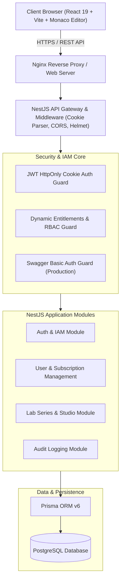

<div align="center">

# 🎓 study-web (project_education)
### Enterprise Hands-on IT Lab Platform & Educational Engineering Ecosystem

[](https://www.typescriptlang.org/)
[](https://nestjs.com/)
[](https://react.dev/)
[](https://tailwindcss.com/)
[](https://www.prisma.io/)
[](https://www.docker.com/)
[](https://github.com/aquasecurity/trivy)

<p align="center">
  <b>Nền tảng thực hành Lab IT qua dự án mẫu thực tế</b> — Giải quyết bài toán "học đi đôi với hành" bằng các chuỗi bài lab thực chiến tinh gọn (15–30 phút), tích hợp hệ thống phân quyền động doanh nghiệp (Dynamic IAM & Entitlements) và kiến trúc Full-Stack Production-Ready.
</p>

[Khám phá Kiến trúc](#-system-architecture) • [Tính năng Nổi bật](#-key-engineering-highlights) • [Công nghệ](#-technology-stack) • [Khởi chạy Nhanh](#-quick-start) • [Tài liệu Chi tiết](#-documentation-index)

---

</div>

## 📌 Tổng quan Dự án (Project Overview)

`study-web` được xây dựng để thay thế mô hình học lý thuyết dài dòng bằng **Chuỗi bài Lab thực hành ngắn hạn (Hands-on Lab Series)** xoay quanh các dự án mẫu thực tế.

- **Learn by Doing**: Người học tiếp cận bài lab, mở codebase dự án mẫu, trực tiếp viết mã / bắt bug / viết test / cấu hình Docker CI/CD và đối chiếu kết quả ngay lập tức.
- **Enterprise Governance**: Tích hợp quy trình biên tập nội dung nhiều vòng (**Content Lifecycle Studio**) dành cho Contributor và Admin với phân quyền đa tầng linh hoạt (**Dynamic Entitlements & Feature Overrides**).
- **Production-Grade Reliability**: Kiến trúc phân tầng tách biệt Frontend (Vite React) và Backend (NestJS Monolith), bảo vệ Swagger tài liệu API qua HTTP Basic Auth và quét bảo mật container tự động với Trivy.

---

## 🏛 Kiến trúc Hệ thống (System Architecture)

Hệ thống được thiết kế theo mô hình Clean Modular Monolith kết hợp kiến trúc phân quyền động (Dynamic Entitlements Engine):



---

## ✨ Điểm nhấn Kỹ thuật (Key Engineering Highlights)

### 1. Phân quyền Động Đa cấp (Dynamic IAM & Feature Overrides)
- Hệ thống hỗ trợ 4 vai trò chính: `Admin`, `Contributor`, `UserPro`, và `User`.
- Cung cấp cơ chế **User Feature Override** cho phép can thiệp bật/tắt quyền truy cập tính năng (Entitlement) đến từng người dùng mà không cần thay đổi Role toàn cục.
- Audit Logging tự động ghi nhận mọi hành vi thay đổi quyền hạn và trạng thái nội dung để phục vụ đối soát an ninh.

### 2. Quy trình Biên tập Nội dung Toàn diện (Content Lifecycle Studio)
- Hỗ trợ workflow chuẩn State Machine cho các Series bài Lab:  
  `Draft` ➔ `Submitted` ➔ `In Review` ➔ `Changes Requested` ➔ `Approved` ➔ `Published` ➔ `Archived`.
- Phân định rõ ràng giữa người tạo đề (Contributor) và người phê duyệt xuất bản (Admin).

### 3. Bảo mật Cấp Doanh nghiệp (Enterprise-Grade Security)
- **Token Security**: Lưu trữ Refresh Token qua `HttpOnly`, `SameSite` Cookies để phòng chống tấn công XSS và trộm cắp token.
- **Tài liệu API được bảo vệ**: Swagger Documentation (`/api/docs`) tự động kích hoạt HTTP Basic Auth ở môi trường Production.
- **Container Hardening**: Dockerfile tối ưu kích thước qua Multi-Stage Build, quét lỗ hổng thư viện và OS qua Trivy Security Scanner.

### 4. Trải nghiệm Học tập Trực quan (Interactive Lab Workspace)
- Tích hợp **Monaco Editor** trực tiếp trên giao diện Frontend giúp học viên đọc mã nguồn, sửa code mẫu và nộp bài lab không cần rời trình duyệt.

---

## 🛠 Công nghệ Sử dụng (Technology Stack)

| Lớp (Layer) | Công nghệ | Mục đích sử dụng |
|:---|:---|:---|
| **Frontend** | React 19, TypeScript, Vite 8 | Single Page Application tốc độ cao, type-safety tuyệt đối |
| **Giao diện & UI** | Tailwind CSS v4, Radix UI, Shadcn | UI Component tinh gọn, chuẩn Accessibility (A11y) |
| **Code Editor** | `@monaco-editor/react` | Môi trường viết mã code in-browser cho các bài lab |
| **State & Data** | TanStack React Query v5, Redux Toolkit | Server state cache, synchronization, client state |
| **Backend API** | NestJS 12, Express, TypeScript | Modular Monolith kiến trúc sạch, Dependency Injection |
| **ORM & Database** | Prisma ORM 6, PostgreSQL | Type-safe database queries, schema migrations, relations |
| **Bảo mật & Auth** | Passport.js, JWT, Bcrypt, Basic Auth | Xác thực bảo vệ endpoint và tài liệu Swagger |
| **DevOps & CI/CD** | Docker, Docker Compose, GitHub Actions, Trivy | Đóng gói container, kiểm thử tự động, quét bảo mật CVE |

---

## 🚀 Khởi chạy Nhanh (Quick Start)

### Yêu cầu Tiên quyết (Prerequisites)
- [Node.js](https://nodejs.org/) (khuyến nghị phiên bản v20 trở lên)
- [Docker](https://www.docker.com/) & Docker Compose
- Cơ sở dữ liệu [PostgreSQL](https://www.postgresql.org/) (hoặc chạy qua Docker container)

### 1. Khởi động Backend (`MODULE_BE`)
```bash
# Di chuyển vào module backend
cd MODULE_BE

# Cài đặt dependencies
npm install

# Cấu hình biến môi trường
cp .env.example .env
# (Chỉnh sửa DATABASE_URL, JWT_SECRET, SWAGGER_USER, SWAGGER_PASSWORD trong file .env)

# Đồng bộ Prisma schema vào cơ sở dữ liệu
npx prisma db push

# Khởi chạy server ở chế độ dev
npm run start:dev
```
> Backend API chạy mặc định tại: `http://localhost:3000`  
> Tài liệu Swagger API tại: `http://localhost:3000/api/docs`

### 2. Khởi động Frontend (`MODULE_FE`)
```bash
# Mở một terminal mới và di chuyển vào module frontend
cd MODULE_FE

# Cài đặt dependencies
npm install

# Khởi chạy Vite Dev Server
npm run dev
```
> Ứng dụng Frontend chạy mặc định tại: `http://localhost:5173`

---

## 📚 Mục lục Tài liệu Kiến trúc (Documentation Index)

Toàn bộ tài liệu phân tích, kiến trúc và lộ trình phát triển được lưu trữ có phiên bản dưới dạng **Docs-as-Code** trong thư mục [`docs/`](./docs):

- 📄 [`docs/01-proposal.md`](./docs/01-proposal.md): Đề xuất dự án, tầm nhìn sản phẩm và triết lý Series bài Lab IT ngắn hạn.
- 📋 [`docs/03-product-backlog.md`](./docs/03-product-backlog.md): Danh mục Product Backlog, phân rã User Stories và tiêu chí chấp nhận.
- 🗄 [`docs/05-database.md`](./docs/05-database.md): Thiết kế thực thể dữ liệu (ERD), quan hệ bảng và vòng đời bản ghi.
- 🔐 [`docs/07-dynamic-authorization-and-entitlements.md`](./docs/07-dynamic-authorization-and-entitlements.md): Đặc tả phân quyền động, cơ chế Guard và Override quyền hạn.
- 🛡 [`docs/SYSTEM_VERIFICATION_AND_ERROR_REPORT.md`](./docs/SYSTEM_VERIFICATION_AND_ERROR_REPORT.md): Báo cáo nghiệm thu hệ thống, kiểm thử và xử lý rủi ro bảo mật.

---

## 👨‍💻 Tác giả & Kiến trúc sư (Lead Architect)

- **Nguyễn Khánh Duy** — *Fullstack Lead & Software Architect*
- GitHub: [@NguyenKhanhDuy2703](https://github.com/NguyenKhanhDuy2703)
- LinkedIn: [Nguyễn Khánh Duy](https://www.linkedin.com/in/nguy%E1%BB%85n-kh%C3%A1nh-duy-4477a2355/)
- Email: [nguyenkhanhduy270304@gmail.com](mailto:nguyenkhanhduy270304@gmail.com)

---
<div align="center">
  <sub>Được phát triển với tư duy kỹ thuật hệ thống chuẩn mực và tinh thần liên tục cải tiến.</sub>
</div>
