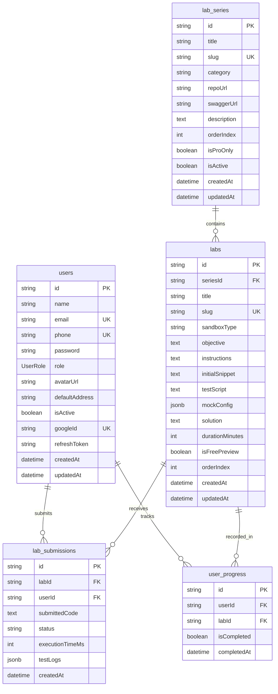

# Thiết kế Cơ sở Dữ liệu Hệ thống study-web (Database Design)

## 1. Thông tin tài liệu (Document Information)

| Thuộc tính | Chi tiết |
|---|---|
| **Tên tài liệu** | Thiết kế Cơ sở Dữ liệu Hệ thống study-web — Mô hình Lab Series & Billing |
| **Version** | v1.3 |
| **Người làm** | Nguyen Khanh Duy (Backend Lead & Database Architect) |
| **Phạm vi (Scope)** | Schema CSDL PostgreSQL, lược đồ ánh xạ Prisma ORM cho Core Platform, Lab Series, Dynamic Entitlements, Billing/Upgrade và In-App Notifications |
| **Thời gian** | 2026-10-26 |
| **Tham chiếu từ** | `MODULE_BE/prisma/schema.prisma` và migration `20261026120000_add_billing_notifications_jobs` |

---

## 2. Nội dung chính (Content)

### 2.1. TL;DR (Tóm tắt cốt lõi)
- **Hệ quản trị CSDL**: PostgreSQL 16+.
- **ORM**: Prisma ORM (`@prisma/client` v6+).
- **Mô hình kiến trúc**: Hoàn thiện toàn diện 27 model, bao phủ Core Platform, Lab Series, Phân quyền động (IAM Groups & Entitlements), Luồng nâng cấp Pro chuyển khoản thủ công (Billing/Upgrade), và Hệ thống Thông báo nội bộ (In-app Notifications & Distributed Leases).
- **Tổng số bảng**: 27 bảng (Bao gồm 21 bảng core baseline + 6 bảng mở rộng billing & notifications).

### 2.2. Sơ đồ Thực thể Mối quan hệ (ERD - Entity Relationship Diagram)

### 2.3. Đặc tả Chi tiết các Bảng Dữ liệu (Data Dictionary)

#### 1. Bảng `users` (Quản lý Người dùng & Xác thực — Giữ nguyên mã nguồn hiện tại)
*Mã nguồn thực tế tại `MODULE_BE/prisma/schema.prisma`.*

| Tên Cột | Kiểu Dữ Liệu | Ràng Buộc | Mô Tả |
|---|---|---|---|
| `id` | `UUID` | PK, Default UUID | Định danh duy nhất |
| `name` | `VARCHAR(255)` | NOT NULL | Họ và tên người dùng |
| `email` | `VARCHAR(255)` | UNIQUE, NULLABLE | Email cá nhân |
| `phone` | `VARCHAR(20)` | UNIQUE, NOT NULL | Số điện thoại dùng đăng nhập |
| `password` | `VARCHAR(255)` | NULLABLE | Mật khẩu băm Bcrypt |
| `role` | `ENUM(UserRole)` | NOT NULL, DEFAULT `'user'` | Vai trò: `admin`, `user`, `userPro` |
| `avatarUrl` | `VARCHAR(500)` | NULLABLE | Đường dẫn ảnh đại diện |
| `defaultAddress` | `TEXT` | NULLABLE | Địa chỉ mặc định |
| `isActive` | `BOOLEAN` | NOT NULL, DEFAULT `true` | Trạng thái tài khoản |
| `googleId` | `VARCHAR(255)` | UNIQUE, NULLABLE | ID Google OAuth |
| `refreshToken` | `TEXT` | NULLABLE | Token làm mới phiên đăng nhập |
| `createdAt` / `updatedAt` | `TIMESTAMP` | NOT NULL | Dấu vết thời gian |

#### 2. Bảng `lab_series` (Các Series Bài Lab Ngắn)

| Tên Cột | Kiểu Dữ Liệu | Ràng Buộc | Mô Tả |
|---|---|---|---|
| `id` | `UUID` | PK, Default UUID | Khóa chính Series |
| `title` | `VARCHAR(255)` | NOT NULL | Tên series (vd: "Lab Bắt Lỗi & Test API") |
| `slug` | `VARCHAR(255)` | UNIQUE, NOT NULL | Slug URL series |
| `category` | `VARCHAR(50)` | NOT NULL | Chuyên môn: `'tester'`, `'backend'`, `'devops'` |
| `repoUrl` | `VARCHAR(500)` | NULLABLE | Link GitHub repository của app mẫu (nếu có) |
| `swaggerUrl` | `VARCHAR(500)` | NULLABLE | Link Swagger UI tương tác trực tiếp (nếu có) |
| `description` | `TEXT` | NOT NULL | Mô tả mục tiêu chuỗi bài lab |
| `orderIndex` | `INTEGER` | NOT NULL, DEFAULT 0 | Thứ tự hiển thị |
| `isProOnly` | `BOOLEAN` | NOT NULL, DEFAULT `false` | Cờ phân quyền: chỉ tài khoản `userPro` được xem |
| `isActive` | `BOOLEAN` | NOT NULL, DEFAULT `true` | Bật/tắt hiển thị |
| `createdAt` / `updatedAt` | `TIMESTAMP` | NOT NULL | Dấu vết thời gian |

#### 3. Bảng `labs` (Chi tiết Bài Lab Thực Hành)

| Tên Cột | Kiểu Dữ Liệu | Ràng Buộc | Mô Tả |
|---|---|---|---|
| `id` | `UUID` | PK, Default UUID | Khóa chính bài lab |
| `seriesId` | `UUID` | FK -> `lab_series.id`, ON DELETE CASCADE | Thuộc series nào |
| `title` | `VARCHAR(255)` | NOT NULL | Tên bài lab (vd: "Thiết kế Test Case màn Login") |
| `slug` | `VARCHAR(255)` | UNIQUE, NOT NULL | Slug URL bài lab |
| `objective` | `TEXT` | NOT NULL | Mục tiêu cụ thể đạt được sau bài lab |
| `instructions` | `TEXT` | NOT NULL | Hướng dẫn từng bước làm lab (định dạng Markdown) |
| `initialSnippet` | `TEXT` | NULLABLE | Code mẫu / template sẵn để học viên bắt đầu |
| `solution` | `TEXT` | NULLABLE | Lời giải / đáp án chuẩn (ẩn với user thường nếu lab là Pro) |
| `durationMinutes` | `INTEGER` | NOT NULL, DEFAULT 20 | Thời lượng ước tính hoàn thành (phút) |
| `isFreePreview` | `BOOLEAN` | NOT NULL, DEFAULT `false` | Cho phép làm thử miễn phí hay không |
| `orderIndex` | `INTEGER` | NOT NULL, DEFAULT 0 | Thứ tự bài lab trong series |
| `createdAt` / `updatedAt` | `TIMESTAMP` | NOT NULL | Dấu vết thời gian |

#### 4. Bảng `lab_submissions` (Kết Quả Nộp Bài Lab)

| Tên Cột | Kiểu Dữ Liệu | Ràng Buộc | Mô Tả |
|---|---|---|---|
| `id` | `UUID` | PK, Default UUID | Khóa chính lượt nộp |
| `labId` | `UUID` | FK -> `labs.id`, ON DELETE CASCADE | Nộp cho bài lab nào |
| `userId` | `UUID` | FK -> `users.id`, ON DELETE CASCADE | Người học nộp bài |
| `submissionContent`| `TEXT` | NOT NULL | Nội dung nộp (Code giải, link file test case, kết quả JSON) |
| `status` | `VARCHAR(50)` | NOT NULL, DEFAULT `'pending'` | Trạng thái: `'pending'`, `'passed'`, `'failed'` |
| `score` | `INTEGER` | NULLABLE | Điểm số đạt được (0–100) |
| `feedback` | `TEXT` | NULLABLE | Nhận xét tự động hoặc giáo viên ghi chú |
| `createdAt` | `TIMESTAMP` | NOT NULL, DEFAULT `NOW()` | Thời gian nộp |

#### 5. Bảng `user_progress` (Ghi Nhận Tiến Độ Hoàn Thành)

| Tên Cột | Kiểu Dữ Liệu | Ràng Buộc | Mô Tả |
|---|---|---|---|
| `id` | `UUID` | PK, Default UUID | Khóa chính bản ghi tiến độ |
| `userId` | `UUID` | FK -> `users.id`, ON DELETE CASCADE | Học viên |
| `labId` | `UUID` | FK -> `labs.id`, ON DELETE CASCADE | Bài lab đã hoàn thành |
| `isCompleted` | `BOOLEAN` | NOT NULL, DEFAULT `false` | Trạng thái hoàn thành |
| `completedAt` | `TIMESTAMP` | NULLABLE | Thời điểm hoàn thành |

*Khóa kết hợp duy nhất (Unique Composite Key)*: `@@unique([userId, labId])`.

---

### 2.4. Các Bảng Mở Rộng: Monetization & Notifications (Migration `20261026120000_add_billing_notifications_jobs`)

#### 6. Bảng `upgrade_requests` (Yêu Cầu Nâng Cấp Pro Chuyển Khoản Thủ Công)

| Tên Cột | Kiểu Dữ Liệu | Ràng Buộc | Mô Tả |
|---|---|---|---|
| `id` | `UUID` | PK, Default UUID | Định danh yêu cầu nâng cấp |
| `userId` | `UUID` | FK -> `users.id`, ON DELETE CASCADE | Học viên tạo yêu cầu |
| `planId` | `UUID` | FK -> `subscription_plans.id`, ON DELETE RESTRICT | Gói đăng ký chọn mua |
| `status` | `ENUM(UpgradeRequestStatus)` | NOT NULL, DEFAULT `AWAITING_PAYMENT` | `AWAITING_PAYMENT`, `PENDING_REVIEW`, `APPROVED`, `REJECTED`, `CANCELLED` |
| `transferReference` | `VARCHAR(50)` | UNIQUE, NOT NULL | Mã nội dung chuyển khoản duy nhất (vd: `PRO-ABCD1234EF`) |
| `priceSnapshot` | `DECIMAL(10,2)` | NOT NULL | Ảnh chụp giá gói tại thời điểm tạo yêu cầu (VND) |
| `currency` | `VARCHAR(10)` | NOT NULL, DEFAULT `'VND'` | Đơn vị tiền tệ |
| `period` | `VARCHAR(20)` | NOT NULL, DEFAULT `'MONTHLY'` | Chu kỳ đăng ký |
| `bankSnapshot` | `JSONB` | NOT NULL | Ảnh chụp thông tin tài khoản thụ hưởng tại thời điểm tạo |
| `paymentReference` | `VARCHAR(255)` | NULLABLE | Mã giao dịch ngân hàng do học viên cung cấp khi xác nhận |
| `paymentSubmittedAt` | `TIMESTAMP` | NULLABLE | Thời điểm học viên bấm xác nhận đã chuyển khoản |
| `reviewedById` | `UUID` | FK -> `users.id`, NULLABLE, ON DELETE SET NULL | Quản trị viên duyệt/từ chối |
| `reviewedAt` | `TIMESTAMP` | NULLABLE | Thời điểm duyệt/từ chối |
| `reviewReason` | `TEXT` | NULLABLE | Lý do từ chối (bắt buộc khi REJECTED, hiển thị cho học viên) |
| `verifiedAmount` | `DECIMAL(10,2)` | NULLABLE | Số tiền thực nhận trên sao kê ngân hàng do Admin đối soát |
| `verifiedBankReference` | `VARCHAR(255)` | UNIQUE, NULLABLE | Mã giao dịch đối soát ngân hàng duy nhất (chống duyệt trùng) |
| `subscriptionId` | `UUID` | FK -> `user_subscriptions.id`, NULLABLE, ON DELETE SET NULL | Bản ghi đăng ký được kích hoạt/gia hạn |
| `createdAt` / `updatedAt` | `TIMESTAMP` | NOT NULL | Dấu vết thời gian |

#### 7. Bảng `billing_settings` (Cấu Hình Tài Khoản Nhận Chuyển Khoản & Tiếp Nhận Đơn)

| Tên Cột | Kiểu Dữ Liệu | Ràng Buộc | Mô Tả |
|---|---|---|---|
| `id` | `VARCHAR(50)` | PK, DEFAULT `'default'` | Khóa chính cấu hình đơn bản ghi |
| `bankName` | `VARCHAR(255)` | NOT NULL, DEFAULT `''` | Tên ngân hàng thụ hưởng (vd: Vietcombank, MB Bank) |
| `bankCode` | `VARCHAR(50)` | NOT NULL, DEFAULT `''` | Mã định danh ngân hàng (vd: VCB, MB) |
| `accountNumber` | `VARCHAR(100)` | NOT NULL, DEFAULT `''` | Số tài khoản nhận tiền |
| `accountHolder` | `VARCHAR(255)` | NOT NULL, DEFAULT `''` | Tên chủ tài khoản thụ hưởng |
| `instructions` | `TEXT` | NULLABLE | Hướng dẫn chuyển khoản hiển thị cho học viên |
| `isIntakeEnabled` | `BOOLEAN` | NOT NULL, DEFAULT `false` | Master toggle bật/tắt tiếp nhận yêu cầu nâng cấp mới |
| `updatedById` | `UUID` | NULLABLE | Admin cập nhật cấu hình gần nhất |
| `createdAt` / `updatedAt` | `TIMESTAMP` | NOT NULL | Dấu vết thời gian |

#### 8. Bảng `notifications` (Hộp Thư Thông Báo Người Dùng In-App)

| Tên Cột | Kiểu Dữ Liệu | Ràng Buộc | Mô Tả |
|---|---|---|---|
| `id` | `UUID` | PK, Default UUID | Định danh thông báo |
| `userId` | `UUID` | FK -> `users.id`, ON DELETE CASCADE | Người nhận thông báo |
| `type` | `ENUM(NotificationType)` | NOT NULL | Loại sự kiện (nâng cấp, hết hạn, duyệt bài, thông báo chung) |
| `title` | `VARCHAR(255)` | NOT NULL | Tiêu đề thông báo |
| `body` | `TEXT` | NOT NULL | Nội dung chi tiết |
| `actionPath` | `VARCHAR(500)` | NULLABLE | Đường dẫn nội bộ để điều hướng khi click |
| `eventKey` | `VARCHAR(255)` | UNIQUE, NULLABLE | Khóa deduplication duy nhất (chống gửi trùng sự kiện) |
| `readAt` | `TIMESTAMP` | NULLABLE | Thời điểm đánh dấu đã đọc (`null` = chưa đọc) |
| `createdAt` / `updatedAt` | `TIMESTAMP` | NOT NULL | Dấu vết thời gian |

#### 9. Bảng `announcements` (Thông Báo Phát Sóng Toàn Hệ Thống Từ Admin)

| Tên Cột | Kiểu Dữ Liệu | Ràng Buộc | Mô Tả |
|---|---|---|---|
| `id` | `UUID` | PK, Default UUID | Định danh thông báo phát sóng |
| `title` | `VARCHAR(255)` | NOT NULL | Tiêu đề phát sóng |
| `body` | `TEXT` | NOT NULL | Nội dung Markdown/Plaintext |
| `actionPath` | `VARCHAR(500)` | NULLABLE | Đường dẫn điều hướng nội bộ |
| `targetAudience` | `VARCHAR(50)` | NOT NULL, DEFAULT `'ALL'` | Đối tượng nhận: `'ALL'`, `'user'`, `'userPro'` |
| `totalRecipients` | `INTEGER` | NOT NULL, DEFAULT 0 | Tổng số người nhận dự kiến |
| `processedRecipients` | `INTEGER` | NOT NULL, DEFAULT 0 | Số người đã được gửi thông báo |
| `status` | `ENUM(AnnouncementStatus)` | NOT NULL, DEFAULT `PENDING` | `PENDING`, `PROCESSING`, `COMPLETED`, `FAILED` |
| `createdById` | `UUID` | FK -> `users.id`, ON DELETE RESTRICT | Admin tạo thông báo |
| `createdAt` / `updatedAt` | `TIMESTAMP` | NOT NULL | Dấu vết thời gian |

#### 10. Bảng `announcement_recipients` (Bản Ghi Nhận Phát Sóng Từng Học Viên)

| Tên Cột | Kiểu Dữ Liệu | Ràng Buộc | Mô Tả |
|---|---|---|---|
| `id` | `UUID` | PK, Default UUID | Định danh bản ghi nhận |
| `announcementId` | `UUID` | FK -> `announcements.id`, ON DELETE CASCADE | Khóa ngoại chiến dịch phát sóng |
| `userId` | `UUID` | FK -> `users.id`, ON DELETE CASCADE | Học viên nhận |
| `notificationId` | `UUID` | NULLABLE | ID bản ghi notification tương ứng |
| `deliveredAt` | `TIMESTAMP` | NULLABLE | Thời điểm phát thông báo thành công |
| `createdAt` | `TIMESTAMP` | NOT NULL, DEFAULT `NOW()` | Dấu vết thời gian |

*Khóa kết hợp duy nhất (Unique Composite Key)*: `@@unique([announcementId, userId])` đảm bảo xử lý batch có thể retry mà không gửi trùng.

#### 11. Bảng `scheduled_job_leases` (Khóa Phân Tán Cho Background Workers)

| Tên Cột | Kiểu Dữ Liệu | Ràng Buộc | Mô Tả |
|---|---|---|---|
| `jobName` | `VARCHAR(100)` | PK | Tên tiến trình (vd: `'billing:membership-expiry'`, `'announcements:batch-delivery'`) |
| `lockedBy` | `VARCHAR(255)` | NOT NULL | Định danh instance/worker đang giữ khóa |
| `lockedAt` | `TIMESTAMP` | NOT NULL | Thời điểm nhận khóa |
| `expiresAt` | `TIMESTAMP` | NOT NULL | Thời điểm khóa hết hạn (tự giải phóng nếu worker crash) |
| `lastRunAt` | `TIMESTAMP` | NULLABLE | Thời điểm chạy thành công gần nhất |
| `lastResult` | `JSONB` | NULLABLE | Kết quả thực thi gần nhất (số bản ghi xử lý, lỗi nếu có) |
| `createdAt` / `updatedAt` | `TIMESTAMP` | NOT NULL | Dấu vết thời gian |

---

### 2.5. Đánh Chỉ mục & Tối ưu Hiệu năng (Indexing)
1. `users(email)` & `users(phone)`: Unique Index phục vụ đăng nhập tức thời.
2. `lab_series(slug, category)`: Index tra cứu danh sách series theo chuyên môn.
3. `labs(seriesId, orderIndex)`: Composite Index lấy bài lab theo đúng thứ tự.
4. `learning_unit_progress(userId, status)`: Tra cứu tiến độ học tập và kiểm tra completion gate trước khi mở reference solution.
5. `upgrade_requests(userId, status)` & `upgrade_requests(status, createdAt)`: Tra cứu nhanh yêu cầu nâng cấp theo người dùng và hàng đợi duyệt của Admin.
6. `upgrade_requests(transferReference)` & `upgrade_requests(verifiedBankReference)`: Unique Index chống gian lận và chống duyệt trùng giao dịch ngân hàng.
7. `notifications(userId, readAt)` & `notifications(userId, createdAt)`: Tối ưu tải hộp thư và đếm nhanh unread count.
8. `notifications(eventKey)`: Unique Index đảm bảo deduplication tuyệt đối của transactional business events.
9. `announcement_recipients(announcementId, deliveredAt)`: Giúp batch worker tiếp tục xử lý các bản ghi chưa gửi sau khi restart.

### 2.6. Lịch sử Migration (Prisma Migrations)
1. `20261023153000_learning_unit_pattern_redesign`: Redesign learning unit pattern, submissions và progress.
2. `20261025180000_complete_core_schema_baseline`: Baseline chuẩn hóa 21 core models & enums.
3. `20261025210000_add_user_saved_series`: Thêm bảng `user_saved_series` cho tính năng bookmark/lưu series.
4. `20261026120000_add_billing_notifications_jobs`: Bổ sung 6 models (`UpgradeRequest`, `BillingSettings`, `Notification`, `Announcement`, `AnnouncementRecipient`, `ScheduledJobLease`) và các trường `isPublic`, `isSaleReady` trong `SubscriptionPlan`.

### 2.7. Lịch sử sửa đổi (Revision History)

| Version | Ngày | Tác giả | Ghi chú thay đổi |
|---|---|---|---|
| 1.0 | 2026-10-02 | Nguyen Khanh Duy | Thiết kế ban đầu. |
| 1.1 | 2026-10-02 | Nguyen Khanh Duy | Chuyển sang mô hình 5 bảng trực tiếp cho `lab_series` và `labs`. |
| 1.2 | 2026-10-25 | StudyWeb engineering team | Baseline chuẩn hóa 21 core models. |
| 1.3 | 2026-10-26 | StudyWeb engineering team | Bổ sung 6 model monetization, in-app notifications, announcements và distributed job leases (27 models tổng thể). |

---

## 3. Tài liệu tham khảo & Liên kết (References)

- **Mã nguồn Schema Prisma thực tế**: [MODULE_BE/prisma/schema.prisma](file:///d:/Projects/study-web/MODULE_BE/prisma/schema.prisma)
- **Đề xuất Dự án**: [01-proposal.md](file:///d:/Projects/study-web/docs/01-proposal.md)
- **Product Backlog**: [03-product-backlog.md](file:///d:/Projects/study-web/docs/03-product-backlog.md)
- **Quy trình Nâng cấp & Thanh toán**: [workflows/12-upgrade-and-payment.md](file:///d:/Projects/study-web/docs/workflows/12-upgrade-and-payment.md)
- **Quy trình Admin Plans & Audit**: [workflows/18-admin-content-plans-and-audit.md](file:///d:/Projects/study-web/docs/workflows/18-admin-content-plans-and-audit.md)

