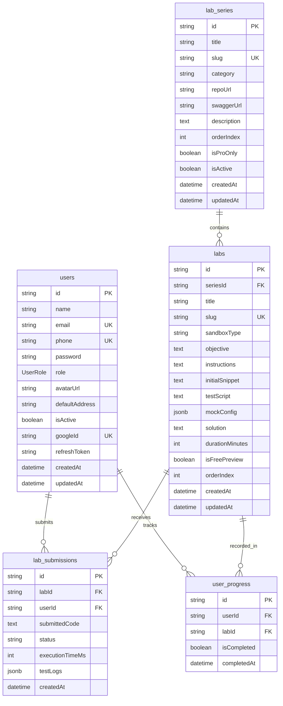

# Thiết kế Cơ sở Dữ liệu Hệ thống study-web (Database Design)

## 1. Thông tin tài liệu (Document Information)

| Thuộc tính | Chi tiết |
|---|---|
| **Tên tài liệu** | Thiết kế Cơ sở Dữ liệu Hệ thống study-web — Mô hình Lab Series |
| **Version** | v1.1 |
| **Người làm** | Nguyen Khanh Duy (Backend Lead & Database Architect) |
| **Phạm vi (Scope)** | Schema CSDL PostgreSQL, lược đồ ánh xạ Prisma ORM, tối ưu hóa cho hệ thống Series bài Lab thực hành ngắn (không dùng mô hình khóa học đa tầng cồng kềnh) |
| **Thời gian** | 2026-10-02 |
| **Tham chiếu từ** | `MODULE_BE/prisma/schema.prisma` và đặc tả tinh gọn mới của dự án |

---

## 2. Nội dung chính (Content)

### 2.1. TL;DR (Tóm tắt cốt lõi)
- **Hệ quản trị CSDL**: PostgreSQL 16+.
- **ORM**: Prisma ORM (`@prisma/client` v6+).
- **Mô hình kiến trúc**: Tinh giản tối đa cấu trúc dữ liệu. Loại bỏ bảng `sample_projects` dư thừa; chỉ giữ lại **5 bảng cốt lõi** phục vụ trực tiếp cho mô phỏng Web Worker.
- **Tổng số bảng**: 5 bảng (Bao gồm bảng `users` đã chạy trong module Backend).

### 2.2. Sơ đồ Thực thể Mối quan hệ (ERD - Entity Relationship Diagram)



### 2.3. Đặc tả Chi tiết các Bảng Dữ liệu (Data Dictionary)

#### 1. Bảng `users` (Quản lý Người dùng & Xác thực — Giữ nguyên mã nguồn hiện tại)
*Mã nguồn thực tế tại `MODULE_BE/prisma/schema.prisma`.*

| Tên Cột | Kiểu Dữ Liệu | Ràng Buộc | Mô Tả |
|---|---|---|---|
| `id` | `UUID` | PK, Default UUID | Định danh duy nhất |
| `name` | `VARCHAR(255)` | NOT NULL | Họ và tên người dùng |
| `email` | `VARCHAR(255)` | UNIQUE, NULLABLE | Email cá nhân |
| `phone` | `VARCHAR(20)` | UNIQUE, NOT NULL | Số điện thoại dùng đăng nhập |
| `password` | `VARCHAR(255)` | NULLABLE | Mật khẩu băm Bcrypt |
| `role` | `ENUM(UserRole)` | NOT NULL, DEFAULT `'user'` | Vai trò: `admin`, `user`, `userPro` |
| `avatarUrl` | `VARCHAR(500)` | NULLABLE | Đường dẫn ảnh đại diện |
| `defaultAddress` | `TEXT` | NULLABLE | Địa chỉ mặc định |
| `isActive` | `BOOLEAN` | NOT NULL, DEFAULT `true` | Trạng thái tài khoản |
| `googleId` | `VARCHAR(255)` | UNIQUE, NULLABLE | ID Google OAuth |
| `refreshToken` | `TEXT` | NULLABLE | Token làm mới phiên đăng nhập |
| `createdAt` / `updatedAt` | `TIMESTAMP` | NOT NULL | Dấu vết thời gian |

#### 2. Bảng `lab_series` (Các Series Bài Lab Ngắn)

| Tên Cột | Kiểu Dữ Liệu | Ràng Buộc | Mô Tả |
|---|---|---|---|
| `id` | `UUID` | PK, Default UUID | Khóa chính Series |
| `title` | `VARCHAR(255)` | NOT NULL | Tên series (vd: "Lab Bắt Lỗi & Test API") |
| `slug` | `VARCHAR(255)` | UNIQUE, NOT NULL | Slug URL series |
| `category` | `VARCHAR(50)` | NOT NULL | Chuyên môn: `'tester'`, `'backend'`, `'devops'` |
| `repoUrl` | `VARCHAR(500)` | NULLABLE | Link GitHub repository của app mẫu (nếu có) |
| `swaggerUrl` | `VARCHAR(500)` | NULLABLE | Link Swagger UI tương tác trực tiếp (nếu có) |
| `description` | `TEXT` | NOT NULL | Mô tả mục tiêu chuỗi bài lab |
| `orderIndex` | `INTEGER` | NOT NULL, DEFAULT 0 | Thứ tự hiển thị |
| `isProOnly` | `BOOLEAN` | NOT NULL, DEFAULT `false` | Cờ phân quyền: chỉ tài khoản `userPro` được xem |
| `isActive` | `BOOLEAN` | NOT NULL, DEFAULT `true` | Bật/tắt hiển thị |
| `createdAt` / `updatedAt` | `TIMESTAMP` | NOT NULL | Dấu vết thời gian |

#### 3. Bảng `labs` (Chi tiết Bài Lab Thực Hành)

| Tên Cột | Kiểu Dữ Liệu | Ràng Buộc | Mô Tả |
|---|---|---|---|
| `id` | `UUID` | PK, Default UUID | Khóa chính bài lab |
| `seriesId` | `UUID` | FK -> `lab_series.id`, ON DELETE CASCADE | Thuộc series nào |
| `title` | `VARCHAR(255)` | NOT NULL | Tên bài lab (vd: "Thiết kế Test Case màn Login") |
| `slug` | `VARCHAR(255)` | UNIQUE, NOT NULL | Slug URL bài lab |
| `objective` | `TEXT` | NOT NULL | Mục tiêu cụ thể đạt được sau bài lab |
| `instructions` | `TEXT` | NOT NULL | Hướng dẫn từng bước làm lab (định dạng Markdown) |
| `initialSnippet` | `TEXT` | NULLABLE | Code mẫu / template sẵn để học viên bắt đầu |
| `solution` | `TEXT` | NULLABLE | Lời giải / đáp án chuẩn (ẩn với user thường nếu lab là Pro) |
| `durationMinutes` | `INTEGER` | NOT NULL, DEFAULT 20 | Thời lượng ước tính hoàn thành (phút) |
| `isFreePreview` | `BOOLEAN` | NOT NULL, DEFAULT `false` | Cho phép làm thử miễn phí hay không |
| `orderIndex` | `INTEGER` | NOT NULL, DEFAULT 0 | Thứ tự bài lab trong series |
| `createdAt` / `updatedAt` | `TIMESTAMP` | NOT NULL | Dấu vết thời gian |

#### 4. Bảng `lab_submissions` (Kết Quả Nộp Bài Lab)

| Tên Cột | Kiểu Dữ Liệu | Ràng Buộc | Mô Tả |
|---|---|---|---|
| `id` | `UUID` | PK, Default UUID | Khóa chính lượt nộp |
| `labId` | `UUID` | FK -> `labs.id`, ON DELETE CASCADE | Nộp cho bài lab nào |
| `userId` | `UUID` | FK -> `users.id`, ON DELETE CASCADE | Người học nộp bài |
| `submissionContent`| `TEXT` | NOT NULL | Nội dung nộp (Code giải, link file test case, kết quả JSON) |
| `status` | `VARCHAR(50)` | NOT NULL, DEFAULT `'pending'` | Trạng thái: `'pending'`, `'passed'`, `'failed'` |
| `score` | `INTEGER` | NULLABLE | Điểm số đạt được (0–100) |
| `feedback` | `TEXT` | NULLABLE | Nhận xét tự động hoặc giáo viên ghi chú |
| `createdAt` | `TIMESTAMP` | NOT NULL, DEFAULT `NOW()` | Thời gian nộp |

#### 5. Bảng `user_progress` (Ghi Nhận Tiến Độ Hoàn Thành)

| Tên Cột | Kiểu Dữ Liệu | Ràng Buộc | Mô Tả |
|---|---|---|---|
| `id` | `UUID` | PK, Default UUID | Khóa chính bản ghi tiến độ |
| `userId` | `UUID` | FK -> `users.id`, ON DELETE CASCADE | Học viên |
| `labId` | `UUID` | FK -> `labs.id`, ON DELETE CASCADE | Bài lab đã hoàn thành |
| `isCompleted` | `BOOLEAN` | NOT NULL, DEFAULT `false` | Trạng thái hoàn thành |
| `completedAt` | `TIMESTAMP` | NULLABLE | Thời điểm hoàn thành |

*Khóa kết hợp duy nhất (Unique Composite Key)*: `@@unique([userId, labId])`.

---

### 2.4. Đánh Chỉ mục & Tối ưu Hiệu năng (Indexing)
1. `users(email)` & `users(phone)`: Unique Index phục vụ đăng nhập tức thời.
2. `lab_series(slug, category)`: Index tra cứu danh sách series theo chuyên môn (Tester, Backend, DevOps).
3. `labs(seriesId, orderIndex)`: Composite Index lấy danh sách bài lab theo đúng thứ tự hiển thị.
4. `user_progress(userId, isCompleted)`: Đếm nhanh số bài lab đã xong để tính % hoàn thành và chuỗi học tập (Streak).
5. `lab_submissions(userId, labId)`: Tra cứu lịch sử nộp bài gần nhất của học viên.

### 2.5. Kế hoạch Cập nhật Prisma Schema (Migration)
1. Thêm các model `LabSeries`, `Lab`, `LabSubmission`, `UserProgress` vào file `MODULE_BE/prisma/schema.prisma`.
2. Chạy lệnh:
   ```bash
   npx prisma migrate dev --name init_lab_series_schema
   ```
3. Tạo file `prisma/seed.ts` để nạp sẵn dữ liệu cho các Series Lab mẫu.

### 2.6. Lịch sử sửa đổi (Revision History)

| Version | Ngày | Tác giả | Ghi chú thay đổi |
|---|---|---|---|
| 1.0 | 2026-10-02 | Nguyen Khanh Duy | Thiết kế ban đầu |
| 1.1 | 2026-10-02 | Nguyen Khanh Duy | **Cắt giảm cấu trúc**: Bỏ bảng courses/lessons cồng kềnh; chuyển sang mô hình 5 bảng trực tiếp cho `lab_series` và `labs` |

### 2.7. Vấn đề tồn đọng (Open Issues)
- Đang cân nhắc bổ sung cột `testRunnerConfig` (JSONB) trong bảng `labs` nếu sau này muốn mở rộng tính năng chạy test tự động trên trình duyệt.

---

## 3. Tài liệu tham khảo & Liên kết (References)

- **Mã nguồn Schema Prisma thực tế**: [MODULE_BE/prisma/schema.prisma](file:///d:/Projects/study-web/MODULE_BE/prisma/schema.prisma)
- **Đề xuất Dự án**: [01-proposal.md](file:///d:/Projects/study-web/Docs/01-proposal.md)
- **Product Backlog**: [03-product-backlog.md](file:///d:/Projects/study-web/Docs/03-product-backlog.md)
