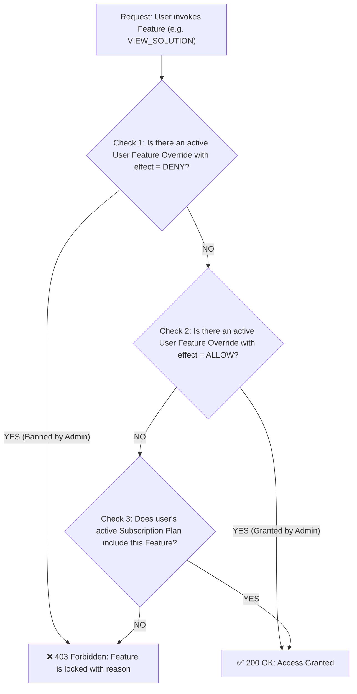

# Dynamic Authorization, Tiered Subscriptions & Feature Entitlements Specification

## 1. Overview & Business Intent
This document specifies the architecture and implementation for the **Dynamic Authorization & Feature Entitlement System**.
It empowers Administrators to:
1. Manage User accounts with full CRUD capabilities.
2. Bundle platform capabilities into **Subscription Plans** (e.g. Free Tier, Pro Monthly, Pro Yearly).
3. Override permissions at the individual user level with **Direct Allow** (custom grant) or **Explicit Deny** (feature ban / suspension), with optional expiration timestamps and mandatory audit reasons.
4. Record all privilege adjustments in an immutable **Audit Trail** (`audit_logs`).

---

## 2. Decision Logic & Priority Hierarchy
When an authenticated user requests access to a protected feature (e.g. `VIEW_SOLUTION`, `SUBMIT_LAB`):
$$\text{Explicit DENY (Admin Ban)} > \text{Direct User ALLOW (Admin Grant)} > \text{Active Subscription Plan} > \text{Default Deny (403 Forbidden)}$$

---

## 3. Database Schema

### 3.1 Tables Overview
- `features`: Catalog of platform features (`code`, `name`, `category`, `isActive`).
- `permissions`: Fine-grained operational action codes (`module`, `code`, `name`).
- `subscription_plans`: Tiered membership plans (`code`, `name`, `price`, `billingCycle`, `isDefault`).
- `plan_features`: Many-to-many relationship linking plans to available features with optional `limitValue`.
- `user_subscriptions`: Subscriptions assigned to users (`userId`, `planId`, `status`, `startDate`, `endDate`).
- `user_feature_overrides`: Individual user overrides (`userId`, `featureId`, `effect: ALLOW|DENY`, `reason`, `expiresAt`).
- `audit_logs`: Immutable security audit log tracking administrator actions.

---

## 4. API Endpoints Specification

### 4.1 Subscription Plans & Features
- `GET /api/v1/admin/plans`: List all plans with bundled features.
- `POST /api/v1/admin/plans`: Create a new plan.
- `PUT /api/v1/admin/plans/:id/features`: Update features mapped to a plan.
- `GET /api/v1/admin/features`: List all registered features.
- `POST /api/v1/admin/features`: Register a new feature.

### 4.2 User Entitlements & Overrides
- `GET /api/v1/admin/users/:id/entitlements`: Get active plan, bundled features, and overrides for a user.
- `POST /api/v1/admin/users/:id/subscription`: Assign or change user's subscription plan.
- `POST /api/v1/admin/users/:id/feature-overrides`: Grant (`ALLOW`) or Ban (`DENY`) a feature for a user.
- `DELETE /api/v1/admin/users/:id/feature-overrides/:featureCode`: Remove override and restore plan default.

### 4.3 Audit Logs
- `GET /api/v1/admin/audit-logs`: Paginated audit log retrieval with filters (`targetUserId`, `action`, date range).

---

## 5. UI/UX Architecture
1. **Admin Studio Tab: Plans & Features**:
   - Left column: Subscription plans management.
   - Right column: Feature toggle matrix for the selected plan.
2. **User Details Drawer: Permissions & Overrides**:
   - Section 1: Active Subscription Plan dropdown.
   - Section 2: Feature Overrides table with three-way control (`Default by Plan` | `Allow` | `Deny`) + reason input + expiry date.
   - Section 3: Audit history specific to that user.
3. **Audit Trail Tab**:
   - Comprehensive timeline of administrator modifications.
