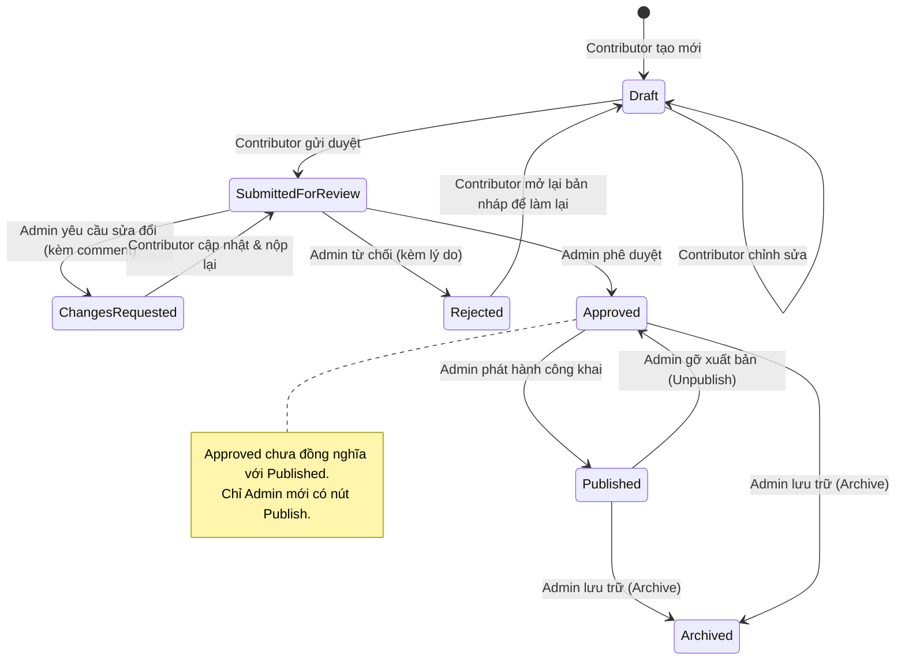
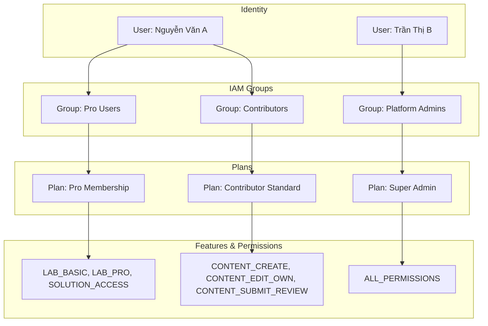

# Đặc tả Kiến trúc Contributor Workspace, Admin Content Review & Phân quyền IAM Group-Based

## 1. Thông tin tài liệu (Document Information)

| Thuộc tính | Chi tiết |
|---|---|
| **Tên tài liệu** | Đặc tả Kiến trúc Contributor Workspace, Admin Review & Phân quyền IAM Group-Based |
| **Version** | v1.0 |
| **Người làm** | Nguyen Khanh Duy (Product Owner & Fullstack Lead) |
| **Phạm vi (Scope)** | Contributor Workspace, Admin Content Review Queue, Mô hình Group-based Plans (AWS IAM-style) và Lộ trình chi tiết 6 Sprint Frontend |
| **Thời gian** | 2026-10-13 |
| **Tham chiếu từ** | Quy tắc nghiệp vụ đã chốt, `07-dynamic-authorization-and-entitlements.md` và mã nguồn `MODULE_FE/src` |

---

## 2. Nội dung chính (Content)

### 2.1. TL;DR (Tóm tắt cốt lõi)
- **Contributor**: Được tạo Topic, Series, Lab. **Không có quyền Publish**. Chỉ được sửa nội dung do chính mình tạo. Toàn bộ nội dung bắt buộc phải gửi cho Admin duyệt (`Submit for review`), xem feedback và resubmit nếu cần.
- **Admin**: Toàn quyền quản trị nội dung, người dùng, kế hoạch gói (Plan), nhóm (Group) và hệ thống. Admin có hàng đợi duyệt bài (`Review Queue`), phê duyệt, yêu cầu sửa đổi, từ chối, chuyển quyền sở hữu và **phát hành nội dung riêng biệt** (`Approved != Published`).
- **Mô hình Phân quyền Group-Based (AWS IAM)**: Thay vì gán quyền hoặc gán gói trực tiếp vào User, hệ thống chuẩn hóa theo chuỗi: `User -> UserGroup -> Plan -> Features/Permissions`. Một User có thể thuộc nhiều Group; quyền hiệu lực cuối cùng là **hợp nhất (Union)** toàn bộ quyền từ các Group mà User tham gia.
- **Chiến lược Thực thi**: Bắt đầu bằng **Sprint 1 (Foundation: UI-001 → UI-004)** với Stateful Mock Store độc lập để toàn bộ luồng Contributor và Admin chạy thử hoàn hảo trên Frontend trước khi tích hợp Backend.

---

### 2.2. Phân vai & Ma trận Quyền hạn (Actor & Permission Matrix)

#### Bảng danh mục Permission Codes chuẩn hóa:
| Module | Mã Permission (`code`) | Tên tính năng | Ý nghĩa nghiệp vụ |
|---|---|---|---|
| **Content Authoring** | `CONTENT_TOPIC_CREATE` | Create Topic | Tạo chủ đề lớn (SQL, Tester, Backend...) |
| | `CONTENT_SERIES_CREATE` | Create Series | Tạo chuỗi bài lab thực hành |
| | `CONTENT_LAB_CREATE` | Create Lab | Tạo bài lab thực hành |
| | `CONTENT_EDIT_OWN` | Edit Own Content | Chỉnh sửa nội dung do chính mình tạo (`authorId === user.id`) |
| | `CONTENT_SUBMIT_REVIEW` | Submit For Review | Gửi nội dung lên Admin duyệt |
| **Content Review & Ops** | `CONTENT_REVIEW` | Review Content | Admin chấm bài: Duyệt, Yêu cầu sửa, Từ chối |
| | `CONTENT_PUBLISH` | Publish Content | Admin phát hành bài lên Catalog công khai |
| | `CONTENT_EDIT_ALL` | Edit Any Content | Admin can thiệp chỉnh sửa bất kỳ nội dung nào |
| | `CONTENT_TRANSFER_OWNERSHIP`| Transfer Ownership | Admin chuyển giao quyền tác giả |
| | `CONTENT_ARCHIVE` | Archive Content | Đưa nội dung vào lưu trữ / gỡ khỏi hệ thống |
| **Learning Access** | `LAB_BASIC` | Basic Lab Access | Thực hành các bài lab miễn phí / cơ bản |
| | `LAB_PRO` | Pro Lab Access | Mở khóa các bài lab nâng cao (Pro Only) |
| | `SOLUTION_ACCESS` | View Solution | Xem lời giải mẫu và mã nguồn chuẩn |
| | `SERIES_PUBLIC` | Browse Catalog | Xem danh mục khóa học & series công khai |
| **Access & Administration** | `USER_MANAGE` | Manage Users | Thêm/xóa user, gán user vào group |
| | `GROUP_MANAGE` | Manage Groups | Tạo/sửa group, gán plan cho group |
| | `PLAN_MANAGE` | Manage Plans | Tạo/sửa plan, gán feature flags cho plan |
| | `SYSTEM_VIEW` | View System Logs | Xem audit log và nhật ký hệ thống |

#### Ma trận Phân quyền theo Nhóm mặc định (Default Groups & Plans):
| Nhóm người dùng (User Group) | Gói liên kết (Assigned Plan) | Quyền hạn hiệu lực (Effective Permissions) |
|---|---|---|
| **Free Users** | Free Plan | `SERIES_PUBLIC`, `LAB_BASIC` |
| **Pro Users** | Pro Plan | `SERIES_PUBLIC`, `LAB_BASIC`, `LAB_PRO`, `SOLUTION_ACCESS` |
| **Contributor Group** | Contributor Plan | `CONTENT_TOPIC_CREATE`, `CONTENT_SERIES_CREATE`, `CONTENT_LAB_CREATE`, `CONTENT_EDIT_OWN`, `CONTENT_SUBMIT_REVIEW`, `LAB_BASIC` |
| **Admin Group** | Admin Master Plan | **ALL_PERMISSIONS** (Toàn bộ 16 permissions) |

---

### 2.3. Vòng đời Nội dung & State Machine (Content Lifecycle)

Nội dung (Topic, Series, Lab) trải qua **7 trạng thái** chặt chẽ:



#### Quy tắc nghiệp vụ cho từng trạng thái:
1. **Draft**: Chỉ tác giả và Admin thấy; tác giả toàn quyền sửa đổi.
2. **Submitted for review**: Bài đã gửi duyệt. Contributor bị khóa chỉnh sửa (để tránh xung đột dữ liệu trong khi Admin đang chấm).
3. **Changes requested**: Admin gửi phản hồi kèm danh sách góp ý. Contributor nhận thông báo, sửa bài và bấm resubmit.
4. **Approved**: Admin duyệt nội dung đạt chất lượng nhưng chưa phát hành ra cộng đồng (dành cho việc kiểm tra lịch phát hành, đồng bộ tài nguyên).
5. **Published**: Nội dung chính thức xuất hiện trên Catalog cho học viên học.
6. **Rejected**: Admin từ chối hẳn do vi phạm tiêu chuẩn hoặc không phù hợp định hướng.
7. **Archived**: Nội dung cũ bị ẩn khỏi Catalog nhưng vẫn lưu trữ trong cơ sở dữ liệu.

---

### 2.4. Mô hình Phân quyền Group-Based IAM (AWS IAM-style)



#### Thuật toán tính quyền hiệu lực (Effective Permissions Resolution):
```typescript
function getEffectivePermissions(user: User, allGroups: UserGroup[], allPlans: AccessPlan[]): Set<PermissionCode> {
  const effective = new Set<PermissionCode>();
  
  // 1. Lọc các group mà user là thành viên và group đang active
  const userGroups = allGroups.filter(g => g.isActive && (user.groupIds?.includes(g.id) || g.memberIds.includes(user.id)));
  
  // 2. Thu thập tất cả planIds thuộc các group trên
  const activePlanIds = new Set<string>();
  userGroups.forEach(g => g.planIds.forEach(pid => activePlanIds.add(pid)));
  
  // 3. Hợp nhất (Union) toàn bộ permissions từ các plan active
  const userPlans = allPlans.filter(p => p.isActive && activePlanIds.has(p.id));
  userPlans.forEach(p => {
    p.permissionCodes.forEach(code => effective.add(code));
  });

  return effective;
}
```

#### Logic kiểm tra can(user, permission, context):
```typescript
function can(
  user: User | null | undefined,
  permission: PermissionCode,
  context?: { authorId?: string }
): boolean {
  if (!user) return false;
  
  const permissions = user.effectivePermissions; // đã tính sẵn trong auth state
  
  // Admin có quyền chỉnh sửa tất cả nội dung
  if (permissions.has('CONTENT_EDIT_ALL')) return true;
  
  // Kiểm tra quyền sửa nội dung chính mình tạo
  if (permission === 'CONTENT_EDIT_OWN') {
    if (!permissions.has('CONTENT_EDIT_OWN')) return false;
    return context?.authorId ? context.authorId === user.id : true;
  }
  
  return permissions.has(permission);
}
```

---

### 2.5. Đặc tả Giao diện Chi tiết (UI Specifications)

#### 1. Contributor Workspace (`/contributor`)
- **Menu điều hướng**:
  - `Overview`: Thống kê tổng số Topic/Series/Lab đã tạo, số bài đang đợi duyệt, số bài cần sửa.
  - `Topics`: Danh sách các chủ đề tác giả đã tạo (CRUD).
  - `Series`: Danh sách các chuỗi bài lab tác giả đã tạo (CRUD).
  - `My Labs`: Quản lý các bài lab do mình sở hữu kèm bộ lọc theo trạng thái (`Draft`, `Changes requested`, `Submitted`, `Approved`, `Published`).
  - `Create Content`: Nút mở nhanh trình tạo Topic / Series / Lab.
  - `Review Feedback`: Hộp thư thông báo nhận xét của Admin khi yêu cầu sửa bài (`Changes requested`).
  - `Published Content`: Kho bài viết của tác giả đã được Admin phát hành chính thức.
- **Ranh giới giao diện**: Không hiển thị nút `Publish`, không hiển thị tính năng quản lý thành viên hoặc phân gói.

#### 2. Admin Content Review (`/admin/review` & `/admin/content`)
- **Review Queue (Hàng đợi xét duyệt)** với 5 tabs lọc:
  1. `Pending review`: Danh sách bài nộp chờ Admin chấm điểm.
  2. `Changes requested`: Danh sách bài Admin đã gửi yêu cầu sửa đổi.
  3. `Approved, not published`: Bài đã duyệt chất lượng, sẵn sàng phát hành.
  4. `Published`: Bài đang hoạt động trên hệ thống.
  5. `Archived`: Bài đã lưu trữ.
- **Màn hình Review Chi tiết (Review Detail Modal / Drawer)**:
  - Header: Tiêu đề nội dung, loại (`Topic` | `Series` | `Lab`), phiên bản hiện tại (`v1.2`), Contributor tạo bài.
  - Vùng hiển thị nội dung: Markdown hướng dẫn, snippet khởi đầu, test script, đáp án mẫu.
  - Toggle **"Preview as Student"**: Xem trải nghiệm y hệt học viên khi làm bài.
  - Lịch sử chỉnh sửa & Version history: Lược sử các lần nộp bài.
  - Khung phản hồi (`Review Notes / Feedback Input`): Nhập nhận xét cụ thể để Contributor sửa bài.
  - Kích thước & Bố cục: Sử dụng kích thước lớn (`w-[95vw] sm:max-w-4xl lg:max-w-5xl max-h-[90vh]`) để đảm bảo tiêu đề dài không bị ngắt chữ đơn lẻ, các ô code không bị lồng thanh cuộn quá dày và Action Bar chân trang luôn hiển thị trọn vẹn không tràn viền.
  - Action Bar:
    - Nút `Request changes` (Màu hổ phách - Bắt buộc nhập feedback).
    - Nút `Reject` (Màu đỏ - Từ chối bài).
    - Nút `Approve` (Màu xanh - Chuyển sang Approved).
    - Nút `Publish` (Màu xanh Meta Blue - Phát hành công khai).
    - Nút `Transfer ownership` (Modal chọn Contributor mới).

#### 3. Admin Group-based Plan UI (`/admin/plans`)
- **Tab 1: Plan Management**:
  - Danh sách Plan: Tên plan, mã code, trạng thái (`Active` / `Inactive`), số group sử dụng, số lượng feature gán vào, ngày cập nhật, Actions (`View`, `Edit`, `Duplicate`, `Archive`).
  - Form Tạo/Sửa Plan: Nhập Name, Code, Description, Status, và ma trận Checkbox chọn danh sách `Features / Permissions`.
- **Tab 2: Group Management**:
  - Danh sách Group: Tên group, mã code, mô tả, các Plan được gán, số lượng thành viên, Actions (`View`, `Edit`, `Members`, `Archive`).
  - Chi tiết Group:
    - Thông tin chung.
    - Quản lý Plan gán cho Group (Cho phép 1 Group gán nhiều Plan).
    - Danh sách thành viên (Thêm/xóa User vào Group).
    - Bảng hiển thị quyền hiệu lực tổng hợp của Group (`Effective Permissions Preview`).
- **Tab 3: User Detail & IAM Assignment (`/admin/users`)**:
  - Xem danh sách Group mà User đang trực thuộc.
  - Modal thêm/bớt User vào các Group.
  - Khung kiểm tra quyền hiệu lực của User (`Effective Permissions Breakdown`) chỉ ra rõ quyền nào đến từ Group nào.

---

### 2.6. Lộ trình Triển khai Sprint (Sprint Master Roadmap)

```text
Sprint 1: Foundation (UI-001 -> UI-004)
    ├── UI-001: Design tokens & Meta styling
    ├── UI-002: Domain components (StatusBadge, AccessBadge, PermissionGate)
    ├── UI-003: Dynamic Permission Map & IAM Resolver
    └── UI-004: Stateful Mock Store (Users, Groups, Plans, Lifecycle Data)

Sprint 2: Student Flow (UI-101 -> UI-202)
    ├── UI-101: Home page
    ├── UI-102: Series Hub catalog
    ├── UI-103: Series Detail & Curriculum
    ├── UI-104: Student Dashboard
    ├── UI-201: Lab Workspace (Split layout, Monaco, Markdown)
    └── UI-202: Responsive Workspace & Sandbox execution

Sprint 3: Contributor Content Flow (UI-301 -> UI-308)
    ├── UI-301: Contributor Layout & Navigation
    ├── UI-302: Contributor Dashboard & Overview
    ├── UI-303: Topic CRUD UI
    ├── UI-304: Series CRUD UI
    ├── UI-305: Lab Studio
    ├── UI-306: Preview Content
    ├── UI-307: Submit for Review Flow
    └── UI-308: Review Feedback & Resubmit Flow

Sprint 4: Admin Review (UI-401 -> UI-406)
    ├── UI-401: Admin Review Layout
    ├── UI-402: Content Review Queue (5 Tabs)
    ├── UI-403: Review Detail & Diff Inspector
    ├── UI-404: Action Handlers (Approve / Request Changes / Reject)
    ├── UI-405: Publish / Unpublish / Archive Controls
    └── UI-406: Version History & Ownership Transfer

Sprint 5: Group-based Plans (UI-501 -> UI-508)
    ├── UI-501: Plan List UI
    ├── UI-502: Create / Edit Plan Modal & Form
    ├── UI-503: Feature & Permission Selector Matrix
    ├── UI-504: Group List UI
    ├── UI-505: Group Detail View
    ├── UI-506: Assign Plans to Group Flow
    ├── UI-507: Assign Users to Group Flow
    └── UI-508: Effective Permissions Inspector

Sprint 6: QA & Hardening (UI-601 -> UI-605)
    ├── UI-601: Permission Boundary Testing (Matrix test)
    ├── UI-602: Responsive & Mobile Cross-Check
    ├── UI-603: Accessibility (a11y) & Contrast Testing
    ├── UI-604: Full User Journey (Contributor -> Admin -> Student)
    └── UI-605: Build, Bundle Size & Regression Testing
```

---

### 2.7. Tiêu chí Chấp thuận (Acceptance Criteria)

#### 1. Contributor Persona
- [x] Có thể tạo Topic, Series, Lab mới ở trạng thái `Draft`.
- [x] Chỉ có thể chỉnh sửa nội dung do chính tài khoản của mình tạo (`authorId === currentUserId`).
- [x] Hoàn toàn không nhìn thấy nút `Publish` ở bất kỳ trang nào.
- [x] Có thể gửi nội dung lên hàng đợi xét duyệt của Admin (`Draft -> Submitted`).
- [x] Khi bị yêu cầu chỉnh sửa (`Changes requested`), đọc được nhận xét của Admin và bấm gửi lại được.

#### 2. Admin Persona
- [x] Nhìn thấy toàn bộ Topic, Series, Lab của tất cả người dùng trong hệ thống.
- [x] Có quyền can thiệp chỉnh sửa bất kỳ nội dung nào.
- [x] Chấm bài đầy đủ luồng: `Approve`, `Request changes` (kèm phản hồi), `Reject`.
- [x] Duyệt bài không tự động phát hành: Phải bấm nút `Publish` riêng thì bài mới thành `Published`.
- [x] Quản lý toàn diện Plan, Group, gán Plan vào Group, gán User vào Group.
- [x] Kiểm tra được `Effective Permissions` của bất kỳ User nào trên giao diện.

#### 3. Student Persona
- [x] Chỉ nhìn thấy nội dung đã xuất bản (`status === 'published'`).
- [x] Không nhìn thấy các bài `Draft`, `Submitted`, `Rejected`.
- [x] Phân biệt được bài miễn phí (`LAB_BASIC`) và bài trả phí (`LAB_PRO`) dựa trên gói thuộc nhóm của mình.
- [x] Bị chặn chuyển hướng tự động nếu cố tình truy cập vào route `/contributor` hoặc `/admin`.

---

### 2.8. Lịch sử sửa đổi & Vấn đề tồn đọng (Revision History & Open Issues)

#### Lịch sử sửa đổi
| Version | Ngày | Tác giả | Nội dung thay đổi |
|---|---|---|---|
| `v1.0` | 2026-10-13 | Nguyen Khanh Duy | Khởi tạo tài liệu đặc tả kiến trúc Contributor, Admin Review, Group-based IAM và kế hoạch chi tiết 6 Sprint. |
| `v1.1` | 2026-10-13 | Nguyen Khanh Duy | Hoàn thành triển khai và kiểm thử thực tế toàn bộ 6 Sprint (UI-001 -> UI-605), xác thực 100% Acceptance Criteria. |
| `v1.2` | 2026-10-13 | Nguyen Khanh Duy | Bổ sung TASK-006: Khắc phục lỗi Review Inspect Modal bị co hẹp 384px trên Desktop do xung đột media query Tailwind CSS (`sm:max-w-sm`), sửa tràn lề Action Bar và lồng thanh cuộn. |

#### Vấn đề mở (Open Issues)
- **Review Inspect Modal Layout Patch**: Đang được xử lý trong kế hoạch thực thi `PLAN-LAB-LEARNING-01` (`TASK-006`).

---

## 3. Tài liệu tham khảo (References)
- [01-proposal.md](file:///d:/Projects/study-web/docs/01-proposal.md)
- [03-product-backlog.md](file:///d:/Projects/study-web/docs/03-product-backlog.md)
- [05-database.md](file:///d:/Projects/study-web/docs/05-database.md)
- [07-dynamic-authorization-and-entitlements.md](file:///d:/Projects/study-web/docs/07-dynamic-authorization-and-entitlements.md)
- [MODULE_FE/src/types/user.types.ts](file:///d:/Projects/study-web/MODULE_FE/src/types/user.types.ts)
- [MODULE_FE/src/features/auth/permissions.ts](file:///d:/Projects/study-web/MODULE_FE/src/features/auth/permissions.ts)
