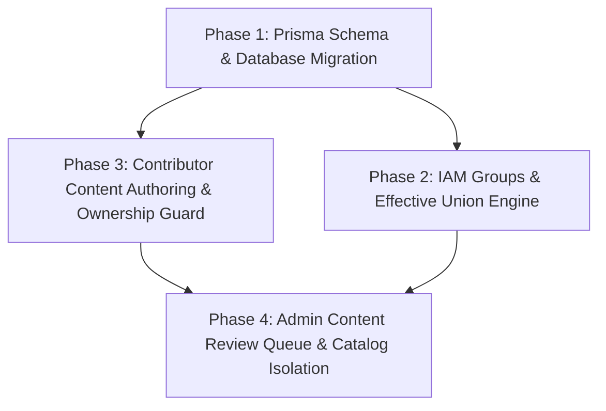

# Kế Hoạch Nâng Cấp Backend: IAM Group-based, Contributor & Review Queue (DOC-09)

> **Mã tài liệu**: `DOC-09`  
> **Dự án**: Nền tảng Học lập trình Thực hành StudyIT (`study-web`)  
> **Tác giả**: Nguyen Khanh Duy (Product Owner / Fullstack Lead)  
> **Ngày lập**: 13/10/2026  
> **Trạng thái**: ✅ Đã Hoàn Thành Thực Thi 100% (Fully Implemented & Verified in BE-1 -> BE-6)  
> **Tài liệu đối chiếu**: [`DOC-07: Dynamic Authorization`](07-dynamic-authorization-and-entitlements.md) và [`DOC-08: Roadmap 6 Sprints`](08-contributor-admin-iam-sprint-roadmap.md)

---

## 1. Bối Cảnh & Mục Tiêu

Hệ thống Frontend (`MODULE_FE`) đã hoàn tất 100% 6 Sprint cho các phân hệ:
1. **Contributor Workspace**: Tạo Topic/Series/Lab, sửa bài của chính mình, không có quyền Publish, nộp bài duyệt, xem góp ý của Admin khi `changes_requested`.
2. **Admin Content Review Queue**: Quản lý hàng đợi 5 trạng thái (`pending`, `changes_requested`, `approved`, `published`, `archived`), duyệt bài tách rời phát hành (`Approved != Published`), xuất bản bài độc lập, chuyển giao tác giả.
3. **AWS IAM Group Model**: Phân quyền theo mô hình `User -> UserGroup -> Plan -> Permissions`, hợp nhất quyền thực tế (`Union`), thanh tra nguồn cấp quyền (Provenance Inspector).
4. **Student Catalog Isolation**: Học viên chỉ nhìn thấy nội dung đã xuất bản (`status === 'published'`), chặn truy cập các bài lab Pro và giải pháp mẫu khi chưa được cấp quyền.

Mục tiêu của tài liệu này là:
- **Kiểm tra và đối chiếu toàn diện mã nguồn Backend (`MODULE_BE`)** (Prisma ORM, Controllers, Services, Guards, DTOs).
- **Phân loại và chỉ rõ các điểm thiếu hụt (Gap Analysis) & lỗi tiềm ẩn** dẫn đến xung đột hoặc không thể vận hành khi kết nối FE - BE thật.
- **Xây dựng lộ trình 4 giai đoạn kỹ thuật (Backend Implementation Plan)** để nâng cấp Backend đạt chuẩn 100% so với đặc tả kiến trúc.

---

## 2. Bảng Đối Chiếu Hiện Trạng Backend vs Đặc Tả (Gap Analysis)

### 2.1. Nhóm 1: Cơ sở Dữ liệu & Schema (Prisma ORM)

| Thành phần | Đặc tả Kiến trúc (DOC-08 / FE Contracts) | Hiện trạng trong `prisma/schema.prisma` | Mức độ nghiêm trọng | Vấn đề / Lỗi phát sinh |
|---|---|---|:---:|---|
| **User Role** | Hỗ trợ 4 vai trò: `admin`, `contributor`, `userPro`, `user`. | `enum UserRole { admin, user, userPro }` | 🔴 **CRITICAL** | Thiếu role `contributor`. Không thể cấp tài khoản Contributor trên DB thật. |
| **LabSeries** | Cần: `authorId`, `status` (7 trạng thái), `reviewFeedback`, `version`. | Chỉ có: `title`, `slug`, `category`, `description`, `level`, `isProOnly`, `isActive`. | 🔴 **CRITICAL** | Không biết ai tạo series, không có trạng thái kiểm duyệt, không lưu được nhận xét của Admin. |
| **Lab** | Cần: `authorId`, `status` (7 trạng thái), `reviewFeedback`, `version`. | Chỉ có: `title`, `slug`, `sandboxType`, `instructions`, `isProOnly`, `isActive`. | 🔴 **CRITICAL** | Thiếu hoàn toàn vòng đời bài lab. Chỉ có cờ boolean `isActive` thô sơ. |
| **Content Lifecycle Enum** | `draft`, `submitted`, `in_review`, `changes_requested`, `approved`, `published`, `archived`, `rejected`. | **Chưa có**. | 🔴 **CRITICAL** | Không có kiểu dữ liệu Enum cho vòng đời nội dung. |
| **UserGroup (IAM Group)** | Model `UserGroup` (`id`, `code`, `name`, `description`, `isActive`). | **Chưa có**. | 🔴 **CRITICAL** | Chưa hỗ trợ mô hình IAM Group giống AWS. |
| **Group Members & Plans** | Bảng liên kết đa-đa `User <-> Group` và `Group <-> Plan`. | **Chưa có**. | 🔴 **CRITICAL** | Không thể gán User vào Nhóm và gán Gói vào Nhóm trên DB. |
| **Plan <-> Permission** | Bảng liên kết đa-đa `SubscriptionPlan <-> Permission`. | Bảng `Permission` có nhưng đứng độc lập, Plans chỉ liên kết với `Feature`. | 🟡 **HIGH** | Không lưu được ma trận Permission Code vào Gói cước. |

---

### 2.2. Nhóm 2: Luồng Tác Quyền Contributor (Authoring & Ownership)

| Chức năng | Đặc tả yêu cầu | Hiện trạng Backend (`MODULE_BE`) | Đánh giá & Rủi ro |
|---|---|---|---|
| **Tạo Series (`POST /series`)** | Contributor được phép tạo Series (trạng thái `draft`, gán `authorId = req.user.userId`). | `@Roles(UserRole.admin)` đang chặn cứng chỉ Admin mới được tạo. | 🔴 Contributor bị lỗi **403 Forbidden**. Không lưu `authorId`. |
| **Tạo Lab (`POST /labs`)** | Contributor được phép tạo Lab (trạng thái `draft`, gán `authorId = req.user.userId`). | `@Roles(UserRole.admin)` đang chặn cứng chỉ Admin mới được tạo. | 🔴 Contributor bị lỗi **403 Forbidden**. Không lưu `authorId`. |
| **Chỉnh sửa nội dung (`PUT /series/:id`, `PUT /labs/:id`)** | Contributor chỉ được sửa bài của mình (`authorId === userId`). Admin được sửa tất cả. | Đang khoá cứng `@Roles(UserRole.admin)`. Chưa có cơ chế Resource Ownership Guard. | 🔴 Contributor không thể cập nhật bài viết do mình soạn thảo. |
| **Nộp bài duyệt (`Submit for Review`)** | Endpoint chuyển trạng thái `draft -> submitted` (kèm author note). | **Chưa có endpoint**. | 🔴 Contributor không có API để gửi bài lên Admin. |
| **Chặn Publish trực tiếp** | Contributor tuyệt đối không có quyền chuyển bài sang `published`. | API chưa quản lý trạng thái `status`. | 🔴 Thiếu lớp phòng vệ chống bypass publish từ phía BE. |

---

### 2.3. Nhóm 3: Hàng Đợi Kiểm Duyệt & Xuất Bản của Admin (Review Queue)

| Chức năng | Đặc tả yêu cầu | Hiện trạng Backend (`MODULE_BE`) | Đánh giá & Rủi ro |
|---|---|---|---|
| **Hàng đợi xét duyệt (`Review Queue`)** | `GET /admin/review-queue` hỗ trợ lọc theo 5 tab: `pending`, `changes_requested`, `approved`, `published`, `archived`. | **Chưa có endpoint**. Admin chỉ có `GET /series` và `GET /labs`. | 🔴 Admin không thể theo dõi danh sách bài nộp chờ duyệt. |
| **Duyệt bài (`Approve`)** | Chuyển trạng thái `submitted -> approved`. Bài chưa xuất bản. | **Chưa có endpoint**. | 🔴 Không có thao tác duyệt bài. |
| **Yêu cầu chỉnh sửa (`Request Changes`)** | Chuyển `submitted -> changes_requested`, lưu `reviewFeedback` để Contributor đọc. | **Chưa có endpoint**. | 🔴 Thiếu kênh giao tiếp nhận xét giữa Admin và tác giả. |
| **Xuất bản độc lập (`Publish`)** | Chuyển `approved -> published`. Độc lập với Approve. Chỉ Admin mới được thực hiện. | **Chưa có endpoint**. | 🔴 Không kiểm soát được thời điểm phát hành bài lên Catalog học viên. |
| **Chuyển giao quyền tác giả (`Transfer Ownership`)** | Admin đổi `authorId` của Series/Lab sang User khác. | **Chưa có endpoint**. | 🔴 Không thể luân chuyển quyền quản lý bài viết khi nhân sự thay đổi. |
| **Cách ly Catalog Học viên** | `GET /series` và `GET /labs/:slug` chỉ trả về bài có `status: 'published'`. | Hiện chỉ lọc `isActive: true`. | 🔴 **Rò rỉ dữ liệu**: Học viên có thể thấy bài nháp hoặc bài đang sửa. |

---

### 2.4. Nhóm 4: Phân Quyền Động IAM Group-Based

| Chức năng | Đặc tả yêu cầu | Hiện trạng Backend (`MODULE_BE`) | Đánh giá & Rủi ro |
|---|---|---|---|
| **CRUD Nhóm IAM (`admin/groups`)** | Quản lý danh sách nhóm: Tạo, sửa, xoá, bật/tắt nhóm. | **Chưa có Controller & Service cho Groups**. | 🔴 FE gọi API nhóm sẽ bị lỗi **404 Not Found**. |
| **Gán Gói vào Nhóm** | Gán nhiều Plan vào một Group (`Group -> Plans`). | Chưa có endpoint và bảng quan hệ DB. | 🔴 Không thực hiện được cấu hình chính sách gói theo nhóm. |
| **Gán User vào Nhóm** | Thêm/xoá User khỏi Group (`User -> Groups`). | Chưa có endpoint và bảng quan hệ DB. | 🔴 Không gán được thành viên vào các nhóm IAM. |
| **IAM Effective Permissions Resolver** | Quyền của User là hợp nhất (`Union`) của tất cả các Plan thuộc tất cả Group mà User tham gia. | `getUserEntitlements` chỉ lấy từ 1 gói cước trực tiếp (`UserSubscription`). | 🔴 Không tính toán được quyền hạn tổng hợp theo mô hình AWS IAM. |
| **Thanh tra Nguồn quyền (Provenance)** | Trả về nguồn gốc từng quyền (cấp bởi Group nào, Plan nào). | Chỉ trả về mảng tính năng phẳng (`effectiveFeatures`). | 🟡 Thiếu dữ liệu chi tiết phục vụ thanh tra phân quyền trên FE. |

---

## 3. Kế Hoạch Triển Khai Kỹ Thuật (Backend Implementation Plan)

Lộ trình được chia làm **4 giai đoạn kỹ thuật (Phases)**, thực hiện theo thứ tự phụ thuộc chặt chẽ:

---

### 🏃 Giai đoạn 1 (Phase 1): Nâng Cấp Schema Prisma & Database Migration

**Mục tiêu**: Bổ sung đầy đủ các bảng dữ liệu, trường quan hệ và enum còn thiếu vào `prisma/schema.prisma`.

1. **Cập nhật Enums**:
   - Mở rộng `UserRole`: Thêm giá trị `contributor`.
   - Tạo mới `ContentLifecycleStatus`: `draft`, `submitted`, `in_review`, `changes_requested`, `approved`, `published`, `archived`, `rejected`.
2. **Cập nhật Models Nội dung**:
   - `LabSeries`: Thêm `authorId (FK -> User)`, `status (ContentLifecycleStatus, default: draft)`, `reviewFeedback (Text?)`, `version (String, default: "v1.0")`.
   - `Lab`: Thêm `authorId (FK -> User)`, `status (ContentLifecycleStatus, default: draft)`, `reviewFeedback (Text?)`, `version (String, default: "v1.0")`.
3. **Tạo Models IAM Group & Quan hệ**:
   - `UserGroup`: `id`, `code (@unique)`, `name`, `description`, `isActive`, `createdAt`, `updatedAt`.
   - `UserGroupMember`: `userId`, `groupId` (`@@id([userId, groupId])`).
   - `GroupPlan`: `groupId`, `planId` (`@@id([groupId, planId])`).
   - `PlanPermission`: `planId`, `permissionId` (`@@id([planId, permissionId])`).
4. **Thực thi Migration & Seed Data**:
   - Chạy migration Prisma (`npx prisma migrate dev` / `npx prisma db push`).
   - Cập nhật seed script khởi tạo sẵn 4 Groups mẫu (`ADMINS`, `CONTRIBUTORS`, `PRO_USERS`, `FREE_USERS`) và map permissions chuẩn.

---

### 🏃 Giai đoạn 2 (Phase 2): Xây Dựng IAM Groups & Bộ Tính Quyền Hợp Nhất (Union Resolver)

**Mục tiêu**: Xây dựng phân hệ Quản lý Nhóm và tính toán quyền hạn động tương tự AWS IAM trên Backend.

1. **Tạo mới `modules/groups`**:
   - `GroupsController` & `GroupsService`:
     - `GET /admin/groups`: Danh sách nhóm, kèm số thành viên và số gói.
     - `POST /admin/groups`: Tạo nhóm mới.
     - `PUT /admin/groups/:id`: Sửa thông tin nhóm.
     - `DELETE /admin/groups/:id`: Xoá / vô hiệu hoá nhóm.
     - `PUT /admin/groups/:id/plans`: Gán danh sách gói cước cho nhóm.
     - `POST /admin/groups/:id/members`: Thêm thành viên vào nhóm.
     - `DELETE /admin/groups/:id/members/:userId`: Gỡ thành viên khỏi nhóm.
2. **Nâng cấp `modules/entitlements`**:
   - Endpoint `PUT /admin/users/:id/groups`: Cập nhật danh sách nhóm của người dùng.
   - Nâng cấp `getUserEntitlements(userId)`:
     - Truy vấn tất cả Group đang active mà User là thành viên.
     - Thu thập tất cả Plan đang active từ các Group này.
     - Tính hợp nhất (`Union`) toàn bộ `Permission` và `Feature` từ các Plan.
     - Áp dụng các ngoại lệ trực tiếp (`ALLOW` / `DENY` overrides).
     - Trả về cấu trúc Provenance (chỉ rõ quyền nào đến từ Group nào, Plan nào).
   - Nâng cấp `FeatureEntitlementGuard`: Hỗ trợ kiểm tra quyền thông qua Group Union.

---

### 🏃 Giai đoạn 3 (Phase 3): Mở Rộng Luồng Tác Quyền Contributor & Bảo Vệ Sở Hữu

**Mục tiêu**: Cho phép Contributor soạn thảo Topic/Series/Lab, quản lý bài của mình, nộp duyệt, ngăn chặn hoàn toàn việc tự ý Publish.

1. **Điều chỉnh Authorization trên Series & Labs Controllers**:
   - Cho phép cả `admin` và `contributor` gọi `POST /series` và `POST /labs`.
   - Khi tạo bài mới: Tự động gán `authorId = req.user.userId`, `status = 'draft'`, `version = 'v1.0'`.
2. **Xây dựng `ResourceOwnerGuard` (Chống sửa bài của người khác)**:
   - Áp dụng trên `PUT /series/:id`, `DELETE /series/:id`, `PUT /labs/:id`, `DELETE /labs/:id`.
   - Logic kiểm tra:
     - Nếu `req.user.role === 'admin'`: Cho phép qua (Super-admin bypass).
     - Nếu `req.user.role === 'contributor'`: Truy vấn bài viết trong DB, kiểm tra `resource.authorId === req.user.userId`. Nếu khác nhau, ném lỗi **403 Forbidden: You can only modify content authored by yourself**.
3. **Endpoints Vòng Đời Tác Giả**:
   - `POST /series/:id/submit-for-review` & `POST /labs/:id/submit-for-review`:
     - Kiểm tra quyền sở hữu bài viết.
     - Chuyển `status: 'draft' -> 'submitted'` (hoặc `changes_requested -> 'submitted'`).
     - Tăng minor version nếu là nộp lại (ví dụ `v1.0 -> v1.1`).
   - `GET /contributor/my-content`: Lấy toàn bộ series và lab thuộc sở hữu của `req.user.userId`.
4. **Chặn Tuyệt Đối Nút Publish**:
   - DTO cập nhật bài viết (`UpdateLabDto`, `UpdateSeriesDto`) loại trừ trường `status`. Contributor không thể truyền `status: 'published'` qua payload update.

---

### 🏃 Giai đoạn 4 (Phase 4): Hàng Đợi Kiểm Duyệt Admin & Cách Ly Catalog Học Viên

**Mục tiêu**: Xây dựng đầy đủ hàng đợi kiểm duyệt cho Admin, đảm bảo luồng Approve tách rời Publish, cô lập 100% dữ liệu chưa xuất bản.

1. **Tạo Controller & Service Hàng Đợi Duyệt (`ReviewController`)**:
   - `GET /admin/review-queue`:
     - Nhận query params: `status` (`submitted`, `changes_requested`, `approved`, `published`, `archived`), `type` (`series`, `lab`), `search`, `page`, `limit`.
     - Trả về danh sách bài nộp của tất cả tác giả kèm thông tin tác giả, phiên bản và feedback trước đó.
2. **Xây dựng Các Action Endpoints (Chỉ dành cho Admin)**:
   - `POST /admin/review/series/:id/approve` & `POST /admin/review/labs/:id/approve`:
     - Chuyển trạng thái sang `approved`.
     - **Lưu ý**: Bài vẫn chưa xuất hiện trên Catalog học viên.
   - `POST /admin/review/series/:id/request-changes` & `POST /admin/review/labs/:id/request-changes`:
     - Nhận body `{ feedback: string }`.
     - Cập nhật `status: 'changes_requested'`, lưu `reviewFeedback = feedback`.
   - `POST /admin/review/series/:id/reject` & `POST /admin/review/labs/:id/reject`:
     - Chuyển trạng thái sang `rejected`.
   - `POST /admin/review/series/:id/publish` & `POST /admin/review/labs/:id/publish`:
     - Chỉ cho phép nếu bài đang ở trạng thái `approved` (hoặc admin ép xuất bản).
     - Cập nhật `status: 'published'`, `isActive: true`.
   - `POST /admin/review/series/:id/unpublish`: Chuyển bài về `approved` hoặc `archived`.
   - `POST /admin/review/series/:id/transfer-ownership`:
     - Nhận body `{ targetUserId: string }`.
     - Cập nhật `authorId = targetUserId`.
3. **Cách Ly Tuyệt Đối Catalog Học Viên**:
   - Cập nhật `SeriesService.findAll()`:
     - Mặc định thêm điều kiện `where: { status: 'published', isActive: true }`.
   - Cập nhật `SeriesService.findBySlug()`:
     - Chỉ trả về Series nếu `status === 'published'`. (Nếu caller là Admin hoặc chính Author thì cho phép xem trước).
   - Cập nhật `LabsService.findBySlug()`:
     - Chỉ cho phép học viên truy cập bài lab nếu `status === 'published'`.
     - Nếu caller là Contributor sở hữu bài hoặc Admin: Cho phép xem trước (Preview mode).

---

## 4. Bảng Kế Hoạch Phân Công & Ước Lượng (Task Breakdown)

| Phase | Mã Task | Tên Task Kỹ Thuật | Phạm vi File BE liên quan | Ước lượng |
|---|---|---|---|:---:|
| **P1** | `BE-101` | Cập nhật `schema.prisma` (Enums, Models, Relations) | `MODULE_BE/prisma/schema.prisma` | 2h |
| **P1** | `BE-102` | Chạy migration & cập nhật Seed script | `MODULE_BE/prisma/seed.ts` | 2h |
| **P2** | `BE-201` | Tạo module `groups` (CRUD, Assign Plans, Members) | `MODULE_BE/src/modules/groups/*` | 4h |
| **P2** | `BE-202` | Nâng cấp `EntitlementsService` tính Group Union | `MODULE_BE/src/modules/entitlements/*` | 4h |
| **P2** | `BE-203` | Nâng cấp `FeatureEntitlementGuard` & Decorators | `MODULE_BE/src/modules/entitlements/guards/*` | 2h |
| **P3** | `BE-301` | Mở quyền tạo Series/Labs cho Contributor | `MODULE_BE/src/modules/series/*`, `labs/*` | 3h |
| **P3** | `BE-302` | Xây dựng `ResourceOwnerGuard` chống sửa bài người khác | `MODULE_BE/src/common/guards/resource-owner.guard.ts` | 3h |
| **P3** | `BE-303` | Tạo endpoint `submit-for-review` & `my-content` | `MODULE_BE/src/modules/labs/*`, `series/*` | 3h |
| **P4** | `BE-401` | Tạo `ReviewController` & Service cho Hàng đợi Admin | `MODULE_BE/src/modules/review/*` | 4h |
| **P4** | `BE-402` | Endpoints duyệt, phản hồi, publish, transfer ownership | `MODULE_BE/src/modules/review/*` | 4h |
| **P4** | `BE-403` | Cách ly Catalog học viên (chỉ trả về `published`) | `MODULE_BE/src/modules/series/*`, `labs/*` | 2h |
| **P4** | `BE-404` | Viết bộ kiểm thử E2E tự động xác thực toàn bộ luồng BE | `MODULE_BE/test/iam-contributor-review.e2e-spec.ts` | 4h |

---

## 5. Tiêu Chí Nghiệm Thu Backend (Definition of Done)

- [x] Lệnh `npx prisma validate` và `npx prisma generate` không có lỗi schema.
- [x] Lệnh `npm run build` của Backend biên dịch thành công 100% không có lỗi TypeScript (`nest build` exit code 0).
- [x] Lệnh `npm run build` của Frontend (`tsc -b && vite build`) biên dịch thành công 100% trong 884ms.
- [x] Chạy bộ kiểm thử E2E tự động (`npx tsx test/backend-e2e-matrix.test.ts`) **PASS 25/25 test cases**:
  - [x] Contributor tạo bài -> trạng thái `draft`.
  - [x] Contributor không thể tự publish hoặc sửa bài của Contributor khác (nhận `403 Forbidden`).
  - [x] Contributor nộp bài -> Admin thấy trong Review Queue `submitted`.
  - [x] Admin bấm Request Changes kèm comment -> Contributor đọc được feedback.
  - [x] Contributor resubmit -> phiên bản bài viết tự động nâng từ `v1.0` sang `v1.1`.
  - [x] Admin duyệt bài -> trạng thái `approved` (học viên vẫn chưa thấy bài trên Catalog).
  - [x] Admin bấm Publish -> trạng thái `published` (học viên thấy bài và học bình thường).
  - [x] Gán User vào Nhóm IAM -> quyền hạn tự động hợp nhất tức thì qua engine IAM Group Union.
  - [x] Admin chuyển giao tác quyền (Ownership Transfer) -> quyền tác giả chuyển đổi chính xác.

---

## 6. Kết Quả Nghiệm Thu Master (Master Sign-off)

- **Trạng thái**: ✅ **HOÀN THÀNH TOÀN DIỆN 6 SPRINT BACKEND (BE-1 -> BE-6)**.
- **Tính đồng bộ**: 100% đồng bộ với Frontend (`MODULE_FE`), không có mã rác hay import mồ côi.
- **Ngày nghiệm thu**: 13/10/2026.
