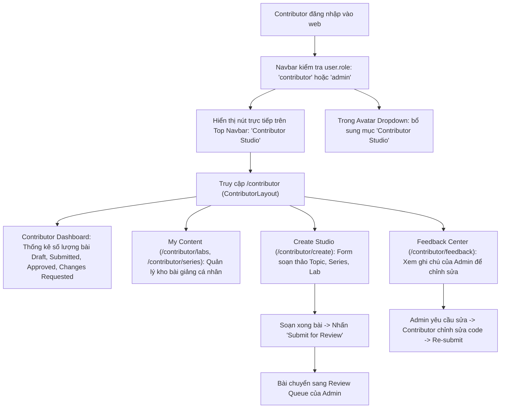
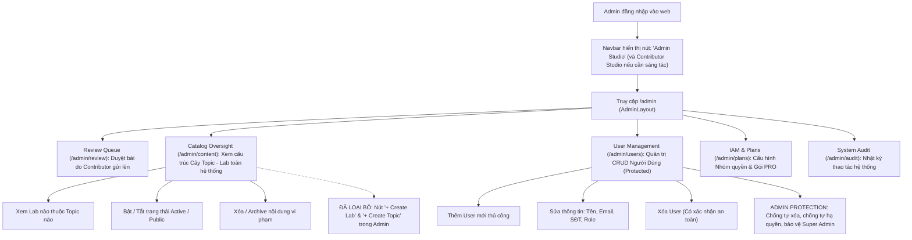

# Kế Hoạch Chi Tiết: Phân Tách Triệt Để Role Admin vs Contributor, Bổ Sung CRUD User (Role Protect) & Tối Ưu Navbar Navigation

> **Mã kế hoạch**: `PLAN-ROLE-SEPARATION-02`  
> **Dự án**: StudyIT Platform (`study-web`)  
> **Tác giả**: Antigravity Lead Pair-Programmer & Architect  
> **Ngày lập**: 13/10/2026  
> **Nguyên tắc chỉ đạo**:
> 1. **Contributor**: Chuyên trách 100% sáng tạo nội dung (Tạo Topic, Series, Lab, bài tập, code testcase, gửi duyệt, sửa bài theo feedback). Có lối vào trực tiếp từ Top Navbar (*Contributor Studio*).
> 2. **Admin**: Là người quản trị toàn quyền hệ thống (System & User Administration, IAM Groups, Review Queue kiểm duyệt, Catalog Oversight giám sát danh mục). Admin **không** trực tiếp gõ code tạo lab trong Admin Dashboard.
> 3. **CRUD User Toàn Diện**: Admin có đầy đủ quyền Thêm, Sửa, Xóa người dùng; tuy nhiên role `admin` bắt buộc phải có cơ chế **Admin Protection** (Chống tự xóa chính mình, chống tự hạ quyền, chống xóa Root Super Admin).
> 4. **Tối Ưu Navigation**: Gỡ bỏ nút "Dashboard" trên top Navbar (như ảnh người dùng đính kèm), đưa "Contributor Studio" ra ngoài top Navbar cho tài khoản Contributor/Admin.

---

## 1. Phân Tích Ma Trận Chức Năng: Admin vs Contributor (Feature Matrix)

| Tiêu chí / Nghiệp vụ | 🛡️ Role: Administrator (Admin Studio) | ✍️ Role: Contributor (Contributor Studio) | 🎓 Role: Student (Học viên) |
|---|---|---|---|
| **Mục đích cốt lõi** | Quản trị vận hành hệ thống, người dùng, bảo mật IAM & kiểm duyệt chất lượng | Sáng tác, biên soạn bài giảng thực hành, câu hỏi trắc nghiệm & nội dung kỹ thuật | Thực hành làm bài lab, nộp code kiểm thử, nâng cấp tài khoản học tập |
| **Tạo mới Topic / Series / Lab** | ❌ **Không làm trong Admin Dashboard** (Tránh dư thừa/loãng giao diện quản trị) | ✅ **Toàn quyền tạo & biên tập** trong Contributor Studio (`/contributor/create`) | ❌ Không có quyền |
| **Soạn thảo code / Test script / Monaco Editor** | ❌ Không cần soạn bài (chỉ inspect khi review bài nộp) | ✅ Trực tiếp lập trình starter code, test assertions, model solutions | ❌ Chỉ làm bài trong Workspace học viên |
| **Quy trình nộp bài kiểm duyệt (Review Lifecycle)** | ✅ **Kiểm duyệt & Phê duyệt**: Approve, Request Changes (kèm nhận xét), Reject, Publish live, Archive | ✅ **Soạn bài & Gửi duyệt**: Chuyển trạng thái từ `draft` $\to$ `submitted`; đọc feedback và chỉnh sửa | ❌ Không có quyền |
| **Giám sát Danh mục nội dung (Catalog Oversight)** | ✅ **Giám sát & Quản lý cây danh mục**: Xem hệ thống có những topic/lab nào, toggle active/inactive, gỡ bỏ nội dung vi phạm | ❌ Chỉ quản lý các nội dung do chính mình sáng tác (`my-labs`, `my-series`) | ❌ Chỉ xem catalog công khai đã publish |
| **Quản trị Người dùng (User Management)** | ✅ **CRUD Đầy đủ có bảo vệ**: Thêm mới, Sửa thông tin, Xóa user, Đổi role, Khóa/mở khóa | ❌ Không có quyền | ❌ Không có quyền |
| **Quản trị IAM Groups & Phân quyền Entitlements** | ✅ Quản lý nhóm AWS-style IAM Group, gói Subscription, User Overrides | ❌ Không có quyền | ❌ Không có quyền |
| **Audit Logs (Nhật ký kiểm toán)** | ✅ Xem toàn bộ lịch sử thao tác hệ thống | ❌ Không có quyền | ❌ Không có quyền |
| **Vị trí trên Navbar** | Nút đỏ nổi bật: `Admin Studio` (`/admin`) | Nút xanh/tím nổi bật: `Contributor Studio` (`/contributor`) | Chỉ hiển thị Avatar Dropdown & Series Catalog |

---

## 2. User Flow Chi Tiết: Contributor Khi Vào Website

---

## 3. User Flow Chi Tiết: Administrator (Admin)

---

## 4. Thiết Kế Module Quản Trị User (CRUD Toàn Diện + Role Protection)

### 4.1. Cơ Chế Bảo Vệ Quyền Quản Trị (Admin Role Protection Rules)
1. **Rule 1: Chống Tự Xóa (Self-Deletion Prevention)**:
   - Admin đang đăng nhập (`currentUser.userId === targetUser.id`) không thể tự bấm nút Xóa tài khoản của chính mình.
   - Nút Xóa trên giao diện bị vô hiệu hóa (disabled). Backend trả lỗi `400 Bad Request`.
2. **Rule 2: Chống Tự Hạ Quyền (Self-Demotion Prevention)**:
   - Admin không thể tự đổi role của chính mình từ `admin` thành `user` hoặc `contributor`.
3. **Rule 3: Bảo Vệ Super Admin Gốc (Root Admin Protection)**:
   - Tài khoản gốc của hệ thống (`admin@studyweb.dev`) không thể bị xóa hoặc bị vô hiệu hóa bởi bất kỳ ai.
4. **Rule 4: Cảnh Báo & Xác Nhận Cấp Cao Khi Thao Tác Quyền Admin**:
   - Khi cấp role `admin`: Hộp thoại xác nhận cảnh báo an ninh.
   - Khi xóa tài khoản: Bắt buộc mở modal xác nhận, yêu cầu gõ chữ `"DELETE"`.

### 4.2. Thiết Kế API Backend (`MODULE_BE/src/modules/users`)
- `POST /api/v1/users`: Tạo người dùng mới (Hash password bcrypt, gán role, kích hoạt tài khoản).
- `GET /api/v1/users/:id`: Lấy chi tiết thông tin người dùng.
- `PUT /api/v1/users/:id`: Cập nhật thông tin định danh & role (có kiểm tra Admin Protection).
- `DELETE /api/v1/users/:id`: Xóa người dùng (có kiểm tra Admin Protection).

### 4.3. Thiết Kế Giao Diện Frontend (`AdminUsersTab.tsx`)
- **Nút `+ Add New User`** mở `CreateUserModal`.
- **Nút `Edit`** mở `EditUserModal`.
- **Nút `Delete`** mở `DeleteUserDialog` với cảnh báo bảo vệ Admin.
- Bổ sung role `contributor` vào danh sách role filter và selector.

---

## 5. Tối Ưu Hóa Điều Hướng (Navigation & Top Navbar)
- **Gỡ bỏ nút "Dashboard" trên top Navbar**:
  - Xóa bỏ nút `<Link to="/user/dashboard">Dashboard</Link>` trên header.
  - Vẫn giữ mục *"Dashboard & Progress"* bên trong Avatar Dropdown cho học viên.
- **Đưa "Contributor Studio" ra Top Navbar**:
  - Khi user có role `contributor` (hoặc `admin`): Hiển thị nút trực tiếp `Contributor Studio` trên Navbar.

---

## 6. Kế Hoạch Thực Thi (WBS)
- **Phase 1: Backend Users Module**: DTOs, Service (Create, Update, Delete với Protection), Controller.
- **Phase 2: Frontend Navbar**: Xóa "Dashboard" trên header, đưa "Contributor Studio" ra Navbar.
- **Phase 3: Tinh Chỉnh Admin Content**: Gỡ bỏ "+ Create Topic" và "+ Add Lab", chuyển Admin Content thành Catalog Inspector.
- **Phase 4: Hoàn Thiện CRUD User Frontend**: API client, Create Modal, Edit Modal, Delete Modal, Admin Protection UI.
- **Phase 5: Kiểm Thử E2E & Hồi Quy**: Test script kiểm tra bảo vệ Admin, verify builds.
