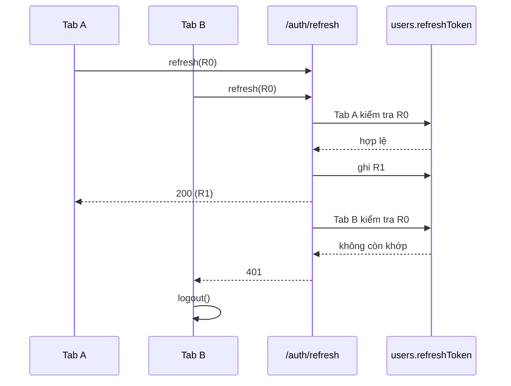
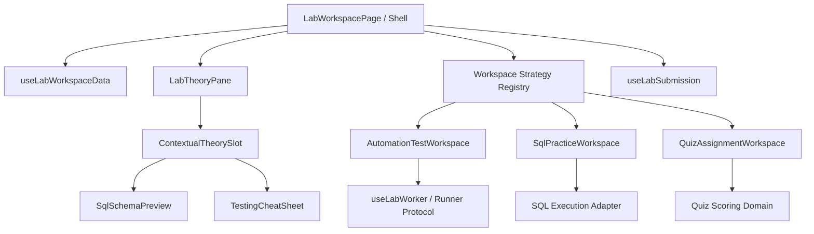

# Phân tích Nâng cấp Auth, Lab Workspace và Contributor Studio

## 1. Thông tin tài liệu (Document Information)

| Thuộc tính | Chi tiết |
|---|---|
| **Tên tài liệu** | Phân tích Nâng cấp Auth, Lab Workspace và Contributor Studio |
| **Version** | 1.0 |
| **Người làm** | OpenAI Codex — Software Architecture Analyst; người phê duyệt/owner: `n/a (not stated in source)` |
| **Phạm vi (Scope)** | Auth/session rotation; learner `LabWorkspacePage`; Web Worker runner; chiến lược Automation Test, SQL, Quiz; Contributor Studio; hợp đồng dữ liệu Lab |
| **Thời gian** | 2026-10-17 |
| **Tham chiếu từ** | Brief đính kèm `Pasted text.txt`, code trong working tree hiện tại và các tài liệu liên quan trong `docs/` |

> [!IMPORTANT]
> Tài liệu này là **phân tích hiện trạng và kiến trúc đề xuất**, không xác nhận rằng các hạng mục đã được triển khai. Baseline được khảo sát là working tree ngày 2026-10-17, trong đó đã có nhiều thay đổi chưa commit liên quan đến Lab Workspace, Worker, seed và Lab types. Các nhận định về “hiện trạng” vì vậy áp dụng cho working tree này, không nhất thiết trùng với `HEAD`.

## 2. Nội dung chính (Content)

### 2.1. TL;DR

- Hướng tách `LabWorkspacePage` thành shell + shared theory + workspace strategy là đúng. File hiện tại có **1.804 dòng** và đang giữ quá nhiều trách nhiệm độc lập.
- Root cause Auth trong brief **đúng một phần**: backend chỉ lưu một refresh token và có rotation, nhưng frontend đã có single-flight queue cho các request đồng thời trong cùng một tab. Rủi ro còn lại chủ yếu nằm ở nhiều tab/nhiều client, body token cũ được ưu tiên hơn cookie, và rotation không idempotent.
- Không nên thêm “grace period 30 giây” bằng cách chấp nhận mọi JWT refresh còn hạn. Cách đó làm yếu logout/revocation. Grace period chỉ an toàn khi server lưu dấu vết token trước đó hoặc kết quả rotation theo thời hạn và có kiểm thử replay/revocation.
- Automation runner hiện chỉ hỗ trợ `assert(...)`; chưa có `expect(...).toBe/toEqual/toBeDefined/toContain`. Dedicated Worker tránh khóa UI nhưng **không phải security sandbox hoàn chỉnh** vì worker vẫn có các API như `fetch`.
- SQL hiện là bộ diễn giải regex ở UI, không phải PostgreSQL 16 dù giao diện ghi như vậy. Nó sẽ tạo false positive/false negative khi câu lệnh vượt khỏi tập cú pháp rất hẹp.
- Quiz hiện hiển thị từng câu và chấm ngay từng câu. Assignment sheet + question palette là thay đổi hợp lý, nhưng cần chốt policy: cho sửa đáp án đến lúc submit, cách tính điểm, và có lưu điểm/đáp án hay không.
- Contributor Studio đã có split Markdown/live preview, toolbar định dạng và autosave 1,5 giây. Vấn đề quan trọng hơn là contract lưu dữ liệu: frontend gửi `sqlSchema`, `sampleData`, `quizQuestions`, trong khi backend DTO đang cấm các field này.
- Nên thêm một **Phase 0: hợp đồng dữ liệu + test harness** trước khi refactor UI. Nếu không, các workspace mới vẫn đọc/ghi dữ liệu theo các fallback JSON không ổn định.

### 2.2. Phân công & Vai trò (Who Does What)

| Thành phần / Actor | Trách nhiệm hiện tại | Trách nhiệm mục tiêu |
|---|---|---|
| Learner | Đọc theory, chạy code/query, trả lời quiz, submit | Giữ nguyên; UX thay đổi theo từng loại lab |
| Contributor | Soạn theory và cấu hình exercise qua 2 bước | Soạn một tài liệu Markdown-first, preview đúng góc nhìn learner, xác thực trước khi submit review |
| `LabWorkspacePage` | Fetch data, navigation, permissions, submissions, toàn bộ UI và logic 3 loại lab | Shell/orchestrator: fetch, shared state tối thiểu, navigation, submit, chọn strategy |
| `LabTheoryPane` | Chưa tồn tại; logic nằm inline trong page | Render header, description, PRO solution, history và contextual slot |
| Workspace strategy | Các nhánh `if/ternary` trong page | Component độc lập theo discriminated `sandboxType` contract |
| Web Worker runner | Ghép `submittedCode + testScript` bằng `new Function`, cung cấp `assert` | Runner có protocol versioned, matcher API, timeout, giới hạn output và policy capability rõ ràng |
| NestJS Auth | Xác thực, ký token, lưu một refresh token/user | Rotation an toàn, có concurrency semantics rõ ràng, revoke/replay tests |
| Axios gateway | Attach access token, single-flight refresh trong một JS context | Cookie-first refresh, cross-tab coordination, retry có giới hạn, logout chỉ khi refresh được xác nhận thất bại |
| Labs API / Prisma | Lưu các cột Lab hiện hữu; parse JSON từ `objective` khi đọc | Contract versioned cho metadata theo loại lab, validate ở boundary, không phụ thuộc fallback ngầm |
| Product owner | `n/a (not stated in source)` | Chốt các open decisions ở mục 2.12 trước implementation |

### 2.3. Phương pháp và Baseline kiểm chứng

Phân tích dựa trên:

1. Đọc toàn bộ brief đính kèm.
2. Đối chiếu trực tiếp code Auth, Lab Workspace, Worker, Studio, DTO và Prisma schema.
3. Đối chiếu `docs/workflows/01`, `03`, `06`, Product Backlog và Database Design.
4. Chạy production build hiện tại:
   - `MODULE_FE`: `npm run build` — **PASS**; có cảnh báo bundle JS khoảng 973 kB, lớn hơn ngưỡng 500 kB.
   - `MODULE_BE`: `npm run build` — **PASS**.
5. Không chạy E2E thực với database/browser vì repository hiện chỉ có placeholder unit-test scripts và không có test tự động cho concurrency refresh hoặc UI workflows.

Build pass chỉ chứng minh compile/bundle thành công; nó không chứng minh request Studio được backend chấp nhận hay refresh rotation an toàn dưới concurrency.

### 2.4. Phân tích Vấn đề 1 — Auth & Session Idle Auto-logout

#### 2.4.1. Những gì code hiện tại xác nhận

| Nhận định | Kết quả | Bằng chứng |
|---|---|---|
| Access token mặc định hết hạn sau 15 phút | **Confirmed** | `jwt.config.ts` dùng `ACCESS_TOKEN_EXPIRES_IN || '15m'` |
| Refresh token được rotate | **Confirmed** | `AuthService.refreshToken()` xác thực token hiện tại rồi gọi `generateTokens()`, hàm này ghi refresh token mới |
| Mỗi user chỉ có một refresh token hợp lệ trong DB | **Confirmed** | `User.refreshToken String?`; lookup bằng equality và update đè một field |
| Concurrent 401 trong cùng một tab tạo nhiều refresh call | **Không đúng với code hiện tại** | `api.client.ts` có `isRefreshing` + `failedQueue`; request sau chờ request refresh đầu tiên |
| Race vẫn có thể xảy ra giữa nhiều tab/client context | **Plausible / chưa có test** | Lock chỉ là biến module trong một JS context; backend rotation không idempotent |
| Refresh thất bại làm logout ngay | **Confirmed** | Catch của interceptor gọi `processQueue(error)` và `store.dispatch(logout())` |
| Có proactive silent refresh | **Không có** | `useAuth.ts` chỉ query `/auth/me`; không schedule theo JWT `exp`, không xử lý `visibilitychange` |
| Refresh token chỉ nằm trong HttpOnly cookie | **Sai** | Controller trả token trong response body; Redux lưu token vào `localStorage`; interceptor gửi token trong body |
| Refresh token được hash trong DB | **Sai** | `users.service.ts` lưu và lookup token plaintext |

#### 2.4.2. Race condition thực tế có thể xảy ra



Một interleaving khác còn nguy hiểm hơn: cả hai request cùng đọc R0 trước khi bất kỳ request nào ghi. Cả hai trả 200 với R1/R2, nhưng token được ghi cuối cùng mới hợp lệ; tab nhận token còn lại sẽ lỗi ở lần refresh tiếp theo.

Ngoài ra, endpoint ưu tiên `body.refreshToken` trước cookie. Điều này làm cookie HttpOnly mới có thể bị bỏ qua nếu body chứa token cũ.

#### 2.4.3. Đánh giá đề xuất “Grace Period 30s”

Grace period là một phần hợp lý của giải pháp nhưng chưa đủ chi tiết để implement an toàn.

Không chấp nhận cách sau:

- Nếu token không khớp DB nhưng chữ ký JWT còn đúng và mới rotate dưới 30 giây thì cho qua.

Cách đó không phân biệt token trước đó với token đã bị logout/revoke hoặc token replay bị đánh cắp.

Một trong các mô hình chấp nhận được:

| Mô hình | Cách hoạt động | Trade-off |
|---|---|---|
| Previous-token window | Lưu hash của current token, previous token và `previousValidUntil` | Dễ hiểu; cần thêm storage/schema hoặc cache bền vững |
| Idempotent rotation cache | Key theo hash R0; trong 30 giây các request R0 nhận cùng kết quả R1 | Tốt cho concurrency; cần cache atomic và xử lý multi-instance |
| Refresh-token family | Mỗi token có `jti`, family, replacement/reuse metadata | An toàn và audit tốt nhất; thay đổi lớn hơn |
| Cookie-only + cross-tab mutex | Không gửi refresh token trong body; dùng Web Locks/BroadcastChannel để một tab refresh | Giảm đáng kể race phía client; vẫn cần semantics backend khi nhiều device/client |

Khuyến nghị theo phạm vi surgical:

1. Viết integration test tái hiện hai refresh đồng thời trước khi sửa.
2. Chuyển refresh flow sang cookie-only; không trả/lưu refresh token trong JavaScript storage.
3. Bổ sung cross-tab coordination ở frontend.
4. Thêm idempotent rotation hoặc previous-token window ở backend; token phải được hash nếu lưu lâu dài.
5. Proactive refresh chỉ là lớp UX giảm xác suất 401, không thay thế correctness của rotation.

#### 2.4.4. Acceptance criteria cần bổ sung

- 5 API request đồng thời trong **cùng tab** tạo đúng 1 refresh request và đều retry thành công.
- 2 tab refresh cùng token cũ trong cùng cửa sổ concurrency: cả hai giữ phiên hợp lệ, không có “200 nhưng token chết”.
- Token cũ chỉ được xử lý theo policy grace đã định; hết grace trả 401.
- Logout/revoke vô hiệu hóa current và previous token; grace không được bypass logout.
- Refresh response lỗi mạng/timeout không tự động đồng nhất với “credential invalid”; tránh logout do lỗi tạm thời.
- Tab resume từ background schedule refresh tối đa một lần, tôn trọng clock skew và trạng thái offline.
- Refresh token không xuất hiện trong URL, Redux, `localStorage`, response body hay application logs.

### 2.5. Phân tích Vấn đề 2 — Lab Workspace và ba Strategy

#### 2.5.1. Monolith và boundary

`LabWorkspacePage.tsx` hiện có 1.804 dòng và chứa:

- fetch Lab/Series/Submission;
- permission/PRO solution;
- quick switcher, previous/next navigation, progress;
- shared theory tabs;
- Monaco editor và worker orchestration;
- parser SQL bằng regex, data transform và result diff;
- quiz state, per-question grading, hint/retry;
- submit mutation và success dialog.

Đây là vi phạm boundary rõ ràng. Tuy nhiên, mục tiêu “dưới 250 dòng” chỉ nên là guardrail. Tiêu chí chính phải là:

- shell không chứa thuật toán theo loại lab;
- mỗi strategy có contract typed và test độc lập;
- shared pane không biết chi tiết execution;
- không tạo duplicate fetch/submission logic trong ba workspace.

#### 2.5.2. Kiến trúc mục tiêu



React không cần class-based Strategy Pattern. Một component registry với discriminated union đơn giản hơn:

```ts
type PracticeLab =
  | { sandboxType: 'js_worker'; config: AutomationTestConfig }
  | { sandboxType: 'sql_worker'; config: SqlLabConfig }
  | { sandboxType: 'quizlet'; config: QuizLabConfig };

const workspaceByType = {
  js_worker: AutomationTestWorkspace,
  sql_worker: SqlPracticeWorkspace,
  quizlet: QuizAssignmentWorkspace,
} satisfies Record<PracticeLab['sandboxType'], ComponentType<WorkspaceProps>>;
```

`WorkspaceProps` nên chỉ chứa lab config đã normalize, draft/answer state, `onRun`, `onSubmit` và trạng thái submit. Không truyền toàn bộ query objects hoặc Redux store vào strategy.

#### 2.5.3. Shared Theory Pane

Thiết kế contextual slot là hợp lý, nhưng nên là composition thay vì `LabTheoryPane` tự switch theo `sandboxType`:

```tsx
<LabTheoryPane lab={lab} solution={solution} submissions={submissions}>
  {contextualTheoryAddon}
</LabTheoryPane>
```

Lợi ích: `LabTheoryPane` không phụ thuộc SQL/Automation components và có thể reuse ở Student Preview. Slot cần được đặt trong tab Description; solution/history giữ nguyên access control và data ownership ở shell.

#### 2.5.4. Pattern Automation Test — Guided Low-Code

Hiện trạng:

- Worker chỉ inject `assert(name, condition, message, expected, actual, hint)`.
- Không có `expect`, `toBe`, `toEqual`, `toBeDefined`, `toContain`.
- `new Function` chạy `submittedCode` và `testScript` cùng scope.
- Timeout 2 giây nằm ở main thread hook.
- Working tree đã có expected/actual/hint output, nhưng chưa có Jest-like DSL.

Đề xuất domain contract:

```ts
interface AutomationScenario {
  id: string;
  title: string;
  context: Record<string, unknown>;
  steps: Array<{
    id: string;
    prompt: string;
    starterAssertion: string;
    expectedMatchers: string[];
  }>;
}
```

Matcher nên trả structured result thay vì chỉ ném exception. `toEqual` cần deep equality có quy tắc rõ; error phải chứa matcher, expected, actual, path khác biệt và step id.

Rủi ro bảo mật: Dedicated Worker chặn DOM và giúp chống infinite loop bằng `terminate()`, nhưng worker vẫn có thể truy cập network API như `fetch`. Vì vậy tài liệu hiện tại không nên gọi đây là sandbox chống exfiltration hoàn chỉnh. Cần capability policy hoặc runner environment mạnh hơn nếu code không tin cậy.

#### 2.5.5. Pattern SQL — In-Docs Dataset & Focus Output

Di chuyển schema/dataset sang cột trái là cải thiện UX đúng hướng. Tuy nhiên, vấn đề correctness lớn hơn layout:

- Current engine dùng regex cho `WHERE`, `LIKE`, `IN`, `BETWEEN`, `ORDER BY`, một số aggregation.
- Nó không parse SQL grammar, transaction, null semantics, aliases, joins, nested query, expression precedence hoặc PostgreSQL types.
- UI hiện ghi `PostgreSQL 16`, tạo kỳ vọng sai.
- Diff so sánh theo thứ tự row, kể cả khi query không có `ORDER BY`; điều này có thể báo sai.

Quyết định bắt buộc trước implementation:

1. Nếu mục tiêu là SQL cơ bản, đổi label thành “SQL training subset”, công bố tập cú pháp hỗ trợ và dùng parser/engine thật cho subset.
2. Nếu mục tiêu là PostgreSQL, dùng execution adapter phù hợp (WASM engine tương thích hoặc backend sandbox) và test dialect compatibility.
3. Expected result phải quy định order-sensitive hay order-insensitive; duplicate rows và `NULL` cần semantics riêng.

`SqlSchemaPreview` nên copy column name, collapse dataset và giới hạn render số dòng lớn. Dataset learner nhìn thấy là dữ liệu public; hidden cases không được gửi xuống client.

#### 2.5.6. Pattern Quiz — Assignment Sheet & Question Palette

Hiện tại quiz:

- chỉ render một câu tại một thời điểm;
- chấm ngay khi bấm “Check Answer”;
- cho retry đến đúng;
- chỉ cho submit khi tất cả câu đã đúng;
- submit answers dưới dạng JSON trong `submittedCode`;
- không có field score độc lập ở `LabSubmission`.

Target Assignment Sheet nên tách ba state:

- `answers`: lựa chọn hiện tại, được sửa trước submit;
- `submissionState`: draft/submitting/submitted;
- `gradingResult`: score + per-question explanation sau submit.

Question palette là navigation state, không nên là nguồn dữ liệu riêng. Trạng thái màu phải derive từ `answers`. Trước submit, nếu còn câu trống: mở modal xác nhận, liệt kê số câu trống và cho jump tới câu đầu tiên.

Cần chốt việc scoring chỉ hiển thị trong phiên hay phải lưu/query được. Schema hiện tại chỉ có `submittedCode`, `status`, `executionTimeMs`, `testLogs`; nếu cấm schema change, điểm chỉ có thể encode trong JSON/log, khó query và không phải thiết kế lâu dài.

### 2.6. Phân tích Vấn đề 3 — Contributor Studio

#### 2.6.1. Brief đã lỗi thời một phần

Working tree hiện có:

- Step 1 là split view Markdown editor + live HTML preview.
- Toolbar Markdown cho bold, italic, code, heading, code block, table và link.
- Template theo `sandboxType`.
- Autosave `localStorage` debounce 1,5 giây và restore draft cho lab mới.
- Step 2 có builder riêng cho JS, SQL và Quiz.

Vì vậy không nên rebuild toàn bộ UI từ đầu. Nên giữ component editor và thay đổi workflow/data contract có chọn lọc.

#### 2.6.2. Các lỗi contract được xác nhận

| Vấn đề | Mức độ | Chi tiết |
|---|---|---|
| Field frontend không được DTO chấp nhận | Critical | `CreateLabInput` gửi `sqlSchema`, `sampleData`, `quizQuestions`; `CreateLabDto` không khai báo chúng; global pipe dùng `whitelist: true`, `forbidNonWhitelisted: true` |
| Validation runner không khóa publish | High | Builders có `onValidationChange`, nhưng `LabStudioPage` không truyền callback; page chỉ kiểm tra độ dài/presence |
| “Live Student Preview” chưa phải learner workspace thật | Medium | Preview hiện chủ yếu render Markdown, không reuse strategy workspace |
| Dữ liệu theo type dùng `objective` JSON fallback | High | Backend parse `objective` để lấy sample/expected/quiz; contract không version và không validate shape |
| `sandboxType` backend là string tự do | Medium | Không có enum validation đồng bộ FE/BE |

#### 2.6.3. Markdown-first không đổi schema

Yêu cầu này khả thi nếu định nghĩa một grammar/version rõ và mapper hai chiều. Đề xuất:

```markdown
# Tiêu đề bài lab

:::context
Mục tiêu và scenario...
:::

:::starter lang=javascript
// learner starter code
:::

:::solution lang=javascript
// reference solution
:::

:::tests format=json
{ "version": 1, "cases": [] }
:::
```

Mapper:

- Markdown prose → `instructions`.
- `context` → `objective` summary hoặc config envelope.
- `starter` → `initialSnippet`.
- `solution` → `solution`.
- `tests` → `testScript` hoặc versioned objective envelope, tùy strategy.
- SQL schema/dataset và Quiz questions → versioned config envelope trong field hiện hữu nếu thực sự không đổi DB schema.

Để tránh mất dữ liệu, parser phải bảo đảm:

- `parse(serialize(dto))` semantic-equal với DTO gốc;
- block lạ được preserve hoặc báo lỗi, không silently drop;
- duplicate/missing block có diagnostics với line/column;
- solution không xuất hiện trong student preview;
- config có `schemaVersion` và migration function.

Việc tận dụng `objective` làm JSON envelope là giải pháp migration ngắn hạn phù hợp với code hiện tại, nhưng cần mapper duy nhất ở API boundary. UI không nên tự `JSON.parse` rải rác.

### 2.7. Hợp đồng dữ liệu mục tiêu

Nên bổ sung một normalize layer duy nhất:

```ts
interface LabContentEnvelopeV1 {
  schemaVersion: 1;
  summary?: string;
  automation?: AutomationTestConfig;
  sql?: SqlLabConfig;
  quiz?: QuizLabConfig;
}
```

Luồng dữ liệu:

1. API nhận DTO rõ ràng hoặc Markdown source.
2. Backend validate theo `sandboxType`.
3. Mapper ghi vào các field Prisma hiện có.
4. API response trả `PracticeLab` đã normalize.
5. Workspace/Studio không đọc JSON fallback trực tiếp.

Các invariant:

- `js_worker` bắt buộc scenario + starter + executable assertions.
- `sql_worker` bắt buộc schema + dataset + expected-result policy.
- `quizlet` bắt buộc ít nhất một câu, options hợp lệ và `correctIndex` trong range.
- Không có default sample/quiz giả trong production khi dữ liệu thiếu; trả validation error hoặc explicit empty state.

### 2.8. Kế hoạch thực thi đề xuất và thứ tự phụ thuộc

Kế hoạch trong brief nên được điều chỉnh như sau:

#### Phase 0 — Characterization tests và contract

- Viết test tái hiện refresh concurrency cùng tab và nhiều tab/client.
- Chốt cookie-only vs token-in-body, grace semantics và revocation.
- Định nghĩa `PracticeLab` discriminated union + versioned content envelope.
- Fix DTO/serializer contract; thêm round-trip tests cho Studio data.
- Thêm test framework thật cho FE/BE thay vì placeholder scripts.

#### Phase 1 — Auth correctness

- Backend idempotent rotation/previous-token policy.
- Frontend refresh coordinator dùng chung và cross-tab lock.
- Proactive refresh theo `exp` + `visibilitychange`, nhưng reuse cùng coordinator.
- Security tests cho replay, revoke, logout và transient network error.

#### Phase 2 — Extract shared workspace shell

- Tách hooks data/submission/navigation trước.
- Tách `LabTheoryPane` và contextual slot.
- Tạo workspace registry; lúc đầu strategy components có thể wrap logic hiện hữu để giữ behavior.

#### Phase 3 — Implement từng strategy theo vertical slice

1. Automation: matcher engine → cheat sheet → workspace → tests.
2. SQL: chọn engine/policy → schema preview → result/diff workspace → tests.
3. Quiz: grading domain → assignment sheet → palette → submit/persistence tests.

Không triển khai cả ba UI trước khi contract và test của strategy đầu tiên ổn định.

#### Phase 4 — Markdown-first Studio

- Parser/serializer versioned + diagnostics.
- Smart block toolbar.
- Live Student Preview reuse presentation components của workspace.
- Autosave local + server draft policy; preflight verification khóa submit review.

#### Phase 5 — E2E và cập nhật tài liệu

- Auth idle/resume + multi-tab.
- Ba lab journeys và submission history.
- Studio create/edit/restore/preview/submit review.
- Cập nhật workflow/database docs theo code thật.

### 2.9. Ma trận ưu tiên và rủi ro

| Ưu tiên | Rủi ro | Ảnh hưởng | Giảm thiểu |
|---|---|---|---|
| P0 | Refresh rotation race / logout sai | Mất phiên người dùng | Characterization test + idempotent rotation + cross-tab coordination |
| P0 | Studio payload bị DTO reject | Không tạo/cập nhật được lab type-specific | Mapper/DTO rõ ràng + API integration test |
| P0 | SQL regex cho kết quả sai | Học viên được chấm sai | Engine/grammar thật + dialect contract |
| P1 | Refresh token plaintext và localStorage | Replay/XSS impact cao | Cookie-only, hash server-side, revoke tests |
| P1 | Worker bị gọi là secure sandbox quá mức | Code learner có thể dùng network API | Capability restriction/isolated execution policy |
| P1 | Solution-verification gate không được wire | Nội dung lỗi vẫn publish/submit review | Page-level verified state invalidated khi input đổi |
| P1 | Objective JSON không version | Data drift và mất dữ liệu khi edit | Versioned envelope + migration + round-trip tests |
| P2 | Bundle JS ~973 kB | Tải trang chậm | Lazy-load Monaco/workspaces theo route/strategy |
| P2 | Mục tiêu `<250` dòng trở thành metric cứng | Tách file hình thức nhưng coupling còn nguyên | Đo dependency/cohesion và testability |

### 2.10. Definition of Done tổng thể

- Mỗi subtask có test tự động hoặc verification command tái lập được; không dùng kiểm tra thủ công làm bằng chứng duy nhất.
- Auth concurrency/replay/revoke matrix pass ở backend integration và browser multi-tab test.
- `LabWorkspacePage` chỉ còn orchestration; không chứa SQL parser, quiz grading hay matcher logic.
- Ba strategy dùng typed config, không đọc `objective` JSON trực tiếp.
- SQL UI không tuyên bố PostgreSQL nếu engine không đáp ứng dialect PostgreSQL đã cam kết.
- Student Preview và learner view dùng cùng presentational components/normalizer.
- Studio Markdown round-trip không mất dữ liệu; submit review bị khóa cho đến khi preflight test mới nhất pass.
- FE/BE build, unit/integration tests và E2E journeys đều pass.
- Không còn fallback sample/quiz giả trong production path khi API data thiếu.
- Workflow và Database docs được cập nhật theo source of truth.

### 2.11. Lịch sử sửa đổi (Revision History)

| Version | Ngày | Tác giả | Ghi chú |
|---|---|---|---|
| 1.0 | 2026-10-17 | OpenAI Codex | Phân tích brief, đối chiếu working tree, đề xuất target architecture, sequence thực thi, risks và acceptance criteria |

### 2.12. Vấn đề tồn đọng (Open Issues)

Các quyết định cần người phụ trách sản phẩm/kỹ thuật chốt trước implementation:

1. Auth có hỗ trợ nhiều device/session đồng thời hay mỗi user chỉ được một refresh session?
2. Có chấp nhận migration DB cho refresh-token family/previous-token metadata hay bắt buộc dùng external cache?
3. Refresh token sẽ chuyển hoàn toàn sang HttpOnly cookie hay vẫn hỗ trợ body token cho client không phải browser?
4. Automation Test Lab dạy unit assertion, API response assertion hay browser automation? Ba phạm vi cần runner khác nhau.
5. SQL target là subset giáo dục hay PostgreSQL-compatible execution? Hidden test có cần chạy server-side không?
6. Quiz cho phép xem đáp án ngay hay chỉ sau submit? Có retry không giới hạn không? Điểm có cần lưu/query trong dashboard không?
7. Markdown document là source of truth duy nhất hay chỉ là UI authoring format được map sang DTO?
8. Có cần backward compatibility với dữ liệu seed/current labs dùng `objective` JSON không? Nếu có, migration version nào được hỗ trợ?
9. “Auto-save” là local draft hay phải lưu server-side để dùng qua thiết bị?
10. Working tree hiện có nhiều thay đổi chưa commit trong đúng khu vực Lab; cần xác định owner và baseline commit trước khi refactor để tránh ghi đè công việc đang làm.

Mâu thuẫn/tài liệu cũ phát hiện trong cross-check:

- `docs/workflows/01-auth-login-to-home.md` ghi access token chỉ ở memory và refresh token được hash; code hiện lưu cả hai trong `localStorage` và refresh token plaintext trong DB.
- Workflow Auth ghi cookie path/behavior khác code controller hiện tại.
- `docs/workflows/03-lab-practice-webworker.md` tham chiếu các file không tồn tại: `PracticeLabPage.tsx`, `LabWorkspace.tsx`, `TestOutputPanel.tsx`; file thực tế là `LabWorkspacePage.tsx` và `WorkerResultPanel.tsx`.
- Workflow Worker mô tả security isolation tuyệt đối hơn khả năng thực tế của Dedicated Worker.
- `docs/workflows/06-create-lab-studio.md` nói preflight verification bắt buộc khóa publish; callback có trong builders nhưng chưa được nối vào page-level publish gate.
- `docs/05-database.md` mô tả `mockConfig`, `user_progress`, `submissionContent`, `score`, `feedback`; Prisma schema hiện tại không có các field/model tương ứng. `isFreePreview` cũng lệch default giữa docs và schema.

## 3. Tài liệu tham khảo (References)

### 3.1. Tài liệu nguồn

- Brief gốc: `C:/Users/KhanhDuy/.codex/attachments/368f61e9-1415-4c9c-bed2-3002ee3625e7/Pasted text.txt`

### 3.2. Mã nguồn được đối chiếu

- Backend Auth: [`auth.service.ts`](../MODULE_BE/src/modules/auth/auth.service.ts), [`auth.controller.ts`](../MODULE_BE/src/modules/auth/auth.controller.ts), [`users.service.ts`](../MODULE_BE/src/modules/users/users.service.ts), [`schema.prisma`](../MODULE_BE/prisma/schema.prisma)
- Frontend Auth: [`api.client.ts`](../MODULE_FE/src/services/api.client.ts), [`useAuth.ts`](../MODULE_FE/src/features/auth/hooks/useAuth.ts), [`auth.slice.ts`](../MODULE_FE/src/stores/slices/auth.slice.ts)
- Learner Lab: [`LabWorkspacePage.tsx`](../MODULE_FE/src/pages/lab/LabWorkspacePage.tsx), [`lab-runner.worker.ts`](../MODULE_FE/src/features/lab/workers/lab-runner.worker.ts), [`useLabWorker.ts`](../MODULE_FE/src/features/lab/hooks/useLabWorker.ts), [`lab.types.ts`](../MODULE_FE/src/types/lab.types.ts)
- Contributor Studio: [`LabStudioPage.tsx`](../MODULE_FE/src/pages/lab/LabStudioPage.tsx), [`MarkdownEditorWithPreview.tsx`](../MODULE_FE/src/pages/lab/_components/MarkdownEditorWithPreview.tsx), [`CreateLabDto`](../MODULE_BE/src/modules/labs/dto/create-lab.dto.ts), [`labs.service.ts`](../MODULE_BE/src/modules/labs/labs.service.ts)

### 3.3. Tài liệu liên quan

- [Auth & Session Workflow](workflows/01-auth-login-to-home.md)
- [Lab Practice & Web Worker Workflow](workflows/03-lab-practice-webworker.md)
- [Contributor Lab Studio Workflow](workflows/06-create-lab-studio.md)
- [Product Backlog](03-product-backlog.md)
- [Database Design](05-database.md)

