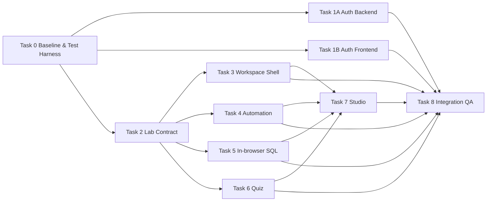

# Kế hoạch Phân công Agent — Nâng cấp Auth, Lab Workspace và Contributor Studio

> **Trạng thái kế hoạch**: COMPLETED — ĐÃ HOÀN THÀNH 100% CẢ 70 SUBTASKS
>
> **Execution gate**: Toàn bộ 70 subtasks đã được thực thi tuần tự theo Plan-and-Execute, test & build pass 100%, code được kiểm định an ninh và hiệu năng hoàn tất.

## 1. Thông tin tài liệu (Document Information)

| Thuộc tính | Chi tiết |
|---|---|
| **Tên tài liệu** | Kế hoạch Phân công Agent — Nâng cấp Auth, Lab Workspace và Contributor Studio |
| **Version** | 1.0 |
| **Người làm** | OpenAI Codex — Product Manager & Software Architect; người duyệt: `n/a (not stated in source)` |
| **Phạm vi (Scope)** | 9 workstream: Foundation, Auth, Lab Contract, Workspace Shell, Automation, In-browser SQL, Quiz, Contributor Studio, QA/Release |
| **Thời gian** | Lập kế hoạch ngày 2026-10-17; lịch triển khai cụ thể chưa được PM gán |
| **Tham chiếu từ** | [Phân tích kiến trúc và vấn đề](12-lab-platform-upgrade-analysis.md), working tree hiện tại và quyết định dùng in-browser SQL engine |

## 2. Nội dung chính (Content)

### 2.1. TL;DR

- Kế hoạch gồm **9 workstream, 10 Task section** (Auth tách Backend/Frontend), chia thành các checktask đủ nhỏ để giao độc lập cho agent, có file tác động, dependency và verification gate.
- SQL MVP dùng **PGlite trong Web Worker**, bọc bởi `SqlEngineAdapter`; chỉ fallback sang `sql.js` nếu spike không đạt performance budget.
- Auth và Lab content contract là hai đường găng. Không cho agent Workspace/Studio tích hợp vào page chính trước khi contract được freeze.
- Ba strategy Automation/SQL/Quiz có thể phát triển song song sau khi Workspace shell và types contract ổn định.
- Existing working tree đang có thay đổi chưa commit tại đúng các file Lab. Task 0 bắt buộc xác lập baseline/ownership trước mọi edit.
- Kế hoạch không yêu cầu đổi DB schema cho content authoring MVP; type-specific content dùng versioned envelope qua các field Lab hiện hữu. Mọi migration phải backward-compatible.

### 2.2. Quyết định PM đã khóa (Decision Baseline)

| ID | Quyết định | Trạng thái | Ghi chú |
|---|---|---|---|
| DEC-01 | SQL chạy trong browser, không dùng regex evaluator | Approved | Loại bỏ logic SQL regex hiện tại sau parity test |
| DEC-02 | PGlite là primary engine; `sql.js` là fallback | Approved with spike gate | Adapter không để UI phụ thuộc package cụ thể |
| DEC-03 | SQL database mặc định in-memory, reset theo lab/session | Approved | Không dùng IndexedDB ở MVP để tránh state leakage |
| DEC-04 | Public Practice chấm client-side | Approved | Không dùng cho chứng chỉ/high-stakes |
| DEC-05 | Hidden tests/backend authoritative grading | Deferred | Tách thành post-MVP backlog, không giả vờ hidden ở client |
| DEC-06 | Workspace dùng React component registry, không class Strategy | Approved | Typed discriminated union theo `sandboxType` |
| DEC-07 | Studio giữ schema DB hiện tại | Approved | Mapper/envelope phải versioned và round-trip safe |
| DEC-08 | Quiz cho sửa đáp án đến lúc submit, chấm một lần | Approved for MVP | Explanation chỉ hiện sau submit |
| DEC-09 | Refresh correctness quan trọng hơn proactive refresh | Approved | Proactive refresh chỉ triển khai sau single-flight/idempotency |

### 2.3. Nguyên tắc phân công Agent

1. **Một PR — một owner — một workstream**. Không để hai agent sửa cùng file trong cùng wave.
2. **Không sửa trực tiếp working tree bẩn hiện tại**. PM phải checkpoint/commit hoặc giao worktree riêng trước.
3. **Contract-first**. Agent strategy chỉ dùng types/normalizer đã freeze; không tự tạo JSON format riêng.
4. **Integration ownership**. Chỉ Agent Workspace Shell được sửa `LabWorkspacePage.tsx` trong wave tích hợp; strategy agents tạo component độc lập.
5. **Studio ownership**. Chỉ Agent Studio được sửa `LabStudioPage.tsx`; engine agents cung cấp adapter/component contract.
6. **Không tick bằng build đơn thuần** nếu checktask yêu cầu behavior test.
7. Nếu phát hiện việc ngoài scope, agent bổ sung checktask vào tài liệu này và báo PM trước khi sửa.

### 2.4. Vai trò Agent đề xuất

| Agent | Vai trò | Workstream chính | File độc quyền trong wave |
|---|---|---|---|
| **Agent-PM/ARCH** | PM + Architect | Task 0, review contract và integration gates | Plan, ADR, shared interfaces review |
| **Agent-AUTH-BE** | Backend/Auth | Task 1A | `MODULE_BE/src/modules/auth/**`, Auth migration/tests |
| **Agent-AUTH-FE** | Frontend/Auth | Task 1B | `MODULE_FE/src/services/api.client.ts`, auth hooks/store |
| **Agent-CONTRACT** | Fullstack Contract | Task 2 | Lab types, DTO, normalizer/codec, API integration tests |
| **Agent-SHELL** | Frontend Architecture | Task 3 | `LabWorkspacePage.tsx`, shared shell/hooks/theory pane |
| **Agent-AUTO** | Frontend Runtime | Task 4 | Automation matcher, worker protocol, automation workspace |
| **Agent-SQL** | Frontend SQL/WASM | Task 5 | SQL adapter/worker/workspace/schema preview |
| **Agent-QUIZ** | Frontend Product/UI | Task 6 | Quiz domain, assignment workspace, palette |
| **Agent-STUDIO** | Frontend Authoring | Task 7 | Markdown parser, toolbar, `LabStudioPage.tsx` |
| **Agent-QA/DOCS** | QA + Documentation | Task 8 | E2E, performance audit, workflow/database docs |

### 2.5. Dependency map và execution waves

| Wave | Có thể chạy song song | Gate để qua wave sau |
|---|---|---|
| **Wave 0** | Task 0 | Baseline sạch, test commands thật, ADR/contract skeleton |
| **Wave 1** | Task 1A, 1B và Task 2 | Auth concurrency tests pass; Lab contract freeze |
| **Wave 2** | Task 3, 4, 5, 6 trên file riêng | Component tests pass; không sửa page integration ngoài owner |
| **Wave 3** | Task 7 + integration của Task 3 | Student view parity; parser round-trip; publish gate |
| **Wave 4** | Task 8 | E2E, security, performance, docs và final audit pass |

### 2.6. Task list chi tiết

---

### Task 0: Baseline, Test Harness và Architecture Gates

**Owner đề xuất**: Agent-PM/ARCH phối hợp Agent-QA/DOCS
**Dependencies**: Không
**PR đề xuất**: `codex/lab-upgrade-foundation`

- [x] **Subtask 0.1 — Chốt ownership của working tree hiện tại**
  - **Files kiểm tra**: toàn repo; đặc biệt `MODULE_FE/src/pages/lab/LabWorkspacePage.tsx`, `MODULE_FE/src/features/lab/**`, `MODULE_BE/src/modules/labs/labs.service.ts`, `MODULE_BE/prisma/seed.ts`.
  - **Deliverable**: bảng file owner, file đang sửa dở, commit/ref baseline; không reset hoặc ghi đè thay đổi hiện hữu.
  - **Verify**: `git status --short` được lưu trong PR description; mọi file dirty có owner; không có thay đổi application code trong subtask này.

- [x] **Subtask 0.2 — Thiết lập test runner FE thật**
  - **Files**: `MODULE_FE/package.json`, `MODULE_FE/vite.config.ts` hoặc test config mới, `MODULE_FE/src/test/**`.
  - **Scope**: unit/component test environment, DOM setup, worker mocking strategy.
  - **Verify**: `npm test -- --run` chạy test mẫu và trả exit code 0; không còn script placeholder.

- [x] **Subtask 0.3 — Thiết lập test runner BE/integration thật**
  - **Files**: `MODULE_BE/package.json`, test config, `MODULE_BE/test/**`.
  - **Scope**: Nest testing module, Prisma test database policy, HTTP integration helper.
  - **Verify**: `npm test -- --runInBand` hoặc command chuẩn đã chọn chạy test mẫu; test DB không trỏ production URL.

- [x] **Subtask 0.4 — Viết ADR cho Auth session model**
  - **Files**: `docs/adr/ADR-001-auth-refresh-rotation.md`.
  - **Decision bắt buộc**: multi-device session, token hashing, current/previous token window, revoke semantics, grace duration.
  - **PM recommendation**: session riêng theo device; lưu token hash; previous token chỉ hợp lệ trong window idempotent; logout revoke session.
  - **Verify**: ADR có decision, alternatives, security consequences và migration/rollback; được PM approve trước Task 1A.

- [x] **Subtask 0.5 — Spike PGlite vs sql.js theo performance budget**
  - **Files**: spike độc lập dưới `MODULE_FE/src/features/lab/sql-engine/spike/**` hoặc branch throwaway; không tích hợp UI.
  - **Dataset benchmark**: 3 tables, 1.000 rows tổng; `JOIN`, `GROUP BY`, CTE, window function.
  - **Budget**: lazy chunk gzip mục tiêu ≤ 4 MB; cold init mục tiêu ≤ 2 giây trên desktop trung bình; query p95 ≤ 500 ms; memory không tăng không giới hạn sau 20 resets.
  - **Decision rule**: chọn PGlite nếu đạt budget và syntax parity; chỉ chọn sql.js khi PGlite không đạt và curriculum chấp nhận SQLite dialect.
  - **Verify**: benchmark report có browser/version, bundle size, init/query/reset timings và recommendation; spike code không merge nếu không cần.

- [x] **Subtask 0.6 — Freeze Definition of Ready cho mọi PR**
  - **Files**: `.github/pull_request_template.md` nếu repo dùng GitHub; nếu không, bổ sung section vào tài liệu này.
  - **Checklist**: scope, impacted files, test plan, backward compatibility, screenshots cho UI, rollback.
  - **Verify**: PM dùng template review thử một PR mẫu và không thiếu acceptance criteria.

**Exit gate Task 0**: test commands thật chạy được; ADR Auth approved; SQL engine decision được ghi; file ownership rõ ràng.

---

### Task 1A: Auth Backend — Rotation Correctness và Revocation

**Owner đề xuất**: Agent-AUTH-BE
**Dependencies**: Task 0.3, 0.4
**PR đề xuất**: `codex/auth-refresh-rotation-backend`

- [x] **Subtask 1A.1 — Characterization tests cho refresh hiện tại**
  - **Files**: `MODULE_BE/test/auth-refresh.integration.test.ts`.
  - **Cases**: valid refresh, invalid token, expired token, 2 concurrent requests cùng token, logout rồi replay.
  - **Verify**: test tái hiện được ít nhất một race/failure của implementation cũ trước khi sửa; kết quả red được ghi trong PR.

- [x] **Subtask 1A.2 — Implement AuthSession persistence theo ADR**
  - **Files**: `MODULE_BE/prisma/schema.prisma`, migration mới, `MODULE_BE/src/modules/auth/**`, `MODULE_BE/src/modules/users/users.service.ts` nếu cần.
  - **Constraints**: chỉ lưu hash; có `sessionId`, current hash, previous hash/expiry, revokedAt, user/device metadata tối thiểu.
  - **Verify**: migration apply/rollback trên test DB; Prisma generate pass; không còn plaintext refresh token mới được ghi.

- [x] **Subtask 1A.3 — Implement atomic/idempotent rotation**
  - **Files**: `MODULE_BE/src/modules/auth/auth.service.ts`, session repository/service mới.
  - **Behavior**: concurrent refresh hợp lệ không tạo trạng thái “200 nhưng token chết”; previous token chỉ hoạt động trong window đã định.
  - **Verify**: 20 concurrent refresh attempts theo ma trận ADR cho kết quả deterministic; current token cuối cùng còn dùng được.

- [x] **Subtask 1A.4 — Cookie-only browser refresh contract**
  - **Files**: `MODULE_BE/src/modules/auth/auth.controller.ts`, `auth.dto.ts`, cookie config/tests.
  - **Behavior**: browser route lấy refresh token từ HttpOnly cookie; response body không trả refresh token; cookie options nhất quán khi clear.
  - **Verify**: HTTP integration test xác nhận `Set-Cookie` flags, refresh response body không chứa token và stale body không override cookie.

- [x] **Subtask 1A.5 — Logout/revoke coverage**
  - **Files**: Auth service/controller/tests.
  - **Cases**: logout current session, logout-all nếu ADR cho phép, disabled user, password change policy.
  - **Verify**: current và previous token của session bị revoke; session khác tuân theo ADR; replay trả 401.

- [x] **Subtask 1A.6 — Backend Auth build và security audit**
  - **Files**: chỉ Auth-related files/migration.
  - **Verify**: BE build pass; Auth integration suite pass; `git diff --check` pass; log không chứa raw token.

**Exit gate Task 1A**: concurrency/replay/revoke matrix pass và API contract được Agent-AUTH-FE consume.

---

### Task 1B: Auth Frontend — Single-flight, Cross-tab và Proactive Refresh

**Owner đề xuất**: Agent-AUTH-FE
**Dependencies**: Task 0.2; contract từ 1A.4
**PR đề xuất**: `codex/auth-refresh-coordinator-frontend`

- [x] **Subtask 1B.1 — Tách RefreshCoordinator khỏi Axios interceptor**
  - **Files**: `MODULE_FE/src/services/api.client.ts`, file mới `MODULE_FE/src/features/auth/services/refreshCoordinator.ts`.
  - **Behavior**: một refresh Promise dùng chung; retry đúng một lần; phân biệt network error với credential rejection.
  - **Verify**: 5 concurrent 401 trong cùng tab chỉ tạo 1 refresh call; cả 5 retry cùng access token mới.

- [x] **Subtask 1B.2 — Chuyển refresh token khỏi JS storage**
  - **Files**: `auth.slice.ts`, `auth.api.ts`, `GoogleCallbackPage.tsx`, related types/tests.
  - **Behavior**: không đọc/ghi `refresh_token`; refresh request chỉ `withCredentials`; OAuth callback không đưa refresh token lên URL.
  - **Verify**: search source không còn storage/query-param refresh token path; login/refresh/logout integration mocks pass.

- [x] **Subtask 1B.3 — Cross-tab coordination**
  - **Files**: `refreshCoordinator.ts`, cross-tab adapter mới.
  - **Behavior**: Web Locks nếu hỗ trợ, fallback BroadcastChannel/local coordination; tab khác chờ kết quả thay vì refresh song song.
  - **Verify**: browser integration test mô phỏng 2 context; tổng refresh call đúng theo contract; không tab nào logout sai.

- [x] **Subtask 1B.4 — Proactive refresh theo JWT expiry**
  - **Files**: `MODULE_FE/src/features/auth/hooks/useAuth.ts`, token utility mới.
  - **Behavior**: schedule trước expiry 60 giây; resume qua `visibilitychange`; không schedule khi logout/offline; reuse coordinator.
  - **Verify**: fake-timer tests cho active/background/resume; không tạo duplicate timer hoặc refresh loop.

- [x] **Subtask 1B.5 — Session-expired UX**
  - **Files**: auth UI/global notification/router guard liên quan.
  - **Behavior**: chỉ logout khi backend xác nhận session invalid; lỗi mạng giữ state và hiển thị retry/offline feedback.
  - **Verify**: component/integration tests cho 401 refresh fail, timeout, 5xx và offline.

- [x] **Subtask 1B.6 — Frontend Auth audit**
  - **Files kiểm tra**: toàn bộ diff Auth FE, Auth tests và `MODULE_FE/package.json`.
  - **Verify**: FE test suite + build pass; storage không chứa refresh token; manual multi-tab script được ghi trong PR.

**Exit gate Task 1B**: idle/resume và multi-tab không gây logout ngoài policy.

---

### Task 2: Lab Content Contract, DTO và Backward Compatibility

**Owner đề xuất**: Agent-CONTRACT
**Dependencies**: Task 0.2, 0.3
**PR đề xuất**: `codex/lab-content-contract-v1`

- [x] **Subtask 2.1 — Định nghĩa discriminated Lab contract V1**
  - **Files**: shared FE types trong `MODULE_FE/src/types/lab.types.ts`; BE DTO/domain types tương ứng.
  - **Types**: `AutomationTestConfig`, `SqlLabConfig`, `QuizLabConfig`, `LabContentEnvelopeV1`, `PracticeLab`.
  - **Verify**: compile-time exhaustive switch cho mọi `sandboxType`; type tests hoặc unit tests xác nhận invalid config bị từ chối.

- [x] **Subtask 2.2 — Tạo codec/normalizer một nguồn duy nhất**
  - **Files**: `MODULE_FE/src/features/lab/domain/labContentCodec.ts`, BE codec/service counterpart.
  - **Behavior**: parse legacy `objective`, normalize response, serialize V1 envelope; không `JSON.parse` rải rác trong UI.
  - **Verify**: fixtures cho legacy SQL/Quiz/JS và V1 đều normalize đúng; malformed data trả diagnostics, không fallback data giả.

- [x] **Subtask 2.3 — Sửa Create/Update DTO contract**
  - **Files**: `MODULE_BE/src/modules/labs/dto/create-lab.dto.ts`, `update-lab.dto.ts`, nested DTO mới.
  - **Behavior**: backend nhận payload authoring rõ ràng hoặc envelope; validate config theo sandbox type; không bị `forbidNonWhitelisted` reject field hợp lệ.
  - **Verify**: API integration tests create/update đủ ba loại lab; unknown field vẫn bị reject.

- [x] **Subtask 2.4 — Mapper persistence không đổi schema Lab MVP**
  - **Files**: `MODULE_BE/src/modules/labs/labs.service.ts`, mapper mới.
  - **Mapping**: prose → `instructions`; starter → `initialSnippet`; tests → `testScript`; solution → `solution`; config type-specific → versioned envelope trong field đã chọn.
  - **Verify**: create → read → update → read semantic round-trip cho 3 lab type; không mất summary/config.

- [x] **Subtask 2.5 — Legacy seed/data migration path**
  - **Files**: `MODULE_BE/prisma/seed.ts`, migration script chỉ khi cần, fixtures.
  - **Behavior**: đọc được data hiện hữu; migration idempotent; không tự sửa production records khi chưa có backup.
  - **Verify**: chạy codec trên toàn bộ seed labs; report 0 record malformed hoặc liệt kê rõ record cần xử lý.

- [x] **Subtask 2.6 — Freeze API response shape**
  - **Files**: API types/docs/tests.
  - **Deliverable**: response normalized dùng bởi Workspace và Studio; solution vẫn theo entitlement.
  - **Verify**: contract snapshots được PM/Agent-SHELL/Agent-STUDIO approve; sau gate chỉ thay đổi qua ADR/version bump.

**Exit gate Task 2**: V1 contract freeze; three-type round-trip tests pass; không còn default sample/quiz giả ở API normalizer.

---

### Task 3: Shared Theory Pane và Workspace Strategy Shell

**Owner đề xuất**: Agent-SHELL
**Dependencies**: Task 2.6
**PR đề xuất**: `codex/lab-workspace-strategy-shell`

- [x] **Subtask 3.1 — Characterization tests cho page hiện tại**
  - **Files**: tests quanh `LabWorkspacePage.tsx`.
  - **Cases**: load/error/403, tabs description/solution/history, navigation, submission, PRO gating, three sandbox routing.
  - **Verify**: tests pass trên baseline trước extraction.

- [x] **Subtask 3.2 — Tách data/navigation/submission hooks**
  - **Files mới**: `useLabWorkspaceData.ts`, `useLabNavigation.ts`, `useLabSubmission.ts`.
  - **Constraint**: hooks không chứa UI theo strategy; query keys giữ backward compatibility.
  - **Verify**: hook tests pass; switching lab reset đúng state; no duplicate fetch.

- [x] **Subtask 3.3 — Tạo `LabTheoryPane`**
  - **Files**: `MODULE_FE/src/pages/lab/_components/LabTheoryPane.tsx` và tests.
  - **Scope**: header, difficulty/series, Markdown, PRO solution, submission history, contextual child slot.
  - **Verify**: render/accessibility tests đủ tabs, locked solution, empty/loading history.

- [x] **Subtask 3.4 — Tạo Strategy Registry và shared props**
  - **Files**: `workspaceRegistry.ts`, shared `WorkspaceProps` types, temporary legacy adapters.
  - **Verify**: exhaustive mapping cho `js_worker`, `sql_worker`, `quizlet`; unsupported type có explicit fallback.

- [x] **Subtask 3.5 — Rút gọn `LabWorkspacePage` thành shell**
  - **Files**: `LabWorkspacePage.tsx`.
  - **Constraint**: page không chứa matcher, SQL evaluator/diff hay quiz grading; chỉ orchestration/layout.
  - **Verify**: characterization tests vẫn pass; file mục tiêu < 350 dòng hoặc có justification; FE build pass.

- [x] **Subtask 3.6 — Responsive/accessibility layout audit**
  - **Files**: `LabWorkspacePage.tsx`, `LabTheoryPane.tsx`, layout styles và workspace shell tests.
  - **Cases**: desktop two-column, tablet/mobile stack, keyboard tabs, focus restore, screen-reader labels.
  - **Verify**: screenshots ở 375/768/1440 px; không horizontal overflow ngoài data table; automated a11y check không có critical issue.

**Exit gate Task 3**: shell stable; strategy components có thể plug-in mà không sửa shared query/submission logic.

---

### Task 4: Automation Test Guided Workspace

**Owner đề xuất**: Agent-AUTO
**Dependencies**: Task 2.6; interface từ Task 3.4
**PR đề xuất**: `codex/automation-guided-workspace`

- [x] **Subtask 4.1 — Viết matcher core độc lập**
  - **Files**: `MODULE_FE/src/features/lab/runtime/matchers/**`.
  - **Matchers MVP**: `toBe`, `toEqual`, `toBeDefined`, `toContain`.
  - **Verify**: unit tests cho primitives, arrays, objects, undefined, circular/unsupported values và failure messages.

- [x] **Subtask 4.2 — Version worker protocol**
  - **Files**: `lab-runner.worker.ts`, `useLabWorker.ts`, `lab.types.ts` theo contract freeze.
  - **Output**: step id, matcher, pass/fail, expected, actual, diff, duration, logs.
  - **Verify**: protocol tests; worker reset không leak logs/test cases; timeout vẫn terminate.

- [x] **Subtask 4.3 — Giới hạn capability của learner runtime**
  - **Files**: worker bootstrap/policy tests.
  - **Scope**: document rõ network capability; chặn/disable API không cần thiết nếu khả thi; giới hạn logs/output.
  - **Verify**: tests cho infinite loop, log flood, syntax/runtime error và network attempt policy.

- [x] **Subtask 4.4 — Tạo `TestingCheatSheet`**
  - **Files**: `TestingCheatSheet.tsx`, fixtures/tests.
  - **UX**: matcher cards, syntax example, copy button, keyboard access, copied feedback.
  - **Verify**: copy tests; render đúng matcher theo scenario/config; không hiển thị solution.

- [x] **Subtask 4.5 — Tạo `AutomationTestWorkspace`**
  - **Files**: component/tests riêng; không sửa `LabWorkspacePage.tsx`.
  - **UX**: scenario context, guided steps, Monaco, run state, granular result panel, reset.
  - **Verify**: sample login-response scenario chạy pass/fail; retry/reset; submission payload đúng contract.

- [x] **Subtask 4.6 — Strategy integration handoff**
  - **Files**: Automation component exports, strategy registration types và test harness; không sửa page shell.
  - **Deliverable**: export component + contextual addon factory cho Agent-SHELL.
  - **Verify**: Story/test harness render độc lập; Agent-SHELL review props và ownership.

**Exit gate Task 4**: matcher suite pass; Automation workspace độc lập, typed và không phụ thuộc page monolith.

---

### Task 5: In-browser SQL Engine và SQL Practice Workspace

**Owner đề xuất**: Agent-SQL
**Dependencies**: Task 0.5 decision; Task 2.6; Task 3.4 interface
**PR đề xuất**: `codex/pglite-sql-workspace`

- [x] **Subtask 5.1 — Khai báo `SqlEngineAdapter`**
  - **Files**: `MODULE_FE/src/features/lab/sql-engine/types.ts`, `SqlEngineAdapter.ts`.
  - **API**: initialize, execute, reset, dispose, cancel; structured columns/rows/error/duration.
  - **Verify**: contract tests dùng fake adapter; UI không import PGlite trực tiếp.

- [x] **Subtask 5.2 — Implement PGlite Web Worker adapter**
  - **Files**: PGlite worker/adapter, `MODULE_FE/package.json`, Vite worker config nếu cần.
  - **Behavior**: dynamic import/lazy chunk; database in-memory; no IndexedDB default.
  - **Verify**: init, create schema, seed, SELECT, dispose tests; package không vào initial home bundle.

- [x] **Subtask 5.3 — Dataset lifecycle và reset**
  - **Files**: SQL engine service/worker fixtures.
  - **Behavior**: load `schemaSql` + `seedSql`; fresh state khi đổi lab/reset; deterministic data.
  - **Verify**: 20 init/reset cycles cho cùng và khác lab không bleed data; memory trend trong budget spike.

- [x] **Subtask 5.4 — Query guard và timeout**
  - **Files**: SQL guard utility + worker controller.
  - **MVP policy**: chỉ một statement; allow `SELECT`, `WITH`, optionally `EXPLAIN`; reject DDL/DML/multi-statement trước execution; worker hard-timeout 3 giây.
  - **Verify**: allow/deny matrix tests; infinite/heavy query bị terminate; UI phục hồi sau timeout.

- [x] **Subtask 5.5 — Result normalization và diff engine**
  - **Files**: `sqlResultNormalizer.ts`, `sqlDiff.ts` và tests.
  - **Rules**: column case, `NULL`, numeric/date serialization, duplicates, order-sensitive khi contract yêu cầu; otherwise multiset comparison.
  - **Verify**: unit tests cho exact match, row order, duplicate, missing/extra column, null/type differences.

- [x] **Subtask 5.6 — Tạo `SqlSchemaPreview`**
  - **Files**: component/tests riêng.
  - **UX**: schema + sample rows, collapse/expand, copy column, row truncation notice.
  - **Verify**: copy/accessibility tests; dataset lớn không render vô hạn.

- [x] **Subtask 5.7 — Tạo `SqlPracticeWorkspace`**
  - **Files**: component/tests riêng.
  - **UX**: Monaco SQL, initialization/running/error/timeout states, Actual/Expected/Diff; không còn “Sample Test Cases” tab.
  - **Verify**: JOIN/GROUP BY/CTE/window sample labs chạy đúng PGlite; result diff và submit payload đúng.

- [x] **Subtask 5.8 — Xóa regex SQL evaluator sau parity gate**
  - **Files**: legacy logic trong `LabWorkspacePage.tsx` do Agent-SHELL thực hiện hoặc paired integration commit.
  - **Constraint**: chỉ xóa khi fixtures cũ đã chuyển sang engine mới và tests pass.
  - **Verify**: source search không còn regex evaluator; không còn UI label giả lập; FE build/test pass.

- [x] **Subtask 5.9 — Performance and fallback gate**
  - **Files kiểm tra**: SQL engine bundle output, benchmark report; ADR fallback mới nếu không đạt.
  - **Budget**: lazy chunk, cold init, p95 query, memory theo Task 0.5.
  - **Fallback**: nếu PGlite fail budget, agent viết ADR chuyển sang sql.js và liệt kê dialect differences trước khi đổi package.
  - **Verify**: report đính kèm PR; không fallback âm thầm.

**Exit gate Task 5**: SQL thực thi bằng engine thật trong worker; regex evaluator bị loại; performance budget đạt hoặc có ADR fallback approved.

---

### Task 6: Quiz Assignment Workspace và Question Palette

**Owner đề xuất**: Agent-QUIZ
**Dependencies**: Task 2.6; Task 3.4 interface
**PR đề xuất**: `codex/quiz-assignment-workspace`

- [x] **Subtask 6.1 — Tách quiz grading domain**
  - **Files**: `MODULE_FE/src/features/lab/quiz/quizGrading.ts`, tests.
  - **Behavior**: validate question config, unanswered IDs, score, per-question result; pure functions.
  - **Verify**: tests cho empty quiz, unanswered, all correct, partial score, invalid correctIndex.

- [x] **Subtask 6.2 — Tạo assignment question list**
  - **Files**: `QuizAssignmentWorkspace.tsx`, `QuizQuestionCard.tsx` và tests.
  - **UX**: tất cả câu cuộn liền mạch; radio; code/Markdown; sửa đáp án trước submit; explanation ẩn trước submit.
  - **Verify**: answer state ổn định khi scroll/rerender; keyboard/screen-reader radio group hoạt động.

- [x] **Subtask 6.3 — Tạo `QuestionPaletteModal`**
  - **Files**: component/tests.
  - **UX**: answered/unanswered/current states; jump smooth-scroll; focus return khi đóng; mobile layout.
  - **Verify**: click/keyboard jump đúng question; state derive từ answers, không duplicate source of truth.

- [x] **Subtask 6.4 — Warning unanswered trước submit**
  - **Files**: quiz workspace/dialog tests.
  - **Behavior**: liệt kê số câu bỏ trống; “Continue answering” jump câu đầu; “Submit anyway” theo DEC-08 policy.
  - **Verify**: modal chỉ xuất hiện khi cần; double-submit bị chặn.

- [x] **Subtask 6.5 — Grade once và explanation review**
  - **Files**: `QuizAssignmentWorkspace.tsx`, `quizGrading.ts` và related tests.
  - **Behavior**: sau submit khóa answers, hiện tổng điểm và explanation từng câu; reset chỉ theo explicit action/policy.
  - **Verify**: score deterministic; không lộ `correctIndex` qua UI trước submit ngoài payload limitation đã chấp nhận.

- [x] **Subtask 6.6 — Submission serialization V1**
  - **Files**: submission mapper/types; backend validation nếu cần.
  - **MVP**: answers/score encode versioned trong existing `submittedCode`/`testLogs`; không thêm schema trong PR này.
  - **Verify**: save/read history round-trip; malformed payload không crash; status mapping được PM approve.

- [x] **Subtask 6.7 — Strategy integration handoff**
  - **Files**: Quiz component exports, strategy registration types và test harness; không sửa page shell.
  - **Verify**: component render độc lập; contextual addon none/explicit; Agent-SHELL review props; FE tests/build pass.

**Exit gate Task 6**: Assignment UX, palette, warning, grade-once và submission round-trip pass.

---

### Task 7: Contributor Studio — Markdown-first, Smart Toolbar và Student Preview

**Owner đề xuất**: Agent-STUDIO
**Dependencies**: Task 2.6; presentation contracts Task 3–6
**PR đề xuất**: `codex/markdown-first-lab-studio`

- [x] **Subtask 7.1 — Đặc tả Markdown block grammar V1**
  - **Files**: `docs/specs/lab-markdown-v1.md`.
  - **Blocks**: context, starter, solution, tests, schema, seed, expected, quiz/table as applicable.
  - **Verify**: examples đủ 3 sandbox type; rules cho duplicate/missing/unknown/escaping; PM + Agent-CONTRACT approve.

- [x] **Subtask 7.2 — Implement parser/serializer hai chiều**
  - **Files**: `MODULE_FE/src/features/lab/utils/lab-markdown-parser.ts`, tests/fixtures.
  - **Behavior**: parse diagnostics có line; preserve prose/unknown safe content; serialize normalized DTO.
  - **Verify**: `parse(serialize(dto))` semantic-equal cho 3 type; malformed block tests; không mất solution/config.

- [x] **Subtask 7.3 — Tạo Smart Toolbar domain blocks**
  - **Files**: `SmartLabToolbar.tsx`, integrate vào `MarkdownEditorWithPreview.tsx`.
  - **UX**: insert context/starter/solution/tests/schema/table tại cursor; không duplicate block singleton; undo vẫn hoạt động.
  - **Verify**: cursor/selection tests; keyboard labels; generated Markdown parse thành công.

- [x] **Subtask 7.4 — Tạo Live Student Preview thực**
  - **Files**: preview adapter/component; reuse presentational components từ Task 3–6.
  - **Constraint**: preview không gọi submit API, không chạy solution tự động, không lộ PRO solution.
  - **Verify**: fixture screenshot parity giữa preview và learner view cho 3 types.

- [x] **Subtask 7.5 — Giữ và gia cố autosave draft**
  - **Files**: `LabStudioPage.tsx`, draft utility/tests.
  - **MVP**: localStorage debounce; key versioned theo lab/user; quota/corrupt recovery; clear chỉ sau save server thành công.
  - **Verify**: fake-timer tests, restore/discard flow, corrupted draft, edit/new collision.

- [x] **Subtask 7.6 — Wire preflight verification vào publish gate**
  - **Files**: `LabStudioPage.tsx`, builders/adapters.
  - **Behavior**: verification state invalidated khi relevant input đổi; publish/submit review disabled đến latest run pass.
  - **Verify**: tests cho JS/SQL/Quiz valid, edit-after-pass, timeout/failure; không bypass bằng step navigation.

- [x] **Subtask 7.7 — Thay two-step hard wall bằng hybrid flow**
  - **Files**: `MODULE_FE/src/pages/lab/LabStudioPage.tsx` và Studio layout/component tests.
  - **Scope**: một authoring screen có metadata/theory/editor/preview; advanced config collapsible theo type; không xóa feature cần thiết.
  - **Verify**: create/edit workflows không mất field; responsive 375/768/1440 screenshots; validation summary đưa user tới lỗi.

- [x] **Subtask 7.8 — API round-trip và review lifecycle**
  - **Files kiểm tra**: Studio integration tests, `lab.api.ts`, Lab DTO/contract fixtures; chỉ sửa contract qua version review.
  - **Verify**: create draft → reload → edit → preflight → submit review cho 3 types; backend không reject field; entitlement/author ownership giữ nguyên.

**Exit gate Task 7**: Markdown round-trip, live preview parity, autosave và preflight publish gate pass.

---

### Task 8: Integration, E2E, Performance, Security và Documentation

**Owner đề xuất**: Agent-QA/DOCS; mỗi owner feature hỗ trợ fix
**Dependencies**: Task 1A–7
**PR đề xuất**: `codex/lab-upgrade-integration-qa`

- [x] **Subtask 8.1 — Thiết lập browser E2E harness**
  - **Files**: E2E config/tests, package scripts, test fixtures.
  - **Verify**: smoke test login → open lab chạy ổn định trong CI/local; artifacts screenshot/trace khi fail.

- [x] **Subtask 8.2 — Auth E2E matrix**
  - **Files**: Auth E2E specs, multi-page fixtures và test helpers.
  - **Cases**: login, access expiry, same-tab burst, two-tab refresh, background >15 phút, network interruption, logout/replay.
  - **Verify**: không unexpected redirect `/login`; expected invalid session mới logout.

- [x] **Subtask 8.3 — Automation journey**
  - **Files**: Automation E2E spec và scenario fixtures.
  - **Flow**: open scenario → use cheat sheet → run fail → inspect diff → fix → pass → submit → history.
  - **Verify**: expected screenshots/results; timeout and error recovery.

- [x] **Subtask 8.4 — SQL journey**
  - **Files**: SQL E2E spec, schema/seed fixtures và bundle assertion helper.
  - **Flow**: engine lazy init → inspect/copy schema → JOIN/aggregate query → Actual/Expected/Diff → reset → submit.
  - **Verify**: no regex path; timeout/reset works; initial route bundle không chứa eager SQL engine.

- [x] **Subtask 8.5 — Quiz journey**
  - **Files**: Quiz E2E spec và question fixtures.
  - **Flow**: answer partial → palette jump → warning → complete → submit → score/explanations → history.
  - **Verify**: unanswered/answered states chính xác; double-submit không xảy ra.

- [x] **Subtask 8.6 — Studio journey**
  - **Files**: Studio E2E spec, Markdown fixtures và API seed helpers.
  - **Flow**: author Markdown → insert blocks → preview → autosave restore → preflight → save draft → submit review.
  - **Verify**: run cho 3 lab types; API reload semantic-equal.

- [x] **Subtask 8.7 — Performance budgets**
  - **Files**: performance scripts/config, build stats và `docs/reports/lab-upgrade-performance.md`.
  - **Checks**: route bundle, lazy Monaco/PGlite, cold SQL init, query p95, workspace render, memory after repeated runs.
  - **Verify**: budget report; regression vượt budget phải có PM waiver hoặc fix.

- [x] **Subtask 8.8 — Security review**
  - **Files kiểm tra**: Auth, worker, SQL guard, entitlement paths, security tests và `docs/reports/lab-upgrade-security.md`.
  - **Checks**: raw refresh token search, OAuth URL, worker capabilities, SQL guard bypass, entitlement solution leak, payload tampering.
  - **Verify**: threat checklist pass; P0/P1 finding được fix trước release.

- [x] **Subtask 8.9 — Cập nhật docs-as-code**
  - **Files**: Auth/Worker/Studio workflows, Database Design, Product Backlog, docs register.
  - **Verify**: mọi path/field/claim khớp code; stale references trong analysis đã được resolve hoặc giữ Open Issue.

- [x] **Subtask 8.10 — Final audit và release gate**
  - **Files kiểm tra**: toàn bộ planned diff, CI config, release notes và rollback plan.
  - **Commands**: FE test/build/lint; BE test/build; E2E; `git diff --check`.
  - **Verify**: toàn bộ checklist `[x]`, không `[ / ]`; không unrelated diff; release notes và rollback plan được PM approve.

**Exit gate Task 8**: Definition of Done toàn chương trình đạt; chỉ khi đó mới mark initiative complete.

### 2.7. PR map và ownership để tránh conflict

| PR | Owner | Task | Merge dependency | Không được sửa |
|---|---|---|---|---|
| PR-00 Foundation | PM/QA | 0 | — | Feature implementation |
| PR-01 Auth BE | AUTH-BE | 1A | PR-00 | FE Lab files |
| PR-02 Auth FE | AUTH-FE | 1B | PR-00 + API contract 1A.4 | Lab workspace/studio |
| PR-03 Lab Contract | CONTRACT | 2 | PR-00 | Workspace UI beyond adapters |
| PR-04 Shell | SHELL | 3 | PR-03 | Strategy internals |
| PR-05 Automation | AUTO | 4 | PR-03 + registry interface | `LabWorkspacePage.tsx` |
| PR-06 SQL | SQL | 5 | PR-03 + spike decision | `LabWorkspacePage.tsx`, Studio page |
| PR-07 Quiz | QUIZ | 6 | PR-03 + registry interface | `LabWorkspacePage.tsx` |
| PR-08 Studio | STUDIO | 7 | PR-03–07 contracts | Auth and learner page shell |
| PR-09 Integration | QA/DOCS | 8 | all above | New feature scope |

### 2.8. Relative estimate và critical path

| Task | Size | Critical path? | Ghi chú |
|---|---:|---|---|
| Task 0 | M | Yes | Unblock toàn bộ chương trình |
| Task 1A | L | Yes | Auth correctness/security |
| Task 1B | M | Yes | Phụ thuộc API contract |
| Task 2 | L | Yes | Unblock 4 UI workstreams |
| Task 3 | L | Yes | Integration owner |
| Task 4 | M | No | Chạy song song Wave 2 |
| Task 5 | XL | Yes | WASM/performance risk lớn nhất |
| Task 6 | M | No | Chạy song song Wave 2 |
| Task 7 | XL | Yes | Phụ thuộc presentation + contract |
| Task 8 | L | Yes | Release gate |

Nếu có 5–6 agent độc lập và worktree/PR tách biệt, kế hoạch phù hợp với 4–5 wave. Không cam kết ngày hoàn thành cho đến khi Task 0.1 xác định baseline và Task 0.5 hoàn tất spike.

### 2.9. Definition of Done cấp chương trình

- Auth concurrency/replay/revoke tests pass; browser không lưu refresh token.
- Lab content V1 round-trip pass cho Automation, SQL và Quiz.
- `LabWorkspacePage` chỉ orchestration, không còn algorithm theo strategy.
- Automation có matcher structured; SQL dùng engine WASM thật; Quiz dùng assignment sheet/palette.
- SQL engine lazy-load, in-memory, reset/timeout/resource limits đạt budget.
- Studio Markdown-first round-trip không mất dữ liệu và latest preflight pass mới được submit review.
- FE/BE automated test scripts không còn placeholder.
- E2E đủ Auth + 3 labs + Studio.
- Documentation khớp source code; không còn stale file links được liệt kê trong analysis.
- Toàn bộ task/checktask chỉ được `[x]` sau verification thực tế.

### 2.10. Lịch sử sửa đổi (Revision History)

| Version | Ngày | Tác giả | Ghi chú |
|---|---|---|---|
| 1.0 | 2026-10-17 | OpenAI Codex | Tạo kế hoạch phân công agent chi tiết; chốt in-browser SQL với PGlite primary/sql.js fallback; định nghĩa waves, ownership và verification gates |

### 2.11. Vấn đề tồn đọng (Open Issues)

1. Tên/người thật của từng agent chưa được PM gán; tài liệu dùng role alias.
2. ADR Auth session model phải được duyệt ở Task 0.4 trước khi Agent-AUTH-BE thay schema.
3. PGlite là primary nhưng quyết định merge cuối cùng phụ thuộc benchmark Task 0.5.
4. Hidden tests và authoritative backend grading được hoãn khỏi MVP; không dùng client-only result cho chứng chỉ hoặc quyền lợi có giá trị.
5. Quiz score MVP serialize trong submission hiện hữu; normalized score column là backlog sau khi có nhu cầu reporting.
6. Autosave MVP là local-only; server draft/cross-device draft chưa nằm trong scope.
7. Existing uncommitted Lab changes phải được owner xác nhận trước khi tạo worktree/branch; không archive/reset/delete chúng.

## 3. Tài liệu tham khảo (References)

- [Phân tích Nâng cấp Auth, Lab Workspace và Contributor Studio](12-lab-platform-upgrade-analysis.md)
- [Auth & Session Workflow](workflows/01-auth-login-to-home.md)
- [Lab Practice & Web Worker Workflow](workflows/03-lab-practice-webworker.md)
- [Contributor Lab Studio Workflow](workflows/06-create-lab-studio.md)
- [Database Design](05-database.md)
- [Product Backlog](03-product-backlog.md)
- [PGlite official documentation](https://pglite.dev/docs/about)
- [sql.js official documentation](https://sql.js.org/)

