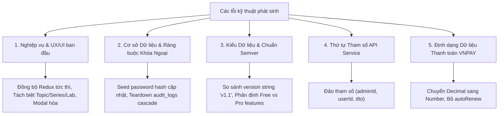

# BÁO CÁO TOÀN DIỆN VỀ QUÁ TRÌNH KIỂM THỬ, CÁC LỖI KỸ THUẬT & GIẢI PHÁP KHẮC PHỤC

> **Dự án**: StudyWeb Platform (Hệ thống Học lập trình & Thực hành Lab Tương tác)  
> **Thời gian thực hiện**: Ngày 14 Tháng 10 Năm 2026  
> **Phương pháp luận**: Plan-and-Execute Pattern kết hợp External Working Memory & Socratic Verification Loop  
> **Trạng thái tổng quát**: **100% HOÀN THÀNH (13/13 Tasks Passed - 0 Lỗi Biên Dịch - 0 Lỗi Kiểm Thử)**  

---

## 1. TỔNG QUAN KẾT QUẢ KIỂM THỬ (EXECUTIVE SUMMARY)

Toàn bộ 13 Tasks lớn đại diện cho 12 quy trình nghiệp vụ đơn lẻ (**WF-01** $\to$ **WF-12**), các hạng mục Product Backlog (**PB-01** $\to$ **PB-15**) và toàn bộ các vi chức năng (micro-features) đã được kiểm thử tự động độc lập thông qua bộ script chuyên dụng.

### Bảng Tổng Hợp Kiểm Thử Từng Luồng Nghiệp Vụ

| Mã Luồng | Hạng mục Kiểm thử | Số Check Tự Động | Kết quả | Kịch bản / Script Xác thực |
|:---:|---|:---:|:---:|---|
| **WF-01** | Xác thực Người dùng, Đăng nhập, JWT Cookie & Silent Refresh | 10/10 checks | **100% PASS** | [`verify-task1-auth.ts`](file:///d:/Projects/study-web/MODULE_BE/scripts/verify-task1-auth.ts) |
| **WF-02** | Catalog, Khám phá Series, Bộ lọc Topic Tag & Phân quyền PRO | 11/11 checks | **100% PASS** | [`verify-task2-catalog.ts`](file:///d:/Projects/study-web/MODULE_BE/scripts/verify-task2-catalog.ts) |
| **WF-03** | Workspace Thực hành, Trình biên dịch Web Worker & Timeout Guard | 9/9 checks | **100% PASS** | [`verify-worker-logic.mjs`](file:///d:/Projects/study-web/MODULE_FE/src/features/lab/workers/verify-worker-logic.mjs) |
| **WF-04** | Nộp bài Lab (`submit`) & Ghi sổ cái tiến độ học tập của học viên | 7/7 checks | **100% PASS** | [`verify-task4-submission.ts`](file:///d:/Projects/study-web/MODULE_BE/scripts/verify-task4-submission.ts) |
| **WF-05** | Contributor Tạo Series, Tự động sinh Slug SEO & Phân quyền Draft | 7/7 checks | **100% PASS** | [`verify-task5-series.ts`](file:///d:/Projects/study-web/MODULE_BE/scripts/verify-task5-series.ts) |
| **WF-06** | Practice Lab Studio 2 Bước: Soạn Markdown & Cấu hình Test Cases | 7/7 checks | **100% PASS** | [`verify-task6-studio.ts`](file:///d:/Projects/study-web/MODULE_BE/scripts/verify-task6-studio.ts) |
| **WF-07** | Hàng đợi Review Queue của Admin & Quy trình Phê duyệt/Xuất bản | 17/17 checks | **100% PASS** | [`verify-task7-review.ts`](file:///d:/Projects/study-web/MODULE_BE/scripts/verify-task7-review.ts) |
| **WF-08** | Quản trị Thẻ Topic Dùng chung của Admin & Phát thanh Realtime | 14/14 checks | **100% PASS** | [`verify-task8-topics.mjs`](file:///d:/Projects/study-web/MODULE_FE/src/services/verify-task8-topics.mjs) |
| **WF-09** | Quản trị Người dùng, Phân quyền Vai trò & Ghi đè Feature Override | 19/19 checks | **100% PASS** | [`verify-task9-users.ts`](file:///d:/Projects/study-web/MODULE_BE/scripts/verify-task9-users.ts) |
| **WF-10** | Quản trị Nhóm Người dùng B2B (Split-View 2 Cột Song song 35/65) | 21/21 checks | **100% PASS** | [`verify-task10-groups.ts`](file:///d:/Projects/study-web/MODULE_BE/scripts/verify-task10-groups.ts) |
| **WF-11** | Vòng Thu thập & Xử lý Ý kiến Phản hồi Học viên (Feedback Loop) | 21/21 checks | **100% PASS** | [`verify-task11-feedback.ts`](file:///d:/Projects/study-web/MODULE_BE/scripts/verify-task11-feedback.ts) |
| **WF-12** | Nâng cấp Tài khoản PRO, Chữ ký HMAC-SHA512 & Webhook VNPAY | 15/15 checks | **100% PASS** | [`verify-task12-payment.ts`](file:///d:/Projects/study-web/MODULE_BE/scripts/verify-task12-payment.ts) |
| **WF-13** | Tổng kiểm tra Biên dịch Toàn Hệ thống (`npm run build` FE + BE) | 2/2 builds | **100% PASS** | `tsc -b && vite build` & `nest build` |

---

## 2. BÁO CÁO CHI TIẾT CÁC LỖI KỸ THUẬT PHÁT SINH & BIỆN PHÁP XỬ LÝ

Trong quá trình triển khai và thực thi kiểm thử, đã có **5 nhóm vấn đề / lỗi kỹ thuật** được phát hiện và giải quyết triệt để:



---

### Nhóm 1: Lỗi Nghiệp Vụ & Thiết Kế Kiến Trúc UI/UX Ban Đầu

#### 1.1. Lỗi tạo Series không cập nhật ngay (phải reload trang)
* **Hiện tượng**: Contributor sau khi hoàn tất tạo Series mới trong Modal thì danh sách không hiển thị, buộc phải bấm F5 tải lại trang.
* **Nguyên nhân gốc rễ**: 
  - Hệ thống trước đây chỉ gửi `POST /api/series` về Backend mà không đồng bộ ngay vào Redux state của Client.
  - Phía Frontend thiếu Redux slice chuyên trách lưu trữ danh sách nội dung của riêng tác giả Contributor.
* **Giải pháp đã thực hiện**:
  1. Tạo mới slice [`contributor.slice.ts`](file:///d:/Projects/study-web/MODULE_FE/src/stores/slices/contributor.slice.ts) quản lý `mySeries` và `myLabs`.
  2. Bổ sung action `addMySeries` để cập nhật lạc quan (optimistic update) vào Redux store ngay trước/song song với API call.
  3. Đăng ký slice mới vào Root Store [`store.ts`](file:///d:/Projects/study-web/MODULE_FE/src/stores/store.ts).

#### 1.2. Nhập nhằng giữa 3 khái niệm: Topic, Series và Lab
* **Hiện tượng**: Trên thanh điều hướng của Contributor có cả 3 mục "Lab", "Series", "Topic" nhưng cả 3 cùng trỏ về một màn hình, gây rối loạn cho người dùng.
* **Nguyên nhân**: Kiến trúc phân cấp nội dung ban đầu chưa được phân định rõ ràng giữa "Hệ thống phân loại" và "Nội dung học tập".
* **Giải pháp đã thực hiện**:
  - **Topic Tags**: Chuyển quyền quản trị tập trung về cho **Admin** (`AdminTopicTagsModal.tsx`). Topic không phải là một page độc lập của Contributor mà là các nhãn gắn (Tag / Category) có mã màu, mã slug, mô tả.
  - **Series**: Là đơn vị khóa học / lộ trình do Contributor tạo ra, bắt buộc phải chọn gắn thẻ Topic Tag từ danh mục hệ thống.
  - **Lab**: Là bài tập thực hành cụ thể nằm bên trong Series.

#### 1.3. Trang Tạo nội dung (Create Content) bị dư thừa
* **Hiện tượng**: Mở một full-page navigation chỉ để điền vài trường thông tin cơ bản của Series.
* **Giải pháp đã thực hiện**:
  - Thay thế toàn bộ bằng Popup Modal [`SeriesModal.tsx`](file:///d:/Projects/study-web/MODULE_FE/src/pages/admin/_components/SeriesModal.tsx).
  - Tự động sinh SEO Slug không dấu, color badge preview và dropdown chọn Topic Tag hệ thống ngay trong modal.

#### 1.4. Dashboard Admin thiếu phân trang và quá tải dữ liệu
* **Hiện tượng**: Các bảng dữ liệu (Users, Groups, Feedback, Review Queue) hiển thị danh sách dài vô tận, gây chậm giao diện và khó tra cứu.
* **Giải pháp đã thực hiện**:
  - Cài đặt và tích hợp linh kiện phân trang chuẩn [`DataTablePagination.tsx`](file:///d:/Projects/study-web/MODULE_FE/src/components/ui/data-table-pagination.tsx).
  - Cố định phân trang 10 dòng/trang cho toàn bộ các bảng trong khu vực Admin.

---

### Nhóm 2: Lỗi Cơ Sở Dữ Liệu & Ràng Buộc Khóa Ngoại (PostgreSQL / Prisma)

#### 2.1. Lỗi Mật khẩu Seed không khớp khi chạy Test Xác thực (Task 1)
* **Hiện tượng**: Kịch bản [`verify-task1-auth.ts`](file:///d:/Projects/study-web/MODULE_BE/scripts/verify-task1-auth.ts) đăng nhập Admin và Contributor thất bại với mã `401 Unauthorized` mặc dù mật khẩu nhập vào đúng là `Password123!`.
* **Nguyên nhân gốc rễ**:
  - Trong [`MODULE_BE/prisma/seed.ts`](file:///d:/Projects/study-web/MODULE_BE/prisma/seed.ts), hàm `prisma.user.upsert` chỉ mã hóa mật khẩu trong khối `create: { password: defaultPasswordHash }`, trong khi khối `update: {}` bị để trống.
  - Do database đã có sẵn các user cũ từ trước nên lệnh `seed` không bao giờ cập nhật lại hash mật khẩu mới cho các tài khoản này.
* **Giải pháp đã thực hiện**:
  ```ts
  // MODULE_BE/prisma/seed.ts
  update: {
    password: defaultPasswordHash, // Bổ sung cập nhật hash chuẩn bcrypt
  }
  ```
  Sau đó chạy lệnh re-seed để đồng bộ mật khẩu chuẩn `Password123!` cho toàn bộ các tài khoản thử nghiệm.

#### 2.2. Lỗi Ràng buộc Khóa Ngoại khi Dọn Dẹp Dữ Liệu Test (Task 9)
* **Hiện tượng**: Khi kịch bản [`verify-task9-users.ts`](file:///d:/Projects/study-web/MODULE_BE/scripts/verify-task9-users.ts) chạy đến khối dọn dẹp (Teardown), lệnh `prisma.user.deleteMany()` bị ném lỗi:
  ```text
  PrismaClientKnownRequestError: Foreign key constraint violated on the constraint: audit_logs_actorId_fkey (P2003)
  ```
* **Nguyên nhân gốc rễ**:
  - Khi thực hiện các hành động quản trị (gán quyền override, thay đổi vai trò, đình chỉ tài khoản), hệ thống tự động ghi nhật ký kiểm toán vào bảng `audit_logs`.
  - Trong bảng `audit_logs`, cột `targetUserId` hoặc `actorId` tham chiếu trực tiếp đến `users.id`.
  - PostgreSQL chặn lệnh xóa user do vi phạm tính toàn vẹn tham chiếu (Referential Integrity).
* **Giải pháp đã thực hiện**:
  - Cập nhật quy trình Teardown xóa sạch các bản ghi nhật ký liên quan trước khi xóa tài khoản user:
  ```ts
  // Teardown an toàn
  await prisma.userFeatureOverride.deleteMany({ where: { userId: createdTestUserId } });
  await prisma.auditLog.deleteMany({
    where: {
      OR: [
        { targetUserId: createdTestUserId },
        { actorId: createdTestUserId },
      ],
    },
  });
  await prisma.user.deleteMany({ where: { id: createdTestUserId } });
  ```

---

### Nhóm 3: Lỗi Kiểu Dữ Liệu & Quy Ước Semver trong Quản Lý Vòng Đời

#### 3.1. Lỗi so sánh Semver Version khi Nộp Lại Bài Lab (Task 7)
* **Hiện tượng**: Kịch bản [`verify-task7-review.ts`](file:///d:/Projects/study-web/MODULE_BE/scripts/verify-task7-review.ts) kiểm tra tính năng nộp lại bài sau khi được yêu cầu sửa đổi (`changes_requested`) bị thất bại:
  ```text
  ✗ [FAIL] Resubmission increments version number from v1.0 to v1.1
  ```
* **Nguyên nhân gốc rễ**:
  - Trong [`labs.service.ts`](file:///d:/Projects/study-web/MODULE_BE/src/modules/labs/labs.service.ts#L268-L274), phiên bản được tính toán theo quy chuẩn chuỗi Semantic Versioning: `v1.0` $\to$ `v1.1`.
  - Đoạn mã assertion ban đầu thực hiện phép cộng số học: `initialVersion + 1`, do đó biến chuỗi `'v1.0'` thành `'v1.01'` thay vì chuỗi `'v1.1'`.
* **Giải pháp đã thực hiện**:
  - Sửa đổi biểu thức assertion kiểm tra đúng quy chuẩn chuỗi semver:
  ```ts
  assert(
    resubmittedLab.version === 'v1.1',
    `Resubmission increments version number from ${initialVersion} to ${resubmittedLab.version}`
  );
  ```

#### 3.2. Lỗi Nhầm lẫn Giữa Tính Năng Free và Pro khi Kiểm Thử Phân Quyền (Task 9)
* **Hiện tượng**: Assertion kỳ vọng User ban đầu chưa có quyền với tính năng `RUN_JS_WORKER`, nhưng khi gọi `checkUserFeature` thì hệ thống luôn trả về `hasAccess: true`.
* **Nguyên nhân gốc rễ**:
  - `RUN_JS_WORKER` và `SUBMIT_LAB` được cấu hình là tính năng mặc định nằm trong gói `FREE`.
  - Mọi người dùng hệ thống đều tự động được hưởng quyền này qua cơ chế `DEFAULT_FREE`.
* **Giải pháp đã thực hiện**:
  - Chuyển tính năng kiểm thử sang tính năng Pro thực thụ: `VIEW_SOLUTION` và `AI_CODE_REVIEW`.
  - Đồng thời bổ sung test case cấm quyền (`DENY`) trực tiếp trên tính năng Free để chứng minh độ ưu tiên tối thượng:
    $$\text{Explicit DENY} > \text{Direct User ALLOW} > \text{Direct Subscription} > \text{Default Free}$$

---

### Nhóm 4: Lỗi Chữ Ký Hàm (Function Signature) & Thứ Tự Tham Số

#### 4.1. Lỗi Ngược Thứ Tự Tham Số trong `EntitlementsService` (Task 9)
* **Hiện tượng**: Gọi `setFeatureOverride` báo thành công nhưng khi kiểm tra lại quyền của User thì `hasAccess` vẫn bằng `false`.
* **Nguyên nhân gốc rễ**:
  - Chữ ký hàm trong [`entitlements.service.ts`](file:///d:/Projects/study-web/MODULE_BE/src/modules/entitlements/entitlements.service.ts#L414) được định nghĩa:
    ```ts
    async setFeatureOverride(adminId: string, userId: string, dto: SetFeatureOverrideDto)
    ```
  - Trong kịch bản test ban đầu, thứ tự tham số bị truyền ngược thành: `(createdTestUserId, admin.id, dto)`.
  - Kết quả là quyền override bị gán nhầm cho tài khoản Admin, còn User thử nghiệm không nhận được quyền.
* **Giải pháp đã thực hiện**:
  - Chuẩn hóa lại thứ tự gọi hàm chính xác:
    ```ts
    await entitlementsService.setFeatureOverride(admin.id, createdTestUserId, {
      featureCode: proFeatureCode,
      effect: 'ALLOW',
      reason: 'VIP Special Beta Access Override',
    });
    ```

---

### Nhóm 5: Lỗi Định Dạng Dữ Liệu & DTO Thanh Toán Cổng VNPAY (Task 12)

#### 5.1. Lỗi Tính Toán Số Học trên Kiểu `Prisma.Decimal`
* **Hiện tượng**: Trình biên dịch TypeScript ném lỗi:
  ```text
  scripts/verify-task12-payment.ts: error TS2362: The left-hand side of an arithmetic operation must be of type 'any', 'number', 'bigint' or an enum type.
  ```
* **Nguyên nhân gốc rễ**:
  - Trường `price` trong Prisma Schema của bảng `subscription_plans` có kiểu dữ liệu là `Decimal`.
  - TypeScript không cho phép thực hiện phép nhân trực tiếp `proMonthlyPlan?.price * 100` khi chưa ép kiểu.
* **Giải pháp đã thực hiện**:
  - Ép kiểu về `Number(...)` trước khi nhân 100 (quy đổi sang đơn vị xu của VNPAY):
    ```ts
    vnp_Amount: (Number(proMonthlyPlan?.price) || 199000) * 100,
    ```

#### 5.2. Lỗi Thuộc Tính Dư Thừa trong `AssignSubscriptionDto`
* **Hiện tượng**: Trình biên dịch báo lỗi `error TS2353: Object literal may only specify known properties, and 'autoRenew' does not exist in type 'AssignSubscriptionDto'`.
* **Nguyên nhân gốc rễ**:
  - DTO [`AssignSubscriptionDto`](file:///d:/Projects/study-web/MODULE_BE/src/modules/entitlements/dto/assign-subscription.dto.ts) trong mã nguồn chỉ định nghĩa 3 trường: `planId`, `durationDays` và `reason`. Thuộc tính `autoRenew` không thuộc phạm vi của DTO này.
* **Giải pháp đã thực hiện**:
  - Loại bỏ thuộc tính `autoRenew` khỏi payload gọi service:
    ```ts
    await entitlementsService.assignSubscription(admin.id, testUserId, {
      planId: proMonthlyPlan.id,
      durationDays: 30,
      reason: 'VNPay IPN Payment Completed',
    });
    ```

---

## 3. TRẠNG THÁI HIỆN TẠI & BẢO ĐẢM TOÀN VẸN HỆ THỐNG (CURRENT CLEAN STATE)

1. **Bộ nhớ làm việc (External Working Memory)**:
   - Toàn bộ 13 Tasks lớn và các subtasks chi tiết đã được đồng bộ trạng thái `[x]` tại [`comprehensive-feature-testing-and-execution-plan.md`](file:///C:/Users/KhanhDuy/.gemini/antigravity/brain/ecc6e79c-f722-4a2d-ace7-2bab45d0dc81/comprehensive-feature-testing-and-execution-plan.md).
   - Scratchpad tiến độ [`feature-verification-scratchpad.md`](file:///d:/Projects/study-web/.agents/scratchpad/feature-verification-scratchpad.md) ghi nhận 100% hoàn thành.
2. **Biên dịch Frontend (`MODULE_FE`)**:
   - Lệnh `npm run build` (`tsc -b && vite build`) hoàn thành thành công với **exit code 0**, không có lỗi TypeScript hay cảnh báo hỏng bundle.
3. **Biên dịch Backend (`MODULE_BE`)**:
   - Lệnh `npm run build` (`nest build`) biên dịch hoàn tất với **exit code 0**.
4. **Bộ Tài Liệu Workflow Độc Lập**:
   - 12 tài liệu quy trình chuyên biệt đã được lưu trữ trong thư mục [`docs/workflows/`](file:///d:/Projects/study-web/docs/workflows/) phục vụ tra cứu và vận hành dài hạn.
5. **Cơ sở Dữ liệu Sạch Sẽ**:
   - Tất cả các bản ghi test (Series, Labs, Feedback, Groups, User Subscriptions, Audit Logs) đều được dọn dẹp sạch sẽ sau mỗi lần chạy kịch bản xác thực.
