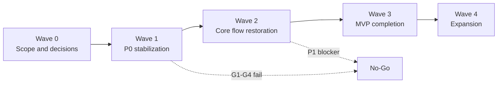

# Product Backlog v1.2 Remediation and Delivery Plan

## 1. Thông tin tài liệu (Document Information)

| Thuộc tính | Chi tiết |
|---|---|
| **Tên tài liệu** | Product Backlog v1.2 Remediation and Delivery Plan |
| **Version** | 1.0 — Draft for PO review |
| **Người làm** | Nguyen Khanh Duy (Kduy) — Product Owner & Fullstack Lead; BA-assisted repository audit |
| **Phạm vi (Scope)** | Kế hoạch thực thi PB-01–PB-27 qua Backend, Learner FE, Admin FE, database và CI/test |
| **Thời gian** | 2026-10-25; chưa gán delivery date vì chưa có capacity/team availability |
| **Tham chiếu từ** | Product Backlog v1.2 và Current Product Backlog Gap Audit |

## 2. Nội dung chính (Content)

### 2.1. Outcome và nguyên tắc điều hành

Mục tiêu đầu tiên không phải bổ sung feature mà là đưa hệ thống về trạng thái có thể tin cậy: database dựng lại được, session không replay/revive, nội dung không XSS, quyền PRO không bypass, grading không tin client và critical journeys chạy qua stack thật.

**No-Go rules:**

1. Không bắt đầu Wave 3/4 khi còn P0 open hoặc `G1`–`G4` của Wave 1 chưa pass.
2. Không đổi status sang Done chỉ vì build/unit test xanh; phải có evidence đúng tầng của item.
3. Không merge consumer UI nếu provider API contract chưa khóa hoặc contract test fail.
4. Không deploy data change nếu fresh migration, upgrade rehearsal, backup và rollback chưa có evidence.
5. Không quảng bá capability payment/saved-series/taxonomy nếu implementation vẫn placeholder/local-only.

### 2.2. Quyết định G0 cần PO/Tech Lead chốt trước khi coding

| Decision | Khuyến nghị baseline | Trade-off / lý do | Owner | Exit evidence |
|---|---|---|---|---|
| **D-01 Registration session** | Register thành công trả `201 + user + nextAction=login`; không auto-login | Ít contract/session ambiguity; thêm một bước login | PO + BE/FE | Response schema và navigation AC được duyệt |
| **D-02 Authorization source** | Backend entitlement là source of truth; role chỉ là persona/admin bypass có audit | Tránh `userPro` trên FE nhưng không có quyền backend | PO + BE | Canonical feature matrix Free/Pro/Admin |
| **D-03 Canonical feature keys** | Giữ key backend mô tả capability; FE đọc server access/locked state, không tự quyết từ role | Giảm duplicate permission registry | BE + FE | Shared schema/OpenAPI + seed list |
| **D-04 Content rendering policy** | Một Markdown pipeline với sanitizer allowlist dùng cho learner/admin | Giảm renderer trùng và stored XSS | Security + FE/Admin | Allowed tags/attrs/URL protocol note |
| **D-05 Migration strategy** | Incremental upgrade cho môi trường có dữ liệu + verified baseline/fresh chain cho môi trường mới | An toàn hơn thay toàn bộ history nhưng cần rehearsal | BE/Ops | Backup, upgrade, fresh deploy và rollback plan |
| **D-06 Grading trust boundary** | Server/isolated worker quyết định; client chỉ gửi artifact/input | Bảo vệ learning outcome; tăng cost sandbox/private checks | PO + BE | Threat model + grading contract per lab type |
| **D-07 Archive lifecycle** | Implement archive endpoint/state thay vì bỏ action khỏi Admin | Phù hợp lifecycle/recovery/audit đã có trong UI | PO + BE/Admin | State transition table được duyệt |
| **D-08 External services** | Email provider phải chốt trước PB-22 reset; payment provider/merchant/legal phải chốt trước PB-24 estimate | Tránh giả định hạ tầng/pháp lý | PO/Ops | Provider decision record + credentials/env owner |

Nếu PO chọn phương án khác, cập nhật backlog/contract trước khi code; không “sửa ngầm” trong implementation.

### 2.3. Delivery waves và dependency

| Wave | Items | Có thể song song | Không được bắt đầu khi |
|---|---|---|---|
| **0 — Decisions** | D-01–D-08, refine PB-16–PB-20 | Contract/security/migration discovery | Audit chưa được PO chấp thuận |
| **1 — P0 stabilization** | PB-03, PB-07, PB-09, PB-11, PB-15, PB-16–PB-20 | Markdown security, session security và migration discovery sau G0 | Relevant G0 decision chưa khóa |
| **2 — Core restoration** | PB-01, PB-04, PB-12–PB-14, PB-21, PB-22, PB-26 | Account UI và admin contract sau provider contract | Còn P0 hoặc G1–G4 fail |
| **3 — MVP completion** | PB-08, PB-10, PB-23, PB-25 | Các feature độc lập sau schema/contract | Còn release-blocking P1 |
| **4 — Expansion** | PB-24; PB-27 nếu re-open | Chỉ sau capacity/provider decision | External decision hoặc reconciliation design thiếu |

### 2.4. Detailed task plan

#### Wave 0 — Scope, contract và test-first baseline

| Task | Việc thực hiện | Artifacts | Gate |
|---|---|---|---|
| **W0.1 — Approve backlog** | PO review status/priority/out-of-scope; chỉ định owner; xác nhận Done/DoR/DoD. | Approved `03-product-backlog.md`; owner/capacity note | G0 |
| **W0.2 — Freeze contracts** | Chốt D-01–D-07; lập API/DTO/status/state transition matrix cho auth, entitlement, progress, review, submission. | Contract/schema decision records | G0/G2 |
| **W0.3 — Convert vulnerabilities to failing tests** | Đổi P0 reproduction thành prevention expectations; thêm XSS, token revoke, direct API entitlement, migration smoke tests ở trạng thái red có chủ đích. | Named regression tests mapped PB-16–PB-20 | G1–G4 entry evidence |

**Wave 0 exit:** mọi PB P0 đạt DoR; test hiện tại tái hiện bug được gắn owner; không còn contract quan trọng “tự hiểu”.

#### Wave 1 — Fix P0 trước feature mới

##### W1.1 — PB-16 Database migration baseline

- **Implementation:** inventory 20 Prisma models so với migration; thiết kế migration bổ sung không làm mất dữ liệu; backup snapshot; rehearsal upgrade từ schema hiện hành; fresh `migrate deploy`; constraints/index/FK parity; thêm CI disposable database smoke test.
- **Affected:** `MODULE_BE/prisma/schema.prisma`, `MODULE_BE/prisma/migrations/**`, CI/deployment scripts, runbook docs.
- **Tests/evidence:** `npx prisma validate`; fresh database migration; seeded smoke query; upgrade rehearsal trên sanitized copy; schema-drift output; rollback/restore record.
- **Exit:** `G3` pass; DB mới có đủ object; môi trường cũ upgrade không mất dữ liệu; PB-16 Done.

##### W1.2 — PB-18/PB-07/PB-15 Safe Markdown

- **Implementation:** chọn sanitizer allowlist; hợp nhất hoặc chia sẻ policy giữa FE/Admin; sanitize trước mọi `dangerouslySetInnerHTML`; xử lý links/images/code; cân nhắc CSP; sanitize preview và published content như nhau.
- **Affected:** `MODULE_FE/src/pages/lab/**`, `MODULE_ADMIN/src/pages/admin/**`, shared utility/package nếu được chọn.
- **Tests/evidence:** payload `<script>`, event handler, `javascript:` URL, malformed HTML, safe Markdown snapshot; learner + review queue + editor preview tests.
- **Exit:** `G1`, `G4`, `G5` pass; không payload test nào thực thi; PB-18 Done và unblock PB-07/PB-15 security AC.

##### W1.3 — PB-19/PB-03 Secure session lifecycle

- **Implementation:** xóa plaintext `User.refreshToken` và legacy lookup/fallback; backfill/cleanup; rotation/replay family handling; change-password/logout revoke; OAuth dùng cookie hoặc one-time code, không query refresh token; rate limit login/register/refresh/feedback; scrub secrets from logs.
- **Affected:** auth/users services/controllers/session schema/migrations, FE Google callback, environment/security docs.
- **Tests/evidence:** old/replayed/revoked token denied; concurrent refresh policy; password-change invalidation; OAuth URL assertion; 429 tests; secret scan/log assertion.
- **Exit:** `G1`–`G4` pass; PB-03/PB-19 không còn token-revival path.

##### W1.4 — PB-20/PB-09 Unified entitlement and access

- **Implementation:** canonical feature keys + seed; define role/plan/group/override precedence; server returns effective capabilities/locked state; remove FE role-only decision; locked lab returns metadata tối thiểu; guard inactive/draft series; authorize progress start/update/complete; invalidate capability cache/session after admin change.
- **Affected:** BE entitlements/labs/series/progress/seeds; FE permissions/workspace/series; Admin user/plan actions.
- **Tests/evidence:** matrix Free/Pro/Admin/contributor/override; direct API negative tests; draft/inactive anonymous denial; locked payload snapshot; progress unauthorized denial.
- **Exit:** `G1`–`G4` pass; no UI/API disagreement; PB-20 Done; PB-09 access AC can close.

##### W1.5 — PB-17/PB-11/PB-13 Server-authoritative grading

- **Implementation:** remove trust in `payload.status`; define grader adapter per sandbox type; private rules/key for all labs; change seed/config so starter never passes; timeout/resource boundary; derive submission status/score and progress only from grader; quarantine invalid legacy lab config.
- **Affected:** BE lab submission/grading services, lab configs/seeds, worker boundary, progress service, test fixtures.
- **Tests/evidence:** current `wave0-p0-reproduction.spec.ts` converted to prevention assertions; empty/forged/starter submissions fail; valid reference solution passes; timeout/error yields controlled failure; score cannot be client supplied.
- **Exit:** `G1`–`G4` pass; all active labs have grading contract; PB-17 Done; integrity blockers on PB-11/PB-13 removed.

**Wave 1 release gate:** zero open P0; clean migration evidence; security and direct-API negative tests pass; core auth/lab/submission/progress integration pass. Nếu bất kỳ check nào fail → No-Go Wave 2/release.

#### Wave 2 — Restore core contracts và lifecycle

##### W2.1 — PB-01 Registration contract

- Implement D-01 response/navigation; `409` duplicate email/SĐT; shared response types; never persist undefined token; success/error/duplicate integration + FE navigation tests.
- **Exit:** G2/G4; PB-01 Done.

##### W2.2 — PB-04/PB-22 Account lifecycle

- Add profile update DTO/API/UI for `name`, `avatarUrl`, `defaultAddress`; expose consistent `/auth/me`; change-password UI; forgot/reset token model with hash/expiry/single use; enumeration-safe responses; email adapter boundary; revoke sessions after reset.
- **Exit:** G1–G4; profile/change/reset E2E; PB-04 Done and PB-22 Done or remains Blocked only on explicit email-provider dependency.

##### W2.3 — PB-21/PB-14/PB-15 Admin governance contract

- Align group plan `PUT`; reject `{reason}`; transfer `{newAuthorId,reason?}`; implement archive per D-07; deny orphan ownership to contributors; add confirmation to role/plan mutations; transactional entitlement update; complete audit events; server-side audit search if retained in scope.
- **Exit:** G1/G2/G4; contract tests cover every action; invalid transition/ownership denied; PB-21 Done and PB-14/PB-15 remaining AC re-evaluated.

##### W2.4 — PB-11/PB-12/PB-13 Submission, solution, progress closure

- Add typed submission model/DTO/UI for PR/code/file with size/type validation and storage decision; add pending transition; enforce solution prerequisite/entitlement; compute progress/score from grading; update dashboard aggregation and historical data migration if required.
- **Exit:** G1–G4; full journey submit → grade → progress → authorized solution passes; PB-11–PB-13 Done.

##### W2.5 — PB-26 Release quality pipeline

- Include real-Prisma matrix in default test glob; full-stack Playwright starts disposable DB + BE + FE + Admin; add BE/Admin lint/type checks; security regression job; bundle budget/lazy-load PGlite/worker/admin; generate release evidence; docs-status consistency check.
- **Exit:** G4–G6; one repeatable CI/release command produces pass/fail artifact; PB-26 Done.

**Wave 2 release gate:** registration/account/admin/submit-progress-solution critical journeys pass against real services; no release-blocking P1; bundle exceptions require documented waiver and expiry.

#### Wave 3 — Complete committed MVP features

##### W3.1 — PB-08 Sample project links

- Validate/store GitHub and Swagger URLs; render contextual CTA in series/lab; handle missing/invalid/unavailable links; publication/permission behavior; analytics optional only if privacy decision exists.
- **Exit:** G2/G4/G5; PB-08 Done.

##### W3.2 — PB-10 Bug Hints

- Define hint data schema with severity `Critical/Major/Minor`; toggle defaults closed; prevent unauthorized API leakage; authoring support in Admin; responsive/a11y tests.
- **Exit:** G1/G2/G4/G5; PB-10 Done.

##### W3.3 — PB-23 Saved series

- Add unique user-series bookmark model/migration; idempotent save/unsave API; card action and saved-library page; handle unpublished/deleted series; cross-device E2E.
- **Exit:** G1–G4; PB-23 Done.

##### W3.4 — PB-25 Shared taxonomy

- Add topic model/API/RBAC; slug/name constraints; decide import/reset for browser-local data; migrate FE/Admin to server query/mutation; cache invalidation and concurrent edit behavior.
- **Exit:** G1–G4; same taxonomy visible across browser/domain; PB-25 Done.

**Wave 3 release gate:** original PB-01–PB-15 không còn Partial/Not implemented trừ item được PO formally Deferred; G6 status/docs updated.

#### Wave 4 — Expansion, không mặc định cam kết

##### W4.1 — PB-24 Payment/subscription

1. Discovery: provider, market/currency, merchant, invoice/VAT/refund, webhook SLA, reconciliation owner.
2. Contract: order and subscription state machine; idempotency; entitlement activation/revocation; retry/manual recovery.
3. Implementation: checkout, signed webhook, reconciliation job, admin support/audit, sandbox E2E and operational alerts.
4. Copy gate: pricing page chỉ hiển thị method/SLA đã có evidence.

**Exit:** G0–G6; provider sandbox + reconciliation pass. Trước G0, PB-24 vẫn Blocked và không estimate.

##### W4.2 — PB-27 GitHub/Webhook verification

Giữ Deferred. Chỉ discovery sau PB-17 ổn định: provider/app model, signed webhook, repo/PR ownership, queue/retry/idempotency, secret rotation, abuse/cost controls. Không đưa vào MVP release scope nếu chưa có PO re-prioritization.

### 2.5. Gate checklist và lệnh evidence

| Gate | Checklist | Lệnh/evidence hiện có hoặc cần bổ sung |
|---|---|---|
| **G0 Scope** | AC, out-of-scope, owner, dependency, estimate, contract/security decision | Backlog approval + decision records; không có command thay thế review |
| **G1 Security** | XSS; token replay/revoke; authz/ownership; secret leakage; rate limit; direct API bypass | Named negative tests trong BE/FE/Admin; security checklist artifact |
| **G2 Contract** | Route/verb/DTO/status/error schema; consumer/provider compatibility | Contract/OpenAPI tests cần bổ sung; current unit tests không đủ |
| **G3 Data** | Prisma validate; fresh deploy; upgrade; seed; drift; backup/rollback | `cd MODULE_BE && npx prisma validate`; disposable-DB migration scripts cần bổ sung |
| **G4 Functional** | BE integration; FE/Admin tests; real full-stack critical journeys | `cd MODULE_BE && npm test`; `cd MODULE_FE && npm test`; `cd MODULE_ADMIN && npm test`; `cd tests/e2e && npm test` sau khi cấu hình full stack |
| **G5 Non-functional** | Build, lint/type, bundle budgets, a11y/perf, observability | `npm run build` cả 3 module; `MODULE_FE npm run lint`; BE/Admin lint và budget gate cần bổ sung |
| **G6 Release/docs** | CI summary, runbook/env, migration evidence, rollback, backlog/audit/register sync | Release checklist artifact + docs link validation + git diff review |

### 2.6. Traceability matrix

| Problem/feature | Backlog | Primary task | Mandatory gates |
|---|---|---|---|
| Migration incomplete | PB-16 | W1.1 | G0, G3, G6 |
| Markdown XSS | PB-07, PB-15, PB-18 | W1.2 | G1, G4, G5 |
| Token revive/OAuth URL/rate limit | PB-03, PB-19 | W1.3 | G1–G4 |
| PRO/draft/progress access | PB-09, PB-12–PB-14, PB-20 | W1.4 | G1–G4 |
| Client-trusted grading | PB-11, PB-13, PB-17 | W1.5 | G1–G4 |
| Registration mismatch | PB-01 | W2.1 | G2, G4 |
| Profile/password recovery | PB-04, PB-22 | W2.2 | G1–G4 |
| Admin contract/ownership | PB-14, PB-15, PB-21 | W2.3 | G1, G2, G4 |
| Typed submission/solution/progress | PB-11–PB-13 | W2.4 | G1–G4 |
| Real E2E/performance/docs | PB-26 | W2.5 | G3–G6 |
| Sample project | PB-08 | W3.1 | G2, G4, G5 |
| Bug Hints | PB-10 | W3.2 | G1, G2, G4, G5 |
| Saved series | PB-23 | W3.3 | G1–G4 |
| Shared taxonomy | PB-25 | W3.4 | G1–G4 |
| Payment/subscription | PB-24 | W4.1 | G0–G6 |
| GitHub/Webhook grading | PB-27 | W4.2 | G0 discovery; full gates if re-opened |

### 2.7. Risk register và response

| Risk | Probability / Impact | Response | Trigger/owner |
|---|---|---|---|
| Existing production data không khớp migration history | High / Critical | Backup, schema inventory, upgrade rehearsal, rollback; không reset production | Schema drift/fresh deploy fail — BE/Ops |
| Security fix phá content/render hiện có | Medium / High | Allowlist fixtures, visual regression, content compatibility sample | Safe Markdown bị thay đổi ngoài dự kiến — FE/Admin |
| Entitlement migration khóa nhầm user Pro | High / High | Access matrix, backfill dry-run, audit, rollback and support query | Effective access count lệch — BE/PO |
| Private grader tăng CPU/time/cost | Medium / High | Timeout/resource cap, queue/worker isolation, metrics | Latency/error budget vượt — BE/Ops |
| E2E tiếp tục mock/hang | High / Medium | Deterministic services, health checks, seeded disposable DB, trace/video artifact | Startup timeout/flaky > threshold — QA/Ops |
| Scope expansion vào payment trước stabilization | Medium / High | Enforce Wave gates and PB-24 Blocked | Feature start khi P0/P1 open — PO |

### 2.8. Status update và change control

- Mỗi item có một owner cập nhật status/evidence; PO là người duyệt priority hoặc scope change.
- Mỗi PR phải ghi PB ID và gate bị ảnh hưởng; không gộp unrelated PB nếu làm mất khả năng rollback/review.
- Khi gate fail, item quay về `Partial/Blocked`; ghi nguyên nhân và evidence, không giữ Done.
- Khi thêm requirement mới, tạo PB mới hoặc revision AC với dependency; cập nhật backlog, execution plan, audit/register trong cùng change set.
- Review cadence đề xuất: sau mỗi Wave gate và trước mọi production release; không tự suy ra ngày nếu chưa capacity planning.

### 2.9. Lịch sử sửa đổi (Revision history)

| Version | Ngày | Tác giả | Thay đổi |
|---|---|---|---|
| 1.0 | 2026-10-25 | Nguyen Khanh Duy / BA-assisted repository audit | Kế hoạch stabilization-first, W0–W4, D-01–D-08 và G0–G6. |
| 1.1 | 2026-10-25 | Nguyen Khanh Duy / Implementation Taskforce | Hoàn tất Wave 0, Wave 1 (P0 Stabilization), Wave 2 (Core Flows), và Wave 3 (MVP Completion: PB-08, PB-10, PB-23, PB-25). Gates G0–G6 verified. |

### 2.10. Open issues & Status

- **D-01–D-08**: Toàn bộ 8 quyết định kiến trúc đã được áp dụng và bảo vệ bằng prevention tests.
- **PB-16**: Hoàn tất 2 migration an toàn (`20261025180000` và `20261025210000`), 21 model Prisma và toàn bộ enum đã có DDL.
- **PB-24 (Payment/Subscription)**: **BLOCKED** theo quyết định D-08, chờ lựa chọn nhà cung cấp cổng thanh toán chính thức (Stripe / MoMo / VNPay).
- **PB-27 (GitHub/Webhook)**: **DEFERRED** sang giai đoạn Post-MVP sau khi hệ sinh thái học tập và chấm điểm cốt lõi đã ổn định.
- **Test Evidence**: 81 BE unit/spec tests (24 suites) + 25 E2E matrix tests, 294 FE tests (59 suites), 53 Admin tests (9 suites) đều PASS. Production builds xanh 100%.

## 3. Tài liệu tham khảo (References)

- [Product Backlog v1.2](../03-product-backlog.md)
- [Current Product Backlog Gap Audit](current-product-backlog-gap-audit.md)
- [Workflow Register](../workflows/README.md)
- [Database Design](../05-database.md)
- [Backend tests](../../MODULE_BE/test)
- [Learner frontend tests](../../MODULE_FE/src/test)
- [Admin frontend tests](../../MODULE_ADMIN/src/test)
- [Playwright tests](../../tests/e2e)

