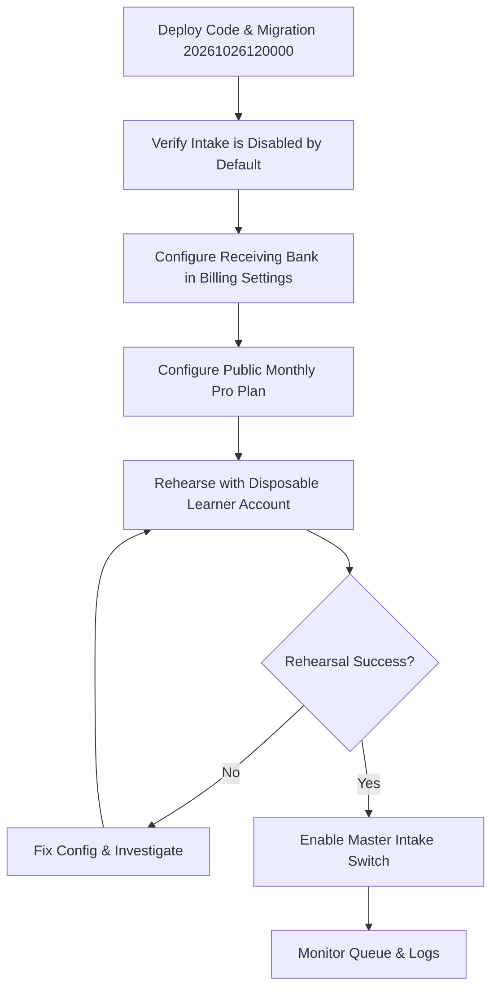

# Billing & Pro Upgrade Operations Runbook

## 1. Document Information

| Attribute | Detail |
|---|---|
| Document | Billing & Pro Upgrade Operations Runbook |
| Version | 1.0 — Manual Bank Transfer Operational Standard |
| Author | StudyWeb Engineering & Operations Team |
| Scope | Admin configuration, disabled-by-default rollout, bank reconciliation, duplicate prevention, rejection handling, and emergency intake pausing |
| Date | 2026-10-26 |
| Target Audience | Platform Administrators, Operations Leads, and Support Engineers |

---

## 2. Operational Procedures

### 2.1. Initial Disabled-by-Default Rollout Lifecycle

To guarantee zero accidental charges or unmonitored requests, billing intake is **disabled by default** upon deployment. Follow this sequence strictly before opening purchases to learners:

#### Step 1: Deploy & Verify Default State
- Apply migration: `npx prisma migrate deploy` in `MODULE_BE`.
- Verify database state: `billing_settings.isIntakeEnabled` defaults to `false`.
- Verify public API: `GET /plans/public` returns `{ isIntakeEnabled: false, plans: [...] }`.
- In the Learner UI (`/pricing`), the upgrade button displays "Tạm đóng đăng ký" and is disabled.

#### Step 2: Configure Receiving Bank Details
1. Sign in to the Admin Portal with an account holding the `admin` role.
2. Navigate to `/admin/plans` and select the **Cấu hình thanh toán** tab (`AdminBillingSettingsTab`).
3. Fill in the receiving bank information accurately:
   - **Tên ngân hàng**: e.g., `Ngân hàng TMCP Ngoại thương Việt Nam (Vietcombank)`
   - **Mã ngân hàng (Bank Code)**: e.g., `VCB`
   - **Số tài khoản**: e.g., `0123456789`
   - **Chủ tài khoản**: e.g., `NGUYEN KHANH DUY` (All uppercase recommended)
   - **Hướng dẫn chuyển khoản**: Specify that learners must include their unique `transferReference` in the transfer memo/description.
4. Click **Lưu cấu hình**. (Do NOT enable the intake toggle yet).

#### Step 3: Configure Monthly Pro Plan
1. In `/admin/plans`, select the **Gói đăng ký** tab (`AdminPlansTab`).
2. Identify the active monthly plan (or create one):
   - Set **Giá (VND)**: Must be a positive integer in Vietnamese Đồng (e.g., `199000`).
   - Check **Công khai cho học viên (isPublic)**.
   - Check **Sẵn sàng mở bán (isSaleReady)**.
3. Save changes. Only plans with `isActive`, `isPublic`, and `isSaleReady` all set to `true` will be presented on `/pricing`.

#### Step 4: Staging Rehearsal with a Disposable Account
1. Log in as a test learner on `MODULE_FE`.
2. Visit `/pricing` (or directly test the API if testing pre-intake).
3. Temporarily enable intake in test environment, initiate an upgrade request, and confirm that:
   - A unique transfer reference (e.g. `PRO-ABCD1234EF`) is generated.
   - The price snapshot and bank snapshot are permanently locked to the request.
   - Submitting the test bank reference updates the request status from `AWAITING_PAYMENT` to `PENDING_REVIEW`.
4. Switch to Admin Portal, locate the request in **Hàng đợi nâng cấp**, enter verified bank reference and exact amount, and click **Duyệt**.
5. Verify test learner receives Pro status and in-app notification.
6. Verify subscription renewal date is correctly clamped to 1 calendar month.

#### Step 5: Enable Production Intake
1. Return to `/admin/plans` -> **Cấu hình thanh toán**.
2. Toggle **Mở tiếp nhận yêu cầu nâng cấp Pro (isIntakeEnabled)** to `ON`.
3. Click **Lưu cấu hình**.
4. Learners can now initiate upgrade requests from `/pricing` and `/dashboard/membership`.

---

### 2.2. Daily Operations & Bank Statement Reconciliation

Reconciliation should be conducted at least twice daily (e.g., morning and afternoon shifts):

1. **Open Queue**: Navigate to `/admin/plans` -> **Hàng đợi nâng cấp** tab.
2. **Filter Pending**: Select the **Chờ duyệt** tab (`status = 'PENDING_REVIEW'`).
3. **Cross-Check Bank Statement**:
   - Log in to the business bank portal / banking app.
   - Search bank statement transactions matching the learner's `transferReference` or learner name.
   - Verify the incoming amount matches `priceSnapshot` **to the exact dong**.
4. **Approve Transfer**:
   - Click **Duyệt** on the corresponding row.
   - Enter the **Mã giao dịch ngân hàng thực tế** (e.g., `FT26102600123456`) from the bank statement into the modal.
   - Enter the **Số tiền xác minh** (must equal the expected price snapshot).
   - Click **Xác nhận duyệt**.
   - The backend atomically creates/extends `UserSubscription`, sends an in-app notification, and records an audit log.

---

### 2.3. Handling Irregularities & Edge Cases

| Scenario | Risk | Prescribed Operator Action |
|---|---|---|
| **Transfer memo missing reference** | Cannot automatically attribute funds | Search bank transaction description for learner's phone number or name. Cross-reference with `GET /admin/upgrade-requests` search bar. If located, approve with bank transaction code. If not located after 48h, contact learner or wait for learner inquiry. |
| **Incorrect amount received (underpaid)** | Underpayment fraud or misunderstanding | **DO NOT APPROVE**. Click **Từ chối**, select reason: *"Số tiền chuyển khoản không đủ. Yêu cầu [X] VND, nhận được [Y] VND. Vui lòng liên hệ hỗ trợ hoặc tạo lại yêu cầu."* |
| **Duplicate bank reference entered** | Replay attack / accidental double credit | The backend database enforces a unique constraint on `verifiedBankReference`. If an operator attempts to approve using a previously used reference, the system returns `409 Conflict`. Verify why the reference was reused. |
| **Learner requests cancellation** | Changed mind before payment | Learners can cancel requests in `AWAITING_PAYMENT` themselves via `/dashboard/membership`. Once in `PENDING_REVIEW`, only an Admin can reject the request. |
| **Stale requests in AWAITING_PAYMENT** | User abandoned without paying | Leave as `AWAITING_PAYMENT`. If learner starts anew, the system returns their existing open request. Stale unpaid requests do not grant access or tie up resources. |

---

### 2.4. Emergency Intake Pause Procedure

If fraudulent transfer attempts, banking discrepancies, or operational overload occur:

1. **Immediate Pause**:
   - Navigate to `/admin/plans` -> **Cấu hình thanh toán**.
   - Switch **Mở tiếp nhận yêu cầu nâng cấp Pro** to **OFF**.
   - Click **Lưu cấu hình**.
2. **Operational Effect of Pause**:
   - **New Purchases Blocked**: Learners visiting `/pricing` will see intake temporarily paused. `POST /upgrade-requests` will immediately reject new requests with `400 Bad Request`.
   - **Queue Continuity**: Requests already in `PENDING_REVIEW` or `AWAITING_PAYMENT` **remain fully actionable**. Operators can continue reconciling and approving/rejecting existing requests.
   - **Subscriber Continuity**: Existing PRO subscribers retain full access without interruption.
3. **Resuming Operations**:
   - Resolve discrepancies on the banking side.
   - Re-enable the toggle and save configuration.

---

### 2.5. Background Workers & System Health Monitoring

The billing system relies on two scheduled jobs managed via database leader leases (`ScheduledJobLease`):

1. **`billing:membership-expiry`**:
   - Runs every minute.
   - Identifies active subscriptions where `endDate <= NOW()` and marks them `EXPIRED`.
   - Sends `MEMBERSHIP_EXPIRING_SOON` notifications 3 days prior to expiry (deduplicated via `eventKey`).
   - Sends `MEMBERSHIP_EXPIRED` notifications upon expiry.
2. **`announcements:batch-delivery`**:
   - Processes broadcast announcements in batches of 50 recipients.
   - Safe to restart: picks up pending recipients where `deliveredAt IS NULL`.
3. **Lease Expiry & Failover**:
   - Leases expire after 2 minutes. If a server instance crashes during execution, another instance acquires the lease and resumes processing cleanly.

---

## 3. References

- [PRO access and payment boundary workflow](../workflows/12-upgrade-and-payment.md)
- [Admin plans and audit workflow](../workflows/18-admin-content-plans-and-audit.md)
- [Monetization & notification plan](../15-notifications-pricing-pro-execution-plan.md)
- [Admin Plans Page](file:///d:/Projects/study-web/MODULE_ADMIN/src/pages/admin/AdminPlansPage.tsx)
- [Backend Billing Service](file:///d:/Projects/study-web/MODULE_BE/src/modules/billing/billing.service.ts)
