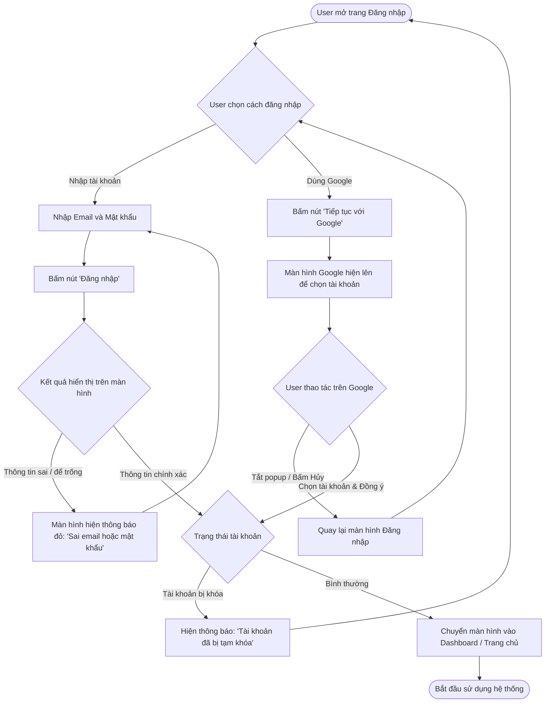
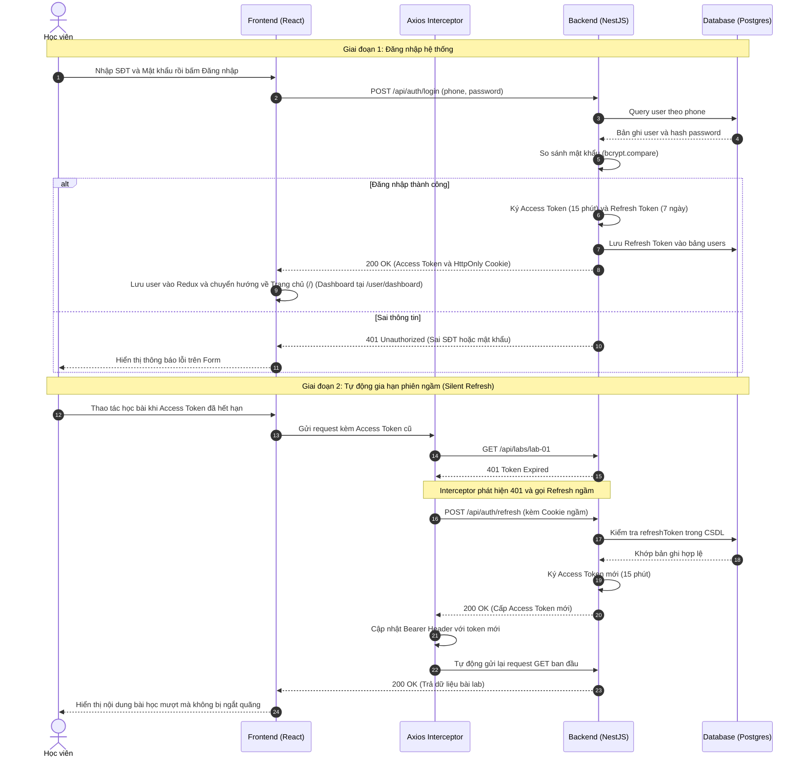

# Sơ đồ Luồng Xác thực & Quản lý Phiên Đăng nhập (Auth & Silent Refresh)

## 1. Thông tin tài liệu (Document Information)

| Thuộc tính | Chi tiết |
|---|---|
| **Tên tài liệu** | Sơ đồ Luồng Xác thực & Quản lý Phiên Đăng nhập |
| **Version** | v1.1 |
| **Người làm** | Nguyen Khanh Duy (Fullstack Lead & Architect) |
| **Phạm vi (Scope)** | Luồng nghiệp vụ người dùng (Email/Mật khẩu & Google OAuth), phân quyền JWT và cơ chế Silent Refresh qua Axios Interceptor |
| **Thời gian** | 2026-10-12 |
| **Tham chiếu từ** | Hiện trạng mã nguồn xác thực tại `MODULE_BE/src/modules/auth` và `MODULE_FE/src/services/api.client.ts` |

---

## 2. Nội dung chính (Content)

### 2.1. Sơ đồ Luồng Nghiệp vụ Người dùng (User Business Flow)

Sơ đồ thể hiện chu trình tương tác thực tế của người dùng trên giao diện Web khi thực hiện đăng nhập qua 2 hình thức: Tài khoản thông thường (Email & Mật khẩu) hoặc Google OAuth:

#### Các điểm chạm (Touchpoints) của Người dùng trên Giao diện:
1. **Lựa chọn hình thức**: Người dùng nhìn thấy 2 tùy chọn rõ ràng trên màn hình (Form nhập Email/Password và nút liên kết "Tiếp tục với Google").
2. **Phản hồi lỗi trên UI**:
   - Nếu nhập thiếu hoặc sai thông tin, giao diện giữ nguyên ngữ cảnh nhập liệu và hiển thị thông báo lỗi trực quan ngay tại form.
   - Khi chọn đăng nhập Google, mở hộp thoại chọn tài khoản Google. Nếu người dùng đóng popup/hủy bỏ, trạng thái trang đăng nhập được bảo toàn.
3. **Phản hồi trạng thái & Điều hướng**:
   - Trường hợp tài khoản bị khóa: Hệ thống hiển thị thông báo trạng thái tài khoản bị tạm khóa.
   - Trường hợp thành công: Người dùng được tự động điều hướng vào Dashboard hoặc trang bài lab đang thao tác dở trước đó.

### 2.2. Sơ đồ Tuần tự Kỹ thuật (Sequence Diagram)

### 2.3. Phân tích Chi tiết Từng Bước

1. **Đăng nhập an toàn**:
   * Mật khẩu không bao giờ được lưu dạng thô (plain-text) mà luôn được băm với salt 10 rounds qua Bcrypt.
   * `Access Token` chỉ có thời hạn ngắn (15 phút) lưu trong bộ nhớ tạm (Redux State) để chống rò rỉ lâu dài.
   * `Refresh Token` có thời hạn dài (7 ngày) được trả về qua cờ `HttpOnly`, `SameSite=Strict` để JavaScript phía trình duyệt không thể đọc được, chống triệt để tấn công XSS.

2. **Cơ chế Silent Refresh Token**:
   * Phía Frontend cấu hình `Axios Response Interceptor`. Khi bất kỳ API nào trả về lỗi `401 Unauthorized` do hết hạn token, interceptor sẽ tạm dừng request đó, gọi ngầm endpoint `/api/auth/refresh`.
   * Trình duyệt tự động đính kèm cookie `refreshToken`. Nếu hợp lệ, backend cấp Access Token mới và interceptor tự động phát lại (replay) request cũ mà không cần người dùng thao tác lại.

3. **Xử lý Ngoại lệ (Edge Cases)**:
   * Nếu Refresh Token cũng hết hạn (hoặc bị vô hiệu hóa): API `/api/auth/refresh` trả về `401/403` -> Redux dispatch action `logout()`, xóa sạch state và chuyển hướng về trang `/login` kèm thông báo *"Phiên làm việc đã hết hạn, vui lòng đăng nhập lại"*.

---

## 3. Tài liệu tham khảo & Liên kết (References)

- **Mã nguồn liên quan**:
  - Controller & Service Auth: [MODULE_BE/src/modules/auth](file:///d:/Projects/study-web/MODULE_BE/src/modules/auth)
  - Cấu hình Axios & Interceptor: [MODULE_FE/src/services/api.client.ts](file:///d:/Projects/study-web/MODULE_FE/src/services/api.client.ts)
  - Khai báo bảng Users: [MODULE_BE/prisma/schema.prisma](file:///d:/Projects/study-web/MODULE_BE/prisma/schema.prisma)
- **Tài liệu hệ thống**:
  - Thiết kế Cơ sở Dữ liệu: [05-database.md](file:///d:/Projects/study-web/Docs/05-database.md)
  - Danh sách Yêu cầu Sản phẩm: [03-product-backlog.md](file:///d:/Projects/study-web/Docs/03-product-backlog.md)
