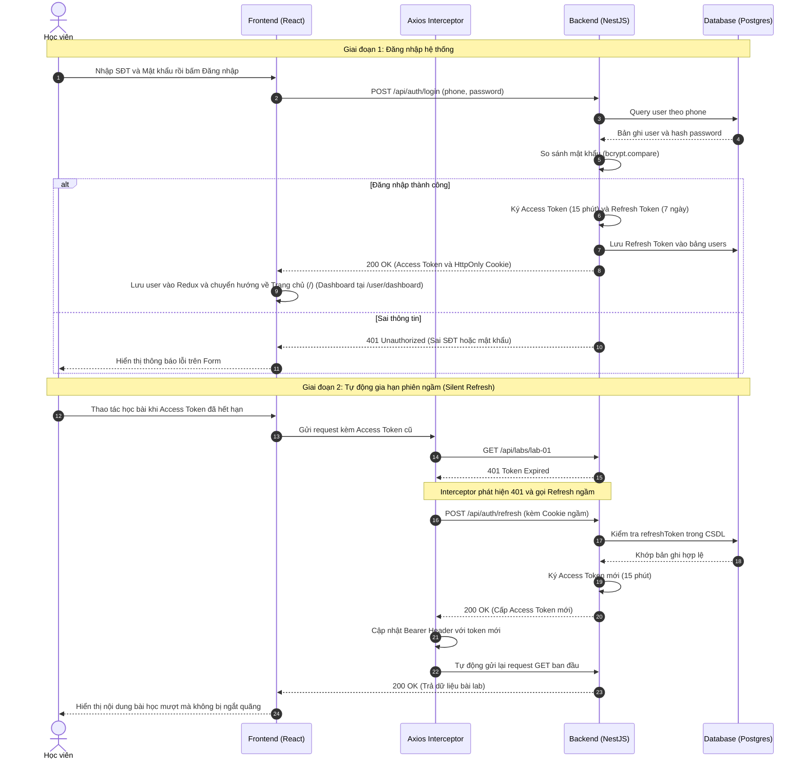

# Sơ đồ Luồng Xác thực & Quản lý Phiên Đăng nhập (Auth & Silent Refresh)

## 1. Thông tin tài liệu (Document Information)

| Thuộc tính | Chi tiết |
|---|---|
| **Tên tài liệu** | Sơ đồ Luồng Xác thực & Quản lý Phiên Đăng nhập |
| **Version** | v1.0 |
| **Người làm** | Nguyen Khanh Duy (Fullstack Lead & Architect) |
| **Phạm vi (Scope)** | Chu trình xác thực người dùng bằng SĐT/Mật khẩu, phân quyền JWT và cơ chế Silent Refresh qua Axios Interceptor |
| **Thời gian** | 2026-10-02 |
| **Tham chiếu từ** | Hiện trạng mã nguồn xác thực tại `MODULE_BE/src/modules/auth` và `MODULE_FE/src/services/api.client.ts` |

---

## 2. Nội dung chính (Content)

### 2.1. Sơ đồ Tuần tự (Sequence Diagram)

### 2.2. Phân tích Chi tiết Từng Bước

1. **Đăng nhập an toàn**:
   * Mật khẩu không bao giờ được lưu dạng thô (plain-text) mà luôn được băm với salt 10 rounds qua Bcrypt.
   * `Access Token` chỉ có thời hạn ngắn (15 phút) lưu trong bộ nhớ tạm (Redux State) để chống rò rỉ lâu dài.
   * `Refresh Token` có thời hạn dài (7 ngày) được trả về qua cờ `HttpOnly`, `SameSite=Strict` để JavaScript phía trình duyệt không thể đọc được, chống triệt để tấn công XSS.

2. **Cơ chế Silent Refresh Token**:
   * Phía Frontend cấu hình `Axios Response Interceptor`. Khi bất kỳ API nào trả về lỗi `401 Unauthorized` do hết hạn token, interceptor sẽ tạm dừng request đó, gọi ngầm endpoint `/api/auth/refresh`.
   * Trình duyệt tự động đính kèm cookie `refreshToken`. Nếu hợp lệ, backend cấp Access Token mới và interceptor tự động phát lại (replay) request cũ mà không cần người dùng thao tác lại.

3. **Xử lý Ngoại lệ (Edge Cases)**:
   * Nếu Refresh Token cũng hết hạn (hoặc bị vô hiệu hóa): API `/api/auth/refresh` trả về `401/403` -> Redux dispatch action `logout()`, xóa sạch state và chuyển hướng về trang `/login` kèm thông báo *"Phiên làm việc đã hết hạn, vui lòng đăng nhập lại"*.

---

## 3. Tài liệu tham khảo & Liên kết (References)

- **Mã nguồn liên quan**:
  - Controller & Service Auth: [MODULE_BE/src/modules/auth](file:///d:/Projects/study-web/MODULE_BE/src/modules/auth)
  - Cấu hình Axios & Interceptor: [MODULE_FE/src/services/api.client.ts](file:///d:/Projects/study-web/MODULE_FE/src/services/api.client.ts)
  - Khai báo bảng Users: [MODULE_BE/prisma/schema.prisma](file:///d:/Projects/study-web/MODULE_BE/prisma/schema.prisma)
- **Tài liệu hệ thống**:
  - Thiết kế Cơ sở Dữ liệu: [05-database.md](file:///d:/Projects/study-web/Docs/05-database.md)
  - Danh sách Yêu cầu Sản phẩm: [03-product-backlog.md](file:///d:/Projects/study-web/Docs/03-product-backlog.md)
