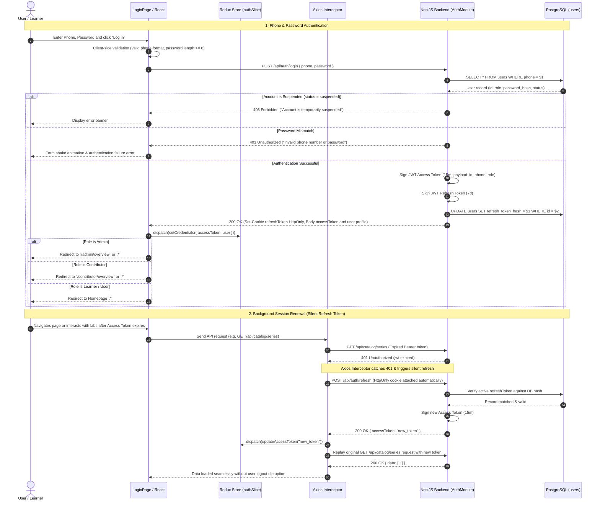

# Sequence Diagram: Authentication, Session Management & Homepage Navigation (Auth & Session Flow)

## 1. Document Information

| Attribute | Details |
|---|---|
| **Document Title** | Authentication, Session Management & Homepage Navigation Workflow |
| **Version** | v1.1 |
| **Author** | Nguyen Khanh Duy (Fullstack Lead & Architect) |
| **Scope** | End-to-end user lifecycle from opening the login form, entering Phone/Password or Google OAuth, NestJS verification, in-memory Redux Access Token storage, HttpOnly Refresh Cookie issuance, to automatic role-based redirect into Homepage or dedicated Dashboards |
| **Date** | 2026-10-14 |
| **Source Reference** | `MODULE_BE/src/modules/auth/auth.controller.ts`, `MODULE_BE/src/modules/auth/auth.service.ts`, `MODULE_FE/src/features/auth/store/authSlice.ts`, `MODULE_FE/src/services/api.client.ts` |

---

## 2. Core Content

### 2.1. Workflow Summary (TL;DR)
- **Input**: Phone Number + Password (or Google OAuth account).
- **Processing**:
  - Bcrypt-hashed password comparison against PostgreSQL `users` table.
  - Dual-token issuance: Access Token (15-minute lifetime, stored in client-side React Redux state) and Refresh Token (7-day lifetime, persisted securely in HttpOnly cookie).
- **Output**: User successfully authenticated, Redux sets `isAuthenticated = true`, populates `user` state (id, name, phone, role, entitlements), and performs automated redirection:
  - `admin` role: `/admin/overview` (or `/`)
  - `contributor` role: `/contributor/overview` (or `/`)
  - `user` role: `/` (Platform Homepage).

---

### 2.2. Roles & Responsibilities (Who Does What)

| Entity | Type | Roles & Responsibilities |
|---|---|---|
| **User / Guest** | Actor | Inputs credentials or triggers Google OAuth login |
| **LoginPage (React FE)** | Client UI | Performs client-side form validation, dispatches login thunk, renders error alerts |
| **Redux Store (`authSlice`)** | Client State | In-memory store for Access Token, user profile, role, and dynamic entitlements |
| **Axios Client (`api.client.ts`)** | HTTP Gateway | Injects Bearer Token headers, intercepts 401 Unauthorized responses, triggers background Silent Refresh |
| **AuthController & Service** | NestJS Backend | Validates credentials, executes Bcrypt comparison, signs JWTs, sets `refreshToken` cookie |
| **PostgreSQL Database** | Storage | Stores `users` records and hashed refresh tokens for session revocation |

---

### 2.3. Sequence Diagram

---

### 2.4. Technical Specifications & Architecture Details

1. **Multi-layer Security Model**:
   - Passwords hashed using Bcrypt with salt rounds = 10.
   - `Access Token`: Short-lived (15 minutes), stored solely in memory (Redux State), never written to `localStorage` to eliminate XSS token theft vectors.
   - `Refresh Token`: Long-lived (7 days), persisted in secure `HttpOnly Cookie` configured with `SameSite=Strict; Path=/api/auth/refresh; Secure`.
2. **Request Replaying Queue**:
   - In `api.client.ts`, when multiple concurrent requests trigger 401 status codes upon token expiration, an `isRefreshing` lock flag and a `failedQueue` array ensure the refresh endpoint is invoked **exactly once**. All queued requests are subsequent replay targets using the newly issued token.
3. **Session Revocation & Logout**:
   - When the user clicks "Log out":
     - FE sends `POST /api/auth/logout`.
     - Backend nullifies the refresh token hash in PostgreSQL and issues a `Clear-Cookie` header.
     - Redux dispatches `logout()`, wiping all authenticated user state and resetting client cache.

---

### 2.5. Edge Cases & Exception Handling

| Edge Case | System Response | User Experience |
|---|---|---|
| **Expired or Revoked Refresh Token** | `/api/auth/refresh` responds with `401 Unauthorized` | Interceptor flushes pending queue, dispatches logout, redirects to `/login?redirect=...` with notice *"Session expired. Please log in again."* |
| **Network Interruption During Refresh** | Request throws `ERR_NETWORK` | Retains state, surfaces toast *"Network connection lost. Please try again."* |
| **Account Suspended by Admin** | Token rejected via auth middleware checking user status in database | Immediate session termination with guidance to contact platform support |

---

## 3. References & Source Links

- **Frontend Codebase**:
  - Login Form: [LoginForm.tsx](file:///d:/Projects/study-web/MODULE_FE/src/features/auth/components/LoginForm.tsx)
  - Redux Auth Slice: [authSlice.ts](file:///d:/Projects/study-web/MODULE_FE/src/features/auth/store/authSlice.ts)
  - Axios Interceptor: [api.client.ts](file:///d:/Projects/study-web/MODULE_FE/src/services/api.client.ts)
- **Backend Codebase**:
  - Auth Controller: [auth.controller.ts](file:///d:/Projects/study-web/MODULE_BE/src/modules/auth/auth.controller.ts)
  - Auth Service: [auth.service.ts](file:///d:/Projects/study-web/MODULE_BE/src/modules/auth/auth.service.ts)
  - Prisma User Model: [schema.prisma](file:///d:/Projects/study-web/MODULE_BE/prisma/schema.prisma)
- **Related Workflows**:
  - Course Discovery Workflow: [02-catalog-topic-discovery.md](file:///d:/Projects/study-web/docs/workflows/02-catalog-topic-discovery.md)
  - Admin User Governance: [09-admin-users-and-entitlements.md](file:///d:/Projects/study-web/docs/workflows/09-admin-users-and-entitlements.md)
