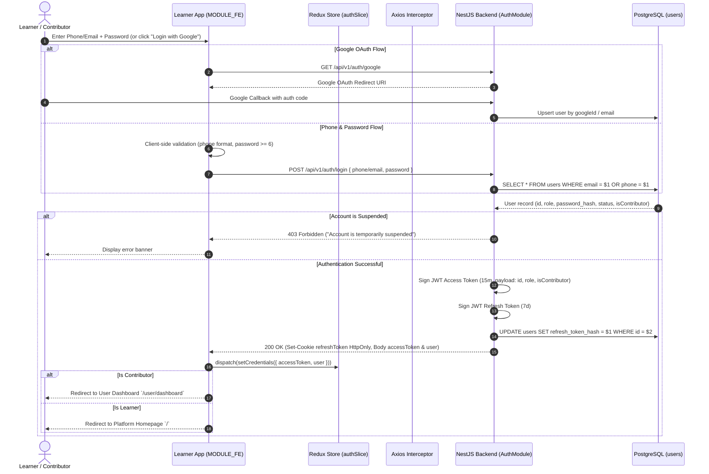
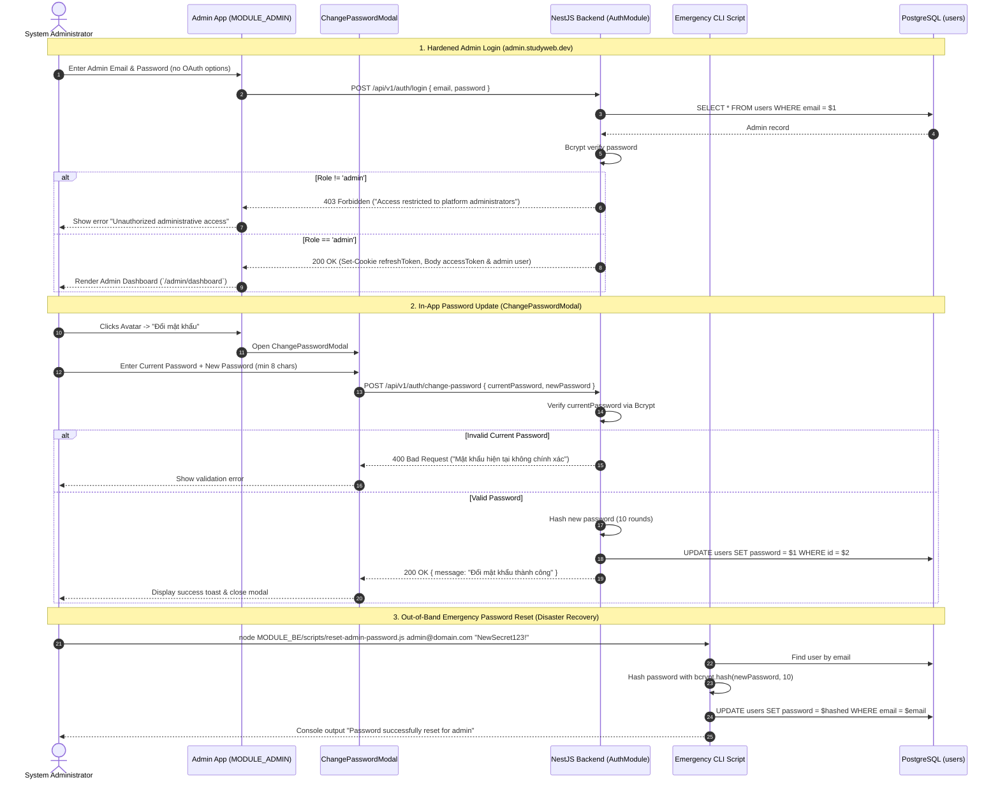

# Sequence Diagram: Authentication, Session Management & Portal Isolation (Auth & Session Flow)

## 1. Document Information

| Attribute | Details |
|---|---|
| **Document Title** | Authentication, Session Management & Portal Isolation Workflow |
| **Version** | v1.2 |
| **Author** | Nguyen Khanh Duy (Fullstack Lead & Architect) |
| **Scope** | End-to-end user and administrator lifecycle across two decoupled client frontends (`MODULE_FE` for learners/contributors, `MODULE_ADMIN` for platform administrators), dual-token issuance, silent refresh, role-based PBAC routing, admin change password modal, and CLI emergency disaster recovery |
| **Date** | 2026-10-15 |
| **Source Reference** | `MODULE_BE/src/modules/auth/auth.controller.ts`, `MODULE_BE/src/modules/auth/auth.service.ts`, `MODULE_ADMIN/src/pages/auth/AdminLoginPage.tsx`, `MODULE_ADMIN/src/components/domain/ChangePasswordModal.tsx`, `MODULE_BE/scripts/reset-admin-password.js` |

---

## 2. Core Content

### 2.1. Workflow Summary (TL;DR)
- **Flow A: Learner & Contributor Authentication (`MODULE_FE`)**:
  - Input: Phone Number / Email + Password OR one-click Google OAuth.
  - Processing: Bcrypt verification or Google OAuth ID token validation, dual-token issuance (15m in-memory Access Token + 7d HttpOnly Refresh Cookie).
  - Output: Automated routing: Learner $\to$ Homepage `/`; Contributor $\to$ User Dashboard `/user/dashboard`.
- **Flow B: Platform Administrator Authentication & Hardening (`MODULE_ADMIN`)**:
  - Input: Dedicated Admin portal login at `admin.studyweb.dev/login`. Local email/password credentials only (**Google OAuth is strictly disabled** to eliminate third-party OAuth compromise vectors).
  - Authorization Gate: Backend checks `user.role === 'admin'`. Non-admin accounts attempting login are immediately rejected with `403 Forbidden`.
  - Self-Service Password Update: Admin changes password in-app via Topbar dropdown modal (`POST /api/v1/auth/change-password` with current password verification).
  - Emergency Recovery: If the root admin password is lost, server administrators execute the root CLI script `node MODULE_BE/scripts/reset-admin-password.js <email> <newPassword>`.

---

### 2.2. Roles & Responsibilities (Who Does What)

| Entity | Type | Roles & Responsibilities |
|---|---|---|
| **Learner / Contributor** | Actor | Authenticates on `MODULE_FE` using Phone/Password or Google OAuth |
| **Platform Administrator** | Actor | Authenticates on `MODULE_ADMIN` using isolated admin credentials |
| **Learner Portal (`MODULE_FE`)** | Client UI | Renders public login modal/page, supports OAuth popup, manages learner session |
| **Admin Portal (`MODULE_ADMIN`)** | Client UI | Independent administrative client, handles admin login, houses `ChangePasswordModal` |
| **Redux Store (`authSlice`)** | Client State | In-memory store for Access Token, user profile, role, and dynamic entitlements |
| **Axios Gateway (`api.client.ts`)** | HTTP Gateway | Injects Bearer Token headers, intercepts 401 Unauthorized responses, triggers background Silent Refresh |
| **AuthController & Service** | NestJS Backend | Validates credentials, executes Bcrypt comparison, signs JWTs, sets `refreshToken` cookie, handles `change-password` |
| **CLI Reset Tool** | DevOps Script | `scripts/reset-admin-password.js`: Out-of-band direct database password hash updater |
| **PostgreSQL Database** | Storage | Stores `users` records, password hashes, and hashed refresh tokens for session revocation |

---

### 2.3. Sequence Diagrams

#### Sequence 1: Learner & Contributor Authentication (`MODULE_FE`)

#### Sequence 2: Administrator Portal Authentication & Password Lifecycle (`MODULE_ADMIN`)

---

### 2.4. Technical Specifications & Architecture Details

1. **Multi-layer Security Model**:
   - Passwords hashed using Bcrypt with salt rounds = 10.
   - `Access Token`: Short-lived (15 minutes), stored solely in memory (Redux State), never written to `localStorage` to eliminate XSS token theft vectors.
   - `Refresh Token`: Long-lived (7 days), persisted in secure `HttpOnly Cookie` configured with `SameSite=Lax; Path=/api/v1/auth/refresh; Secure`.
2. **Administrative Isolation & Subdomain Guard**:
   - `MODULE_ADMIN` is hosted on a separate origin (`admin.studyweb.dev` or port 5174/5175).
   - NestJS CORS whitelist specifically permits `http://localhost:5174` and `http://localhost:5175` alongside production admin domains.
   - OAuth login endpoints are unavailable on `MODULE_ADMIN`, enforcing strict credential stewardship.
3. **Emergency Disaster Recovery**:
   - In case of root admin credential lockout, the emergency script `MODULE_BE/scripts/reset-admin-password.js` provides secure, zero-downtime credential resets directly via CLI access to the database.

---

### 2.5. Edge Cases & Exception Handling

| Edge Case | System Response | User Experience |
|---|---|---|
| **Expired or Revoked Refresh Token** | `/api/v1/auth/refresh` responds with `401 Unauthorized` | Interceptor flushes pending queue, dispatches logout, redirects to `/login` with notice *"Session expired. Please log in again."* |
| **Non-Admin attempting Admin Portal Login** | Backend evaluates role; if role $\neq$ `admin`, returns `403 Forbidden` | Access denied banner displayed; prevented from entering Admin Topbar / Dashboard |
| **Admin enters incorrect current password** | `POST /api/v1/auth/change-password` returns `400 Bad Request` | Modal displays red error alert: *"Mật khẩu hiện tại không chính xác"* |
| **New password matches old password** | `changePassword` service throws `BadRequestException` | Modal alerts *"Mật khẩu mới không được trùng với mật khẩu hiện tại"* |
| **Account Suspended by Admin** | Token rejected via auth middleware checking user status in database | Immediate session termination across both portals |

---

## 3. References & Source Links

- **Frontend Codebase**:
  - Learner Login Form: [LoginForm.tsx](file:///d:/Projects/study-web/MODULE_FE/src/features/auth/components/LoginForm.tsx)
  - Admin Login Page: [AdminLoginPage.tsx](file:///d:/Projects/study-web/MODULE_ADMIN/src/pages/auth/AdminLoginPage.tsx)
  - Admin Change Password Modal: [ChangePasswordModal.tsx](file:///d:/Projects/study-web/MODULE_ADMIN/src/components/domain/ChangePasswordModal.tsx)
  - Admin Topbar Integration: [AdminTopbar.tsx](file:///d:/Projects/study-web/MODULE_ADMIN/src/pages/admin/_components/AdminTopbar.tsx)
- **Backend Codebase**:
  - Auth Controller: [auth.controller.ts](file:///d:/Projects/study-web/MODULE_BE/src/modules/auth/auth.controller.ts)
  - Auth Service: [auth.service.ts](file:///d:/Projects/study-web/MODULE_BE/src/modules/auth/auth.service.ts)
  - Auth DTOs: [auth.dto.ts](file:///d:/Projects/study-web/MODULE_BE/src/modules/auth/auth.dto.ts)
  - Emergency Reset Script: [reset-admin-password.js](file:///d:/Projects/study-web/MODULE_BE/scripts/reset-admin-password.js)
  - Prisma User Model: [schema.prisma](file:///d:/Projects/study-web/MODULE_BE/prisma/schema.prisma)
- **Related Workflows**:
  - Course Discovery Workflow: [02-catalog-topic-discovery.md](file:///d:/Projects/study-web/docs/workflows/02-catalog-topic-discovery.md)
  - Admin User Governance: [09-admin-users-and-entitlements.md](file:///d:/Projects/study-web/docs/workflows/09-admin-users-and-entitlements.md)
  - Contributor Onboarding: [13-contributor-onboarding-and-application.md](file:///d:/Projects/study-web/docs/workflows/13-contributor-onboarding-and-application.md)

