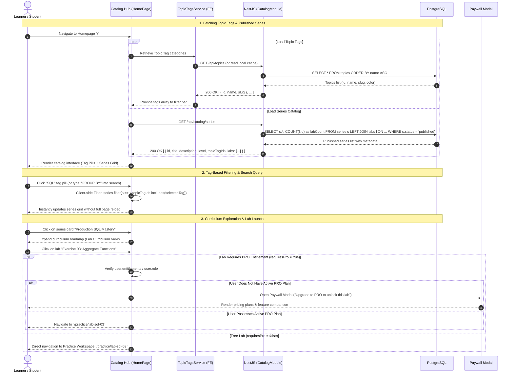

# Sequence Diagram: Course Discovery, Series Browsing & Topic Tag Filtering (Catalog & Topic Discovery)

## 1. Document Information

| Attribute | Details |
|---|---|
| **Document Title** | Course Discovery, Series Browsing & Topic Tag Filtering Workflow |
| **Version** | v1.0 |
| **Author** | Nguyen Khanh Duy (Fullstack Lead & Architect) |
| **Scope** | Learner discovery journey across the platform: Series catalog retrieval, interactive Topic Tag pill filters, keyword search, curriculum roadmap exploration, and two-tier lab access entitlement checks |
| **Date** | 2026-10-14 |
| **Source Reference** | `MODULE_FE/src/pages/HomePage.tsx`, `MODULE_FE/src/features/catalog/components/SeriesCard.tsx`, `MODULE_BE/src/modules/catalog/catalog.controller.ts`, `MODULE_FE/src/services/topicTags.service.ts` |

---

## 2. Core Content

### 2.1. Workflow Summary (TL;DR)
- **Input**: Learner navigates to Homepage `/` or Catalog `/series`.
- **Loading & Filtering**:
  - Fetches system Topic Tags from backend API or local cache (`GET /api/topics`).
  - Fetches published Series list with associated lab counts, difficulty levels, and assigned topic tags (`GET /api/catalog/series`).
  - Learner selects Topic Tag pills (e.g., JavaScript, SQL, Algorithms, Frontend) or enters query strings in the search bar.
- **Interactions**:
  - Instant client-side reactive filtering across Series cards.
  - Clicking a Series expands the lab curriculum and learning roadmap.
  - Access Gate evaluation: If lab is Free or user possesses PRO entitlement $\to$ opens the Practice Workspace (`/practice/:labId`); if lab requires PRO and user has standard role $\to$ triggers the Paywall Modal.

---

### 2.2. Roles & Responsibilities (Who Does What)

| Entity | Type | Roles & Responsibilities |
|---|---|---|
| **Learner (User / Guest)** | Actor | Selects topic tags, searches keywords, explores series roadmaps, and launches labs |
| **Catalog Hub (`HomePage`)** | Client UI | Renders hero banner, topic tag pill bar, search inputs, and responsive series grid |
| **TopicTagsService** | FE Service | Manages topic tags cache and dispatches `topic-tags-updated` custom events |
| **CatalogController & Service** | NestJS Backend | Queries published series with joined `labs` and `topicTags` relations |
| **PostgreSQL Database** | Storage | Houses `series`, `labs`, `topics`, and `series_topics` tables |

---

### 2.3. Sequence Diagram

---

### 2.4. Technical Specifications & Architecture Details

1. **Decoupled Topic Tagging Taxonomy**:
   - Topic Tags provide flexible multi-dimensional categorization rather than rigid hierarchical directory nesting.
   - A single Series or Lab can carry multiple Topic Tags simultaneously (e.g., both `#Backend` and `#SQL`).
   - The frontend implements a reactive Tag Pills bar with `activeTagId` state, offering instantaneous filtering across "All", "JavaScript", "SQL", "Frontend", and "System Design".
2. **Personalized Progress Integration**:
   - For authenticated users, completion metrics (`user_progress`) are aggregated to compute progress percentages (e.g., "4/10 Labs Completed — 40%") directly overlaid on Series cards.
3. **Two-tier Entitlement Guard Architecture**:
   - **Tier 1 (Frontend Route & Modal Gate)**: Checks `requiresPro` flag on lab entities against `role = 'user_pro' | 'admin'` in Redux. Non-entitled attempts prompt the Paywall modal before route navigation.
   - **Tier 2 (Backend Security Guard)**: The `GET /api/labs/:id` endpoint enforces `JwtAuthGuard` and `RequireProGuard` to thwart direct REST API bypass.

---

### 2.5. Edge Cases & Exception Handling

| Edge Case | System Response | User Experience |
|---|---|---|
| **No Series Matches Selected Tag/Search** | Empty array `[]` returned | Displays friendly Empty State: *"No series found matching your criteria. Try choosing another tag or resetting filters"* with "Reset Filters" action button |
| **Network or Server Error (500)** | Axios error caught in request lifecycle | Displays error state banner with "Retry" button |
| **Series Unlisted / Draft by Author** | Filtered out by backend query `WHERE status = 'published'` | Excluded from catalog; direct deep links respond with 404 Not Found |

---

## 3. References & Source Links

- **Frontend Codebase**:
  - Catalog Homepage: [HomePage.tsx](file:///d:/Projects/study-web/MODULE_FE/src/pages/HomePage.tsx)
  - Series Card Component: [SeriesCard.tsx](file:///d:/Projects/study-web/MODULE_FE/src/features/catalog/components/SeriesCard.tsx)
  - Topic Tags Service: [topicTags.service.ts](file:///d:/Projects/study-web/MODULE_FE/src/services/topicTags.service.ts)
- **Backend Codebase**:
  - Catalog Controller: [catalog.controller.ts](file:///d:/Projects/study-web/MODULE_BE/src/modules/catalog/catalog.controller.ts)
  - Database Schema: [schema.prisma](file:///d:/Projects/study-web/MODULE_BE/prisma/schema.prisma)
- **Related Workflows**:
  - Lab Workspace Execution: [03-lab-practice-webworker.md](file:///d:/Projects/study-web/docs/workflows/03-lab-practice-webworker.md)
  - Admin Topic Governance: [08-admin-topic-governance.md](file:///d:/Projects/study-web/docs/workflows/08-admin-topic-governance.md)
  - PRO Upgrade & Payment Flow: [12-upgrade-and-payment.md](file:///d:/Projects/study-web/docs/workflows/12-upgrade-and-payment.md)
