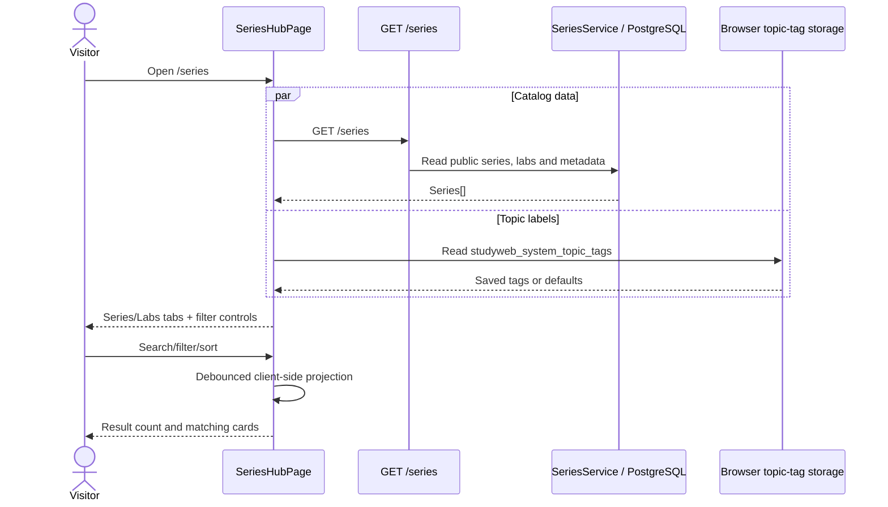

# Catalog, Series Curriculum, Topic Discovery, and Lab Access

## 1. Document Information

| Attribute | Detail |
|---|---|
| Document | Catalog, Series Curriculum, Topic Discovery, and Lab Access |
| Version | 2.0 |
| Owner | Nguyen Khanh Duy — Fullstack Lead & Architect |
| Scope | `/series`, `/series/:slug`, `/roadmaps`, lab cards and entitlement-aware navigation |
| Date | 2026-10-24 |
| Source | Current frontend series pages/services and backend series controller/service |

## 2. Content

### 2.1. Feature coverage

| Feature | Status | Behavior |
|---|---|---|
| Series catalog | `IMPLEMENTED` | Loads public series and toggles between series and flattened lab views. |
| Search/filter/sort | `IMPLEMENTED` | 250 ms search debounce; topic, tier, difficulty, format, and sort controls run client-side. |
| Topic taxonomy | `PARTIAL` | Default/admin-edited tags are browser-local, not loaded from a backend topic endpoint. |
| Series curriculum | `IMPLEMENTED` | Sections/units, unit type, duration, author, status and per-user progress are displayed. |
| PRO gating | `IMPLEMENTED` | Locked units open the upgrade modal; unlocked units route to `/labs/:slug`. |
| Saved/bookmarked series | `PLACEHOLDER` | No persistence despite pricing/catalog copy references. |

### 2.2. Catalog flow

1. `seriesApi.getAll()` requests `GET /series` without requiring authentication.
2. The hub flattens included labs for the “Practice Labs” view.
3. Search matches series title/description/category or lab title/category/type/parent series.
4. Filters cover topic, Free/PRO tier, difficulty, and learning format; sorting covers popularity proxy, newest, duration, and difficulty.
5. Empty results show a reset action; loading shows six card skeletons.
6. Current page does not expose a dedicated network-error banner, which is an open UX gap.

### 2.3. Topic taxonomy (`PARTIAL`)

`topicTags.service.ts` provides five defaults and alias normalization such as `sql → database` and `qa → testing`. Admin editing writes `localStorage.studyweb_system_topic_tags` and dispatches a browser custom event. This is reactive on one browser profile but is not system-wide persistence. There is no current `CatalogController`, `/topics` endpoint, or `series_topics` API contract in this flow.

### 2.4. Series detail and curriculum flow

1. Visitor opens `/series/:slug`; `GET /series/:slug` uses optional JWT.
2. Backend returns public series detail and can attach current-user progress when a valid identity is present.
3. Page renders topic/format/PRO/status badges, description, duration, author, and a pedagogical summary.
4. Explicit sections are ordered and rendered; legacy series without sections receive a client fallback section named “Curriculum Units”.
5. Each unit displays inferred type, duration and progress (`IN_PROGRESS`, `COMPLETED`, or passed status).
6. Free/entitled unit routes to `/labs/:slug`; locked unit opens `UpgradeModal` without navigating.
7. Loading uses skeletons; missing/error series shows “Series not found” and a catalog return action.

### 2.5. Access and security boundaries

- Catalog and series reads are public; optional JWT enriches personal progress and privileged content context.
- Client `can(user, 'LAB_PRO')` provides immediate gating UX.
- Lab retrieval/submission and protected configuration remain backend-controlled; directly typing a lab URL cannot create a valid entitlement.
- `isFreePreview` can keep selected units accessible inside a PRO series.
- Author-only solutions/grading configuration are not implied by catalog access.

### 2.6. Routes and UI states

| Route | Access | States |
|---|---|---|
| `/` | Public | Marketing/landing navigation to catalog and account actions. |
| `/series` | Public | Skeleton, series/lab views, filtered empty, results. |
| `/series/:slug` | Public + optional identity | Skeleton, not found/error, curriculum, locked unit modal. |
| `/roadmaps` | Public | Roadmap presentation; links into series/catalog as implemented by the page. |
| `/labs/:slug` | Authenticated | Workspace loading/error/PRO gate and strategy flow in WF-17. |
| `/terms`, `/privacy`, `*` | Public | Legal content and not-found fallback. |

### 2.7. Revision history and open issues

| Version | Date | Author | Note |
|---|---|---|---|
| 1.0 | 2026-10-14 | Nguyen Khanh Duy | Earlier catalog design referenced nonexistent catalog/topic APIs and `/practice`. |
| 2.0 | 2026-10-24 | StudyWeb engineering team | Reconciled routes, `SeriesController`, browser-local tags and current access behavior. |

Open issues:

1. Add a visible catalog query error/retry state.
2. Move topic taxonomy to backend persistence if changes must be shared across admins/devices.
3. Replace fallback popularity counts/defaults with explicit analytics data where required.
4. Do not advertise saved-series persistence until WF-16 placeholder is implemented.

## 3. References

- [PRO access and payment boundary](12-upgrade-and-payment.md)
- [Learner dashboard and library](16-learner-dashboard-and-library.md)
- [Learning unit strategies](17-learning-unit-strategies.md)
- [`MODULE_FE/src/pages/lab/SeriesHubPage.tsx`](../../MODULE_FE/src/pages/lab/SeriesHubPage.tsx)
- [`MODULE_FE/src/pages/lab/SeriesDetailPage.tsx`](../../MODULE_FE/src/pages/lab/SeriesDetailPage.tsx)
- [`MODULE_FE/src/pages/lab/RoadmapsPage.tsx`](../../MODULE_FE/src/pages/lab/RoadmapsPage.tsx)
- [`MODULE_FE/src/features/lab/api/series.api.ts`](../../MODULE_FE/src/features/lab/api/series.api.ts)
- [`MODULE_FE/src/services/topicTags.service.ts`](../../MODULE_FE/src/services/topicTags.service.ts)
- [`MODULE_BE/src/modules/series/series.controller.ts`](../../MODULE_BE/src/modules/series/series.controller.ts)
- [`MODULE_BE/src/modules/series/series.service.ts`](../../MODULE_BE/src/modules/series/series.service.ts)
