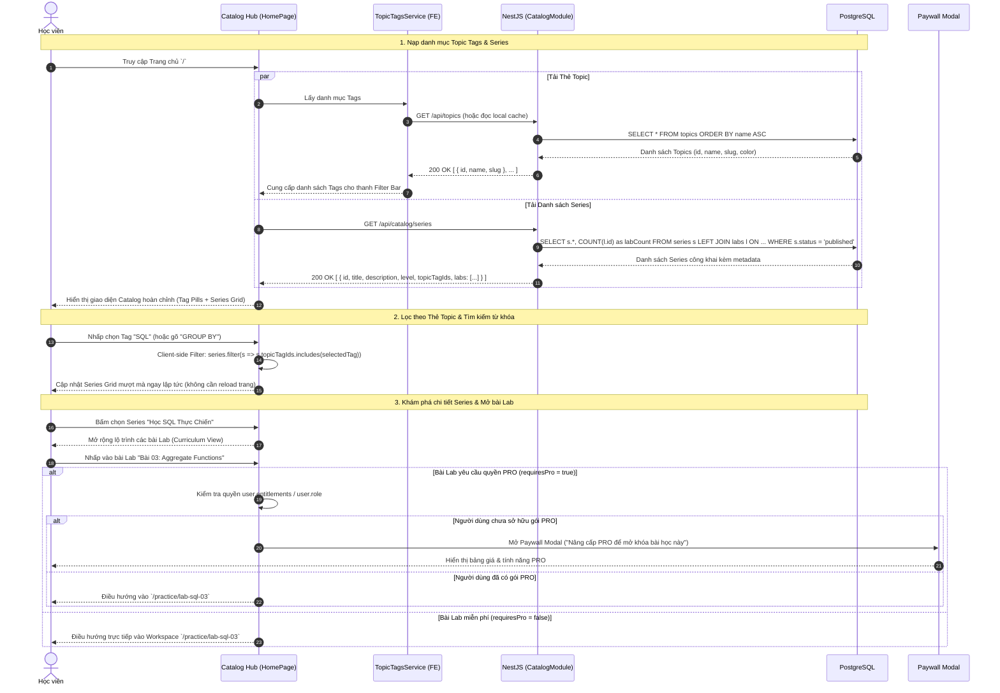

# Sơ đồ Luồng Khám phá Khóa học, Duyệt Series & Lọc theo Thẻ Topic (Catalog & Topic Discovery)

## 1. Thông tin tài liệu (Document Information)

| Thuộc tính | Chi tiết |
|---|---|
| **Tên tài liệu** | Sơ đồ Luồng Khám phá Khóa học, Duyệt Series & Lọc theo Thẻ Topic |
| **Version** | v1.0 |
| **Người làm** | Nguyen Khanh Duy (Fullstack Lead & Architect) |
| **Phạm vi (Scope)** | Trải nghiệm khám phá thư viện học tập: Hiển thị danh mục Series, bộ lọc theo Thẻ Topic Tags, thanh tìm kiếm từ khóa, hiển thị lộ trình học và kiểm tra quyền mở bài Lab |
| **Thời gian** | 2026-10-14 |
| **Tham chiếu từ** | `MODULE_FE/src/pages/HomePage.tsx`, `MODULE_FE/src/features/catalog/components/SeriesCard.tsx`, `MODULE_BE/src/modules/catalog/catalog.controller.ts`, `MODULE_FE/src/features/topics/services/topicTags.service.ts` |

---

## 2. Nội dung chính (Content)

### 2.1. Tóm tắt luồng (TL;DR)
- **Đầu vào**: Học viên truy cập Trang chủ `/` hoặc trang Khám phá `/catalog`.
- **Hiển thị & Bộ lọc**:
  - Tải danh mục thẻ Topic Tags từ API hoặc bộ nhớ cache (`GET /api/topics`).
  - Tải danh sách Series kèm bài lab và tags tương ứng (`GET /api/catalog/series`).
  - Học viên nhấp chọn các Tag (JavaScript, SQL, Algorithm, Frontend...) hoặc gõ từ khóa tìm kiếm.
- **Tương tác**:
  - Danh sách Series tự động lọc ngay lập tức (instant reactive filtering).
  - Nhấp vào một Series để xem lộ trình các bài Lab bên trong.
  - Kiểm tra điều kiện bài Lab: Nếu là bài Free hoặc user có gói PRO -> Cho phép mở Workspace làm bài (`/practice/:labId`); nếu bài PRO và user chưa mua gói -> Kích hoạt Paywall Modal.

---

### 2.2. Phân công & Vai trò (Who does what)

| Thực thể | Loại | Vai trò & Trách nhiệm trong luồng |
|---|---|---|
| **Học viên (User / Guest)** | Actor | Chọn Topic Tag, gõ từ khóa tìm kiếm, nhấp chọn Series và mở bài Lab |
| **Catalog Hub (`HomePage`)** | Client UI | Render Hero banner, thanh Topic Tag pills, search box và danh sách Series Grid |
| **TopicTagsService** | FE Service | Quản lý danh mục thẻ Topic, phát sự kiện `topic-tags-updated` khi có thay đổi |
| **CatalogController & Service** | NestJS Backend | Query Series kèm quan hệ `labs`, `topicTags`, tổng số bài, độ khó và trạng thái `published` |
| **PostgreSQL Database** | Storage | Bảng `series`, `labs`, `topics`, `series_topics` |

---

### 2.3. Sơ đồ Tuần tự (Sequence Diagram)

---

### 2.4. Phân tích Kỹ thuật Chi tiết

1. **Kiến trúc Thẻ Topic phi tập trung (Topic Tagging)**:
   - Topic Tags đóng vai trò là "nhãn phân loại linh hoạt" (cross-cutting categorization) thay vì phân cấp thư mục cứng nhắc.
   - Một Series hoặc Bài Lab có thể gắn đồng thời nhiều Thẻ Topic (ví dụ: vừa thuộc `#Backend`, vừa thuộc `#SQL`).
   - Phía Frontend sử dụng component Tag Pills với trạng thái `activeTagId`, cho phép chuyển đổi tức thì giữa các chủ đề: "Tất cả", "JavaScript", "SQL", "Frontend", "System Design".
2. **Hiển thị tiến độ cá nhân hóa (Personalized Progress)**:
   - Nếu người dùng đã đăng nhập, thông tin tiến độ hoàn thành bài Lab (`user_lab_progress`) được kết hợp để hiển thị thanh tiến độ phần trăm (Progress Bar: ví dụ "4/10 bài hoàn thành - 40%") trực tiếp trên thẻ Series.
3. **Phân quyền truy cập 2 lớp (Two-tier Entitlement Guard)**:
   - **Lớp 1 (Frontend Route & Modal Gate)**: Component kiểm tra cờ `requiresPro` của bài Lab so với quyền `role = 'user_pro' | 'admin'` trong Redux. Nếu thiếu quyền, ngăn điều hướng và bật popup Paywall.
   - **Lớp 2 (Backend Guard)**: Endpoint `GET /api/labs/:id` chạy Guard `JwtAuthGuard` + `RequireProGuard` để ngăn ngừa việc bypass trực tiếp qua API.

---

### 2.5. Xử lý Ngoại lệ (Edge Cases)

| Tình huống ngoại lệ | Phản hồi hệ thống | Trải nghiệm người dùng |
|---|---|---|
| **Không tìm thấy Series nào khớp với Tag/Từ khóa** | Trả về mảng rỗng `[]` | Hiển thị Empty State: *"Không tìm thấy khóa học nào phù hợp. Thử chọn thẻ khác hoặc xóa bộ lọc"* kèm nút "Đặt lại bộ lọc" |
| **API Series bị lỗi mạng hoặc 500** | Axios ném lỗi bắt trong `catch` | Hiển thị Skeleton lỗi kèm nút "Thử lại" |
| **Series bị tác giả hoặc admin gỡ xuống (`status = draft` / `archived`)** | Backend lọc bỏ khỏi danh mục công khai | Không xuất hiện trong Catalog; nếu truy cập trực tiếp bằng URL thì trả về 404 Not Found |

---

## 3. Tài liệu tham khảo & Liên kết (References)

- **Mã nguồn Frontend**:
  - Trang chủ Catalog: [MODULE_FE/src/pages/HomePage.tsx](file:///d:/Projects/study-web/MODULE_FE/src/pages/HomePage.tsx)
  - Card hiển thị Series: [MODULE_FE/src/features/catalog/components/SeriesCard.tsx](file:///d:/Projects/study-web/MODULE_FE/src/features/catalog/components/SeriesCard.tsx)
  - Service Thẻ Topic: [MODULE_FE/src/features/topics/services/topicTags.service.ts](file:///d:/Projects/study-web/MODULE_FE/src/features/topics/services/topicTags.service.ts)
- **Mã nguồn Backend**:
  - Controller Catalog: [MODULE_BE/src/modules/catalog/catalog.controller.ts](file:///d:/Projects/study-web/MODULE_BE/src/modules/catalog/catalog.controller.ts)
  - Schema Database: [MODULE_BE/prisma/schema.prisma](file:///d:/Projects/study-web/MODULE_BE/prisma/schema.prisma)
- **Tài liệu liên quan**:
  - Thực hành Bài Lab trong Sandbox: [03-lab-practice-webworker.md](file:///d:/Projects/study-web/docs/workflows/03-lab-practice-webworker.md)
  - Quản trị Thẻ Topic của Admin: [08-admin-topic-governance.md](file:///d:/Projects/study-web/docs/workflows/08-admin-topic-governance.md)
  - Nâng cấp Tài khoản qua Paywall: [12-upgrade-and-payment.md](file:///d:/Projects/study-web/docs/workflows/12-upgrade-and-payment.md)
