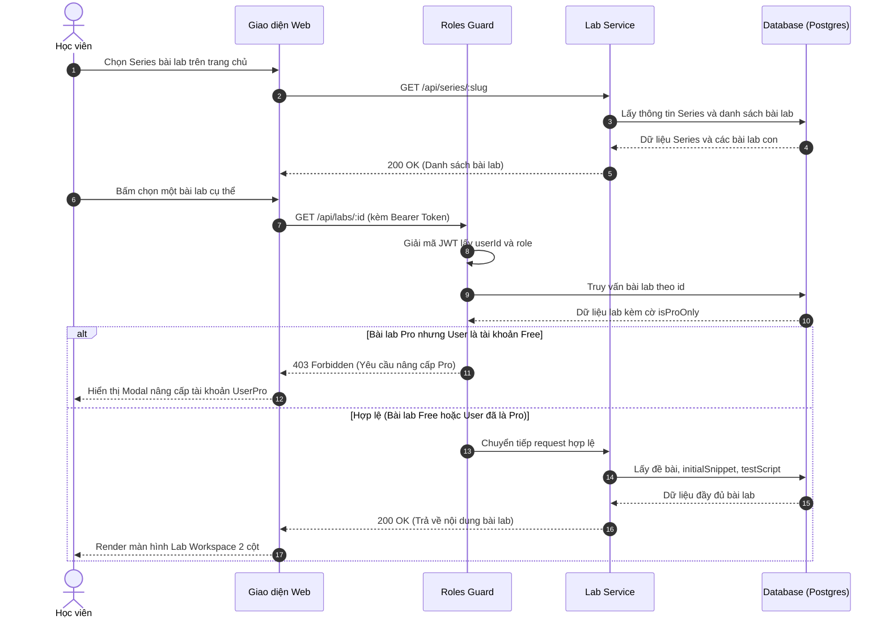

# Sơ đồ Luồng Truy cập Bài Lab & Phân quyền Pro (RBAC Guard)

## 1. Thông tin tài liệu (Document Information)

| Thuộc tính | Chi tiết |
|---|---|
| **Tên tài liệu** | Sơ đồ Luồng Truy cập Bài Lab & Phân quyền Pro |
| **Version** | v1.0 |
| **Người làm** | Nguyen Khanh Duy (Fullstack Lead & Architect) |
| **Phạm vi (Scope)** | Luồng người dùng khám phá danh mục Series, chọn bài lab, kiểm tra vai trò (RBAC) và mở không gian thực hành Lab Workspace |
| **Thời gian** | 2026-10-02 |
| **Tham chiếu từ** | `MODULE_BE/src/common/guards/roles.guard.ts` và cơ chế bảo vệ Route phía `MODULE_FE/src/routes` |

---

## 2. Nội dung chính (Content)

### 2.1. Sơ đồ Tuần tự (Sequence Diagram)

### 2.2. Phân tích Chi tiết Từng Bước

1. **Cấp độ Series (Public Catalog)**:
   * Danh sách các Series bài lab được công khai để khách vãng lai và học viên tự do khám phá.
   * Từng bài lab trong series được gắn nhãn minh bạch: `Miễn phí (Free Preview)` hoặc `Dành cho Pro (Pro Only)`.

2. **Cơ chế Bảo vệ 2 Lớp (Dual-layer Guard)**:
   * **Lớp 1 (Phía Frontend)**: Kiểm tra thông tin `user.role` trong Redux Store để hiển thị biểu tượng ổ khóa 🔒 hoặc nút mở khóa.
   * **Lớp 2 (Phía Backend - Tuyệt đối)**: Sử dụng NestJS `RolesGuard`. Dù học viên có cố tình gọi API trực tiếp bằng Postman, nếu không có token `userPro` hoặc `admin`, backend lập tức từ chối với mã `403 Forbidden`. Không trả về bất kỳ nội dung bài lab hay kịch bản test nào.

3. **Cung cấp Dữ liệu Môi trường Thực hành (Lab Workspace)**:
   * Khi vượt qua kiểm tra quyền, Frontend nhận về payload gồm:
     * `instructions`: Nội dung hướng dẫn từng bước viết bằng Markdown.
     * `initialSnippet`: Đoạn code mẫu ban đầu đưa vào khung soạn thảo.
     * `sandboxType`: Loại môi trường cần khởi tạo (`js_worker`, `ui_mock`, `api_mock`).
     * `testScript`: Kịch bản kiểm thử sẵn sàng để gửi xuống Web Worker khi bấm nút Test.

---

## 3. Tài liệu tham khảo & Liên kết (References)

- **Mã nguồn liên quan**:
  - Guard kiểm tra vai trò: [MODULE_BE/src/common/guards/roles.guard.ts](file:///d:/Projects/study-web/MODULE_BE/src/common/guards/roles.guard.ts)
  - Định tuyến bảo vệ Frontend: [MODULE_FE/src/routes/ProtectedRoute.tsx](file:///d:/Projects/study-web/MODULE_FE/src/routes/ProtectedRoute.tsx)
- **Tài liệu hệ thống**:
  - Đề xuất Dự án: [01-proposal.md](file:///d:/Projects/study-web/Docs/01-proposal.md)
  - Thiết kế Cơ sở Dữ liệu: [05-database.md](file:///d:/Projects/study-web/Docs/05-database.md)
