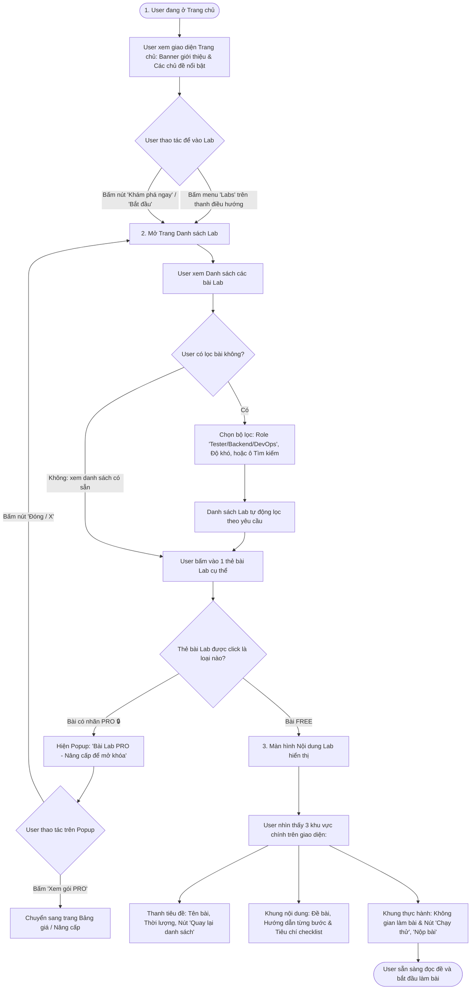
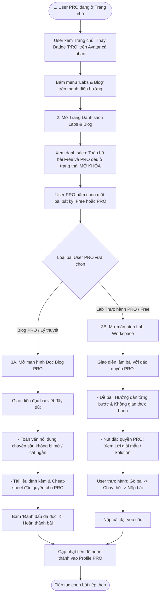
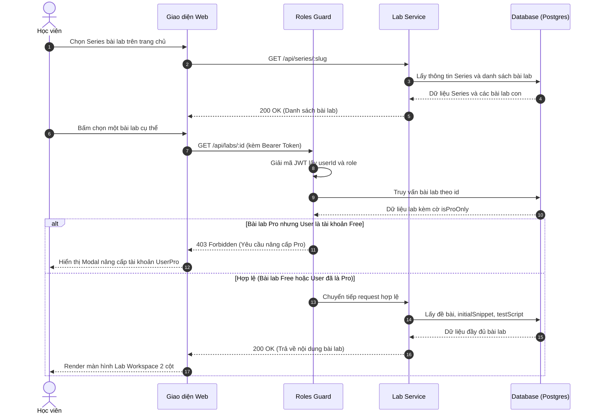

# Sơ đồ Luồng Truy cập Bài Lab & Phân quyền Pro (RBAC Guard)

## 1. Thông tin tài liệu (Document Information)

| Thuộc tính | Chi tiết |
|---|---|
| **Tên tài liệu** | Sơ đồ Luồng Truy cập Bài Lab & Phân quyền Pro |
| **Version** | v1.1 |
| **Người làm** | Nguyen Khanh Duy (Fullstack Lead & Architect) |
| **Phạm vi (Scope)** | Luồng nghiệp vụ người dùng từ Trang chủ -> Danh sách Lab -> Mở nội dung Lab, kèm kiểm soát quyền RBAC 2 lớp |
| **Thời gian** | 2026-10-13 |
| **Tham chiếu từ** | `MODULE_BE/src/common/guards/roles.guard.ts` và cơ chế bảo vệ Route phía `MODULE_FE/src/routes` |

---

## 2. Nội dung chính (Content)

### 2.1. Sơ đồ Luồng Nghiệp vụ Người dùng (User Business Flow)

Sơ đồ thể hiện chu trình tương tác thực tế của người dùng thông thường từ Trang chủ, qua trang Danh sách bài Lab và mở Nội dung bài Lab thực hành:

#### Các điểm chạm (Touchpoints) của Người dùng trên Giao diện:
1. **Trang chủ (Home Page)**:
   - Người dùng dễ dàng thấy menu cố định "Labs" trên thanh điều hướng (Navbar) hoặc nút kêu gọi hành động (Call-to-Action) tại banner chính để mở danh mục thực hành.
2. **Trang Danh sách Lab (Lab Catalog)**:
   - Bộ lọc và thanh tìm kiếm hỗ trợ lọc nhanh theo Chuyên môn (Tester, Backend, DevOps) và Độ khó.
   - Thẻ bài Lab thể hiện rõ nhãn phân loại (Free vs Pro 🔒) và trạng thái làm bài cá nhân (Chưa làm / Đang làm / Đã hoàn thành).
3. **Mở Nội dung Lab**:
   - Nếu bấm bài Pro: Hiển thị Modal thông báo quyền lợi gói Pro văn minh kèm nút tìm hiểu và nút đóng, không gây đứt gãy luồng trải nghiệm.
   - Nếu bấm bài Free: Mở thẳng giao diện Workspace chia bố cục rõ ràng: Khung đọc đề/hướng dẫn và Khung thực hành thao tác.

### 2.2. Sơ đồ Luồng Nghiệp vụ Dành cho Tài khoản PRO (User PRO Flow)

Đối với học viên sở hữu tài khoản **User PRO**, lộ trình tương tự tài khoản thường nhưng toàn bộ rào cản Paywall được gỡ bỏ, đồng thời mở khóa cả Blog lý thuyết PRO và tính năng xem Lời giải mẫu (Solution):

#### Các đặc quyền giao diện của User PRO:
1. **Không bị chặn Paywall**: Toàn bộ bài có gắn nhãn PRO hiển thị biểu tượng mở khóa 🔓, bấm vào là xem ngay mà không gặp popup yêu cầu nâng cấp.
2. **Blog lý thuyết PRO**: Hiển thị đầy đủ 100% nội dung kiến thức chuyên sâu và tài liệu đính kèm.
3. **Workspace Thực hành PRO**: Mở khóa thêm nút **"Xem Lời giải mẫu (Solution)"** để tham khảo đáp án chuẩn khi gặp bài khó.

### 2.3. Sơ đồ Tuần tự Kỹ thuật (Sequence Diagram)

### 2.4. Phân tích Chi tiết Từng Bước

1. **Cấp độ Series (Public Catalog)**:
   * Danh sách các Series bài lab được công khai để khách vãng lai và học viên tự do khám phá.
   * Từng bài lab trong series được gắn nhãn minh bạch: `Miễn phí (Free Preview)` hoặc `Dành cho Pro (Pro Only)`.

2. **Cơ chế Bảo vệ 2 Lớp (Dual-layer Guard)**:
   * **Lớp 1 (Phía Frontend)**: Kiểm tra thông tin `user.role` trong Redux Store để hiển thị biểu tượng ổ khóa 🔒 hoặc nút mở khóa.
   * **Lớp 2 (Phía Backend - Tuyệt đối)**: Sử dụng NestJS `RolesGuard`. Dù học viên có cố tình gọi API trực tiếp bằng Postman, nếu không có token `userPro` hoặc `admin`, backend lập tức từ chối với mã `403 Forbidden`. Không trả về bất kỳ nội dung bài lab hay kịch bản test nào.

3. **Cung cấp Dữ liệu Môi trường Thực hành (Lab Workspace)**:
   * Khi vượt qua kiểm tra quyền, Frontend nhận về payload gồm:
     * `instructions`: Nội dung hướng dẫn từng bước viết bằng Markdown.
     * `initialSnippet`: Đoạn code mẫu ban đầu đưa vào khung soạn thảo.
     * `sandboxType`: Loại môi trường cần khởi tạo (`js_worker`, `ui_mock`, `api_mock`).
     * `testScript`: Kịch bản kiểm thử sẵn sàng để gửi xuống Web Worker khi bấm nút Test.

---

## 3. Tài liệu tham khảo & Liên kết (References)

- **Mã nguồn liên quan**:
  - Guard kiểm tra vai trò: [MODULE_BE/src/common/guards/roles.guard.ts](file:///d:/Projects/study-web/MODULE_BE/src/common/guards/roles.guard.ts)
  - Định tuyến bảo vệ Frontend: [MODULE_FE/src/routes/ProtectedRoute.tsx](file:///d:/Projects/study-web/MODULE_FE/src/routes/ProtectedRoute.tsx)
- **Tài liệu hệ thống**:
  - Đề xuất Dự án: [01-proposal.md](file:///d:/Projects/study-web/Docs/01-proposal.md)
  - Thiết kế Cơ sở Dữ liệu: [05-database.md](file:///d:/Projects/study-web/Docs/05-database.md)
