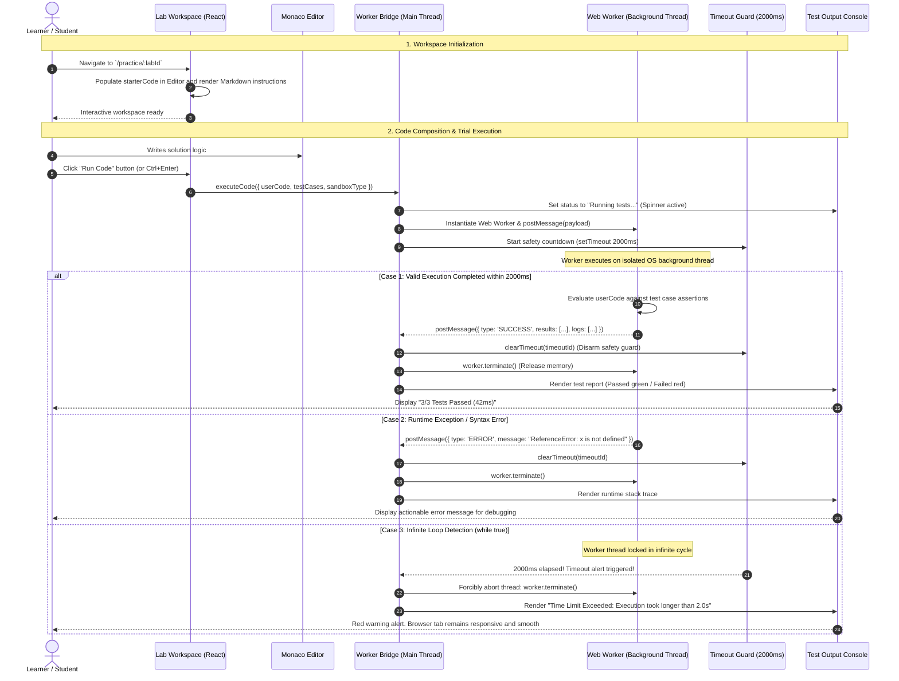

# Sequence Diagram: Lab Practice & Web Worker Execution Sandbox (In-Browser Execution Flow)

## 1. Document Information

| Attribute | Details |
|---|---|
| **Document Title** | Lab Practice & Web Worker Execution Sandbox Workflow |
| **Version** | v1.1 |
| **Author** | Nguyen Khanh Duy (Fullstack Lead & Architect) |
| **Scope** | Learner experience in the Interactive Lab Workspace (`/practice/:labId`): Markdown theory rendering, Monaco Code Editor setup, background thread code execution (JavaScript / SQL / Quiz) inside an isolated Web Worker, and tab freeze protection via a 2-second Timeout Guard |
| **Date** | 2026-10-14 |
| **Source Reference** | `MODULE_FE/src/pages/PracticeLabPage.tsx`, `MODULE_FE/src/features/lab/components/LabWorkspace.tsx`, `MODULE_FE/src/features/lab/workers/lab-runner.worker.ts` |

---

## 2. Core Content

### 2.1. Workflow Summary (TL;DR)
- **Input**: Learner accesses a lab page (`/practice/:labId`), reviews Markdown instructions on the left panel, and writes code solutions in the Monaco Code Editor on the right panel.
- **Execution**:
  - Learner clicks **"Run Code"** or triggers shortcut `Ctrl + Enter`.
  - Frontend spawns an isolated OS background `Web Worker`, transmitting the learner solution alongside automated test case suites.
  - Main thread initiates a **Timeout Guard (2000ms)** countdown timer.
- **Output**:
  - If execution completes within 2000ms: Worker aggregates test cases (Passed/Failed), execution duration (ms), captured console logs, and signals the Main Thread to update the Test Output Console.
  - If code contains an infinite loop (`while (true)`): At 2000ms, Main Thread forcibly invokes `worker.terminate()`, rendering a "Time Limit Exceeded" alert without freezing the browser UI.

---

### 2.2. Roles & Responsibilities (Who Does What)

| Entity | Type | Roles & Responsibilities |
|---|---|---|
| **Learner** | Actor | Reads instructions, writes code, triggers "Run Code" or submits solution |
| **Lab Workspace Layout** | Client UI | Two-pane layout (Theory/Guide on left, Monaco Editor + Test Console on right) |
| **Monaco Editor** | Code Editor | Provides syntax highlighting, auto-completion, line numbers, and keyboard shortcuts |
| **Worker Bridge** | Client Engine | Bundles user code and test cases into structured messages, manages Worker lifecycle |
| **Web Worker Sandbox** | OS Background Thread | Isolated execution environment for JavaScript/SQL, devoid of DOM, storage, or cookie access |
| **Timeout Guard (2s)** | Safety Mechanism | Forcibly terminates the worker if execution runtime exceeds safe thresholds |
| **Test Output Console** | Client UI | Renders granular test results (Status, Input, Expected, Actual, Duration, Logs) |

---

### 2.3. Sequence Diagram

---

### 2.4. Technical Specifications & Architecture Details

1. **Client-Side Web Worker Architecture Rationales**:
   - Zero Server Overhead: Eliminates expensive remote Docker/Kubernetes container orchestration clusters for client-side evaluation exercises.
   - Near-Zero Latency: Tests execute directly on learner hardware, delivering results within tens of milliseconds.
2. **Sandbox Isolation Security**:
   - `window`, `document`, `localStorage`, `sessionStorage`, and `cookies` are strictly inaccessible in a Dedicated Worker scope.
   - User-submitted malicious code cannot manipulate the application DOM, steal tokens, or mount cross-site scripting (XSS) attacks.
3. **Worker Lifecycle Management**:
   - Each execution instance generates an ephemeral Worker thread that is unconditionally killed (`terminate()`) immediately upon task resolution or timeout expiration, preventing memory leaks.

---

### 2.5. Edge Cases & Exception Handling

| Edge Case | System Response | User Experience |
|---|---|---|
| **Infinite Loop / Deep Recursion** | Timeout Guard (2000ms) terminates worker | Renders Time Limit Exceeded error and instantly restores editor controls |
| **Prototype Mutation (`Array.prototype`)** | Dedicated Worker thread scope isolation | Disposed upon run completion; subsequent runs and host application are unharmed |
| **Excessive Console Log Flooding** | Worker caps log collection at 100 entries | Excess logs truncated with notice *"Output truncated to 100 lines..."* |

---

## 3. References & Source Links

- **Frontend Codebase**:
  - Strategy Registry: [workspaceRegistry.ts](file:///d:/Projects/study-web/MODULE_FE/src/features/lab/strategies/workspaceRegistry.ts)
  - Automation Test Workspace: [AutomationTestWorkspace.tsx](file:///d:/Projects/study-web/MODULE_FE/src/features/lab/strategies/AutomationTestWorkspace.tsx)
  - SQL Practice Workspace: [SqlPracticeWorkspace.tsx](file:///d:/Projects/study-web/MODULE_FE/src/features/lab/strategies/SqlPracticeWorkspace.tsx)
  - Quiz Assignment Workspace: [QuizAssignmentWorkspace.tsx](file:///d:/Projects/study-web/MODULE_FE/src/features/lab/strategies/QuizAssignmentWorkspace.tsx)
  - Automation Web Worker: [lab-runner.worker.ts](file:///d:/Projects/study-web/MODULE_FE/src/features/lab/workers/lab-runner.worker.ts)
  - SQL PGlite Web Worker: [sql-runner.worker.ts](file:///d:/Projects/study-web/MODULE_FE/src/features/lab/workers/sql-runner.worker.ts)
- **Related Workflows**:
  - Course Discovery & Lab Access: [02-catalog-topic-discovery.md](file:///d:/Projects/study-web/docs/workflows/02-catalog-topic-discovery.md)
  - Submission & Progress Tracking: [04-lab-submission-progress.md](file:///d:/Projects/study-web/docs/workflows/04-lab-submission-progress.md)
  - Markdown-First Lab Studio: [06-create-lab-studio.md](file:///d:/Projects/study-web/docs/workflows/06-create-lab-studio.md)
