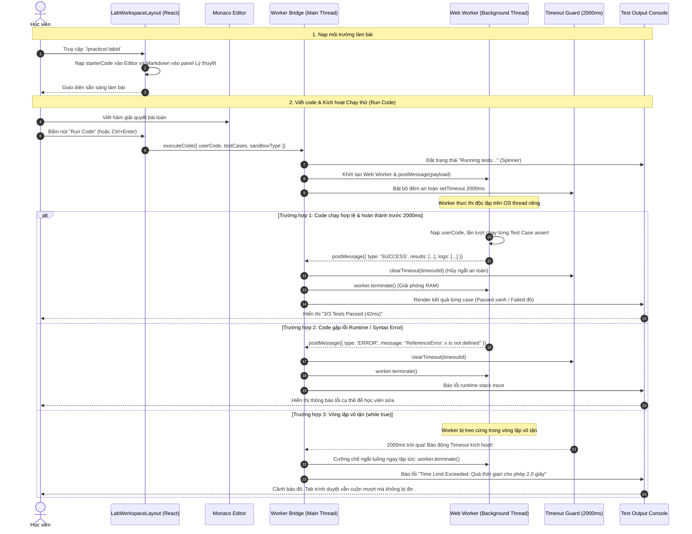

# Sơ đồ Luồng Thực hành Bài Lab & Sandbox Web Worker (In-Browser Execution Flow)

## 1. Thông tin tài liệu (Document Information)

| Thuộc tính | Chi tiết |
|---|---|
| **Tên tài liệu** | Sơ đồ Luồng Thực hành Bài Lab & Sandbox Web Worker |
| **Version** | v1.1 |
| **Người làm** | Nguyen Khanh Duy (Fullstack Lead & Architect) |
| **Phạm vi (Scope)** | Trải nghiệm học viên trong giao diện Làm bài Lab (`/practice/:labId`): Nạp đề bài Markdown, cấu hình Monaco Editor, cơ chế chạy thử nghiệm mã nguồn (JavaScript / SQL / Quiz) bên trong luồng nền Web Worker và bảo vệ treo tab với Timeout Guard |
| **Thời gian** | 2026-10-14 |
| **Tham chiếu từ** | `MODULE_FE/src/pages/PracticeLabPage.tsx`, `MODULE_FE/src/features/labs/components/LabWorkspaceLayout.tsx`, `MODULE_FE/src/workers/runner.worker.ts` |

---

## 2. Nội dung chính (Content)

### 2.1. Tóm tắt luồng (TL;DR)
- **Đầu vào**: Học viên mở trang bài lab (`/practice/:labId`), đọc lý thuyết & đề bài Markdown ở panel bên trái, viết giải pháp trong Monaco Code Editor ở panel bên phải.
- **Thực thi**:
  - Học viên bấm nút **"Run Code" (Chạy thử)** hoặc dùng phím tắt `Ctrl + Enter`.
  - Frontend khởi tạo một `Web Worker` riêng biệt trên luồng nền của OS, chuyển mã giải pháp kèm kịch bản kiểm thử (Test Cases).
  - Main thread kích hoạt bộ đếm thời gian an toàn **Timeout Guard (2000ms)**.
- **Kết quả**:
  - Nếu code chạy xong trước 2000ms: Worker tổng hợp số test case Passed/Failed, thời gian chạy (ms), console logs và gửi về Main Thread để render lên UI Test Console.
  - Nếu code có vòng lặp vô tận (`while(true)`): Hết 2000ms, Main Thread cưỡng chế ngắt luồng `worker.terminate()`, báo lỗi "Time Limit Exceeded" mà không làm đơ trình duyệt.

---

### 2.2. Phân công & Vai trò (Who does what)

| Thực thể | Loại | Vai trò & Trách nhiệm trong luồng |
|---|---|---|
| **Học viên** | Actor | Đọc lý thuyết, viết code giải bài, bấm "Run Code" hoặc "Submit" |
| **LabWorkspaceLayout** | Client UI | Bố cục 2 panel (Lý thuyết / Đề bài bên trái, Code Editor + Console bên phải) |
| **Monaco Editor** | Code Editor | Hỗ trợ syntax highlighting, autocompletion, gõ phím tắt |
| **Worker Bridge** | Client Engine | Đóng gói mã nguồn & test cases thành message, quản lý vòng đời Web Worker |
| **Web Worker Sandbox** | OS Background Thread | Môi trường cô lập thực thi JavaScript/SQL, không có quyền truy cập DOM/Cookies |
| **Timeout Guard (2s)** | Safety Mechanism | Ngắt luồng ngay lập tức nếu thời gian chạy vượt quá ngưỡng an toàn |
| **Test Output Console** | Client UI | Hiển thị chi tiết từng test case (Status, Input, Expected, Actual, Execution Time) |

---

### 2.3. Sơ đồ Tuần tự (Sequence Diagram)

---

### 2.4. Phân tích Kỹ thuật Chi tiết

1. **Lý do kiến trúc Web Worker client-side**:
   - Tiết kiệm chi phí máy chủ: Không cần duy trì cụm server Docker/K8s tốn kém hàng tháng để compile các bài tập nhỏ.
   - Độ trễ gần bằng 0: Toàn bộ quá trình chạy thử diễn ra trực tiếp trên CPU của người dùng, phản hồi trong vài chục mili-giây.
2. **Nguyên lý An toàn Sandbox**:
   - `window`, `document`, `localStorage`, `sessionStorage`, `cookies` hoàn toàn không tồn tại trong ngữ cảnh Dedicated Worker.
   - Mã độc từ người dùng không thể can thiệp vào DOM, không thể đánh cắp token hay chèn script XSS.
3. **Quản lý Vòng đời Worker**:
   - Mỗi lần bấm "Run Code", một instance Worker mới được tạo ra và luôn bị hủy (`terminate()`) ngay khi có kết quả hoặc khi hết thời gian, đảm bảo không rò rỉ bộ nhớ (memory leaks).

---

### 2.5. Xử lý Ngoại lệ (Edge Cases)

| Tình huống ngoại lệ | Phản hồi hệ thống | Trải nghiệm người dùng |
|---|---|---|
| **Vòng lặp vô tận hoặc đệ quy quá sâu** | Timeout Guard (2000ms) kích hoạt | Báo lỗi Time Limit Exceeded, trả quyền điều khiển về editor ngay |
| **Ghi đè hoặc phá hủy prototype chuẩn (`Array.prototype`)** | Worker bị cô lập hoàn toàn | Mỗi lần chạy là một Worker mới, không ảnh hưởng đến các lần chạy kế tiếp hay tab khác |
| **Console log spam quá nhiều dòng** | Worker giới hạn mảng log tối đa 100 dòng | Cắt bớt phần thừa và thông báo *"Output truncated..."* |

---

## 3. Tài liệu tham khảo & Liên kết (References)

- **Mã nguồn Frontend**:
  - Giao diện Workspace: [MODULE_FE/src/features/labs/components/LabWorkspaceLayout.tsx](file:///d:/Projects/study-web/MODULE_FE/src/features/labs/components/LabWorkspaceLayout.tsx)
  - File Web Worker Runner: [MODULE_FE/src/workers/runner.worker.ts](file:///d:/Projects/study-web/MODULE_FE/src/workers/runner.worker.ts)
  - Khung Kết quả Test: [MODULE_FE/src/features/labs/components/TestOutputPanel.tsx](file:///d:/Projects/study-web/MODULE_FE/src/features/labs/components/TestOutputPanel.tsx)
- **Tài liệu liên quan**:
  - Khám phá Khóa học & Mở Lab: [02-catalog-topic-discovery.md](file:///d:/Projects/study-web/docs/workflows/02-catalog-topic-discovery.md)
  - Nộp bài Lab & Ghi nhận Tiến độ: [04-lab-submission-progress.md](file:///d:/Projects/study-web/docs/workflows/04-lab-submission-progress.md)
  - Studio Tạo bài Lab cho Contributor: [06-create-lab-studio.md](file:///d:/Projects/study-web/docs/workflows/06-create-lab-studio.md)
