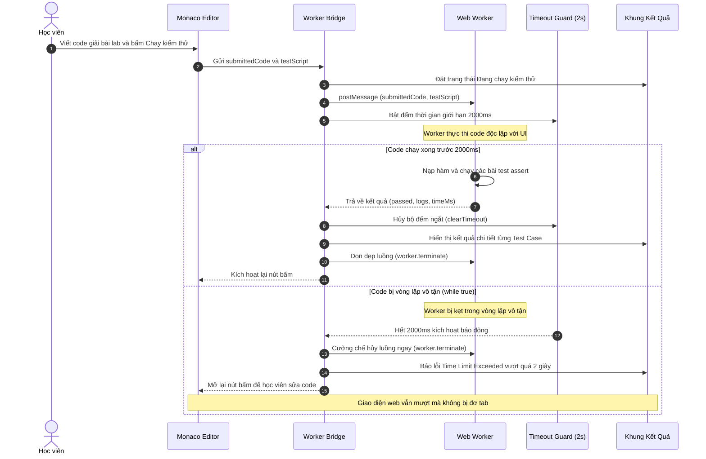

# Sơ đồ Luồng Thực thi Kiểm thử bằng Web Worker (In-Browser Execution)

## 1. Thông tin tài liệu (Document Information)

| Thuộc tính | Chi tiết |
|---|---|
| **Tên tài liệu** | Sơ đồ Luồng Thực thi Kiểm thử bằng Web Worker |
| **Version** | v1.0 |
| **Người làm** | Nguyen Khanh Duy (Fullstack Lead & Architect) |
| **Phạm vi (Scope)** | Cơ chế cô lập và thực thi mã JavaScript của học viên dưới nền thông qua Web Worker, tích hợp bộ ngắt Timeout chống treo tab trình duyệt |
| **Thời gian** | 2026-10-02 |
| **Tham chiếu từ** | Kiến trúc chạy code Client-side an toàn, không phụ thuộc vào server container tốn kém |

---

## 2. Nội dung chính (Content)

### 2.1. Sơ đồ Tuần tự (Sequence Diagram)

### 2.2. Phân tích Kỹ thuật Chi tiết

1. **Tại sao dùng Web Worker thay vì `eval()` trực tiếp?**
   * Trong JavaScript trình duyệt, luồng giao diện (Main Thread) và luồng chạy script chia sẻ chung một Event Loop. Nếu chạy `eval(code)` ngay trên Main Thread, một vòng lặp `while(true)` sẽ phong tỏa hoàn toàn trình duyệt.
   * `Web Worker` chạy trên một **Hệ điều hành Thread (OS Thread) riêng biệt**. Dù code học viên có bị treo cứng, Main Thread của React vẫn cuộn trang, bấm menu, mở thông báo hoàn toàn mượt mà.

2. **Cơ chế Timeout Guard (Bộ ngắt an toàn 2 giây)**:
   * Ngay khi gửi tin nhắn `postMessage()` vào Worker, một bộ đếm `setTimeout` 2000ms được kích hoạt song song.
   * Nếu Worker không gửi kết quả về trước 2000ms, Main Thread lập tức gọi `worker.terminate()`. Hàm này ngắt kết nối và giải phóng toàn bộ tài nguyên bộ nhớ bị Worker chiếm dụng.

3. **Cơ chế Cô lập Bảo mật (Sandboxing & Security)**:
   * Bên trong Web Worker, các đối tượng nhạy cảm như `window`, `document`, `localStorage`, `sessionStorage`, `document.cookie` đều **hoàn toàn không tồn tại** (`undefined`).
   * Mã của học viên không có bất kỳ khả năng nào để đọc trộm Token, tấn công DOM XSS hay phá hoại môi trường trình duyệt của người dùng.

---

## 3. Tài liệu tham khảo & Liên kết (References)

- **Tài liệu Web Worker chuẩn W3C**: [MDN Web Docs — Using Web Workers](https://developer.mozilla.org/en-US/docs/Web/API/Web_Workers_API/Using_web_workers)
- **Tài liệu hệ thống**:
  - Đề xuất Dự án: [01-proposal.md](file:///d:/Projects/study-web/Docs/01-proposal.md)
  - Thiết kế Cơ sở Dữ liệu: [05-database.md](file:///d:/Projects/study-web/Docs/05-database.md)
  - Luồng nộp bài & Cập nhật tiến độ: [04-lab-submission-progress.md](file:///d:/Projects/study-web/Docs/workflows/04-lab-submission-progress.md)
