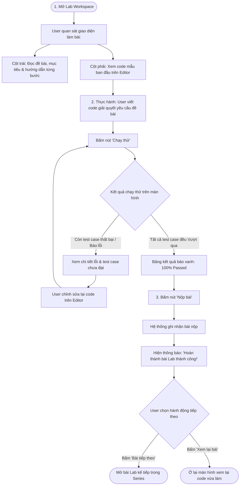
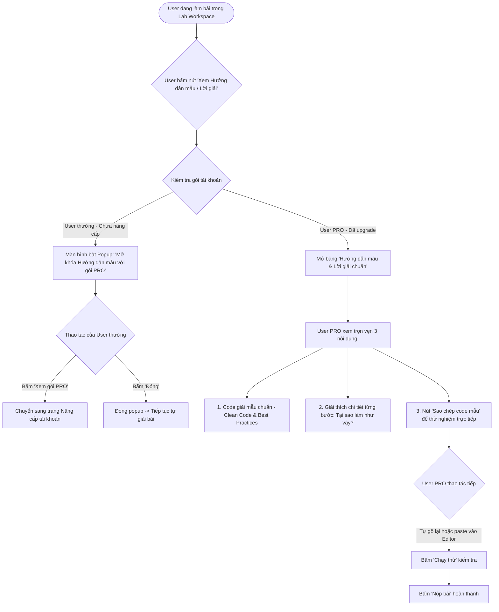
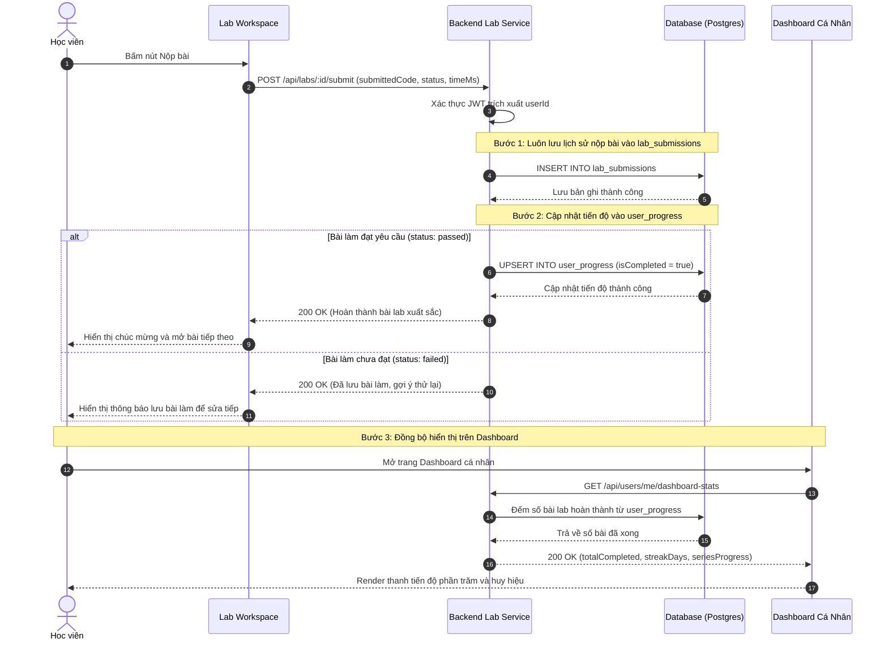

# Sơ đồ Luồng Nộp Bài Lab & Ghi nhận Tiến độ (Submission & Progress Tracking)

## 1. Thông tin tài liệu (Document Information)

| Thuộc tính | Chi tiết |
|---|---|
| **Tên tài liệu** | Sơ đồ Luồng Nộp Bài Lab & Ghi nhận Tiến độ |
| **Version** | v1.1 |
| **Người làm** | Nguyen Khanh Duy (Fullstack Lead & Architect) |
| **Phạm vi (Scope)** | Chu trình nghiệp vụ làm bài (Workspace -> Do Lab -> Submit), lưu lịch sử nộp bài, ghi nhận trạng thái hoàn thành và đồng bộ Dashboard |
| **Thời gian** | 2026-10-13 |
| **Tham chiếu từ** | Thiết kế CSDL tinh gọn tại `docs/05-database.md` (2 bảng `lab_submissions` và `user_progress`) |

---

## 2. Nội dung chính (Content)

### 2.1. Sơ đồ Luồng Nghiệp vụ Người dùng (User Business Flow)

Sơ đồ thể hiện chu trình thao tác cốt lõi của người dùng trên giao diện khi thực hành bài lab: Mở Workspace $\to$ Làm bài (Do Lab) $\to$ Nộp bài (Submit):

#### Các điểm chạm (Touchpoints) của Người dùng trên Giao diện:
1. **Khám phá Workspace (Init)**:
   - Cột trái: Cung cấp đầy đủ đề bài, tiêu chí kiểm thử và hướng dẫn chi tiết.
   - Cột phải: Khung soạn thảo code (Monaco Editor) nạp sẵn Starter Code mẫu.
2. **Thực hành & Vòng lặp chạy thử (Do Lab)**:
   - Học viên viết code và chủ động bấm nút **"Chạy thử"** để chạy test nhanh trên Web Worker (không tốn chi phí server).
   - Nếu lỗi: Panel hiển thị rõ test case bị hỏng, input/output để học viên tự sửa tại chỗ.
   - Khi vượt qua 100% test: Giao diện chuyển trạng thái xanh và kích hoạt nút nộp bài.
3. **Nộp bài & Chuyển tiếp (Submit & Next Lab)**:
   - Bấm **"Nộp bài"**: Kết quả được lưu lên server, đồng bộ tiến độ học tập.
   - Giao diện hiển thị Modal vinh danh hoàn thành, cung cấp nút **"Bài tiếp theo"** giúp học viên tiếp tục lộ trình học tập liền mạch mà không bị đứt đoạn trải nghiệm.

### 2.2. Sơ đồ Luồng Nghiệp vụ Đặc quyền PRO: Xem Hướng dẫn Mẫu (Solution Guide Flow)

Đối với tài khoản **User PRO**, hệ thống mở khóa tính năng xem Hướng dẫn mẫu / Lời giải chi tiết (Solution Guide) ngay trong Workspace, trong khi tài khoản thường sẽ nhận popup giới thiệu nâng cấp:

#### Điểm chạm giao diện (UI Touchpoints) cho Hướng dẫn mẫu:
1. **Nút Hướng dẫn mẫu 💡**: Nằm trên thanh công cụ của Editor; User thường thấy nhãn `🔒 Pro`, User PRO thấy nhãn mở khóa `🔓`.
2. **Popup Paywall cho User thường**: Giới thiệu lợi ích giải pháp chuẩn, không làm mất code đang gõ dở nếu user bấm đóng.
3. **Bảng Lời giải cho User PRO**: Bố trí dạng thanh trượt bên phải (Side Drawer) hoặc Tab song song, hiển thị mã nguồn chuẩn, giải thích từng dòng và nút Copy nhanh.

### 2.3. Sơ đồ Tuần tự Kỹ thuật (Sequence Diagram)

### 2.4. Phân tích Kỹ thuật Chi tiết

1. **Chiến lược Phân tách Dữ liệu (Dual-table Strategy)**:
   * **`lab_submissions` (Lưu vết không giới hạn)**: Mỗi lần học viên bấm Nộp bài đều sinh 1 dòng mới. Phục vụ việc xem lại lịch sử code cũ, đối chiếu quá trình tiến bộ của học viên.
   * **`user_progress` (Trạng thái đơn nhất)**: Chỉ có duy nhất 1 dòng cho mỗi cặp `(userId, labId)`. Dùng cú pháp `ON CONFLICT (userId, labId) DO UPDATE` (PostgreSQL Upsert).
   * 👉 **Lợi ích**: Khi người dùng vào trang Dashboard, câu lệnh đếm bài hoàn thành chỉ cần quét trên bảng `user_progress` cực kỳ nhỏ gọn, không phải `GROUP BY` hay `DISTINCT` trên bảng `lab_submissions` chứa hàng triệu dòng log.

2. **Bảo mật Điểm số & Trạng thái**:
   * Đối với các bài lab chạy Web Worker: Script test chạy ở client, nhưng Backend vẫn có thể thực hiện kiểm tra ngẫu nhiên (Sanity Check) cú pháp hoặc kiểm tra độ dài code trước khi ghi nhận trạng thái `passed`.
   * Học viên phải đăng nhập thì mới được ghi nhận tiến độ vào Database. Nếu là khách vãng lai (Guest), tiến độ được lưu tạm thời vào `localStorage` của trình duyệt.

---

## 3. Tài liệu tham khảo & Liên kết (References)

- **Mã nguồn liên quan**:
  - Trang Dashboard học viên: [MODULE_FE/src/pages/dashboard/DashboardPage.tsx](file:///d:/Projects/study-web/MODULE_FE/src/pages/dashboard/DashboardPage.tsx)
  - Khai báo 2 bảng CSDL: [MODULE_BE/prisma/schema.prisma](file:///d:/Projects/study-web/MODULE_BE/prisma/schema.prisma)
- **Tài liệu hệ thống**:
  - Thiết kế Cơ sở Dữ liệu: [05-database.md](file:///d:/Projects/study-web/Docs/05-database.md)
  - Luồng chạy Web Worker: [03-webworker-execution.md](file:///d:/Projects/study-web/Docs/workflows/03-webworker-execution.md)
