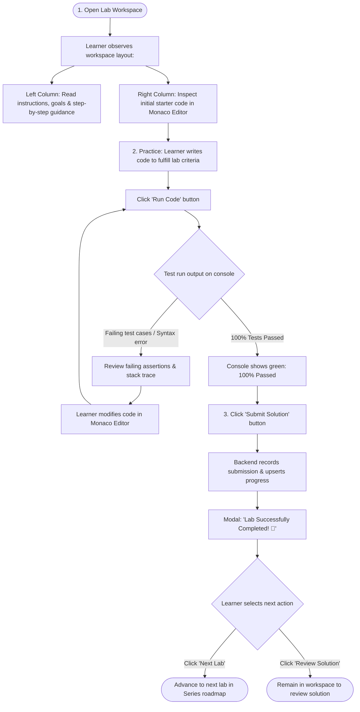
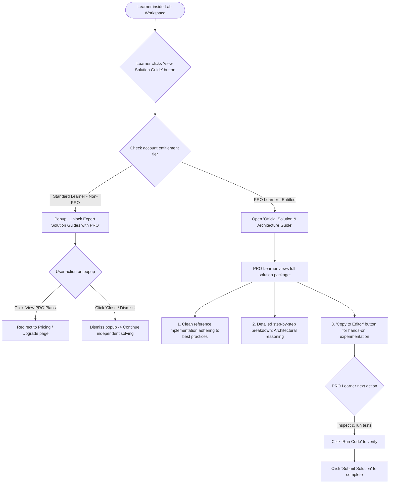
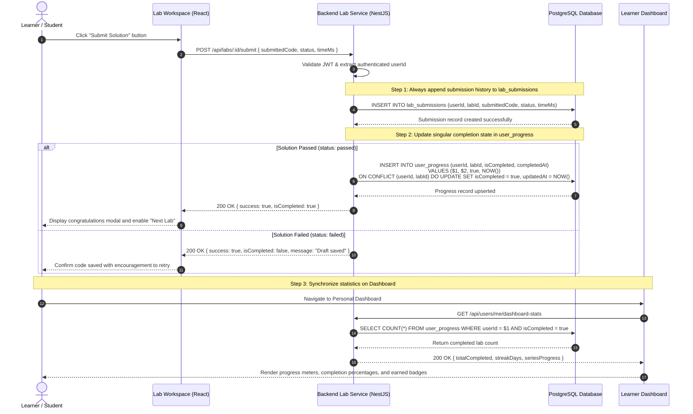

# Sequence Diagram: Lab Submission & Progress Tracking (Submission & Progress Flow)

## 1. Document Information

| Attribute | Details |
|---|---|
| **Document Title** | Lab Submission & Progress Tracking Workflow |
| **Version** | v1.1 |
| **Author** | Nguyen Khanh Duy (Fullstack Lead & Architect) |
| **Scope** | End-to-end user lifecycle: Working in workspace, running in-browser tests, submitting solutions, persisting audit logs in `lab_submissions`, upserting singular progress in `user_progress`, and synchronizing learner dashboard stats |
| **Date** | 2026-10-14 |
| **Source Reference** | Lean dual-table database design in `docs/05-database.md` (`lab_submissions` and `user_progress` tables) and `MODULE_FE/src/pages/dashboard/DashboardPage.tsx` |

---

## 2. Core Content

### 2.1. User Practice Business Flow

The following flowchart outlines the core user journey within the interactive workspace: Open Workspace $\to$ Practice Code $\to$ Submit Solution:

#### User Interface Touchpoints:
1. **Workspace Initialization**:
   - Left Pane: Comprehensive Markdown theory, learning objectives, and test acceptance criteria.
   - Right Pane: Monaco Editor pre-loaded with template Starter Code.
2. **Practice & Trial Run Loop**:
   - Learners compose code and trigger **"Run Code"** for immediate client-side test validation inside a Web Worker.
   - If tests fail: Console provides actionable test diffs (Input / Expected / Actual) for immediate debugging.
   - Upon 100% pass rate: UI highlights green and enables the **"Submit Solution"** action button.
3. **Submission & Next Steps**:
   - Clicking **"Submit Solution"**: Persists submission history, upserts completion status, and updates progress counters.
   - Completion celebration modal offers **"Next Lab"** button to ensure seamless learning continuity.

---

### 2.2. PRO Entitlement Privilege: Solution Guide Access Flow

For **User PRO** accounts, the system unlocks access to the official Solution Guide directly within the workspace, while standard users receive an upgrade paywall prompt:

#### UI Touchpoints for Solution Guide:
1. **Solution Guide Button 💡**: Located on the editor toolbar; Standard users see `🔒 Pro`, PRO users see `🔓 Solution`.
2. **Standard User Paywall**: Explains pedagogical benefits of reviewing reference solutions without resetting unfinished code in the editor.
3. **PRO Solution Drawer**: Slide-over panel presenting the clean reference implementation, line-by-line technical commentary, and quick copy actions.

---

### 2.3. Technical Sequence Diagram

---

### 2.4. Technical Specifications & Architecture Details

1. **Dual-Table Storage Strategy**:
   * **`lab_submissions` (Append-Only Audit Log)**: Every submission generates a discrete record. Stores historical code revisions, execution times, and submission progression.
   * **`user_progress` (Singular Upsert State)**: Exactly one row per `(userId, labId)` pair using PostgreSQL `ON CONFLICT (userId, labId) DO UPDATE`.
   * 👉 **Performance Benefit**: The Dashboard query for completed labs executes a blazing-fast index scan over the compact `user_progress` table, avoiding expensive `COUNT(DISTINCT labId)` operations over multi-million row submission logs.

2. **Security & Validation Integrity**:
   * For Web Worker labs: Test assertions execute client-side, but the backend performs sanity checks on payload syntax, character lengths, and AST signatures before granting `passed` status.
   * Authentication Gate: Submissions are tied to verified JWT credentials. Guest sessions store temporary progress in `localStorage` until account registration.

---

### 2.5. Edge Cases & Exception Handling

| Edge Case | System Response | User Experience |
|---|---|---|
| **Guest User Submits Solution** | Backend rejects unauthenticated requests | Prompts quick login/registration modal, preserving written code in memory |
| **Network Timeout During Submission** | Axios timeout with automatic retry | Displays warning badge with "Retry Submission" button; code remains safe in editor |
| **Simultaneous Submissions** | Handled via PostgreSQL atomic upsert transaction | Idempotent response; latest submission recorded without state corruption |

---

## 3. References & Source Links

- **Codebase References**:
  - Learner Dashboard: [DashboardPage.tsx](file:///d:/Projects/study-web/MODULE_FE/src/pages/dashboard/DashboardPage.tsx)
  - Prisma Schema: [schema.prisma](file:///d:/Projects/study-web/MODULE_BE/prisma/schema.prisma)
- **System Documentation**:
  - Database Design: [05-database.md](file:///d:/Projects/study-web/docs/05-database.md)
  - Web Worker Sandbox Execution: [03-lab-practice-webworker.md](file:///d:/Projects/study-web/docs/workflows/03-lab-practice-webworker.md)
