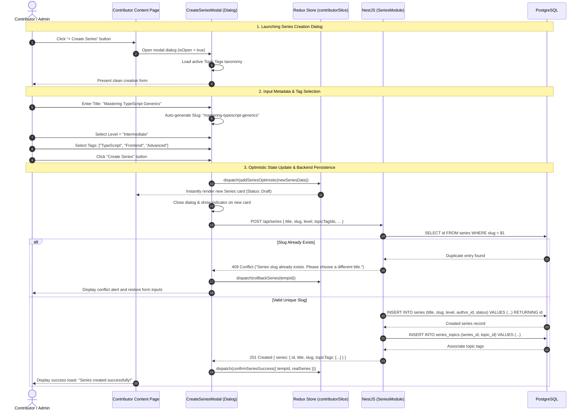

# Sequence Diagram: Series Creation & Topic Tag Association (Create Series Flow)

## 1. Document Information

| Attribute | Details |
|---|---|
| **Document Title** | Series Creation & Topic Tag Association Workflow |
| **Version** | v1.0 |
| **Author** | Nguyen Khanh Duy (Fullstack Lead & Architect) |
| **Scope** | Contributor & Admin workflow for creating a new Series via a lightweight modal dialog, assigning system Topic Tags, performing optimistic Redux updates, and persisting records into PostgreSQL |
| **Date** | 2026-10-14 |
| **Source Reference** | `MODULE_FE/src/pages/contributor/ContributorContentPage.tsx`, `MODULE_FE/src/stores/slices/contributor.slice.ts`, `MODULE_BE/src/modules/series/series.controller.ts` |

---

## 2. Core Content

### 2.1. Workflow Summary (TL;DR)
- **Input**: Contributor accesses `/contributor` and clicks the **"+ Create Series"** action button.
- **Workflow Steps**:
  - A modal dialog opens in-place, preserving page context without disrupting current work.
  - Contributor enters Title (auto-generates SEO slug), description, and selects difficulty level (Beginner, Intermediate, Advanced).
  - Selects one or more Topic Tags (e.g., `JavaScript`, `Algorithms`, `Web Frontend`) from the centrally managed taxonomy.
- **Processing & Feedback**:
  - Immediately optimistic-appends the draft series into the client-side Redux store.
  - Dispatches `POST /api/series` to the NestJS backend.
  - Closes the modal and surfaces a success toast notification; the new Series is immediately ready to accept labs.

---

### 2.2. Roles & Responsibilities (Who Does What)

| Entity | Type | Roles & Responsibilities |
|---|---|---|
| **Contributor / Admin** | Actor | Inputs series metadata, selects topic tags, and confirms creation |
| **CreateSeriesModal** | Client UI | Modal form handling user input, slug auto-generation, and form validation |
| **Redux Store (`contributorSlice`)** | Client State | Manages local series collection with optimistic UI rendering |
| **SeriesController & Service** | NestJS Backend | Validates slug uniqueness, inserts `series` record, establishes `series_topics` links |
| **PostgreSQL Database** | Storage | Stores `series` entity and associative `series_topics` relations |

---

### 2.3. Sequence Diagram

---

### 2.4. Technical Specifications & Architecture Details

1. **Modal Dialog vs Dedicated Page**:
   - Replaces disruptive full-page redirects with an in-place modal, preserving filter states and scroll positions.
2. **Optimistic Redux Synchronization**:
   - The UI appends a temporary record to the local Redux state immediately upon client-side validation.
   - Upon receiving `201 Created`, the temporary ID is replaced with the persisted database ID. If network errors occur, the state automatically rolls back, eliminating manual page reloads.
3. **Many-to-Many Topic Tag Relations**:
   - Backed by the associative table `series_topics (series_id, topic_id)` allowing multifaceted categorization for granular discovery in the Catalog.

---

### 2.5. Edge Cases & Exception Handling

| Edge Case | System Response | User Experience |
|---|---|---|
| **Special Characters in Title** | Regex transforms string into clean kebab-case slug | Learner observes realtime slug preview beneath title input |
| **Network Failure During Submission** | Request fails, Redux triggers rollback | Modal re-opens with alert *"Server connection failed. Please try again"* while preserving form fields |
| **Expired Contributor Session** | Backend responds with 403 Forbidden | Redirects to role verification page |

---

## 3. References & Source Links

- **Frontend Codebase**:
  - Contributor Content Page: [ContributorContentPage.tsx](file:///d:/Projects/study-web/MODULE_FE/src/pages/contributor/ContributorContentPage.tsx)
  - Create Content Dialog: [CreateContentDialog.tsx](file:///d:/Projects/study-web/MODULE_FE/src/pages/contributor/_components/CreateContentDialog.tsx)
  - Contributor Redux Slice: [contributor.slice.ts](file:///d:/Projects/study-web/MODULE_FE/src/stores/slices/contributor.slice.ts)
- **Backend Codebase**:
  - Series Controller: [series.controller.ts](file:///d:/Projects/study-web/MODULE_BE/src/modules/series/series.controller.ts)
- **Related Workflows**:
  - Catalog Discovery: [02-catalog-topic-discovery.md](file:///d:/Projects/study-web/docs/workflows/02-catalog-topic-discovery.md)
  - Two-Step Lab Studio: [06-create-lab-studio.md](file:///d:/Projects/study-web/docs/workflows/06-create-lab-studio.md)
  - System-Wide Topic Governance: [08-admin-topic-governance.md](file:///d:/Projects/study-web/docs/workflows/08-admin-topic-governance.md)
