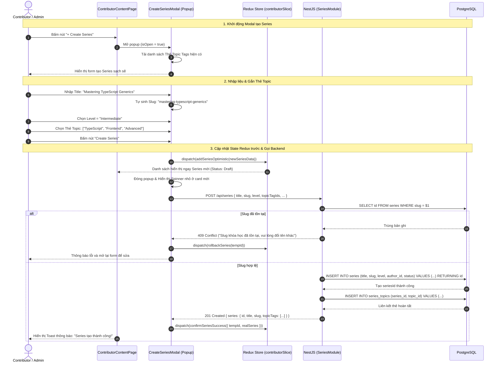

# Sơ đồ Luồng Tạo Series Khóa học & Gắn Thẻ Topic (Create Series Flow)

## 1. Thông tin tài liệu (Document Information)

| Thuộc tính | Chi tiết |
|---|---|
| **Tên tài liệu** | Sơ đồ Luồng Tạo Series Khóa học & Gắn Thẻ Topic |
| **Version** | v1.0 |
| **Người làm** | Nguyen Khanh Duy (Fullstack Lead & Architect) |
| **Phạm vi (Scope)** | Trải nghiệm của Contributor / Admin khi khởi tạo một Series mới qua Modal Popup, gắn các thẻ Topic Tags có sẵn, cập nhật tức thì vào Redux Store (Optimistic State Update) và lưu bản ghi xuống PostgreSQL Backend |
| **Thời gian** | 2026-10-14 |
| **Tham chiếu từ** | `MODULE_FE/src/features/contributor/components/CreateSeriesModal.tsx`, `MODULE_FE/src/features/contributor/store/contributorSlice.ts`, `MODULE_BE/src/modules/series/series.controller.ts` |

---

## 2. Nội dung chính (Content)

### 2.1. Tóm tắt luồng (TL;DR)
- **Đầu vào**: Contributor truy cập `/contributor/content` hoặc `/contributor/overview` và bấm nút **"+ Create Series"**.
- **Thao tác**:
  - Giao diện mở Modal Popup nhẹ nhàng (không chuyển trang riêng biệt, giữ nguyên ngữ cảnh làm việc).
  - Điền Title (tự động gợi ý Slug chuẩn SEO), mô tả ngắn gọn, chọn cấp độ khó (Beginner, Intermediate, Advanced).
  - Chọn một hoặc nhiều Thẻ Topic (ví dụ: `JavaScript`, `Algorithms`, `Web Frontend`) từ danh sách Thẻ dùng chung do Admin quản trị.
- **Xử lý & Phản hồi**:
  - Cập nhật tức thì vào Redux Store để danh sách hiển thị ngay lập tức (không cần F5 reload trang).
  - Gửi request `POST /api/series` xuống Backend để lưu vào CSDL Postgres.
  - Đóng Modal và thông báo Toast thành công. Series mới sẵn sàng để gắn các bài Lab.

---

### 2.2. Phân công & Vai trò (Who does what)

| Thực thể | Loại | Vai trò & Trách nhiệm trong luồng |
|---|---|---|
| **Contributor / Admin** | Actor | Nhập thông tin Series, chọn Thẻ Topic và bấm Xác nhận Tạo |
| **CreateSeriesModal** | Client UI | Modal form thu thập thông tin, validate client-side và tự sinh slug |
| **Redux Store (`contributorSlice`)** | Client State | Quản lý danh sách Series, thực hiện cập nhật trước (optimistic) |
| **SeriesController & Service** | NestJS Backend | Kiểm tra slug trùng lặp, tạo bản ghi trong bảng `series`, liên kết với bảng `series_topics` |
| **PostgreSQL Database** | Storage | Lưu trữ bảng `series` và bảng trung gian `series_topics` |

---

### 2.3. Sơ đồ Tuần tự (Sequence Diagram)

---

### 2.4. Phân tích Kỹ thuật Chi tiết

1. **Popup thay vì Trang riêng biệt**:
   - Trước đây việc tạo bài/series chuyển hướng sang một trang riêng biệt khiến Contributor mất ngữ cảnh và phải tải lại toàn bộ giao diện.
   - Việc chuyển sang Modal Popup giúp việc tạo nhanh chóng, giữ người dùng ở lại đúng vị trí danh sách nội dung để tiếp tục các thao tác khác.
2. **Cập nhật State Redux không cần Reload**:
   - Sử dụng mô hình Optimistic Update: Ngay khi form validate hợp lệ, Redux state được append thêm bản ghi tạm thời.
   - Khi API Backend trả về mã 201 Created, Redux cập nhật lại ID thật từ database. Nếu lỗi mạng, Redux rollback trạng thái cũ. Người dùng không phải bấm F5 thủ công để thấy dữ liệu mới.
3. **Quan hệ Nhiều - Nhiều với Thẻ Topic**:
   - Bảng trung gian `series_topics (series_id, topic_id)` cho phép một series thuộc về nhiều chủ đề linh hoạt, hỗ trợ tìm kiếm và lọc trực quan trên Catalog.

---

### 2.5. Xử lý Ngoại lệ (Edge Cases)

| Tình huống ngoại lệ | Phản hồi hệ thống | Trải nghiệm người dùng |
|---|---|---|
| **Tiêu đề chứa ký tự đặc biệt** | Regex chuyển đổi slug loại bỏ ký tự lạ, chuẩn hóa tiếng Việt thành không dấu | Người dùng thấy slug hiển thị realtime bên dưới tiêu đề |
| **Mất mạng khi bấm nút Tạo** | Axios ném lỗi mạng, Redux rollback | Modal thông báo *"Lỗi kết nối máy chủ, vui lòng thử lại"* và không làm mất dữ liệu đã nhập |
| **Tài khoản hết hạn quyền Contributor** | Backend trả về 403 Forbidden | Điều hướng người dùng về trang yêu cầu nâng quyền |

---

## 3. Tài liệu tham khảo & Liên kết (References)

- **Mã nguồn Frontend**:
  - Trang Quản lý Nội dung Contributor: [MODULE_FE/src/pages/contributor/ContributorContentPage.tsx](file:///d:/Projects/study-web/MODULE_FE/src/pages/contributor/ContributorContentPage.tsx)
  - Modal Tạo Series: [MODULE_FE/src/features/contributor/components/CreateSeriesModal.tsx](file:///d:/Projects/study-web/MODULE_FE/src/features/contributor/components/CreateSeriesModal.tsx)
  - Slice Quản lý Contributor: [MODULE_FE/src/features/contributor/store/contributorSlice.ts](file:///d:/Projects/study-web/MODULE_FE/src/features/contributor/store/contributorSlice.ts)
- **Mã nguồn Backend**:
  - Series Controller: [MODULE_BE/src/modules/series/series.controller.ts](file:///d:/Projects/study-web/MODULE_BE/src/modules/series/series.controller.ts)
- **Tài liệu liên quan**:
  - Luồng Khám phá Catalog: [02-catalog-topic-discovery.md](file:///d:/Projects/study-web/docs/workflows/02-catalog-topic-discovery.md)
  - Studio Tạo bài Lab 2 bước: [06-create-lab-studio.md](file:///d:/Projects/study-web/docs/workflows/06-create-lab-studio.md)
  - Quản trị Thẻ Topic toàn hệ thống: [08-admin-topic-governance.md](file:///d:/Projects/study-web/docs/workflows/08-admin-topic-governance.md)
