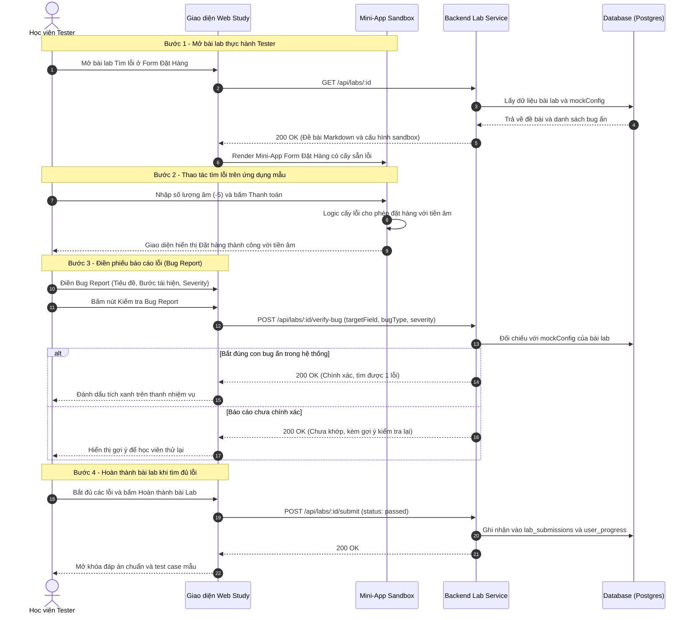

# Sơ đồ Luồng Mô phỏng Mini-App Bắt Lỗi cho Tester (UI Bug Sandbox)

## 1. Thông tin tài liệu (Document Information)

| Thuộc tính | Chi tiết |
|---|---|
| **Tên tài liệu** | Sơ đồ Luồng Mô phỏng Mini-App Bắt Lỗi cho Tester |
| **Version** | v1.0 |
| **Người làm** | Nguyen Khanh Duy (Fullstack Lead & Architect) |
| **Phạm vi (Scope)** | Cơ chế nhúng Mini-App sandbox có cấy sẵn lỗi có chủ đích, luồng học viên thao tác phát hiện lỗi và đối soát phiếu báo cáo lỗi (Bug Report) |
| **Thời gian** | 2026-10-02 |
| **Tham chiếu từ** | Nghiệp vụ đào tạo Tester thực chiến: học viên học bằng cách bắt lỗi trực tiếp trên giao diện thực tế |

---

## 2. Nội dung chính (Content)

### 2.1. Sơ đồ Tuần tự (Sequence Diagram)

### 2.2. Phân tích Kỹ thuật Chi tiết

1. **Cơ chế Cấy lỗi (Bug Injection Architecture)**:
   * Ứng dụng mẫu không phải là code bị lỗi ngoài tầm kiểm soát. Nó là một **React component được thiết kế có chủ đích** với các tham số lỗi có thể bật/tắt (Feature Flags).
   * Ví dụ: prop `injectBugs={['ALLOW_NEGATIVE_QUANTITY', 'BYPASS_PHONE_VALIDATION']}`.

2. **Cách chấm điểm tự động cho Tester**:
   * Tester học viên không nộp code mà nộp **tư duy phân tích lỗi**.
   * Hệ thống chuẩn hóa form nộp thành các thuộc tính cấu trúc: Trường dữ liệu bị lỗi (`targetField`), Kiểu lỗi (`bugType`), Mức độ nghiêm trọng (`severity`).
   * Backend so sánh bộ ba này với danh sách cấu hình trong `mockConfig` để trả về phản hồi tức thì mà không cần người chấm thủ công.

---

## 3. Tài liệu tham khảo & Liên kết (References)

- **Mã nguồn liên quan**:
  - Giao diện Trang chủ Tester: [MODULE_FE/src/pages/HomePage.tsx](file:///d:/Projects/study-web/MODULE_FE/src/pages/HomePage.tsx)
  - Thiết kế Cơ sở Dữ liệu (bảng `labs`, cột `mockConfig`): [05-database.md](file:///d:/Projects/study-web/Docs/05-database.md)
- **Tài liệu hệ thống**:
  - Đề xuất Dự án: [01-proposal.md](file:///d:/Projects/study-web/Docs/01-proposal.md)
  - Luồng nộp bài & Cập nhật tiến độ: [04-lab-submission-progress.md](file:///d:/Projects/study-web/Docs/workflows/04-lab-submission-progress.md)
