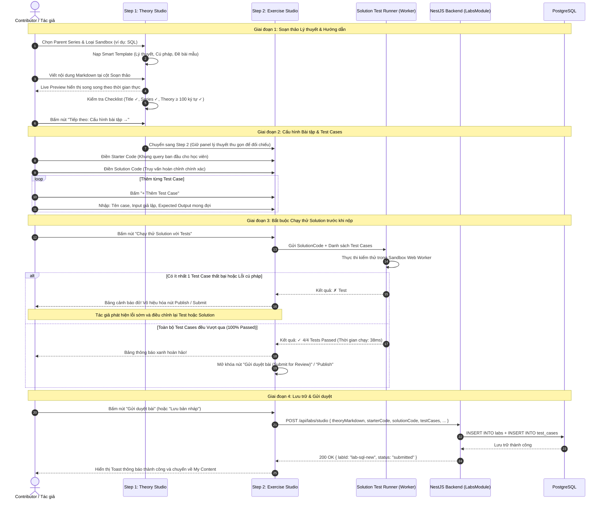

# Sơ đồ Luồng Studio Tạo Bài Lab 2 Bước (Practice Lab Studio Creation Flow)

## 1. Thông tin tài liệu (Document Information)

| Thuộc tính | Chi tiết |
|---|---|
| **Tên tài liệu** | Sơ đồ Luồng Studio Tạo Bài Lab 2 Bước |
| **Version** | v1.0 |
| **Người làm** | Nguyen Khanh Duy (Fullstack Lead & Architect) |
| **Phạm vi (Scope)** | Chu trình thiết kế bài tập của Contributor / Instructor qua Studio 2 bước: Bước 1 (Soạn thảo Lý thuyết Markdown với Live Preview song song), Bước 2 (Cấu hình Bài tập theo bản chất JS/SQL/Quizlet, danh sách Test Cases và Chạy thử Solution trước khi xuất bản) |
| **Thời gian** | 2026-10-14 |
| **Tham chiếu từ** | Bản thiết kế UX/UI Studio mới, `MODULE_FE/src/pages/contributor/CreateLabPage.tsx`, `MODULE_BE/src/modules/labs/labs.controller.ts` |

---

## 2. Nội dung chính (Content)

### 2.1. Tóm tắt luồng (TL;DR)
- **Bước 1 — Lý thuyết & Hướng dẫn (Theory & Guidelines)**:
  - Cột trái (~280px): Thuộc tính chung (Thuộc Series nào, Tiêu đề Lab, Thời lượng ước tính, Loại Sandbox JS/SQL/Quizlet, Cờ yêu cầu PRO) và Checklist điều kiện.
  - Cột phải chia đôi: Khung soạn Markdown bên trái | Khung Live Preview rendered bên phải, cuộn đồng bộ.
  - Mẫu template thông minh nạp sẵn theo định dạng bài.
- **Bước 2 — Cấu hình Bài tập & Kiểm thử (Exercise & Test Configuration)**:
  - Khung Lý thuyết thu gọn ở một bên để đối chiếu yêu cầu.
  - Khung Cấu hình theo từng loại:
    - **JS / SQL**: Starter Code (mã khung cho học viên), Solution Code (lời giải chuẩn của tác giả), Test Cases (danh sách từng case trực quan, gồm Description, Input, Expected Output).
    - **Quizlet**: Soạn danh sách câu hỏi trắc nghiệm, các lựa chọn A/B/C/D và đánh dấu đáp án đúng.
  - **Cơ chế Chạy thử Solution (Test Solution Runner)**: Bắt buộc chạy thử Lời giải chuẩn với toàn bộ Test Cases. Chỉ khi 100% Passed mới kích hoạt nút **"Submit for Review"** hoặc **"Publish"**, chặn hoàn toàn bài tập rác hoặc test case sai.

---

### 2.2. Phân công & Vai trò (Who does what)

| Thực thể | Loại | Vai trò & Trách nhiệm trong luồng |
|---|---|---|
| **Contributor / Instructor** | Actor | Soạn lý thuyết, cấu hình bài tập, nhập test cases và chạy thử nghiệm lời giải |
| **Step 1: Theory Studio** | Client UI | Split-view Markdown Editor & Live Preview, checklist kiểm tra độ dài |
| **Step 2: Exercise Studio** | Client UI | Form nhập Starter Code, Solution Code, danh sách Test Cases dạng cards |
| **Solution Test Runner** | Client Engine | Nạp Solution Code và Test Cases vào Sandbox Web Worker để xác minh trước |
| **Labs Controller & Service** | NestJS Backend | Lưu bản nháp (Draft), lưu trữ test cases và trạng thái gửi duyệt |
| **PostgreSQL Database** | Storage | Bảng `labs`, `test_cases`, `lab_solutions` |

---

### 2.3. Sơ đồ Tuần tự (Sequence Diagram)

---

### 2.4. Phân tích Kỹ thuật Chi tiết

1. **Khắc phục triệt để vấn đề "Soạn mù" (Zero-context problem)**:
   - Trước đây: Ô Starter / Test / Solution bị để trống, test script là 1 chuỗi script nối dài, không có nút chạy thử nghiệm. Nhiều bài lab bị lỗi cú pháp ngay khi phát hành mà người tạo không hề hay biết.
   - Hiện tại: Thiết kế theo **bản chất từng loại bài**. Test script được chuẩn hóa thành mảng đối tượng `testCases: Array<{ id, name, input, expectedOutput, isHidden }>`, có thể thêm/bớt/sửa từng dòng trực quan.
2. **Cổng kiểm định bắt buộc (Mandatory Pre-flight Test Gate)**:
   - Hệ thống ngăn chặn dữ liệu rác hoặc kịch bản kiểm thử vô lý bằng cách yêu cầu `solutionVerified === true`.
   - Nút "Submit for Review" hoặc "Publish" bị `disabled` kèm tooltip hướng dẫn: *"Bạn cần chạy thử Solution thành công trước khi có thể gửi duyệt hoặc xuất bản bài học"*.
3. **Bộ nhớ nháp tự động (Auto-draft saving)**:
   - Trong quá trình soạn thảo, nội dung được định kỳ lưu vào `localStorage` mỗi 30 giây để tránh mất mát nếu vô tình tắt trình duyệt hoặc mất kết nối.

---

### 2.5. Xử lý Ngoại lệ (Edge Cases)

| Tình huống ngoại lệ | Phản hồi hệ thống | Trải nghiệm người dùng |
|---|---|---|
| **Solution chạy quá 2 giây (Timeout)** | Worker Timeout Guard ngắt luồng | Báo lỗi Time Limit Exceeded trên Solution, nhắc tác giả tối ưu thuật toán |
| **Test case có input rỗng hoặc sai kiểu dữ liệu** | Form validation bắt lỗi ngay tại hàng test case | Viền đỏ ô input kèm thông báo *"Vui lòng nhập giá trị đầu vào cho case này"* |
| **Người dùng bấm Back hoặc chuyển tab khi chưa lưu** | Trình duyệt kích hoạt sự kiện `beforeunload` | Hiển thị hộp thoại cảnh báo: *"Các thay đổi chưa lưu có thể bị mất. Bạn có chắc chắn muốn rời đi?"* |

---

## 3. Tài liệu tham khảo & Liên kết (References)

- **Mã nguồn Frontend**:
  - Trang Tạo Lab: [MODULE_FE/src/pages/contributor/CreateLabPage.tsx](file:///d:/Projects/study-web/MODULE_FE/src/pages/contributor/CreateLabPage.tsx)
  - Runner Worker kiểm thử: [MODULE_FE/src/workers/runner.worker.ts](file:///d:/Projects/study-web/MODULE_FE/src/workers/runner.worker.ts)
- **Mã nguồn Backend**:
  - Labs Controller: [MODULE_BE/src/modules/labs/labs.controller.ts](file:///d:/Projects/study-web/MODULE_BE/src/modules/labs/labs.controller.ts)
  - Schema Bài Lab & Test: [MODULE_BE/prisma/schema.prisma](file:///d:/Projects/study-web/MODULE_BE/prisma/schema.prisma)
- **Tài liệu liên quan**:
  - Luồng Tạo Series: [05-create-series.md](file:///d:/Projects/study-web/docs/workflows/05-create-series.md)
  - Luồng Duyệt & Xuất bản Nội dung: [07-content-review-and-publish.md](file:///d:/Projects/study-web/docs/workflows/07-content-review-and-publish.md)
  - Chạy Web Worker Sandbox: [03-lab-practice-webworker.md](file:///d:/Projects/study-web/docs/workflows/03-lab-practice-webworker.md)
