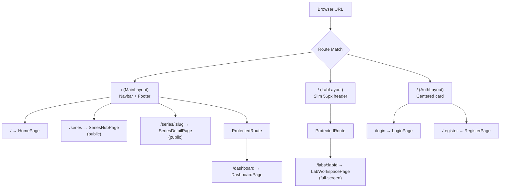
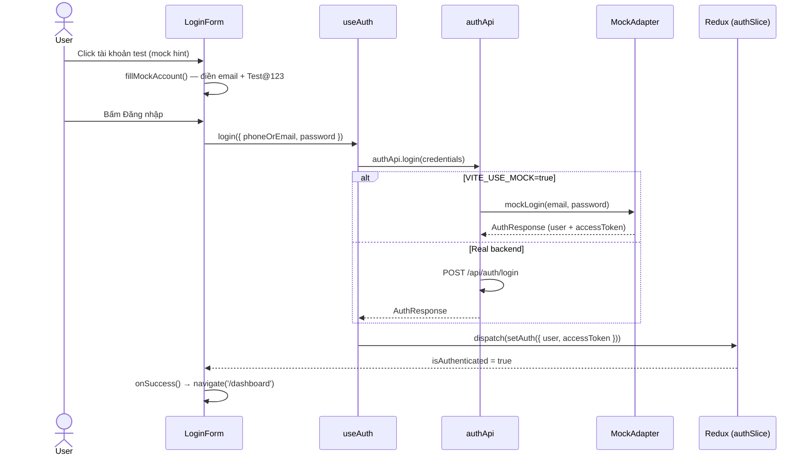
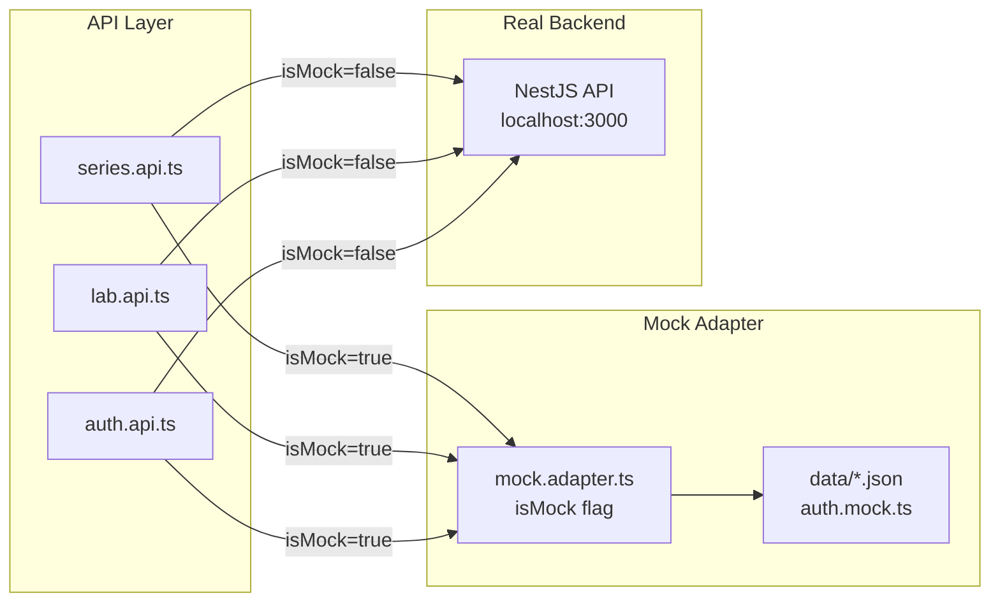
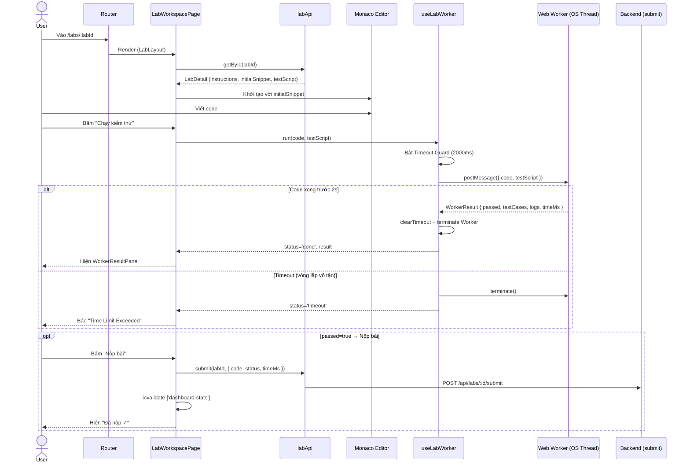

# Kiến trúc & Luồng Chức năng Frontend Hiện tại

## 1. Thông tin tài liệu

| Thuộc tính | Chi tiết |
|---|---|
| **Tên tài liệu** | FE Current State — Kiến trúc & Luồng Chức năng |
| **Version** | v1.0 |
| **Người làm** | Nguyen Khanh Duy (Fullstack Lead & Architect) |
| **Phạm vi** | Toàn bộ module `MODULE_FE/src` — Routing, Auth, Lab, Mock, State |
| **Ngày cập nhật** | 2026-10-02 |
| **Trạng thái** | `draft` — đang phát triển, chưa kết nối Backend thật |

---

## 2. Tech Stack

| Layer | Thư viện / Công cụ |
|---|---|
| Framework | React 19 + TypeScript |
| Routing | React Router v7 (`createBrowserRouter`) |
| State toàn cục | Redux Toolkit (`authSlice`) |
| Data fetching | TanStack React Query v5 |
| HTTP Client | Axios + Interceptor (silent refresh) |
| UI System | Tailwind CSS v4 + shadcn/ui (Radix) |
| Code Editor | `@monaco-editor/react` |
| In-browser Execution | Web Worker (Vite `?worker` bundle) |
| Mock Layer | JSON tĩnh + `VITE_USE_MOCK=true` |
| Design System | `design.md` — Meta flat: `#1C2B33` / `#0866FF` / `#F0F2F5` |

---

## 3. Cấu trúc thư mục

```
MODULE_FE/src/
├── App.tsx                     Entry point: Provider > QueryClient > RouterProvider
├── main.tsx
├── index.css                   Design tokens (CSS variables)
│
├── routes/
│   ├── index.tsx               Khai báo toàn bộ route (3 route tree)
│   └── ProtectedRoute.tsx      Guard: isAuthenticated + allowedRoles check
│
├── layouts/
│   ├── MainLayout.tsx          Navbar + Footer (public pages)
│   ├── AuthLayout.tsx          Layout giữa màn hình (login/register)
│   └── LabLayout.tsx           Slim 56px header, no footer (workspace)
│
├── pages/
│   ├── HomePage.tsx            Trang chủ (public)
│   ├── NotFoundPage.tsx        404
│   ├── auth/
│   │   ├── LoginPage.tsx       → LoginForm (bao gồm mock hint)
│   │   └── RegisterPage.tsx    → RegisterForm
│   ├── dashboard/
│   │   └── DashboardPage.tsx   Stats + Series progress (protected)
│   └── lab/
│       ├── SeriesHubPage.tsx   /series — Catalog công khai
│       ├── SeriesDetailPage.tsx /series/:slug — Lab list + RBAC badge
│       └── LabWorkspacePage.tsx /labs/:labId — Monaco + Worker + Submit
│
├── features/
│   ├── auth/
│   │   ├── api/auth.api.ts     login / register / getCurrentUser / logout
│   │   ├── components/         LoginForm, RegisterForm
│   │   ├── hooks/useAuth.ts    useMutation + useQuery wrapper
│   │   └── types/auth.types.ts LoginCredentials, RegisterCredentials
│   └── lab/
│       ├── api/
│       │   ├── series.api.ts   GET /series, /series/:slug
│       │   └── lab.api.ts      GET /labs/:id, POST submit, dashboard-stats
│       ├── components/
│       │   ├── WorkerResultPanel.tsx  Hiển thị kết quả test (pass/fail/timeout)
│       │   └── UpgradeModal.tsx       Modal 403 Pro-only
│       ├── hooks/
│       │   └── useLabWorker.ts  Worker Bridge: run() + 2s Timeout Guard
│       └── workers/
│           └── lab-runner.worker.ts  Web Worker thực thi code học viên
│
├── services/
│   └── api.client.ts          Axios instance + Request/Response Interceptor
│
├── stores/
│   ├── store.ts               Redux store
│   └── slices/auth.slice.ts   user, accessToken, isAuthenticated
│
├── mocks/
│   ├── mock.adapter.ts        isMock flag + hàm mock từng API
│   └── data/
│       ├── auth.mock.ts       3 tài khoản test (user/pro/admin)
│       ├── series.mock.json   6 series mẫu
│       ├── series-detail.mock.json  Chi tiết series + lab list
│       ├── labs.mock.json     Lab detail: instructions + snippet + testScript
│       └── dashboard-stats.mock.json  Stats, streak, progress
│
└── types/
    ├── user.types.ts          User, UserRole, AuthResponse
    ├── api.types.ts           ApiResponse<T>
    └── lab.types.ts           LabSeries, LabDetail, WorkerResult, DashboardStats
```

---

## 4. Routing — 3 Route Tree



> **ProtectedRoute**: Kiểm tra `isAuthenticated` từ Redux. Nếu chưa login → redirect `/login`. Hỗ trợ `allowedRoles?` để chặn theo role (chưa áp dụng trực tiếp, BE Guard xử lý).

---

## 5. Luồng Auth & Mock Login



### Tài khoản test (mock mode)

| Email | Role | Mật khẩu |
|---|---|---|
| `user@test.com` | `user` (free) | `Test@123` |
| `pro@test.com` | `userPro` | `Test@123` |
| `admin@test.com` | `admin` | `Test@123` |

> Hint panel chỉ hiện khi `VITE_USE_MOCK=true` — tự ẩn ở production.

---

## 6. Luồng Dữ liệu — Mock vs Real API



**Bật/tắt mock:** `.env.local`
```
VITE_USE_MOCK=true   # dev không cần backend
VITE_USE_MOCK=false  # kết nối API thật
```

---

## 7. Luồng Lab Workspace (End-to-End)



---

## 8. State Management

| Store / Query | Dữ liệu | Nơi cập nhật |
|---|---|---|
| `auth.slice` (Redux) | `user`, `accessToken`, `isAuthenticated` | `setAuth()` sau login; `logout()` sau đăng xuất |
| `['series']` (React Query) | Danh sách series | `SeriesHubPage` mount |
| `['series', slug]` | Chi tiết 1 series + labs | `SeriesDetailPage` mount |
| `['lab', labId]` | Lab detail (instructions + code) | `LabWorkspacePage` mount |
| `['dashboard-stats']` | totalCompleted, streak, progress | `DashboardPage` mount; invalidate sau submit |

---

## 9. Silent Refresh (Axios Interceptor)

File: [`MODULE_FE/src/services/api.client.ts`](file:///d:/Projects/study-web/MODULE_FE/src/services/api.client.ts)

```
Request → attach Bearer Token từ Redux
Response 401 → gọi POST /api/auth/refresh-token (kèm HttpOnly cookie)
  ├── Thành công → dispatch setToken(newToken) → replay request cũ
  └── Thất bại   → dispatch logout() → redirect /login
```

> Trong mock mode, không có 401 thật từ server nên interceptor không kích hoạt.

---

## 10. Danh sách Route hiện tại

| URL | Page | Auth | Layout |
|---|---|---|---|
| `/` | `HomePage` | Public | MainLayout |
| `/series` | `SeriesHubPage` | Public | MainLayout |
| `/series/:slug` | `SeriesDetailPage` | Public | MainLayout |
| `/dashboard` | `DashboardPage` | 🔒 Login | MainLayout |
| `/labs/:labId` | `LabWorkspacePage` | 🔒 Login | LabLayout |
| `/login` | `LoginPage` | Public | AuthLayout |
| `/register` | `RegisterPage` | Public | AuthLayout |
| `*` | `NotFoundPage` | Public | MainLayout |

---

## 11. Những gì chưa làm / TODO

| Hạng mục | Trạng thái | Ghi chú |
|---|---|---|
| Kết nối Backend thật | ⏳ Chờ | Tắt mock khi BE sẵn sàng |
| Trang `/roadmaps` | 🚧 Chưa có | Nav trỏ tới, sẽ 404 |
| Trang `/upgrade` (Pro) | 🚧 Chưa có | UpgradeModal trỏ tới `/upgrade` |
| `/register` mock | ❌ Không hỗ trợ | Dùng tài khoản test thay thế |
| RBAC guard FE nâng cao | ✅ Có layer 1 | Backend là layer 2 tuyệt đối |
| Mobile responsive | ✅ Có | Navbar mobile drawer đã có |
| Dark mode | ✅ CSS vars | Toggle chưa có UI button |

---

## 12. Tài liệu tham khảo

- Luồng Auth chi tiết: [`01-auth-and-session.md`](file:///d:/Projects/study-web/Docs/workflows/01-auth-and-session.md)
- Luồng RBAC: [`02-lab-access-rbac.md`](file:///d:/Projects/study-web/Docs/workflows/02-lab-access-rbac.md)
- Luồng Web Worker: [`03-webworker-execution.md`](file:///d:/Projects/study-web/Docs/workflows/03-webworker-execution.md)
- Luồng Submit & Progress: [`04-lab-submission-progress.md`](file:///d:/Projects/study-web/Docs/workflows/04-lab-submission-progress.md)
- Design System: [`design.md`](file:///d:/Projects/study-web/design.md)
- Mock Adapter: [`MODULE_FE/src/mocks/mock.adapter.ts`](file:///d:/Projects/study-web/MODULE_FE/src/mocks/mock.adapter.ts)
