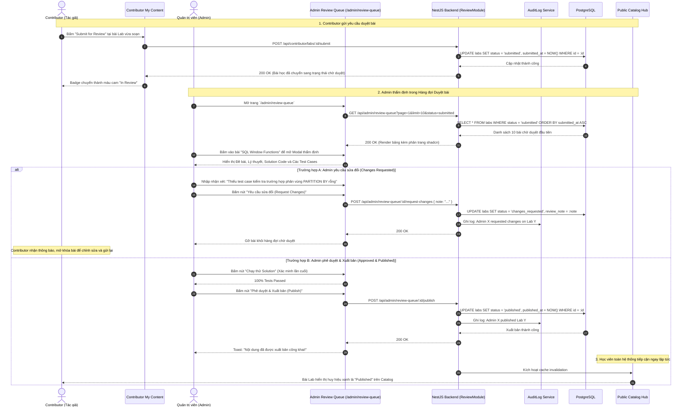

# Sơ đồ Luồng Duyệt & Xuất bản Nội dung (Content Review & Publish Flow)

## 1. Thông tin tài liệu (Document Information)

| Thuộc tính | Chi tiết |
|---|---|
| **Tên tài liệu** | Sơ đồ Luồng Duyệt & Xuất bản Nội dung |
| **Version** | v1.0 |
| **Người làm** | Nguyen Khanh Duy (Fullstack Lead & Architect) |
| **Phạm vi (Scope)** | Chu trình vòng đời của bài Lab và Series từ khi Contributor hoàn thành bản nháp (Draft), gửi duyệt bài (Submitted), Admin thẩm định chất lượng tại Hàng đợi duyệt (Review Queue), phản hồi yêu cầu sửa đổi (Changes Requested), phê duyệt (Approved) và xuất bản lên Catalog công khai (Published) |
| **Thời gian** | 2026-10-14 |
| **Tham chiếu từ** | `MODULE_FE/src/pages/admin/AdminReviewQueue.tsx`, `MODULE_BE/src/modules/content-review/content-review.service.ts`, `MODULE_BE/src/modules/audit-logs` |

---

## 2. Nội dung chính (Content)

### 2.1. Tóm tắt luồng (TL;DR)
- **Vòng đời trạng thái (Content Lifecycle Statuses)**:
  - `draft`: Bản nháp của tác giả, chưa xuất hiện trên Catalog, chỉ tác giả xem được.
  - `submitted`: Tác giả gửi yêu cầu thẩm định, khóa chỉnh sửa tạm thời, đưa vào **Admin Review Queue**.
  - `changes_requested`: Admin yêu cầu sửa đổi kèm nhận xét chi tiết; mở khóa cho tác giả sửa và gửi lại.
  - `approved`: Bài học đạt tiêu chuẩn chất lượng của nền tảng.
  - `published`: Xuất bản chính thức ra Catalog công khai cho toàn bộ học viên tiếp cận.
- **Vai trò tham gia**:
  - Contributor (Tác giả): Soạn bài, gửi duyệt, nhận phản hồi và sửa đổi.
  - Admin (Kiểm duyệt viên): Đọc lý thuyết, kiểm tra cấu hình test cases, bấm Chạy thử Solution, viết ghi chú nhận xét và ấn nút Duyệt / Yêu cầu sửa / Xuất bản.

---

### 2.2. Phân công & Vai trò (Who does what)

| Thực thể | Loại | Vai trò & Trách nhiệm trong luồng |
|---|---|---|
| **Contributor** | Actor | Gửi bài duyệt (`submit`), tiếp nhận phản hồi sửa đổi và nộp lại |
| **Admin** | Actor | Duyệt hàng đợi `/admin/review-queue`, kiểm tra chất lượng và quyết định xuất bản |
| **Review Queue UI** | Client UI | Hiển thị danh sách các bài chờ duyệt kèm bộ lọc trạng thái, phân trang và modal xem chi tiết |
| **ReviewService & Controller** | NestJS Backend | Quản lý chuyển đổi trạng thái (State Machine), kiểm tra quyền Admin, ghi vết vào Audit Log |
| **AuditLogsService** | Audit Ledger | Ghi nhận ai đã duyệt, thời gian duyệt, lý do từ chối (action: `CONTENT_APPROVE`, `CONTENT_PUBLISH`) |
| **PostgreSQL Database** | Storage | Bảng `labs`, `series`, `content_reviews`, `audit_logs` |

---

### 2.3. Sơ đồ Tuần tự (Sequence Diagram)

---

### 2.4. Phân tích Kỹ thuật Chi tiết

1. **Máy trạng thái nghiêm ngặt (State Machine Enforce)**:
   - Các chuyển đổi trạng thái hợp lệ:
     - `draft` $\to$ `submitted`
     - `submitted` $\to$ `changes_requested` HOẶC `approved` / `published`
     - `changes_requested` $\to$ `submitted` (sau khi tác giả sửa xong)
     - `published` $\to$ `archived` (khi cần ẩn bài)
   - Bất kỳ request nào nhảy cóc trạng thái trái phép (ví dụ `draft` $\to$ `published` từ tài khoản không phải Admin) đều bị Backend chặn đứng với mã lỗi `400 Bad Request`.
2. **Minh bạch hóa & Nhật ký Kiểm toán (Audit Trail)**:
   - Mọi thao tác phê duyệt, từ chối hay xuất bản đều được ghi tự động vào bảng `audit_logs` với đầy đủ `actor_id`, `actor_role`, `action`, `resource_type`, `resource_id`, `metadata` và IP request, phục vụ việc tra cứu của ban quản trị.
3. **Phân trang Hàng đợi Duyệt (Shadcn Pagination)**:
   - Trang `/admin/review-queue` áp dụng phân trang 10 phần tử/trang chuẩn mực, đảm bảo khi số lượng bài nộp tăng lên hàng trăm bài thì giao diện vẫn tải cực nhanh.

---

### 2.5. Xử lý Ngoại lệ (Edge Cases)

| Tình huống ngoại lệ | Phản hồi hệ thống | Trải nghiệm người dùng |
|---|---|---|
| **Contributor cố gắng sửa nội dung khi bài đang `submitted`** | Backend từ chối với thông báo *"Bài đang trong quá trình xét duyệt, không thể chỉnh sửa"* | Giao diện hiển thị bài ở chế độ Chỉ đọc (Read-only), kèm nút "Rút lại bài duyệt (Withdraw)" nếu cần |
| **Hai Admin cùng mở và duyệt 1 bài đồng thời** | Database sử dụng cơ chế lạc quan (Optimistic Concurrency Control) kiểm tra version/status | Admin bấm sau nhận thông báo *"Bài nộp này đã được duyệt bởi Quản trị viên khác"* |
| **Bài lab bị xóa trong khi đang nằm trong hàng đợi** | Backend kiểm tra sự tồn tại của resource | Gỡ bỏ bản ghi và thông báo nội dung không còn khả dụng |

---

## 3. Tài liệu tham khảo & Liên kết (References)

- **Mã nguồn Frontend**:
  - Hàng đợi Duyệt Admin: [MODULE_FE/src/pages/admin/AdminReviewQueue.tsx](file:///d:/Projects/study-web/MODULE_FE/src/pages/admin/AdminReviewQueue.tsx)
  - Quản lý Nội dung Contributor: [MODULE_FE/src/pages/contributor/ContributorContentPage.tsx](file:///d:/Projects/study-web/MODULE_FE/src/pages/contributor/ContributorContentPage.tsx)
- **Mã nguồn Backend**:
  - Audit Logs Service: [MODULE_BE/src/modules/audit-logs/audit-logs.service.ts](file:///d:/Projects/study-web/MODULE_BE/src/modules/audit-logs/audit-logs.service.ts)
  - Schema CSDL: [MODULE_BE/prisma/schema.prisma](file:///d:/Projects/study-web/MODULE_BE/prisma/schema.prisma)
- **Tài liệu liên quan**:
  - Studio Tạo bài Lab 2 bước: [06-create-lab-studio.md](file:///d:/Projects/study-web/docs/workflows/06-create-lab-studio.md)
  - Nhật ký Kiểm toán Admin: [08-admin-topic-governance.md](file:///d:/Projects/study-web/docs/workflows/08-admin-topic-governance.md)
