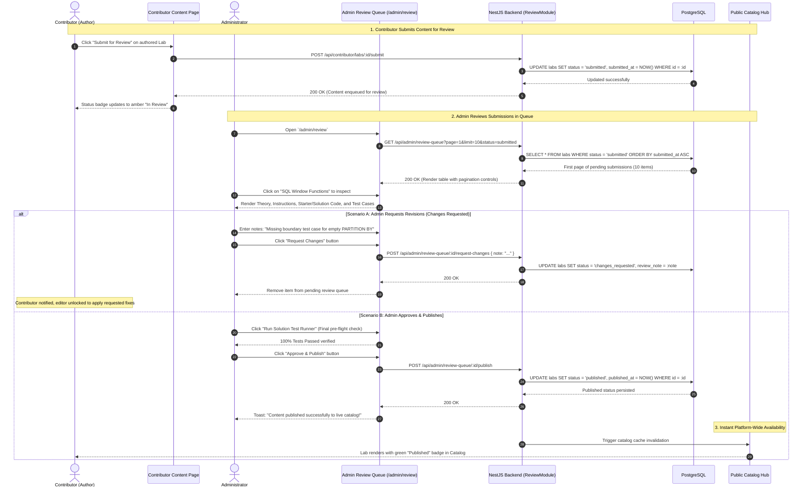

# Sequence Diagram: Content Review Queue & Publishing Lifecycle (Content Review & Publish Flow)

## 1. Document Information

| Attribute | Details |
|---|---|
| **Document Title** | Content Review Queue & Publishing Lifecycle Workflow |
| **Version** | v1.1 |
| **Author** | Nguyen Khanh Duy (Fullstack Lead & Architect) |
| **Scope** | Cross-portal content lifecycle: Contributor drafts content in `MODULE_FE` User Dashboard (`/user/dashboard`), submits for platform review (`submitted`), Administrator conducts quality evaluation in standalone `MODULE_ADMIN` Review Queue (`/admin/review`), requests revisions (`changes_requested`), and executes public publication (`published`) to the learner catalog |
| **Date** | 2026-10-15 |
| **Source Reference** | `MODULE_ADMIN/src/pages/admin/AdminReviewPage.tsx`, `MODULE_ADMIN/src/pages/admin/_components/AdminReviewQueue.tsx`, `MODULE_BE/src/modules/review/review.service.ts`, `MODULE_FE/src/pages/dashboard/views/UserContentManagementView.tsx` |

---

## 2. Core Content

### 2.1. Workflow Summary (TL;DR)
- **Content Lifecycle State Machine**:
  - `draft`: Author's private working copy; hidden from the catalog; visible only to the creator.
  - `submitted`: Author submits for formal platform review; edit capabilities locked; enqueued in the **Admin Review Queue**.
  - `changes_requested`: Admin rejects current iteration with specific constructive commentary; unlocks editor for author revisions.
  - `approved`: Content meets pedagogical and technical quality benchmarks.
  - `published`: Content made available publicly on the Catalog for all platform learners.
- **Participating Actors**:
  - Contributor (Author): Drafts labs, triggers review submission, addresses revision requests.
  - Admin (Curator / Reviewer): Inspects Markdown theory, validates test case specifications, runs pre-flight solution checks, attaches review notes, and decides between Request Changes, Approve, or Publish.

---

### 2.2. Roles & Responsibilities (Who Does What)

| Entity | Type | Roles & Responsibilities |
|---|---|---|
| **Contributor** | Actor | Submits content (`submit`), receives review commentary, updates and re-submits |
| **Admin** | Actor | Inspects `/admin/review` queue, evaluates code quality, executes publishing |
| **Review Queue UI** | Client UI | Renders paginated submission table, status filters, and detailed inspection modal |
| **ReviewService & Controller** | NestJS Backend | Enforces state machine transitions, validates admin authorization, records audit events |
| **Audit Log System** | Audit Ledger | Logs who reviewed, timestamp, action type (`CONTENT_APPROVE`, `CONTENT_PUBLISH`), and notes |
| **PostgreSQL Database** | Storage | Houses `labs`, `series`, and audit records |

---

### 2.3. Sequence Diagram

---

### 2.4. Technical Specifications & Architecture Details

1. **State Machine Enforcement**:
   - Valid lifecycle transitions:
     - `draft` $\to$ `submitted`
     - `submitted` $\to$ `changes_requested` OR `approved` / `published`
     - `changes_requested` $\to$ `submitted` (upon author re-submission)
     - `published` $\to$ `archived` (administrative deprecation)
   - Illegal state bypass attempts (e.g. attempting `draft` $\to$ `published` from a non-admin account) are blocked with `400 Bad Request`.
2. **Comprehensive Audit Trail**:
   - Every review decision (approval, change request, publish) is recorded in `audit_logs` tracking `actor_id`, `actor_role`, `action`, `resource_id`, and client IP.
3. **Queue Pagination (10 Items / Page)**:
   - `/admin/review` incorporates a standardized 10-item pagination model, guaranteeing swift rendering even as submissions scale.

---

### 2.5. Edge Cases & Exception Handling

| Edge Case | System Response | User Experience |
|---|---|---|
| **Contributor Edits While `submitted`** | Backend rejects write mutations | Editor renders in Read-Only mode with option to *"Withdraw Submission"* |
| **Concurrent Admin Reviews** | Optimistic Concurrency Control on status field | Second admin receives alert *"This submission has already been reviewed by another admin"* |
| **Lab Deleted While in Queue** | Backend checks resource existence | Drops from queue with notification *"Resource no longer available"* |

---

## 3. References & Source Links

- **Frontend Codebase**:
  - Admin Review Page: [AdminReviewPage.tsx](file:///d:/Projects/study-web/MODULE_ADMIN/src/pages/admin/AdminReviewPage.tsx)
  - Admin Review Queue Component: [AdminReviewQueue.tsx](file:///d:/Projects/study-web/MODULE_ADMIN/src/pages/admin/_components/AdminReviewQueue.tsx)
  - Contributor Content Management: [UserContentManagementView.tsx](file:///d:/Projects/study-web/MODULE_FE/src/pages/dashboard/views/UserContentManagementView.tsx)
- **Backend Codebase**:
  - Review Controller: [review.controller.ts](file:///d:/Projects/study-web/MODULE_BE/src/modules/review/review.controller.ts)
  - Review Service: [review.service.ts](file:///d:/Projects/study-web/MODULE_BE/src/modules/review/review.service.ts)
- **Related Workflows**:
  - Two-Step Lab Studio: [06-create-lab-studio.md](file:///d:/Projects/study-web/docs/workflows/06-create-lab-studio.md)
  - Catalog Discovery: [02-catalog-topic-discovery.md](file:///d:/Projects/study-web/docs/workflows/02-catalog-topic-discovery.md)
  - Admin Topic Governance: [08-admin-topic-governance.md](file:///d:/Projects/study-web/docs/workflows/08-admin-topic-governance.md)
  - Contributor Onboarding: [13-contributor-onboarding-and-application.md](file:///d:/Projects/study-web/docs/workflows/13-contributor-onboarding-and-application.md)
