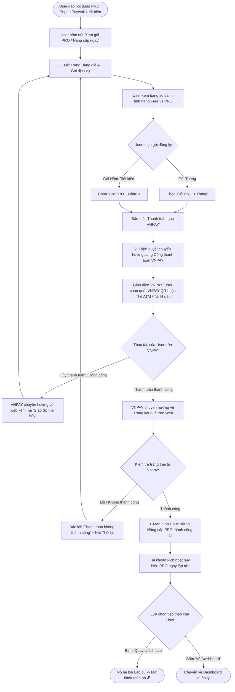

# Sơ đồ Luồng Nâng cấp Tài khoản PRO & Thanh toán VNPAY (Upgrade & Payment Flow)

## 1. Thông tin tài liệu (Document Information)

| Thuộc tính | Chi tiết |
|---|---|
| **Tên tài liệu** | Sơ đồ Luồng Nâng cấp Tài khoản PRO & Thanh toán VNPAY |
| **Version** | v1.0 |
| **Người làm** | Nguyen Khanh Duy (Fullstack Lead & Architect) |
| **Phạm vi (Scope)** | Hành trình người dùng từ Popup Paywall/Bảng giá, chọn gói PRO, chuyển tiếp thanh toán qua Cổng VNPAY và kích hoạt tài khoản PRO |
| **Thời gian** | 2026-10-13 |
| **Trạng thái** | Mẫu thiết kế chuẩn (Template chuẩn bị trước khi phát hành chính thức) |
| **Tham chiếu từ** | Tài liệu phân quyền động [07-dynamic-authorization-and-entitlements.md](file:///d:/Projects/study-web/docs/07-dynamic-authorization-and-entitlements.md) và [UpgradeModal.tsx](file:///d:/Projects/study-web/MODULE_FE/src/features/lab/components/UpgradeModal.tsx) |

---

## 2. Nội dung chính (Content)

### 2.1. Sơ đồ Luồng Nghiệp vụ Người dùng (User Business Flow)

Sơ đồ thể hiện chu trình tương tác thực tế của người dùng từ khi gặp nội dung bị khóa PRO, xem trang Bảng giá, thanh toán qua cổng VNPAY và kích hoạt quyền PRO ngay lập tức:

---

### 2.2. Phân tích Chi tiết Điểm chạm Giao diện (UI Touchpoints)

1. **Kích hoạt từ Paywall (Trigger Context)**:
   - Khi gặp bài Lab PRO, Blog PRO hoặc nút xem Lời giải mẫu, User nhận được thông báo văn minh kèm nút hành động **"Xem gói PRO / Nâng cấp ngay"**.
   - Bấm nút sẽ chuyển thẳng sang trang Bảng giá mà không làm mất thông tin trang trước đó.

2. **Trang Bảng giá (Pricing Page)**:
   - **Bảng so sánh Free vs PRO**: Minh bạch quyền lợi (số lượng bài lab, quyền xem lời giải chuẩn, hỗ trợ).
   - **Lựa chọn gói**: Cung cấp gói Tháng (linh hoạt) và gói Năm (tiết kiệm, đánh dấu khuyên dùng).
   - **Nút thanh toán**: Tích hợp trực tiếp nút hành động **"Thanh toán qua VNPAY"**.

3. **Cổng thanh toán VNPAY (Payment Gateway Interaction)**:
   - Hệ thống chuyển hướng người dùng an toàn sang cổng VNPAY.
   - Học viên lựa chọn hình thức thuận tiện (VNPAY-QR từ app ngân hàng hoặc thẻ ATM/Internet Banking).
   - Nếu bấm hủy hoặc đóng trang, VNPAY điều hướng trở lại trang Bảng giá kèm thông báo hủy đơn để học viên có thể thao tác lại.

4. **Kích hoạt & Trải nghiệm liền mạch (Post-Payment Transition)**:
   - Khi thanh toán thành công, trang kết quả hiển thị thông báo chúc mừng vinh danh tài khoản PRO.
   - Hệ thống tự động nâng cấp quyền hạn, gắn huy hiệu PRO lên avatar/header.
   - Cung cấp nút **"Quay lại bài Lab đang làm"** để học viên tiếp tục ngay nội dung vừa mở khóa, tạo trải nghiệm xuyên suốt không bị ngắt quãng.

---

## 3. Tài liệu tham khảo & Liên kết (References)

- **Mã nguồn liên quan**:
  - Modal thông báo nâng cấp: [MODULE_FE/src/features/lab/components/UpgradeModal.tsx](file:///d:/Projects/study-web/MODULE_FE/src/features/lab/components/UpgradeModal.tsx)
  - Quản lý gói & phân quyền: [MODULE_FE/src/features/entitlements](file:///d:/Projects/study-web/MODULE_FE/src/features/entitlements)
- **Tài liệu hệ thống**:
  - Đặc tả Phân quyền Động & Subscription Plans: [07-dynamic-authorization-and-entitlements.md](file:///d:/Projects/study-web/docs/07-dynamic-authorization-and-entitlements.md)
  - Luồng Truy cập Lab & RBAC Guard: [02-lab-access-rbac.md](file:///d:/Projects/study-web/docs/workflows/02-lab-access-rbac.md)
  - Luồng Làm bài & Xem Lời giải mẫu: [04-lab-submission-progress.md](file:///d:/Projects/study-web/docs/workflows/04-lab-submission-progress.md)
