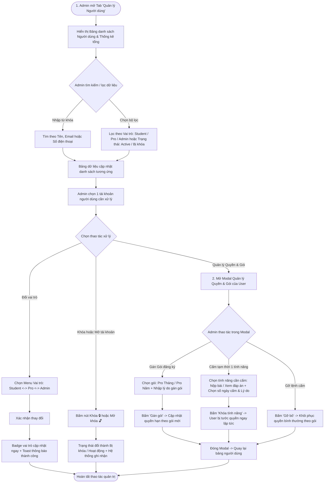
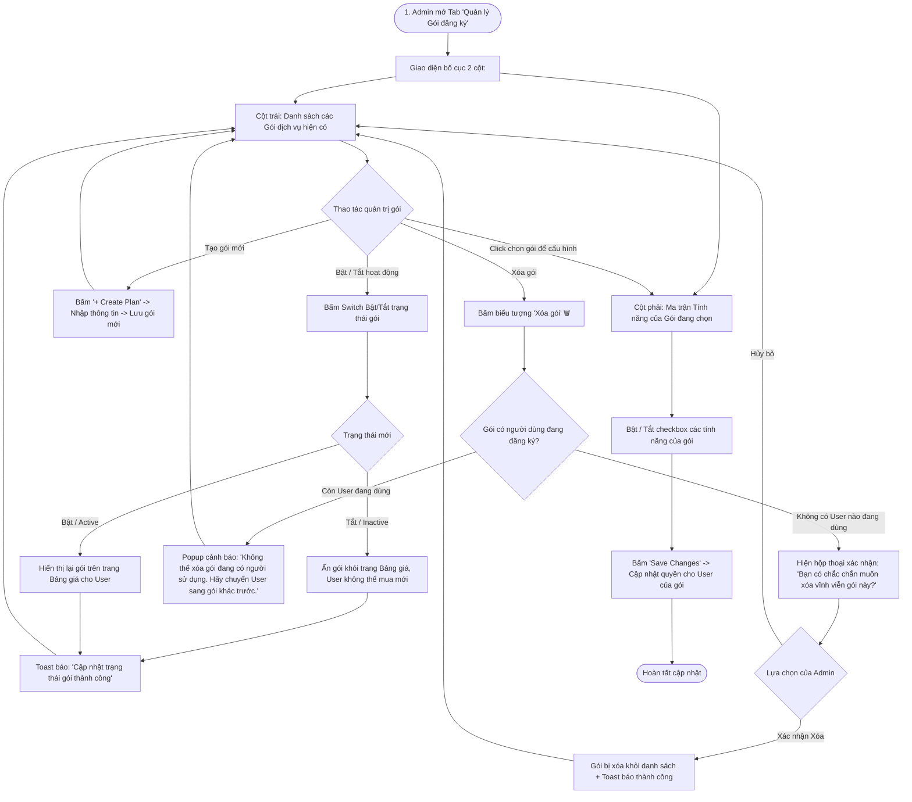

# Sơ đồ Luồng Quản trị Hệ thống (Admin Operations & Management)

## 1. Thông tin tài liệu (Document Information)

| Thuộc tính | Chi tiết |
|---|---|
| **Tên tài liệu** | Sơ đồ Luồng Quản trị Hệ thống (Admin Operations) |
| **Version** | v1.0 |
| **Người làm** | Nguyen Khanh Duy (Fullstack Lead & Architect) |
| **Phạm vi (Scope)** | Tổng hợp các luồng thao tác nghiệp vụ của Quản trị viên (Admin) trên giao diện Admin Studio: Quản lý User, Lab, Gói đăng ký và Audit Log |
| **Thời gian** | 2026-10-13 |
| **Tham chiếu từ** | Hiện trạng giao diện quản trị tại `MODULE_FE/src/pages/admin` và đặc tả phân quyền tại `docs/07-dynamic-authorization-and-entitlements.md` |

---

## 2. Nội dung chính (Content)

### 2.1. Sơ đồ Luồng Nghiệp vụ Quản lý Người dùng (Admin User Management Flow)

Sơ đồ thể hiện chu trình thao tác thực tế của Quản trị viên khi tìm kiếm, phân loại người dùng, điều chỉnh vai trò, khóa tài khoản và quản lý gói/quyền hạn chi tiết:



#### Phân tích Chi tiết Điểm chạm Giao diện (UI Touchpoints):
1. **Tìm kiếm & Phân loại nhanh**:
   - Thanh tìm kiếm theo thời gian thực (Tên, Email, SĐT).
   - Bộ lọc kép: theo **Vai trò** (`Student` / `Pro Member` / `Admin`) và **Trạng thái** (`Đang hoạt động` / `Đã bị khóa`).
2. **Thay đổi vai trò tức thì (Fast Role Switch)**:
   - Dropdown đổi vai trò trực tiếp trên từng dòng, phản hồi bằng thông báo toast thành công và cập nhật màu Badge ngay lập tức.
3. **Khóa / Mở khóa tài khoản (Account Suspension)**:
   - Thao tác 1-click chuyển đổi trạng thái `isActive`, ngăn chặn quyền truy cập của các tài khoản vi phạm.
4. **Modal Phân quyền động & Gán gói (Entitlements Modal)**:
   - **Gán gói thủ công**: Gán gói PRO trực tiếp kèm ghi chú lý do hành chính.
   - **Cấm quyền tính năng (Explicit DENY)**: Cấm tạm thời từng tính năng độc lập (ví dụ cấm nộp bài do spam, cấm xem đáp án do nghi vấn gian lận) theo số ngày nhất định.
   - **Khôi phục (Remove Override)**: Gỡ bỏ lệnh cấm để đưa quyền tài khoản về mặc định theo gói.

---

### 2.2. Sơ đồ Luồng Nghiệp vụ Quản lý Gói Đăng ký & Ma trận Tính năng (Subscription Plans Management Flow)

Sơ đồ thể hiện chu trình quản trị gói dịch vụ (Tạo mới, Bật/Tắt kích hoạt, Xóa an toàn) và cấu hình ma trận tính năng cho từng gói:



#### Phân tích Chi tiết Điểm chạm Giao diện (UI Touchpoints):
1. **Bố cục 2 cột (Dual-Pane Master-Detail)**:
   - **Cột trái**: Liệt kê các gói cước (`Free`, `PRO_MONTHLY`, `PRO_YEARLY`), giá tiền, chu kỳ thanh toán và huy hiệu gói mặc định.
   - **Cột phải**: Tải động ma trận tính năng tương ứng với gói được chọn ở cột trái.
2. **Modal Tạo Gói mới (+ Create Plan)**:
   - Nhập đầy đủ thông số: Tên gói, mã code định danh, mức giá VND, chu kỳ (Monthly/Yearly) và thiết lập gói mặc định.
3. **Bật / Tắt trạng thái gói (Active / Inactive Toggle)**:
   - Nút gạt Switch trực tiếp trên mỗi thẻ gói:
     - **Active (Bật)**: Gói hiển thị trên trang Bảng giá cho học viên đăng ký.
     - **Inactive (Tắt)**: Tạm ngưng mở bán, ẩn khỏi trang Bảng giá nhưng bảo toàn quyền lợi cho các học viên cũ đang trong hạn dùng.
4. **Xóa gói an toàn (Safe Delete)**:
   - Hệ thống tự động kiểm tra: nếu gói còn học viên đang sử dụng, hiển thị thông báo chặn xóa để bảo vệ quyền lợi người dùng.
   - Nếu gói trống: Hiện hộp thoại xác nhận để Admin xác nhận xóa vĩnh viễn.
5. **Cấu hình Ma trận Quyền hạn (Feature Entitlement Matrix)**:
   - Bật/tắt nhanh bằng checkbox cho từng tính năng (`VIEW_SOLUTION`, `ACCESS_PRO_LAB`, `ACCESS_PRO_BLOG`...).
   - Bấm **"Save Changes"** để cập nhật phân quyền tức thì cho toàn bộ người dùng đang kích hoạt gói này.

### 2.3. Mô hình Quản trị Phân cấp Cha - Con & Luồng Tạo Nội dung (Hierarchical Content Architecture)

Hệ thống quản lý nội dung thực hành được chuẩn hóa theo **Mô hình Phân cấp Cha - Con (Parent - Child Hierarchy)** nhằm loại bỏ sự phân mảnh rời rạc:
- **Cấp Cha — Chuyên đề (Topic / Series)**:
  - Sở hữu Tiêu đề, Giới thiệu tổng quan (Introduction bằng Markdown), Cấp độ, và **Thể loại bài tập đồng nhất (`formatType`: SQL Sandbox hoặc Quizlet Trắc nghiệm hoặc JavaScript)**.
  - Toàn bộ các bài lab con được tạo trong Topic này **mặc định kế thừa thể loại của Topic cha**.
- **Cấp Con — Bài thực hành (Lab)**:
  - Nằm trực thuộc một Topic cha xác định.
  - Được xây dựng qua **Trình thuật sĩ 2 Bước tuần tự (2-Step Stepper Wizard)**:
    - **Bước 1 (Content First)**: Soạn thảo Lý thuyết & Đề bài bằng Markdown phong phú kèm Live Preview.
    - **Bước 2 (Exercise Builder)**: Thiết lập bộ bài tập theo đúng Thể loại của Topic cha (SQL DDL/Starter/Solution hoặc Quizlet tối đa 30 câu hỏi hỗ trợ Markdown).

---

#### 1. Draft UI: Giao diện Quản trị Phân cấp (`/admin/content` — Loại bỏ Tabs)

```text
┌────────────────────────────────────────────────────────────────────────────────────────────────────────────────────────┐
│ [ADMIN STUDIO]  Quản trị Nội dung & Bài thực hành                                                  [+ Tạo Topic mới]   │
│ Mô hình Cha - Con: Mỗi Topic quản lý thể loại riêng (SQL, Quizlet) và chứa danh sách các bài lab bên trong.            │
├────────────────────────────────────────────────────────────────────────────────────────────────────────────────────────┤
│ [📊 8 Topics / Series]              [⚡ 24 Bài thực hành]                 [⭐ 4 Topics PRO]                             │
├────────────────────────────────────────────────────────────────────────────────────────────────────────────────────────┤
│ [🔍 Tìm kiếm Topic hoặc bài Lab con...                                        ] [Hiển thị: 8 Topic] [Thu gọn tất cả]   │
├────────────────────────────────────────────────────────────────────────────────────────────────────────────────────────┤
│ ┌────────────────────────────────────────────────────────────────────────────────────────────────────────────────────┐ │
│ │ 🗄️ [SQL SANDBOX] [Database & SQL] [Cơ bản]                          [+ Thêm bài Lab] [Sửa Topic] [Xóa] [Thu gọn]   │ │
│ │ SQL & Tối ưu Cơ sở Dữ liệu  (/sql-database-fundamentals)                                                           │ │
│ │ Thực hành truy vấn SQL từ cơ bản đến nâng cao: WHERE, JOIN, GROUP BY, Indexing...                                  │ │
│ ├────────────────────────────────────────────────────────────────────────────────────────────────────────────────────┤ │
│ │  #   Tên bài Lab nhỏ                   Thể loại          Thời lượng    Quyền hạn       Thao tác                    │ │
│ │  #1  Lọc danh sách khách hàng VIP SQL  [sql_worker]      20 phút       [Miễn phí]      [Làm thử] [Sửa] [Xóa]       │ │
│ │  #2  Truy vấn liên kết bảng với JOIN   [sql_worker]      25 phút       [Gói PRO]       [Làm thử] [Sửa] [Xóa]       │ │
│ └────────────────────────────────────────────────────────────────────────────────────────────────────────────────────┘ │
│                                                                                                                        │
│ ┌────────────────────────────────────────────────────────────────────────────────────────────────────────────────────┐ │
│ │ ⚡ [QUIZLET TRẮC NGHIỆM] [Database] [Trung cấp] [PRO]                [+ Thêm bài Lab] [Sửa Topic] [Xóa] [Thu gọn]   │ │
│ │ Trắc nghiệm Chuyên sâu Indexing & SQL Performance (/database-quizlet-mastery)                                      │ │
│ │ Bộ câu hỏi trắc nghiệm đánh giá kiến thức B-Tree index, phân tán dữ liệu và tối ưu hiệu năng Database...           │ │
│ ├────────────────────────────────────────────────────────────────────────────────────────────────────────────────────┤ │
│ │  #   Tên bài Lab nhỏ                   Thể loại          Thời lượng    Quyền hạn       Thao tác                    │ │
│ │  #1  Kiểm tra kiến thức Indexing DB    [quizlet]         15 phút       [Gói PRO]       [Làm thử] [Sửa] [Xóa]       │ │
│ └────────────────────────────────────────────────────────────────────────────────────────────────────────────────────┘ │
└────────────────────────────────────────────────────────────────────────────────────────────────────────────────────────┘
```

---

#### 2. Draft UI: Trình Tạo Lab 2 Bước (2-Step Stepper Studio — `/admin/labs/new`)

##### BƯỚC 1: Soạn thảo Lý thuyết & Giới thiệu (`Content First`)
```text
┌────────────────────────────────────────────────────────────────────────────────────────────────────────────────────────┐
│ [← Trở về Quản trị Content]   STUDIO SOẠN BÀI THỰC HÀNH                          [Bước 1: Lý thuyết] → [Bước 2: Bài tập]│
├────────────────────────────────────────────────────────────────────────────────────────────────────────────────────────┤
│ 1. THÔNG TIN CHUNG:                                                                                                    │
│    Thuộc Topic cha:  [ SQL & Tối ưu Cơ sở Dữ liệu (SQL Sandbox) ▼ ]                                                    │
│    Thể loại bài tập: [ Truy vấn SQL (Database Sandbox)           ]  (ĐỒNG NHẤT THEO TOPIC CHA - ĐÃ KHÓA)              │
│    Tiêu đề bài Lab:  [ Lọc danh sách khách hàng VIP bằng SQL WHERE                                                   ] │
│    Thời lượng:       [ 20 ] phút                                                [x] Khóa chỉ dành cho học viên PRO     │
├────────────────────────────────────────────────────────────────────────────────────────────────────────────────────────┤
│ 2. NỘI DUNG LÝ THUYẾT & ĐỀ BÀI (Markdown Rich Editor):                                                                 │
│    [ Soạn thảo Markdown ] [ Xem trước Live Preview ]                                                                   │
│    ┌─────────────────────────────────────────────────────────────────────────────────────────────────────────────────┐ │
│    │ # 1. Lý thuyết cơ bản: Mệnh đề WHERE & ORDER BY...                                                              │ │
│    │ Cung cấp đầy đủ cú pháp, ví dụ mẫu và hình ảnh minh họa bằng Markdown phong phú...                              │ │
│    └─────────────────────────────────────────────────────────────────────────────────────────────────────────────────┘ │
│    Sau khi soạn thảo lý thuyết xong, nhấn nút tiếp tục bên phải:         [ Tiếp tục: Bước 2 (Thiết lập Bài tập) → ]   │
└────────────────────────────────────────────────────────────────────────────────────────────────────────────────────────┘
```

##### BƯỚC 2: Thiết lập Bài tập theo Thể loại kế thừa từ Topic cha
```text
┌────────────────────────────────────────────────────────────────────────────────────────────────────────────────────────┐
│ [← Quay lại Bước 1 (Lý thuyết)]   BƯỚC 2: THIẾT LẬP BÀI TẬP                             [✔ Hoàn tất & Lưu bài Lab]     │
├────────────────────────────────────────────────────────────────────────────────────────────────────────────────────────┤
│ [ THỂ LOẠI: QUIZLET TRẮC NGHIỆM — Tối đa 30 câu hỏi ]                                                                  │
│ Chuyển nhanh câu hỏi: [ 1 ] [ 2 ] [ 3 ] ... [ + Thêm câu hỏi (3/30) ]                                                 │
│                                                                                                                        │
│ Câu hỏi số 1:                                                                                                          │
│ [ Xem trước Markdown ]                                                                                                 │
│ Nội dung câu hỏi (hỗ trợ code block & in đậm):                                                                         │
│ ┌────────────────────────────────────────────────────────────────────────────────────────────────────────────────────┐ │
│ │ Loại Index nào là mặc định trong `PostgreSQL` khi tạo khóa chính (`PRIMARY KEY`)?                                  │ │
│ └────────────────────────────────────────────────────────────────────────────────────────────────────────────────────┘ │
│ 4 Phương án lựa chọn:                                                                                                  │
│ ( ) [A] [ Hash Index                                                       ]                                           │
│ (•) [B] [ B-Tree Index                                                     ]  <-- [ĐÁP ÁN ĐÚNG]                        │
│ ( ) [C] [ GIN Index (Generalized Inverted Index)                           ]                                           │
│ ( ) [D] [ BRIN Index                                                       ]                                           │
│                                                                                                                        │
│ Giải thích chi tiết đáp án (Hỗ trợ Markdown):                                                                          │
│ ┌────────────────────────────────────────────────────────────────────────────────────────────────────────────────────┐ │
│ │ B-Tree là cấu trúc index mặc định tối ưu nhất cho các phép so sánh `=`, `<`, `>`, `<=`, `>=`.                      │ │
│ └────────────────────────────────────────────────────────────────────────────────────────────────────────────────────┘ │
│                                                                                             [Xóa câu hỏi này]          │
└────────────────────────────────────────────────────────────────────────────────────────────────────────────────────────┘
```

---

#### 3. Sơ đồ Luồng Nghiệp vụ Quản trị (Admin Content Workflow)

```mermaid
flowchart TD
    StartAdmin([1. Admin mở Quản trị Content]) --> CheckTopic{Topic cha đã tồn tại chưa?}

    %% Nhánh A: Chưa có Topic
    CheckTopic -->|Chưa có| CreateTopicAction[Bấm '+ Tạo Topic mới']
    CreateTopicAction --> InputTopicModal[Nhập Tên, Giới thiệu Markdown & Chọn Thể loại đồng nhất: SQL / Quizlet]
    InputTopicModal --> SaveTopic[Lưu Topic mới thành công]
    SaveTopic --> TopicListUpdated[Topic mới hiển thị trên Cây quản trị kèm nút '+ Thêm bài Lab đầu tiên']
    TopicListUpdated --> AddFirstLab

    %% Nhánh B: Đã có Topic
    CheckTopic -->|Đã có sẵn| AddLabAction[Bấm '+ Thêm bài Lab' trực tiếp trên Topic mong muốn]
    AddFirstLab[Bấm '+ Thêm bài Lab'] --> NavigateStudio[2. Hệ thống chuyển sang Lab Studio 2 bước]
    AddLabAction --> NavigateStudio

    %% Bên trong Lab Studio 2 bước
    NavigateStudio --> Step1Studio[BƯỚC 1: Lý thuyết & Giới thiệu<br/>- Tự động nhận diện Topic cha<br/>- Khóa Thể loại bài tập đồng nhất theo Cha<br/>- Soạn thảo Markdown + Live Preview]
    Step1Studio --> ValidateStep1{Kiểm tra Tiêu đề & Nội dung?}
    ValidateStep1 -->|Chưa đủ| WarnStep1[Báo lỗi yêu cầu hoàn thiện]
    WarnStep1 --> Step1Studio
    ValidateStep1 -->|Hợp lệ| ProceedStep2[Bấm 'Tiếp tục: Bước 2 (Thiết lập Bài tập)']

    %% Bước 2 theo Thể loại
    ProceedStep2 --> CheckInheritedType{Thể loại kế thừa từ Topic cha}
    
    CheckInheritedType -->|Format SQL| ConfigSQL[Cấu hình bài tập SQL:<br/>1. DDL Schema & Dữ liệu mẫu khởi tạo<br/>2. Starter Query gợi ý<br/>3. Solution Query chuẩn]
    
    CheckInheritedType -->|Format Quizlet| ConfigQuiz[Cấu hình Bộ Quizlet:<br/>1. Tối đa 30 câu hỏi với thanh số Quick Jump<br/>2. Soạn câu hỏi & Giải thích bằng Markdown<br/>3. Nhập 4 phương án A/B/C/D & tích chọn đáp án đúng]

    ConfigSQL --> SaveLabBtn[Bấm 'Hoàn tất & Lưu bài Lab']
    ConfigQuiz --> SaveLabBtn

    SaveLabBtn --> ApiSave[Gọi API lưu bài Lab vào Topic]
    ApiSave --> ReturnContent([Quay lại Quản trị: Bài Lab con xuất hiện ngay bên trong Topic đó])
```

---

#### 4. Sơ đồ Luồng Học viên Làm bài (Student Experience Flow)

```mermaid
flowchart TD
    StartUser([Học viên mở bài Lab]) --> ViewLeft[Cột trái: Đọc nội dung lý thuyết Markdown & Yêu cầu đề bài]
    ViewLeft --> CheckExerciseType{Định dạng bài tập của Lab}

    %% Nhánh thực hành SQL
    CheckExerciseType -->|Bài tập Code SQL| SQLWorkspace[Cột phải: Mở Editor SQL & Bảng Testcase]
    SQLWorkspace --> WriteSQL[Học viên viết câu lệnh SQL]
    WriteSQL --> RunSQLBtn[Bấm 'Chạy thử']
    RunSQLBtn --> ShowSQLTable[Khung dưới hiển thị bảng dữ liệu kết quả query]
    VerifySQL{Khớp với dữ liệu mong đợi?}
    ShowSQLTable --> VerifySQL
    VerifySQL -->|Sai kết quả / Lỗi cú pháp| WriteSQL
    VerifySQL -->|Đúng kết quả| SubmitSQL[Bấm 'Nộp bài' -> Ghi nhận Hoàn thành]

    %% Nhánh thực hành Quizlet
    CheckExerciseType -->|Bài tập Quizlet| QuizWorkspace[Cột phải: Mở bộ câu hỏi trắc nghiệm (Hỗ trợ Markdown)]
    QuizWorkspace --> AnswerQuestion[Học viên đọc câu hỏi có code block & chọn đáp án A/B/C/D]
    AnswerQuestion --> CheckAnswerBtn[Bấm 'Kiểm tra đáp án']
    CheckAnswerBtn --> FeedbackQuiz{Đúng hay Sai?}
    FeedbackQuiz -->|Chưa đúng| ShowWrong[Báo đỏ + Hiển thị giải thích chi tiết định dạng Markdown]
    ShowWrong --> RetryQuiz[Chọn lại đáp án]
    FeedbackQuiz -->|Chính xác| SubmitQuiz[Chuyển câu tiếp theo -> Hoàn tất bộ câu hỏi]

    SubmitSQL --> Celebration([Hiện Dialog chúc mừng 100% -> Chuyển sang bài tiếp theo])
    SubmitQuiz --> Celebration
```

---

## 3. Tài liệu tham khảo & Liên kết (References)

- **Mã nguồn liên quan**:
  - Giao diện Phân cấp Quản trị (Không tabs): [MODULE_FE/src/pages/admin/_components/AdminTopicHierarchy.tsx](file:///d:/Projects/study-web/MODULE_FE/src/pages/admin/_components/AdminTopicHierarchy.tsx)
  - Trình Tạo Lab 2 bước tuần tự: [MODULE_FE/src/pages/admin/AdminLabStudioPage.tsx](file:///d:/Projects/study-web/MODULE_FE/src/pages/admin/AdminLabStudioPage.tsx)
  - Trang Quản trị Nội dung Hub: [MODULE_FE/src/pages/admin/AdminContentPage.tsx](file:///d:/Projects/study-web/MODULE_FE/src/pages/admin/AdminContentPage.tsx)
  - Modal Quản lý Topic (Cấp Cha): [MODULE_FE/src/pages/admin/_components/SeriesModal.tsx](file:///d:/Projects/study-web/MODULE_FE/src/pages/admin/_components/SeriesModal.tsx)
  - Màn hình Học viên làm bài (LeetCode Style): [MODULE_FE/src/pages/lab/LabWorkspacePage.tsx](file:///d:/Projects/study-web/MODULE_FE/src/pages/lab/LabWorkspacePage.tsx)
- **Tài liệu hệ thống**:
  - Thiết kế Cơ sở Dữ liệu: [05-database.md](file:///d:/Projects/study-web/docs/05-database.md)
  - Đặc tả Phân quyền Động: [07-dynamic-authorization-and-entitlements.md](file:///d:/Projects/study-web/docs/07-dynamic-authorization-and-entitlements.md)
  - Danh mục Luồng Hệ thống: [docs/workflows/README.md](file:///d:/Projects/study-web/docs/workflows/README.md)
