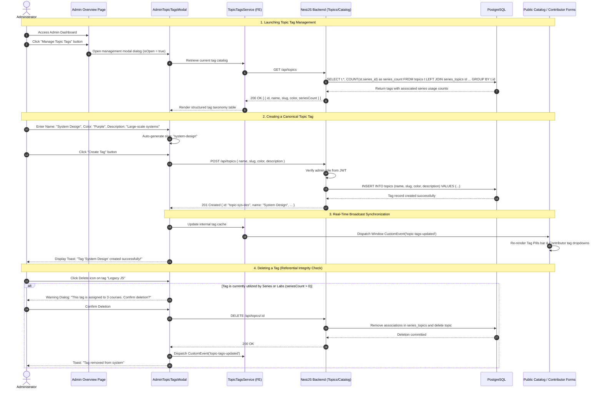

# Sequence Diagram: System-Wide Topic Tag Governance (Admin Topic Governance Flow)

## 1. Document Information

| Attribute | Details |
|---|---|
| **Document Title** | System-Wide Topic Tag Governance Workflow |
| **Version** | v1.1 |
| **Author** | Nguyen Khanh Duy (Fullstack Lead & Architect) |
| **Scope** | Centralized administration of the platform-wide Topic Tags taxonomy by Administrators within the standalone `MODULE_ADMIN` app: Tag creation, slug auto-generation, hex color tagging, unused tag deprecation, tag pollution prevention, and real-time custom event synchronization across Contributor authoring studios and Public Catalog filters |
| **Date** | 2026-10-15 |
| **Source Reference** | `MODULE_ADMIN/src/pages/admin/_components/AdminTopicTagsModal.tsx`, `MODULE_ADMIN/src/services/topicTags.service.ts` |

---

## 2. Core Content

### 2.1. Workflow Summary (TL;DR)
- **Problem Addressed**: Unrestricted freeform user tagging previously caused severe tag pollution and duplicates (e.g. `#javascript`, `#js`, `#Javascript`), degrading search and filter usability.
- **Centralized Governance Rules**:
  - **Admin Exclusive Mutation**: Only Administrators possess privileges to Create, Update, or Delete official system Topic Tags.
  - **Contributor Role as Tag Consumer**: Authors and Contributors select from approved standardized tags when publishing Series and Labs.
  - **Learner Filter Hub**: Learners utilize canonical tags on the Homepage/Catalog to discover targeted learning paths.
- **Real-Time Synchronization**:
  - Whenever an Admin modifies tags in the `AdminTopicTagsModal`, the system fires a browser event `topic-tags-updated`.
  - Active components (Catalog Filters, Create Series Modal, Lab Studio) automatically refresh their tag lists in real-time without requiring a page reload.

---

### 2.2. Roles & Responsibilities (Who Does What)

| Entity | Type | Roles & Responsibilities |
|---|---|---|
| **Administrator** | Actor | Accesses Admin Studio, launches "Manage Topic Tags", and curates taxonomy |
| **Contributor** | Actor | Tag Consumer: Assigns curated tags to courses and exercises |
| **AdminTopicTagsModal** | Client UI | Modal UI for tag CRUD: Name, slug, hex color picker, usage metrics, and deletion |
| **TopicTagsService** | Client Service | In-memory tag cache, CRUD methods, and `topic-tags-updated` event dispatching |
| **Topics Controller & Service** | NestJS Backend | Enforces `@Roles('admin')` authorization and validates foreign key integrity |
| **PostgreSQL Database** | Storage | Houses `topics` entity and relations `series_topics`, `lab_topics` |

---

### 2.3. Sequence Diagram

---

### 2.4. Technical Specifications & Architecture Details

1. **Taxonomy Normalization**:
   - Each topic tag carries a valid `color` attribute (hex code: `#3B82F6`, `#10B981`, etc.) ensuring consistent visual styling across badges on Catalog cards, Drawer roadmaps, and Practice Workspaces.
2. **Lightweight CustomEvent Architecture**:
   - Utilizes `window.dispatchEvent(new CustomEvent('topic-tags-updated'))` instead of heavy WebSocket channels for internal UI synchronization.
   - Any listening component (such as `HomePage` or `CreateSeriesModal`) automatically triggers background re-fetching upon receipt.
3. **Strict Authorization**:
   - Mutating endpoints (Create, Update, Delete) are locked behind `@UseGuards(JwtAuthGuard, RolesGuard)` requiring `@Roles(UserRole.ADMIN)`.
   - General learners and contributors possess read-only access via `GET /api/topics`.

---

### 2.5. Edge Cases & Exception Handling

| Edge Case | System Response | User Experience |
|---|---|---|
| **Duplicate Tag Name or Slug** | Database raises unique constraint violation | Modal highlights field: *"This tag name or slug already exists"* |
| **Invalid Hex Color String** | RegEx validation `/^#([0-9A-F]{3}){1,2}$/i` | Highlights color input in red with formatting hint |
| **Tag Deletion with Active Courses** | Cascade removal with safety check | Two-step confirmation dialog prevents accidental taxonomy loss |

---

## 3. References & Source Links

- **Frontend Codebase (MODULE_ADMIN)**:
  - Admin Topic Tags Modal: [AdminTopicTagsModal.tsx](file:///d:/Projects/study-web/MODULE_ADMIN/src/pages/admin/_components/AdminTopicTagsModal.tsx)
  - Topic Tags Service: [topicTags.service.ts](file:///d:/Projects/study-web/MODULE_ADMIN/src/services/topicTags.service.ts)
  - Admin Topic Hierarchy: [AdminTopicHierarchy.tsx](file:///d:/Projects/study-web/MODULE_ADMIN/src/pages/admin/_components/AdminTopicHierarchy.tsx)
- **Backend Codebase (MODULE_BE)**:
  - Database Schema: [schema.prisma](file:///d:/Projects/study-web/MODULE_BE/prisma/schema.prisma)
- **Related Workflows**:
  - Course Discovery by Tag: [02-catalog-topic-discovery.md](file:///d:/Projects/study-web/docs/workflows/02-catalog-topic-discovery.md)
  - Create Series with Tags: [05-create-series.md](file:///d:/Projects/study-web/docs/workflows/05-create-series.md)
  - Review & Publishing: [07-content-review-and-publish.md](file:///d:/Projects/study-web/docs/workflows/07-content-review-and-publish.md)
