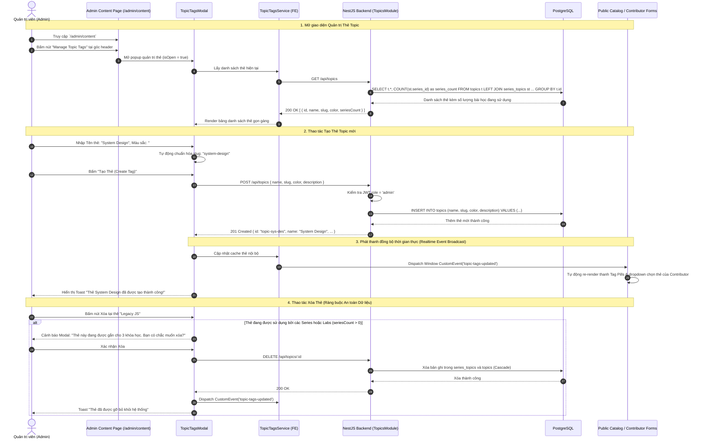

# Sơ đồ Luồng Quản trị Thẻ Topic Toàn Hệ thống (Admin Topic Governance Flow)

## 1. Thông tin tài liệu (Document Information)

| Thuộc tính | Chi tiết |
|---|---|
| **Tên tài liệu** | Sơ đồ Luồng Quản trị Thẻ Topic Toàn Hệ thống |
| **Version** | v1.0 |
| **Người làm** | Nguyen Khanh Duy (Fullstack Lead & Architect) |
| **Phạm vi (Scope)** | Chu trình quản trị tập trung danh mục Thẻ Topic (Topic Tags) của Admin: Tạo mới thẻ, chỉnh sửa màu sắc/tên, xóa thẻ không dùng, ngăn chặn tình trạng rác thẻ và đồng bộ danh mục thẻ sang cho Contributor gắn vào bài học và Catalog để học viên lọc |
| **Thời gian** | 2026-10-14 |
| **Tham chiếu từ** | `MODULE_FE/src/features/topics/components/TopicTagsModal.tsx`, `MODULE_FE/src/features/topics/services/topicTags.service.ts`, `MODULE_BE/src/modules/topics/topics.controller.ts` |

---

## 2. Nội dung chính (Content)

### 2.1. Tóm tắt luồng (TL;DR)
- **Vấn đề giải quyết**: Trước đây người dùng có thể tự gõ tạo thẻ tùy ý, dẫn đến tình trạng rác thẻ (tag pollution), trùng lặp thẻ (ví dụ `#javascript`, `#js`, `#Javascript`) và gây rối loạn cho thanh lọc khóa học.
- **Quy tắc Quản trị mới**:
  - **Chỉ Admin** mới có quyền Tạo, Sửa, Xóa các Thẻ Topic chính thống trong hệ thống.
  - **Contributor & Tác giả** chỉ việc chọn từ danh mục Thẻ đã được chuẩn hóa để gắn vào Series / Bài Lab của mình.
  - **Học viên** dùng các Thẻ này trên Trang chủ Catalog để lọc nội dung theo chuyên đề.
- **Cơ chế Đồng bộ**:
  - Khi Admin tạo hoặc sửa Thẻ trong Modal `Manage Topic Tags`, hệ thống kích hoạt sự kiện phát thanh (Event Broadcast) `topic-tags-updated`.
  - Toàn bộ các component đang mở (như Catalog Filter, Modal tạo Series, Studio tạo bài Lab) tự động cập nhật danh sách thẻ mới mà không cần F5 reload trình duyệt.

---

### 2.2. Phân công & Vai trò (Who does what)

| Thực thể | Loại | Vai trò & Trách nhiệm trong luồng |
|---|---|---|
| **Admin** | Actor | Truy cập `/admin/content`, mở modal "Manage Topic Tags", quản lý danh mục thẻ |
| **Contributor** | Actor | Tiêu thụ thẻ (Consumer): Gắn các thẻ sẵn có vào khóa học và bài lab |
| **TopicTagsModal** | Client UI | Giao diện quản lý thẻ: Xem danh sách, tạo thẻ mới (tên, slug, mã màu hex), sửa và xóa |
| **TopicTagsService** | Client Service | Cache danh mục thẻ, cung cấp phương thức CRUD, phát event `topic-tags-updated` |
| **Topics Controller & Service** | NestJS Backend | Xác thực quyền Admin (`RequireRole(['admin'])`), kiểm tra ràng buộc khóa ngoại trước khi xóa thẻ |
| **PostgreSQL Database** | Storage | Bảng `topics` và quan hệ nhiều - nhiều `series_topics`, `lab_topics` |

---

### 2.3. Sơ đồ Tuần tự (Sequence Diagram)

---

### 2.4. Phân tích Kỹ thuật Chi tiết

1. **Chuẩn hóa Phân loại (Taxonomy Normalization)**:
   - Mỗi thẻ topic có thuộc tính `color` (dạng hex code: `#3B82F6`, `#10B981`...) giúp hiển thị huy hiệu (Badge) đẹp mắt, đồng bộ màu sắc trên toàn bộ giao diện từ Catalog, Drawer chi tiết cho đến Studio làm bài.
2. **Cơ chế Event Bus nhẹ nhàng (CustomEvent)**:
   - Thay vì phải phụ thuộc vào websocket phức tạp cho việc cập nhật thẻ, ứng dụng sử dụng kiến trúc `window.dispatchEvent(new CustomEvent('topic-tags-updated'))`.
   - Bất kỳ màn hình nào đang lắng nghe sự kiện này (như `HomePage` hay `CreateSeriesModal`) đều sẽ nạp lại danh sách tag ngay lập tức.
3. **Bảo mật Phân quyền (Admin Only Mutation)**:
   - Các API tạo, sửa, xóa thẻ đều được bảo vệ bởi Decorator `@UseGuards(JwtAuthGuard, RolesGuard)` và `@Roles(UserRole.ADMIN)`.
   - Người dùng thường hoặc Contributor chỉ có quyền gọi `GET /api/topics` để đọc dữ liệu.

---

### 2.5. Xử lý Ngoại lệ (Edge Cases)

| Tình huống ngoại lệ | Phản hồi hệ thống | Trải nghiệm người dùng |
|---|---|---|
| **Tên thẻ hoặc Slug bị trùng lặp** | Database trả về lỗi ràng buộc Unique constraint | Modal báo lỗi: *"Tên thẻ hoặc Slug này đã tồn tại trong hệ thống"* |
| **Mã màu hex không đúng định dạng** | Regex kiểm tra `/^#([0-9A-F]{3}){1,2}$/i` | Form highlight viền đỏ ô chọn màu |
| **Xóa thẻ đang có hàng nghìn bài học** | Backend thực hiện transaction xóa an toàn hoặc gán thẻ về Default | Admin nhận xác nhận hai lớp (Confirmation Dialog) trước khi thực hiện |

---

## 3. Tài liệu tham khảo & Liên kết (References)

- **Mã nguồn Frontend**:
  - Modal Quản lý Thẻ: [MODULE_FE/src/features/topics/components/TopicTagsModal.tsx](file:///d:/Projects/study-web/MODULE_FE/src/features/topics/components/TopicTagsModal.tsx)
  - Service Thẻ Topic: [MODULE_FE/src/features/topics/services/topicTags.service.ts](file:///d:/Projects/study-web/MODULE_FE/src/features/topics/services/topicTags.service.ts)
  - Trang Quản lý Nội dung Admin: [MODULE_FE/src/pages/admin/AdminContentPage.tsx](file:///d:/Projects/study-web/MODULE_FE/src/pages/admin/AdminContentPage.tsx)
- **Mã nguồn Backend**:
  - Topics Controller: [MODULE_BE/src/modules/topics/topics.controller.ts](file:///d:/Projects/study-web/MODULE_BE/src/modules/topics/topics.controller.ts)
  - Prisma Schema Bảng Topics: [MODULE_BE/prisma/schema.prisma](file:///d:/Projects/study-web/MODULE_BE/prisma/schema.prisma)
- **Tài liệu liên quan**:
  - Khám phá Khóa học theo Thẻ: [02-catalog-topic-discovery.md](file:///d:/Projects/study-web/docs/workflows/02-catalog-topic-discovery.md)
  - Tạo Series & Gắn Thẻ Topic: [05-create-series.md](file:///d:/Projects/study-web/docs/workflows/05-create-series.md)
