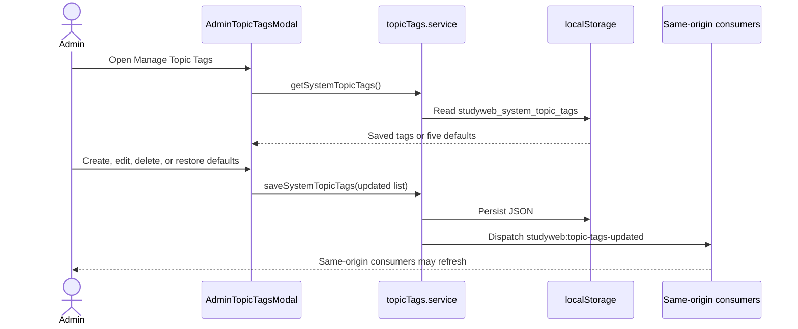

# Browser-Local Topic Tag Governance

## 1. Document Information

| Attribute | Detail |
|---|---|
| Document | Browser-Local Topic Tag Governance |
| Version | 2.0 |
| Owner | Nguyen Khanh Duy — Fullstack Lead & Architect |
| Scope | Topic tag defaults, create/edit/delete/reset UI, local persistence and consumers |
| Date | 2026-10-24 |
| Source | Current Admin modal and duplicated FE/Admin topic-tag services |

## 2. Content

### 2.1. Truth summary

The current feature is a browser-local taxonomy editor, not centralized platform governance. It is `PARTIAL`: Admin UI supports useful CRUD and reacts within its origin, but there is no backend topic controller/table workflow, no cross-device synchronization, and no automatic propagation between the separate learner and admin origins.

### 2.2. Current flow

### 2.3. Operations and validation

| Operation | Validation | Result |
|---|---|---|
| Create | Title/key required; duplicate key rejected | Appends tag with selected preset class. |
| Edit | Key is normalized to lowercase-safe characters | Replaces matching item and saves list. |
| Delete | Confirmation required; at least one tag must remain | Removes tag from local list only. |
| Restore defaults | Confirmation required | Restores testing, database, backend, devops and security. |
| Resolve alias | Known aliases such as `sql`, `qa`, `docker`, `auth` | Maps catalog category to canonical local key. |

UI feedback includes a transient success message, duplicate/minimum-tag alert, edit cancellation, and storage error logging. There is no server loading state because no request occurs.

### 2.4. Persistence and isolation limits

- Storage key: `studyweb_system_topic_tags`.
- `MODULE_ADMIN` and `MODULE_FE` each contain their own service copy.
- `localStorage` is origin-scoped; `admin.studyit.dev` and `studyit.dev` do not share it.
- A `CustomEvent` only reaches listeners in the same document/origin runtime.
- Tags are presentation metadata; deleting one does not alter series rows or enforce referential integrity.

Therefore this feature must not be described as PostgreSQL-backed, real-time system-wide taxonomy governance.

### 2.5. Security and authorization

The modal is reachable through the protected Admin content route, but local storage itself is not an authorization mechanism. A user with browser/devtools access can modify local tag JSON; backend series/category integrity cannot trust it. If taxonomy becomes authoritative, the backend must validate admin role, keys and references.

### 2.6. Revision history and open issues

| Version | Date | Author | Note |
|---|---|---|---|
| 1.0 | 2026-10-14 | Nguyen Khanh Duy | Earlier document described nonexistent topic APIs/database relations. |
| 2.0 | 2026-10-24 | StudyWeb engineering team | Corrected to current local-storage implementation and isolation limits. |

Open issues:

1. Implement a backend taxonomy API/model if tags must be shared across users, devices, or domains.
2. Remove duplicated FE/Admin service logic or generate both clients from one contract.
3. Add migration/validation for series categories before deleting or renaming an authoritative tag.

## 3. References

- [Catalog and topic discovery](02-catalog-topic-discovery.md)
- [Contributor series creation](05-create-series.md)
- [`MODULE_ADMIN/src/pages/admin/_components/AdminTopicTagsModal.tsx`](../../MODULE_ADMIN/src/pages/admin/_components/AdminTopicTagsModal.tsx)
- [`MODULE_ADMIN/src/services/topicTags.service.ts`](../../MODULE_ADMIN/src/services/topicTags.service.ts)
- [`MODULE_FE/src/services/topicTags.service.ts`](../../MODULE_FE/src/services/topicTags.service.ts)
