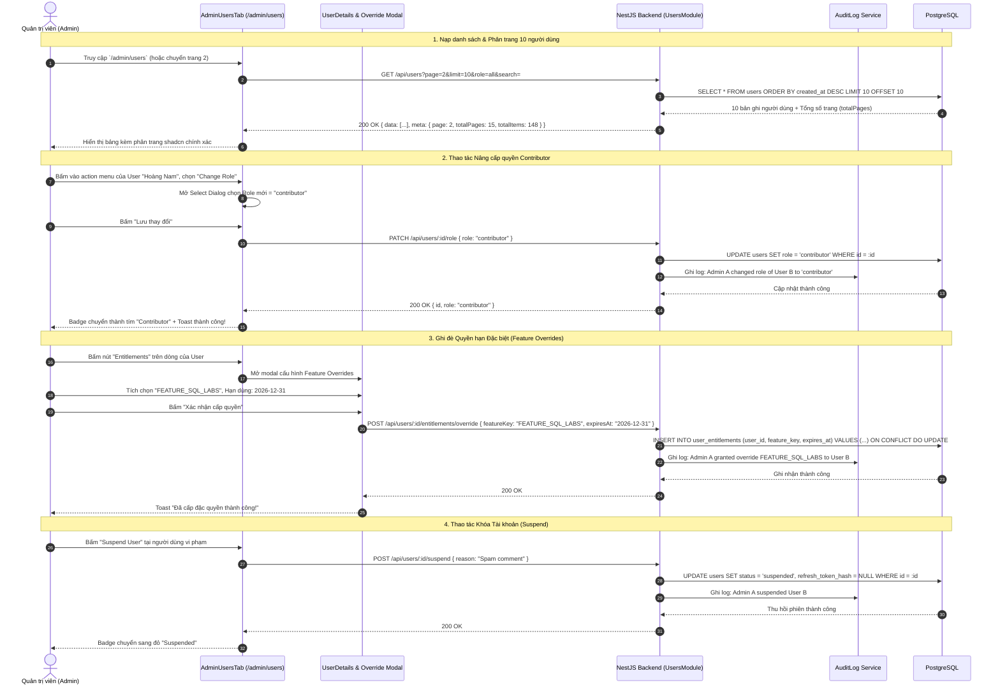

# Sơ đồ Luồng Quản trị Người dùng & Phân quyền Đặc quyền (Admin Users & Entitlements Flow)

## 1. Thông tin tài liệu (Document Information)

| Thuộc tính | Chi tiết |
|---|---|
| **Tên tài liệu** | Sơ đồ Luồng Quản trị Người dùng & Phân quyền Đặc quyền |
| **Version** | v1.0 |
| **Người làm** | Nguyen Khanh Duy (Fullstack Lead & Architect) |
| **Phạm vi (Scope)** | Trải nghiệm quản trị tài khoản tại `/admin/users`: Tra cứu người dùng, phân trang 10 dòng/trang, thay đổi vai trò (User, UserPro, Contributor, Admin), khóa/mở khóa tài khoản (Suspend/Active), và cấp quyền hạn đặc biệt (Feature Overrides / Direct Entitlements) kèm hạn sử dụng |
| **Thời gian** | 2026-10-14 |
| **Tham chiếu từ** | `MODULE_FE/src/features/admin/components/AdminUsersTab.tsx`, `MODULE_BE/src/modules/users/users.controller.ts`, `MODULE_BE/src/modules/audit-logs` |

---

## 2. Nội dung chính (Content)

### 2.1. Tóm tắt luồng (TL;DR)
- **Đầu vào**: Quản trị viên truy cập `/admin/users`.
- **Hiển thị & Tra cứu**:
  - Giao diện nạp danh sách người dùng với thanh tìm kiếm (Họ tên, SĐT, Email), bộ lọc theo Role (`user`, `user_pro`, `contributor`, `admin`) và Trạng thái (`active`, `suspended`).
  - Áp dụng phân trang chuẩn mực 10 người dùng/trang (`DataTablePagination`).
- **Thao tác Nghiệp vụ**:
  1. **Đổi vai trò (Change Role)**: Nâng cấp học viên thành `contributor` (để họ có thể soạn bài) hoặc bổ nhiệm `admin`.
  2. **Khóa tài khoản (Suspend)**: Vô hiệu hóa quyền truy cập khi vi phạm chính sách; chặn đăng nhập và thu hồi phiên làm việc tức thì.
  3. **Ghi đè quyền trực tiếp (Direct Feature Overrides)**: Cấp riêng lẻ một tính năng nâng cao (ví dụ: `FEATURE_AI_MENTOR`, `FEATURE_EXPORT_PDF`) cho một người dùng cụ thể mà không cần họ phải mua toàn bộ gói dịch vụ.

---

### 2.2. Phân công & Vai trò (Who does what)

| Thực thể | Loại | Vai trò & Trách nhiệm trong luồng |
|---|---|---|
| **Admin** | Actor | Thực hiện tìm kiếm, điều chỉnh vai trò, cấp quyền hoặc khóa tài khoản |
| **AdminUsersTab** | Client UI | Render danh sách user, thanh phân trang shadcn, dialog đổi role và modal ghi đè quyền |
| **Users Controller & Service** | NestJS Backend | Xác thực quyền admin, xử lý mutation cập nhật database |
| **AuditLogsService** | Audit Ledger | Ghi vết hành động của Admin: `USER_ROLE_CHANGE`, `USER_SUSPEND`, `USER_OVERRIDE` |
| **PostgreSQL Database** | Storage | Bảng `users`, `user_entitlements`, `audit_logs` |

---

### 2.3. Sơ đồ Tuần tự (Sequence Diagram)

---

### 2.4. Phân tích Kỹ thuật Chi tiết

1. **Kiến trúc Phân quyền Linh hoạt (Role-based vs Direct-entitlement)**:
   - Thay vì ràng buộc cứng mọi tính năng vào một Role duy nhất, hệ thống kết hợp 2 tầng:
     - **Tầng 1 (Role cơ bản)**: Quyết định quyền truy cập các portal lớn (`/admin/*`, `/contributor/*`).
     - **Tầng 2 (Feature Overrides)**: Bảng `user_entitlements` cho phép bật/tắt từng tính năng độc lập (ví dụ mở quyền cho một học sinh giỏi học thử bài Lab nâng cao có hạn dùng 30 ngày).
2. **Thu hồi Phiên ngay lập tức (Instant Session Invalidation)**:
   - Khi tài khoản bị `suspended`, backend lập tức gán `refresh_token_hash = NULL` trong CSDL.
   - Khi token cũ hết hạn 15 phút, người dùng bị khóa không thể refresh phiên và bị buộc đăng xuất ngay lập tức.
3. **Phân trang Tối ưu Hiệu năng (Shadcn DataTablePagination)**:
   - Tích hợp số trang hiển thị dạng `[1] [2] ... [10]`, nút Prev/Next, hỗ trợ truy cập trực tiếp trang bất kỳ mà không phải tải toàn bộ tập dữ liệu đồ sộ về client.

---

### 2.5. Xử lý Ngoại lệ (Edge Cases)

| Tình huống ngoại lệ | Phản hồi hệ thống | Trải nghiệm người dùng |
|---|---|---|
| **Admin tự khóa tài khoản của chính mình** | Backend chặn với lỗi `400 Bad Request: Cannot suspend self` | Giao diện cảnh báo *"Bạn không thể tự khóa tài khoản của chính mình"* |
| **Hạ quyền của Admin duy nhất còn lại trong hệ thống** | Backend kiểm tra số lượng admin tối thiểu (≥ 1) | Chặn thao tác và cảnh báo *"Hệ thống phải có ít nhất 1 Quản trị viên"* |
| **Ghi đè quyền với ngày hết hạn trong quá khứ** | Form validate ngày hết hạn phải `> now()` | Báo lỗi kiểm tra định dạng ngày |

---

## 3. Tài liệu tham khảo & Liên kết (References)

- **Mã nguồn Frontend**:
  - Trang Quản lý Users: [MODULE_FE/src/pages/admin/AdminUsersPage.tsx](file:///d:/Projects/study-web/MODULE_FE/src/pages/admin/AdminUsersPage.tsx)
  - Tab Danh sách Người dùng: [MODULE_FE/src/features/admin/components/AdminUsersTab.tsx](file:///d:/Projects/study-web/MODULE_FE/src/features/admin/components/AdminUsersTab.tsx)
  - Component Phân trang: [MODULE_FE/src/components/ui/data-table-pagination.tsx](file:///d:/Projects/study-web/MODULE_FE/src/components/ui/data-table-pagination.tsx)
- **Mã nguồn Backend**:
  - Users Controller: [MODULE_BE/src/modules/users/users.controller.ts](file:///d:/Projects/study-web/MODULE_BE/src/modules/users/users.controller.ts)
  - Audit Logs Service: [MODULE_BE/src/modules/audit-logs/audit-logs.service.ts](file:///d:/Projects/study-web/MODULE_BE/src/modules/audit-logs/audit-logs.service.ts)
- **Tài liệu liên quan**:
  - Xác thực & Phiên làm việc: [01-auth-login-to-home.md](file:///d:/Projects/study-web/docs/workflows/01-auth-login-to-home.md)
  - Quản trị Nhóm Người dùng 2 Bảng: [10-admin-user-groups-split-view.md](file:///d:/Projects/study-web/docs/workflows/10-admin-user-groups-split-view.md)
