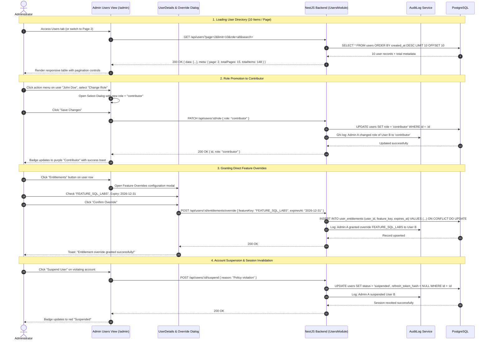

# Sequence Diagram: Admin User Governance & Entitlement Overrides (Admin Users & Entitlements Flow)

## 1. Document Information

| Attribute | Details |
|---|---|
| **Document Title** | Admin User Governance & Entitlement Overrides Workflow |
| **Version** | v1.1 |
| **Author** | Nguyen Khanh Duy (Fullstack Lead & Architect) |
| **Scope** | Comprehensive user administration workflow in `MODULE_ADMIN` (`/admin/users`): Multi-attribute user lookup, 10 items/page pagination, role promotions (`user`, `user_pro`, `contributor`, `admin`), account suspension with immediate session revocation, and fine-grained Direct Feature Overrides with expiration limits |
| **Date** | 2026-10-15 |
| **Source Reference** | `MODULE_ADMIN/src/pages/admin/AdminUsersPage.tsx`, `MODULE_ADMIN/src/pages/admin/_components/AdminUsersTab.tsx`, `MODULE_BE/src/modules/users/users.controller.ts`, `MODULE_BE/src/modules/users/users.service.ts` |

---

## 2. Core Content

### 2.1. Workflow Summary (TL;DR)
- **Input**: Administrator opens `/admin` and navigates to the Users tab.
- **Display & Querying**:
  - Fetches the user directory with query filters (Name, Phone, Email), Role filters (`user`, `user_pro`, `contributor`, `admin`), and Status filters (`active`, `suspended`).
  - Standardized 10 users/page pagination (`DataTablePagination`).
- **Core Operations**:
  1. **Change Role**: Promotes a learner to `contributor` (enabling authoring tools) or designates an `admin`.
  2. **Suspend Account**: Revokes access for policy violations; terminates active refresh tokens for immediate session eviction.
  3. **Direct Feature Overrides**: Grants specific advanced features (e.g. `FEATURE_AI_MENTOR`, `FEATURE_EXPORT_PDF`) to targeted individuals with optional expiration limits, bypassing blanket subscription requirements.

---

### 2.2. Roles & Responsibilities (Who Does What)

| Entity | Type | Roles & Responsibilities |
|---|---|---|
| **Administrator** | Actor | Performs user lookups, manages roles, issues overrides, or suspends accounts |
| **Admin Users View** | Client UI | Renders user list, pagination controls, role change dropdowns, and override dialogs |
| **Users Controller & Service** | NestJS Backend | Enforces admin authorization, handles database mutations |
| **Audit Log System** | Audit Ledger | Records administrative events: `USER_ROLE_CHANGE`, `USER_SUSPEND`, `USER_OVERRIDE` |
| **PostgreSQL Database** | Storage | Houses `users`, `user_entitlements`, and `audit_logs` |

---

### 2.3. Sequence Diagram

---

### 2.4. Technical Specifications & Architecture Details

1. **Dual-Tier Authorization Model (Role-Based vs Direct-Entitlement)**:
   - **Tier 1 (Base Roles)**: Governs access to primary portal applications (`/admin/*`, `/contributor/*`).
   - **Tier 2 (Feature Overrides)**: The `user_entitlements` table enables enabling/disabling individual modular capabilities (e.g. granting access to an advanced SQL lab series for a 30-day trial).
2. **Instant Session Invalidation**:
   - Suspending a user immediately clears `refresh_token_hash = NULL` in PostgreSQL.
   - Upon the 15-minute expiration of the active Access Token, the client cannot refresh and is immediately logged out.
3. **High-Performance Pagination**:
   - Implements `DataTablePagination` with discrete page indicators (`[1] [2] ... [10]`), allowing direct random-access navigation without over-fetching large datasets.

---

### 2.5. Edge Cases & Exception Handling

| Edge Case | System Response | User Experience |
|---|---|---|
| **Admin Self-Suspension Attempt** | Backend rejects with `400 Bad Request: Cannot suspend self` | UI renders error: *"You cannot suspend your own administrative account"* |
| **Demoting Last Remaining Admin** | Backend enforces minimum count (count ≥ 1) | Mutation rejected: *"System requires at least one active Administrator"* |
| **Override with Past Expiration Date** | Form validates expiration date `> now()` | Highlights date picker in red with validation message |

---

## 3. References & Source Links

- **Frontend Codebase (MODULE_ADMIN)**:
  - Users Page: [AdminUsersPage.tsx](file:///d:/Projects/study-web/MODULE_ADMIN/src/pages/admin/AdminUsersPage.tsx)
  - Users Table Component: [AdminUsersTab.tsx](file:///d:/Projects/study-web/MODULE_ADMIN/src/pages/admin/_components/AdminUsersTab.tsx)
  - Entitlements Modal: [UserEntitlementsModal.tsx](file:///d:/Projects/study-web/MODULE_ADMIN/src/pages/admin/_components/UserEntitlementsModal.tsx)
  - Pagination Component: [data-table-pagination.tsx](file:///d:/Projects/study-web/MODULE_ADMIN/src/components/ui/data-table-pagination.tsx)
- **Backend Codebase (MODULE_BE)**:
  - Users Controller: [users.controller.ts](file:///d:/Projects/study-web/MODULE_BE/src/modules/users/users.controller.ts)
  - Users Service: [users.service.ts](file:///d:/Projects/study-web/MODULE_BE/src/modules/users/users.service.ts)
  - Database Schema: [schema.prisma](file:///d:/Projects/study-web/MODULE_BE/prisma/schema.prisma)
- **Related Workflows**:
  - Authentication & Session: [01-auth-login-to-home.md](file:///d:/Projects/study-web/docs/workflows/01-auth-login-to-home.md)
  - Split-View Group Management: [10-admin-user-groups-split-view.md](file:///d:/Projects/study-web/docs/workflows/10-admin-user-groups-split-view.md)
  - Contributor Onboarding: [13-contributor-onboarding-and-application.md](file:///d:/Projects/study-web/docs/workflows/13-contributor-onboarding-and-application.md)
