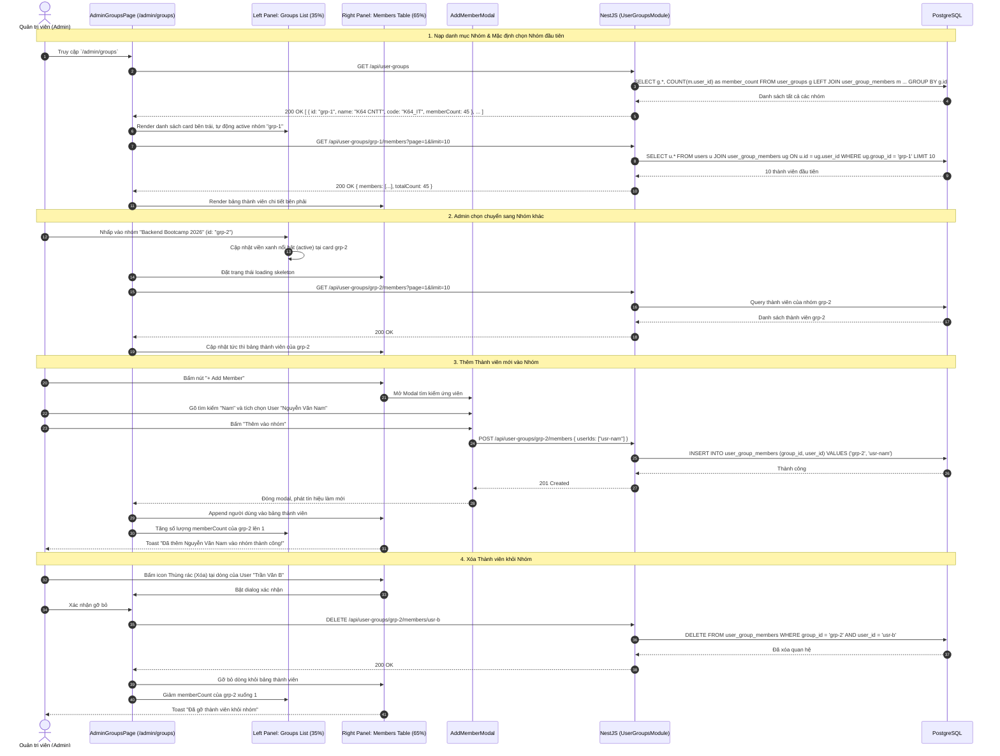

# Sơ đồ Luồng Quản trị Nhóm Người dùng 2 Bảng Song song (Admin User Groups Split-View Flow)

## 1. Thông tin tài liệu (Document Information)

| Thuộc tính | Chi tiết |
|---|---|
| **Tên tài liệu** | Sơ đồ Luồng Quản trị Nhóm Người dùng 2 Bảng Song song |
| **Version** | v1.0 |
| **Người làm** | Nguyen Khanh Duy (Fullstack Lead & Architect) |
| **Phạm vi (Scope)** | Trải nghiệm quản trị Nhóm người dùng tại trang `/admin/groups` (đã tách riêng khỏi Plans): Bố cục Split View trực quan gồm bảng danh bạ Groups bên trái (~35%) và bảng danh sách thành viên bên phải (~65%), cơ chế thêm/xóa thành viên và gán gói dịch vụ cho nhóm |
| **Thời gian** | 2026-10-14 |
| **Tham chiếu từ** | `MODULE_FE/src/pages/admin/AdminGroupsPage.tsx`, `MODULE_BE/src/modules/user-groups/user-groups.controller.ts`, `MODULE_BE/src/modules/user-groups/user-groups.service.ts` |

---

## 2. Nội dung chính (Content)

### 2.1. Tóm tắt luồng (TL;DR)
- **Kiến trúc Giao diện Split View (2 Bảng Song song)**:
  - **Cột trái (~35%) — Thư mục Nhóm (Groups Directory)**:
    - Tìm kiếm nhanh nhóm theo Tên hoặc Mã Code.
    - Nút "+ New Group" tạo nhóm tổ chức/lớp học mới.
    - Danh sách thẻ nhóm hiển thị: Tên, Mã Code, Số lượng thành viên, Huy hiệu gói Plan được gán, Nút Sửa / Xóa.
    - Nhấp chuột vào một nhóm sẽ đánh dấu nhóm đó là Active Selection.
  - **Cột phải (~65%) — Thành viên trong Nhóm (Group Members)**:
    - Hiển thị thông tin chi tiết nhóm đang chọn.
    - Nút "+ Add Member" mở modal tra cứu và thêm học viên vào nhóm.
    - Bảng danh sách thành viên kèm Avatar, Họ tên, Email, Vai trò, Ngày gia nhập, và Nút "Xóa khỏi nhóm".
    - Tích hợp thanh phân trang shadcn `DataTablePagination` 10 thành viên/trang.
- **Lợi ích**: Giúp Admin quản lý hàng chục lớp học, nhóm sinh viên hoặc nhóm doanh nghiệp (B2B) mà không phải chuyển trang qua lại, thao tác nạp thành viên diễn ra tức thì.

---

### 2.2. Phân công & Vai trò (Who does what)

| Thực thể | Loại | Vai trò & Trách nhiệm trong luồng |
|---|---|---|
| **Admin** | Actor | Chọn nhóm, tạo nhóm mới, thêm/xóa thành viên khỏi nhóm |
| **AdminGroupsPage** | Client UI | Điều phối trạng thái Split View: `selectedGroupId`, nạp danh sách group và nạp thành viên tương ứng |
| **AddMemberModal** | Client UI | Modal tìm kiếm người dùng ứng viên chưa thuộc nhóm để thêm vào |
| **UserGroups Controller & Service** | NestJS Backend | Xử lý CRUD nhóm, thêm/xóa quan hệ trong bảng `user_group_members`, ghi Audit Log |
| **PostgreSQL Database** | Storage | Bảng `user_groups`, `user_group_members`, `users` |

---

### 2.3. Sơ đồ Tuần tự (Sequence Diagram)

---

### 2.4. Phân tích Kỹ thuật Chi tiết

1. **Tách biệt Trách nhiệm UI (Decoupling from Plans)**:
   - Trước đây: Quản trị User Groups bị nhồi nhét dưới dạng một Sub-tab mờ nhạt bên trong trang Membership Plans, gây nhầm lẫn giữa định nghĩa gói cước (Plans) và tập hợp người học (Groups).
   - Hiện tại: Route riêng `/admin/groups` với sidebar menu độc lập, tập trung 100% vào nghiệp vụ quản trị cơ cấu thành viên.
2. **Đồng bộ Hai Chiều Cục bộ (Bi-directional State Sync)**:
   - Khi thêm hoặc xóa thành viên ở bảng bên phải, giá trị `memberCount` trên card tương ứng ở cột trái tự động điều chỉnh ngay lập tức mà không cần gọi lại toàn bộ danh mục Groups.
3. **Phân trang Độc lập cho Thành viên (Independent Member Pagination)**:
   - Một nhóm có thể có tới hàng nghìn học viên (lớp đại học, doanh nghiệp). Phân trang 10 thành viên/trang phía máy chủ (Server-side Pagination) đảm bảo thời gian tải bảng chỉ mất dưới 50ms.

---

### 2.5. Xử lý Ngoại lệ (Edge Cases)

| Tình huống ngoại lệ | Phản hồi hệ thống | Trải nghiệm người dùng |
|---|---|---|
| **Thêm người dùng đã có sẵn trong nhóm** | Backend kiểm tra ràng buộc duy nhất `(group_id, user_id)` | Modal lọc bỏ trước các user đã ở trong nhóm, hoặc thông báo *"User đã là thành viên"* |
| **Xóa một Nhóm đang có thành viên** | Hệ thống hiển thị Dialog cảnh báo xóa | Khi Admin xác nhận, xóa bản ghi nhóm và tự động dọn sạch các bản ghi liên kết trong `user_group_members` (Cascade) |
| **Nhóm chưa có bất kỳ thành viên nào** | API trả về mảng rỗng `[]` | Cột bên phải hiển thị Empty State lịch sự: *"Chưa có thành viên nào trong nhóm này. Hãy bấm + Add Member để bắt đầu"* |

---

## 3. Tài liệu tham khảo & Liên kết (References)

- **Mã nguồn Frontend**:
  - Trang Quản trị Nhóm: [MODULE_FE/src/pages/admin/AdminGroupsPage.tsx](file:///d:/Projects/study-web/MODULE_FE/src/pages/admin/AdminGroupsPage.tsx)
  - Sidebar Admin: [MODULE_FE/src/components/admin/AdminSidebar.tsx](file:///d:/Projects/study-web/MODULE_FE/src/components/admin/AdminSidebar.tsx)
  - Component Phân trang: [MODULE_FE/src/components/ui/data-table-pagination.tsx](file:///d:/Projects/study-web/MODULE_FE/src/components/ui/data-table-pagination.tsx)
- **Mã nguồn Backend**:
  - User Groups Controller: [MODULE_BE/src/modules/user-groups/user-groups.controller.ts](file:///d:/Projects/study-web/MODULE_BE/src/modules/user-groups/user-groups.controller.ts)
  - Schema Prisma: [MODULE_BE/prisma/schema.prisma](file:///d:/Projects/study-web/MODULE_BE/prisma/schema.prisma)
- **Tài liệu liên quan**:
  - Quản trị Người dùng & Entitlements: [09-admin-users-and-entitlements.md](file:///d:/Projects/study-web/docs/workflows/09-admin-users-and-entitlements.md)
  - Quản trị Gói Cước Plans: [12-upgrade-and-payment.md](file:///d:/Projects/study-web/docs/workflows/12-upgrade-and-payment.md)
