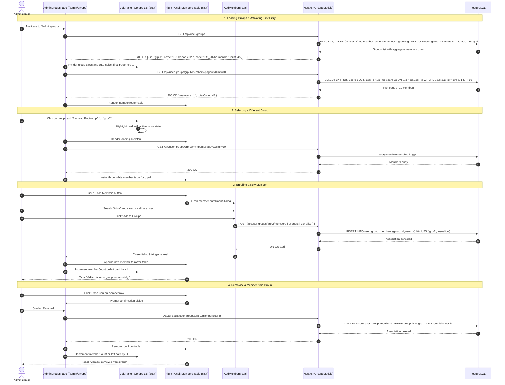

# Sequence Diagram: User Group Management Split View (Admin User Groups Split-View Flow)

## 1. Document Information

| Attribute | Details |
|---|---|
| **Document Title** | User Group Management Split View Workflow |
| **Version** | v1.1 |
| **Author** | Nguyen Khanh Duy (Fullstack Lead & Architect) |
| **Scope** | User Group administration workflow in `MODULE_ADMIN` at `/admin/groups`: Interactive Split-View layout featuring a left-hand Groups Directory (~35%) and a right-hand Member Roster (~65%), dynamic member addition/removal, and group-level subscription plan associations |
| **Date** | 2026-10-15 |
| **Source Reference** | `MODULE_ADMIN/src/pages/admin/AdminGroupsPage.tsx`, `MODULE_ADMIN/src/pages/admin/_components/AdminGroupsTab.tsx`, `MODULE_BE/src/modules/groups/groups.controller.ts`, `MODULE_BE/src/modules/groups/groups.service.ts` |

---

## 2. Core Content

### 2.1. Workflow Summary (TL;DR)
- **Split-View Dual-Pane Architecture**:
  - **Left Pane (~35%) — Groups Directory**:
    - Quick search by Group Name or Code.
    - "+ New Group" action to create university cohorts, classrooms, or B2B enterprise departments.
    - Group cards render: Title, Code, Member Count, assigned Plan Badge, and Edit/Delete controls.
    - Clicking a group card establishes it as the active selection.
  - **Right Pane (~65%) — Group Members**:
    - Displays detailed metadata for the selected group.
    - "+ Add Member" opens a candidate search modal to enroll learners into the active group.
    - Member table with Avatar, Name, Email, Role, Joined Date, and "Remove" action.
    - Integrated with `DataTablePagination` (10 members/page).
- **Architectural Benefit**: Enables administrators to oversee dozens of cohorts and hundreds of members without jarring page transitions.

---

### 2.2. Roles & Responsibilities (Who Does What)

| Entity | Type | Roles & Responsibilities |
|---|---|---|
| **Administrator** | Actor | Selects groups, creates cohorts, manages member enrollment |
| **AdminGroupsPage** | Client UI | Coordinates Split-View state: `selectedGroupId`, loads groups and active member list |
| **AddMemberModal** | Client UI | Modal dialog for searching and multi-selecting unenrolled candidates |
| **Groups Controller & Service** | NestJS Backend | Handles Group CRUD, manages `user_group_members` associative relations, logs audit trails |
| **PostgreSQL Database** | Storage | Houses `user_groups`, `user_group_members`, and `users` |

---

### 2.3. Sequence Diagram

---

### 2.4. Technical Specifications & Architecture Details

1. **Decoupled Architecture (Separate from Plans)**:
   - Dedicated route `/admin/groups` with independent layout, removing confusion between monetized plan definitions and learner cohort management.
2. **Bi-directional Local State Synchronization**:
   - Adding or removing members immediately updates the `memberCount` badge on the corresponding card on the left without re-fetching the entire groups list.
3. **Server-Side Pagination for Scalability**:
   - Server-side pagination (10 items/page) guarantees sub-50ms table rendering even for enterprise cohorts containing thousands of enrolled students.

---

### 2.5. Edge Cases & Exception Handling

| Edge Case | System Response | User Experience |
|---|---|---|
| **Adding Existing Group Member** | Database enforces `(group_id, user_id)` unique constraint | Candidate search filters out enrolled members beforehand |
| **Deleting a Non-Empty Group** | Prompts confirmation dialog | Upon admin confirmation, cascade deletes group and associations in `user_group_members` |
| **Group Has Zero Members** | API returns empty array `[]` | Right pane renders friendly Empty State: *"No members in this group yet. Click + Add Member to enroll learners."* |

---

## 3. References & Source Links

- **Frontend Codebase (MODULE_ADMIN)**:
  - Admin Groups Page: [AdminGroupsPage.tsx](file:///d:/Projects/study-web/MODULE_ADMIN/src/pages/admin/AdminGroupsPage.tsx)
  - Admin Groups Tab Component: [AdminGroupsTab.tsx](file:///d:/Projects/study-web/MODULE_ADMIN/src/pages/admin/_components/AdminGroupsTab.tsx)
  - Groups Admin API Client: [groups.admin.api.ts](file:///d:/Projects/study-web/MODULE_ADMIN/src/features/admin/api/groups.admin.api.ts)
- **Backend Codebase (MODULE_BE)**:
  - Groups Controller: [groups.controller.ts](file:///d:/Projects/study-web/MODULE_BE/src/modules/groups/groups.controller.ts)
  - Groups Service: [groups.service.ts](file:///d:/Projects/study-web/MODULE_BE/src/modules/groups/groups.service.ts)
- **Related Workflows**:
  - Admin Users Governance: [09-admin-users-and-entitlements.md](file:///d:/Projects/study-web/docs/workflows/09-admin-users-and-entitlements.md)
  - Subscription Plans & Payment: [12-upgrade-and-payment.md](file:///d:/Projects/study-web/docs/workflows/12-upgrade-and-payment.md)
